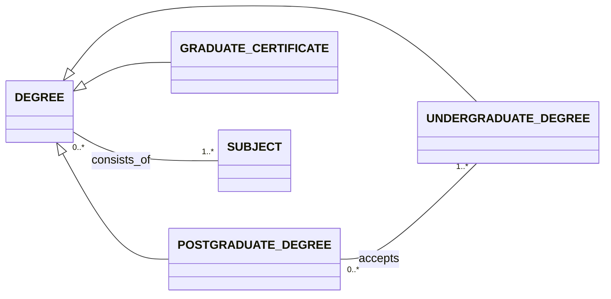
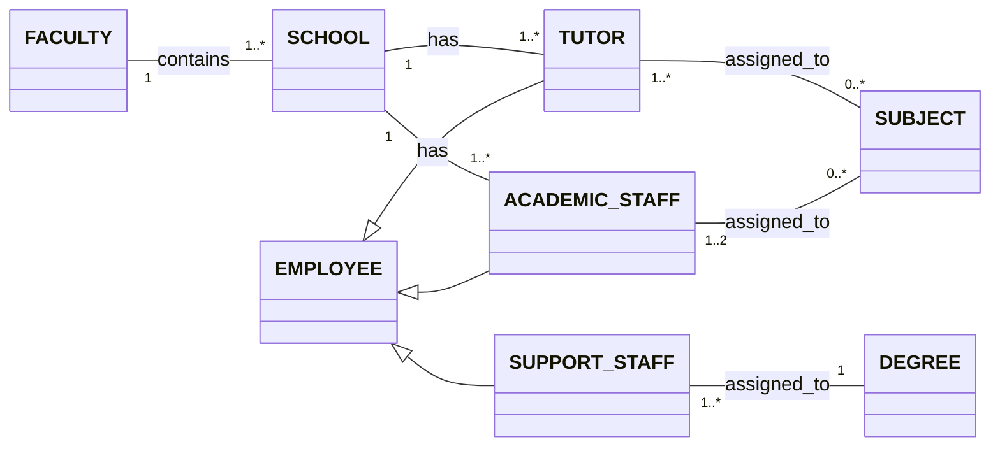
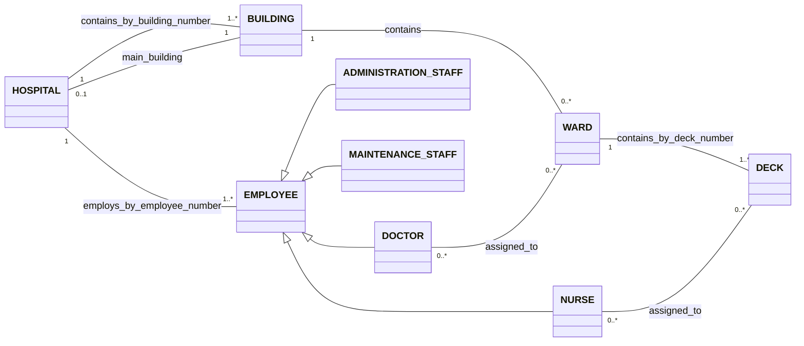
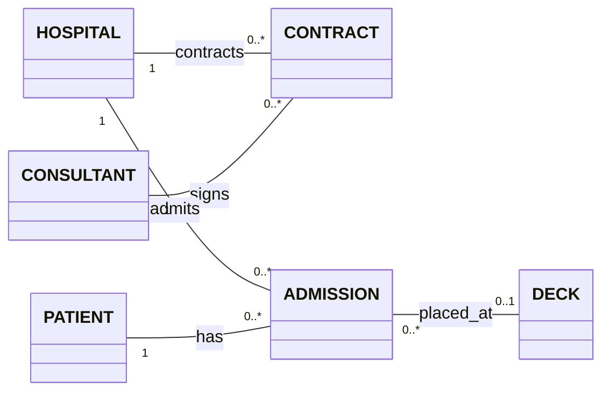
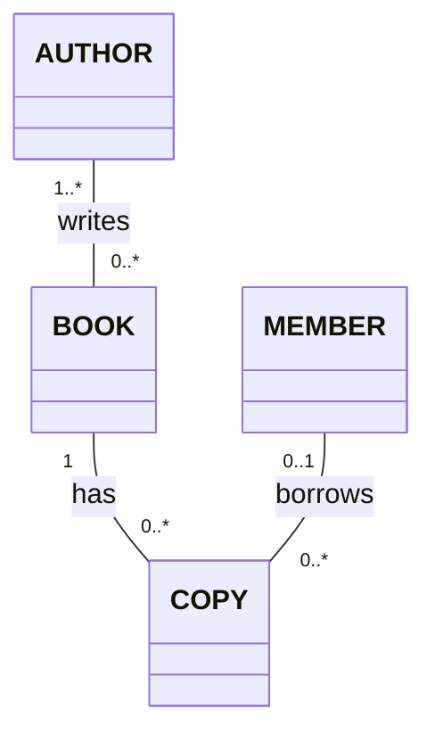
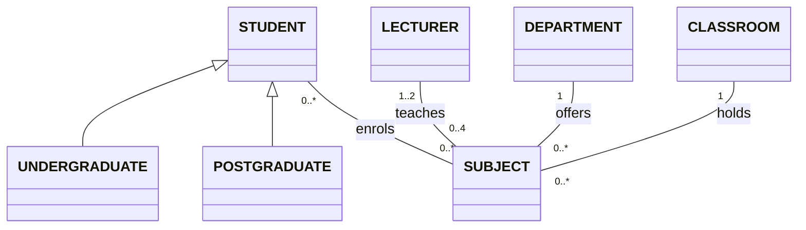
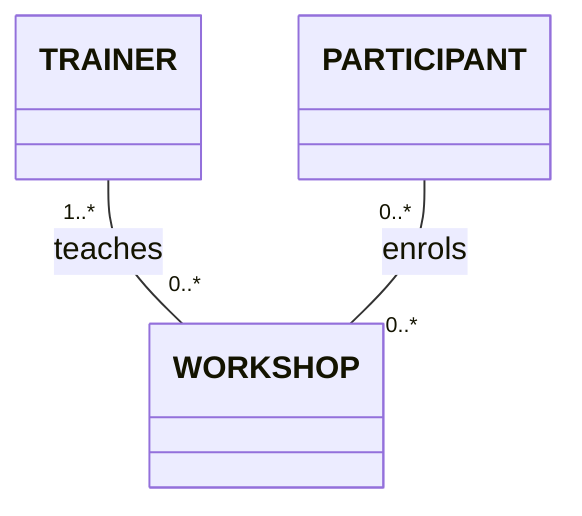
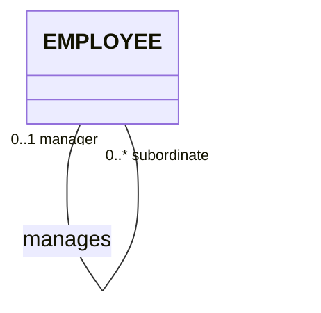

# CSIT882 · 详细解析与参考答案

题目用英文，解析用中文，专业术语与SQL保留英文。独立整理的答案不等于学校官方评分标准。每小题先看目标、再按步骤完成，最后核对条件。

## M1-Q1 · Mock Examination 1 — Question 1

### (1) 从大学业务说明生成完整conceptual schema

1. 先分对象种类：Degree、Subject、Employee、Faculty、School；再分Degree的三个子类、Employee的三个子类。不要因为文字提到学生，就新增没有描述要求的Student类。
2. 逐项读唯一性：Subject的code与title分别唯一；Employee除employee_number外，还有(first_name,last_name,date_of_birth)这个组合identifier。把三个姓名/日期属性标成同一个ID标签。
3. 把requirements、learning objectives表示为multivalued attributes；支持人员的qualification和acquired_date要成对，避免两个列表无法一一对应。
4. 每条association分别向两个方向读：一门科目有1–2名academic staff；一位academic staff可负责多门。Support staff恰属于一个Degree，Degree至少对应一位Support staff。
5. 将已确定的attributes、identifiers、multiplicities填进类框和关联线。a number of等未给精确下限的措辞，采用假设时单独标明，不把假设写成题面事实。

**完成后核对：** 图中必须既有属性，也有连接和数量；code、title两种独立identifier与员工三项组合identifier没有混淆。

**易错点：** 不要用关系表的foreign keys代替conceptual association，也不要把员工已获学位限制为必须来自本校。

### 完整参考答案

这道题要求画概念图。先确定要描述哪些类，再把属性和关联放入图中。下面的属性表与两张关联图共同构成参考设计。

### 类、属性和identifier

| 类名 | 属性及标识规则 |
| --- | --- |
| DEGREE | 学位名称唯一；另记录所需总学分和若干入学要求 |
| UNDERGRADUATE_DEGREE | 继承 DEGREE 的属性 |
| POSTGRADUATE_DEGREE | 继承 DEGREE；用关联记录接受的本科学位 |
| GRADUATE_CERTIFICATE | 继承 DEGREE；另记录所需专业工作年数 |
| SUBJECT | 科目代码、科目名称分别唯一；另记录学分和学习目标列表 |
| EMPLOYEE | 员工号唯一；“名、姓、出生日期”的组合也是一个独立identifier |
| ACADEMIC_STAFF | 继承 EMPLOYEE；另记录已取得的学位 |
| TUTOR | 继承 EMPLOYEE；另记录已取得的学位 |
| SUPPORT_STAFF | 继承 EMPLOYEE；逐项记录资格名称及该资格的获得日期 |
| FACULTY | 学院名称唯一 |
| SCHOOL | 学系名称唯一 |

同一员工的一项资格及其日期需要配成一组。不能把全部资格、全部日期分别存成两个互不对应的列表。

### 学位和科目之间的关联



一个学位包含一组科目；本参考图允许一个科目用于多个学位。研究生学位与可接受的本科学位之间建立关联。

### 员工、组织和工作分配之间的关联



每个学系属于一个学院；每位学术人员、辅导教师属于一个学系。每个科目分配一至两名学术人员。支持人员与学位之间，支持人员一方只能对应一个学位，学位一方至少对应一名支持人员。

### 本参考图采用的假设

- 将三种学位理解为互不重叠、覆盖全部学位的分类；原题没有明确员工身份能否重叠，故不额外声明员工子类互斥。
- 对“若干辅导教师”和学系中的“多名人员”，图中采用至少一名的下限。若课程允许暂未配人，下限需相应改成 0，并写明解释。
- 对题目没有强制下限的反方向，图中允许暂时没有分配。例如一名学术人员可以暂未负责科目。这是图中采用的解释，不是原文明确给出的最低数。
- 员工已取得的学位、研究生项目接受的本科资格，可能来自校外。本设计不能因只记录本校开设的学位而排除这种资格。

## M1-Q2 · Mock Examination 1 — Question 2

### (1) 按superset method把运输服务图转换成relational schemas

1. TSERVICE的三个ID属性合起来才识别一项服务；先抄完整组合(departure_city,destination_city,departure_time)，后续所有引用都使用这三项。
2. 先建立不引用其他表的BUS与DRIVER。DRIVER的dlnumber、enumber分别唯一：选其中一个为primary key，另一个保留为candidate key。
3. 把较长与较短服务合入TSERVICE，增加service_type。total_days与total_hours是子类专有属性，在整表需要允许NULL，并按类别填写。
4. BUS到TSERVICE是一对多，把rego放入TSERVICE作foreign key；TSERVICE到DRIVER是many-to-many，建立SERVICE_DRIVER保存完整配对。
5. STOP受服务和snumber共同限定，所以primary key是服务三项标识再加snumber；STOP本身的到离时间与服务时间要区分命名。
6. 用课堂PRIMARY KEY =、CANDIDATE KEY =、FOREIGN KEY = ... REFERENCES ...格式列出，父表先于子表。检查minimum participation不能仅靠foreign key保证的限制。

**完成后核对：** 最终有BUS、DRIVER、TSERVICE、SERVICE_DRIVER、STOP五个schemas；STOP每个key含4项。

**易错点：** 0..1针对固定(service,snumber)，不是整项服务最多一个STOP。

### 完整参考答案

下面逐表列出relational schema。PK 表示primary key；Other CK 表示未选作primary key的其他candidate key；FK 表示foreign key。primary key本身也属于candidate key。

foreign key能保证被引用对象存在，但不能单独保证“每项服务至少有一位司机”。这个最低数量要求需要另外维护。

### 先识别服务的复合identifier

TSERVICE 的三个属性使用同一个 ID 标签，表示它们共同识别一项服务，而不是各自唯一。

```text
(departure_city, destination_city, departure_time)
```

### BUS：巴士

每辆巴士由 rego 唯一识别。

```text
BUS(rego, make)
PRIMARY KEY = (rego)
OTHER CANDIDATE KEYS = none
FOREIGN KEY1 = none
```

### DRIVER：司机

dlnumber 和 enumber 是两个分别唯一的identifier。本答案选择驾照号作primary key，员工号作另一个candidate key。

```text
DRIVER(dlnumber, enumber, full_name)
PRIMARY KEY = (dlnumber)
CANDIDATE KEY1 = (enumber)
FOREIGN KEY1 = none
```

### TSERVICE：把父类和子类合成一张表

按照 superset method，把共有属性和两个子类的专有属性放在同一表。用 service_type 记录类别。较长服务填写 total_days，较短服务填写 total_hours。这里假设每项服务只属于一种类型。每项服务使用一辆巴士，因此 rego 是非空foreign key。

```text
TSERVICE(
    departure_city,
    destination_city,
    departure_time,
    arrival_time,
    rego,
    service_type,
    total_days,
    total_hours
)

PRIMARY KEY = (departure_city, destination_city, departure_time)
OTHER CANDIDATE KEYS = none
FOREIGN KEY1 = (rego) REFERENCES BUS(rego)
```

### SERVICE_DRIVER：记录服务与司机的分配

一项服务可有多名司机，一名司机可负责多项服务，因此每一对“服务—司机”单独记录。表中的primary key包含完整服务identifier和司机identifier。

```text
SERVICE_DRIVER(
    departure_city,
    destination_city,
    departure_time,
    dlnumber
)

PRIMARY KEY = (departure_city, destination_city, departure_time, dlnumber)
OTHER CANDIDATE KEYS = none
FOREIGN KEY1 = (departure_city, destination_city, departure_time)
     REFERENCES TSERVICE(departure_city, destination_city, departure_time)
FOREIGN KEY2 = (dlnumber) REFERENCES DRIVER(dlnumber)
```

### STOP：记录同一服务下的停靠点

snumber 是qualifier。图中的 0..1 表示：固定一项服务和一个 snumber，至多对应一个停靠点；不表示整项服务最多只能有一个停靠点。停靠点的primary key是完整服务identifier加 snumber。带 service_ 前缀的时间属于服务，不带该前缀的时间属于停靠点。

```text
STOP(
    service_departure_city,
    service_destination_city,
    service_departure_time,
    snumber,
    stop_city,
    departure_time,
    arrival_time
)

PRIMARY KEY = (
    service_departure_city,
    service_destination_city,
    service_departure_time,
    snumber
)
OTHER CANDIDATE KEYS = none
FOREIGN KEY1 = (service_departure_city, service_destination_city, service_departure_time)
    REFERENCES TSERVICE(departure_city, destination_city, departure_time)
```

### 图中标签对照

**图中文字对照（仅翻译，不作转换提示）**：LONGER TSERVICE 较长运输服务；SHORTER TSERVICE 较短运输服务；TSERVICE 运输服务；BUS 巴士；DRIVER 司机；STOP 停靠点。total-days 总天数；total-hours 总小时数；rego 注册号；make 品牌；departure-city 出发城市；destination-city 目的城市；departure-time 出发时间；arrival time/arrival-time 到达时间；dlnumber 驾照号；enumber 员工号；full-name 全名；snumber 停靠序号。Assigned-to 分配给；Passes-through 途经。ID identifier；ID1、ID2 为不同identifier；1 恰好一个；* 多个（可为零）；1..* 一个或多个；0..1 零个或一个。三角空心箭头为 generalization（泛化）符号。

## M1-Q3 · Mock Examination 1 — Question 3

### (1) 返回容量区间内卡车的注册号

1. 输出只有注册号REGNUM，数据来自TRUCK，不需要连接其他表。
2. inclusive要求100、500都包含，使用CAPACITY BETWEEN 100 AND 500。
3. 核对CREATE TABLE中的CAPACITY CHECK；若小于100的约束生效，此查询合法但没有匹配行。

```sql
SELECT REGNUM
FROM TRUCK
WHERE CAPACITY BETWEEN 100 AND 500;
```

**完成后核对：** WHERE条件包含两个边界；有空结果时先核对约束，不修改题目数值。

**易错点：** 不要把CAPACITY换成WEIGHT来“修复”原题冲突。

### (2) 返回休假司机的名和姓

1. 姓名在EMPLOYEE，状态在DRIVER，确定两表通过ENUM匹配。
2. JOIN后筛选D.STATUS = 'ON LEAVE'，而不是筛选员工表中不存在的状态。
3. SELECT只列FNAME、LNAME。不同司机可同名，题目没有要求按姓名去重。

```sql
SELECT E.FNAME, E.LNAME
FROM EMPLOYEE AS E
JOIN DRIVER AS D
    ON D.ENUM = E.ENUM
WHERE D.STATUS = 'ON LEAVE';
```

**完成后核对：** 每个符合状态的司机贡献一行姓名。

**易错点：** 只查DRIVER得不到姓名，随意DISTINCT又可能合并不同司机。

### (3) 返回从未执行行程的卡车

1. 从TRUCK开始，才能包含没有任何TRIP的卡车。
2. 对当前卡车匹配TRIP.REGNUM = TRUCK.REGNUM。
3. 用NOT EXISTS保留完全没有匹配行程的卡车；车辆当前状态不代表历史是否使用过。

```sql
SELECT T.REGNUM
FROM TRUCK AS T
WHERE NOT EXISTS (
    SELECT 1
    FROM TRIP AS P
    WHERE P.REGNUM = T.REGNUM
);
```

**完成后核对：** 没有行程的卡车必须保留；有一次或更多行程的必须排除。

**易错点：** WHERE状态AVAILABLE不能回答“从未使用”。

### (4) 按已使用卡车统计行程次数

1. TRIP中的一行是一趟行程，正是要计数的对象。
2. 按REGNUM分组，用COUNT(*)统计每组行数。
3. 直接从TRIP出发即可自动排除没有行程的卡车，不需要额外outer join。

```sql
SELECT REGNUM, COUNT(*) AS TOTAL_TRIPS
FROM TRIP
GROUP BY REGNUM;
```

**完成后核对：** 同一注册号只出一行；计数是trip数而不是leg数。

**易错点：** 连接TRIPLEG会把一趟多段行程放大成多行。

### (5) 明确城市查询的结果形状，再选择SQL

1. 先区分两种可能：一列“所有城市名称”，或者两列“出发城市—目的城市配对”。原句未明确这一点。
2. 若要求合成一列名单，分别SELECT DEPARTURE、DESTINATION，用UNION合并去重。
3. 若要求配对，则SELECT DISTINCT DEPARTURE, DESTINATION，保留同一条路段上的配对关系。

```sql
SELECT DEPARTURE AS CITY
FROM TRIPLEG
UNION
SELECT DESTINATION AS CITY
FROM TRIPLEG;
```

```sql
SELECT DISTINCT DEPARTURE, DESTINATION
FROM TRIPLEG;
```

**完成后核对：** 核对输出列数以及是否保留城市配对；两种答案不能称为含义相同。

**易错点：** 不要不说明结果形状就把两条SQL当作完全可互换的写法。

### 完整参考答案

### (1) 容量从100到500，包含两端

BETWEEN 包含两个边界。原建表语句同时规定 CAPACITY 小于100；如果该 CHECK 生效，合法数据中不会有符合本查询的行。这里按查询要求写语句，并保留原题的约束冲突。

```sql
SELECT REGNUM
FROM TRUCK
WHERE CAPACITY BETWEEN 100 AND 500;
```

### (2) 休假司机的名和姓

姓名在 EMPLOYEE，司机状态在 DRIVER。通过员工号 ENUM 连接，再筛选 ON LEAVE。不同司机可能同名，所以不能仅因姓名相同就去重。

```sql
SELECT E.FNAME, E.LNAME
FROM EMPLOYEE AS E
JOIN DRIVER AS D
    ON D.ENUM = E.ENUM
WHERE D.STATUS = 'ON LEAVE';
```

### (3) 从未用于行程的卡车

对每辆卡车，检查 TRIP 中是否不存在引用它的行程记录。当前车辆状态不能代替历史行程记录。

```sql
SELECT T.REGNUM
FROM TRUCK AS T
WHERE NOT EXISTS (
    SELECT 1
    FROM TRIP AS P
    WHERE P.REGNUM = T.REGNUM
);
```

### (4) 每辆已使用卡车的行程总数

TRIP 每行代表一次行程。按卡车注册号分组后计数即可，未使用的卡车自然不会出现。连接 TRIPLEG 后直接计数可能会数成路段数。

```sql
SELECT REGNUM, COUNT(*) AS TOTAL_TRIPS
FROM TRIP
GROUP BY REGNUM;
```

### (5) 解释一：合成一列城市名单

如果原句要求把出发城市和目的城市合成一个名单，用 UNION，并去除重复名称。

```sql
SELECT DEPARTURE AS CITY
FROM TRIPLEG
UNION
SELECT DESTINATION AS CITY
FROM TRIPLEG;
```

### (5) 解释二：列出出发地和目的地的配对

如果老师要求的是两列“出发城市—目的城市”配对，用下面这条查询。原句没有明确结果形状；两条查询回答的含义不同，不能当成可互换的答案。

```sql
SELECT DISTINCT DEPARTURE, DESTINATION
FROM TRIPLEG;
```

## M1-Q4 · Mock Examination 1 — Question 4

### (1) 用结构表达司机与技能的many-to-many关系

1. 技能可能没有任何司机拥有，因此SKILL必须能独立存一行。
2. DRIVER_SKILL每行保存一个司机与技能配对，两个foreign keys分别引用DRIVER和SKILL。
3. 把(ENUM,SKILL_CODE)作为composite primary key，防止重复拥有关系。若还要求每司机至少一项技能，说明这不是普通foreign key自动保证的。

```sql
CREATE TABLE SKILL (
    SKILL_CODE VARCHAR(20) NOT NULL,
    SKILL_NAME VARCHAR(100) NOT NULL,
    CONSTRAINT SKILL_PKEY PRIMARY KEY (SKILL_CODE)
);

CREATE TABLE DRIVER_SKILL (
    ENUM DECIMAL(12) NOT NULL,
    SKILL_CODE VARCHAR(20) NOT NULL,
    CONSTRAINT DRIVER_SKILL_PKEY PRIMARY KEY (ENUM, SKILL_CODE),
    CONSTRAINT DRIVER_SKILL_DRIVER_FKEY
        FOREIGN KEY (ENUM) REFERENCES DRIVER (ENUM),
    CONSTRAINT DRIVER_SKILL_SKILL_FKEY
        FOREIGN KEY (SKILL_CODE) REFERENCES SKILL (SKILL_CODE)
);
```

**完成后核对：** 可以只插入SKILL而没有DRIVER_SKILL；配对的两端必须真实存在。

**易错点：** 不要把多个技能用逗号塞进DRIVER的一列，也不要只建配对表而丢失无人拥有的技能。

### (2) 只删除行程36的第2、3段

1. 操作对象是TRIPLEG中的行，不是TRIP整行。
2. TNUM = 36限定行程，LEGNUM IN (2,3)限定两个路段。
3. DELETE前可用相同WHERE写SELECT检查命中范围；正式答案保留必要DELETE即可。

```sql
DELETE FROM TRIPLEG
WHERE TNUM = 36
  AND LEGNUM IN (2, 3);
```

**完成后核对：** 其他行程的第2、3段、行程36的其他路段均保留。

**易错点：** 漏掉TNUM会误删所有行程的这些路段。

### (3) 给行程26当前日期加一天

1. WHERE TNUM=26确定唯一要更新的行。
2. 题目说present date of trip 26，基准是已存TDATE。
3. SET TDATE=DATE_ADD(TDATE,INTERVAL 1 DAY)处理跨月、跨年；检查更新后不会违反既有UNIQUE组合。

```sql
UPDATE TRIP
SET TDATE = DATE_ADD(TDATE, INTERVAL 1 DAY)
WHERE TNUM = 26;
```

**完成后核对：** 原日期若为月末或年末，结果仍是正确下一天。

**易错点：** CURRENT_DATE()+1用今天作起点，与题意不同。

### (4) 为行程25增加第四段返回路程

1. 原有三段，新路段LEGNUM应为4。
2. 原终点Perth成为新路段起点，原起点Sydney成为新路段终点。
3. 向TRIPLEG插入(25,4,Perth,Sydney)，TRIP记录必须已存在。

```sql
INSERT INTO TRIPLEG (TNUM, LEGNUM, DEPARTURE, DESTINATION)
VALUES (25, 4, 'Perth', 'Sydney');
```

**完成后核对：** 新增后最后一个目的地为Sydney，且与前一段终点接续。

**易错点：** 不要把新增路段写成Sydney到Perth，或覆盖现有第三段。

### (5) 把行程20第一段目的地改成Perth

1. 直接要求由TNUM=20且LEGNUM=1定位。
2. 第一条UPDATE只修改DESTINATION，直接完成题面要求。
3. 若额外采用“相邻路段必须首尾相接”的业务规则，再同步更新第二段DEPARTURE，并在同一transaction处理；这条规则不是原DDL强制的。

```sql
UPDATE TRIPLEG
SET DESTINATION = 'Perth'
WHERE TNUM = 20
  AND LEGNUM = 1;

UPDATE TRIPLEG
SET DEPARTURE = 'Perth'
WHERE TNUM = 20
  AND LEGNUM = 2;
```

**完成后核对：** 明确区分最低题面要求与额外连续性假设；检查UNIQUE仍满足。

**易错点：** 不要无说明地把修改第二段也宣称为题目明确要求。

### 完整参考答案

以下数据修改还必须满足已有唯一性约束。例如，改变行程日期后若造成 (LNUM, REGNUM, TDATE) 重复，更新会被拒绝。

### (1) 记录技能及司机拥有的技能

SKILL 保存技能本身。DRIVER_SKILL 每行表示一名司机拥有一项技能。这样，没有司机具备的技能仍可保存在 SKILL 中。composite primary key防止同一配对重复；这些键不自动保证每名司机至少拥有一项技能。

```sql
CREATE TABLE SKILL (
    SKILL_CODE VARCHAR(20) NOT NULL,
    SKILL_NAME VARCHAR(100) NOT NULL,
    CONSTRAINT SKILL_PKEY PRIMARY KEY (SKILL_CODE)
);

CREATE TABLE DRIVER_SKILL (
    ENUM DECIMAL(12) NOT NULL,
    SKILL_CODE VARCHAR(20) NOT NULL,
    CONSTRAINT DRIVER_SKILL_PKEY PRIMARY KEY (ENUM, SKILL_CODE),
    CONSTRAINT DRIVER_SKILL_DRIVER_FKEY
        FOREIGN KEY (ENUM) REFERENCES DRIVER (ENUM),
    CONSTRAINT DRIVER_SKILL_SKILL_FKEY
        FOREIGN KEY (SKILL_CODE) REFERENCES SKILL (SKILL_CODE)
);
```

### (2) 删除行程36的第2、3段

同时限制 TNUM 和 LEGNUM，只删除这次行程的两个指定路段。

```sql
DELETE FROM TRIPLEG
WHERE TNUM = 36
  AND LEGNUM IN (2, 3);
```

### (3) 行程26的已存日期加一天

起点是该行程当前保存在 TDATE 中的日期，而不是今天。

```sql
UPDATE TRIP
SET TDATE = DATE_ADD(TDATE, INTERVAL 1 DAY)
WHERE TNUM = 26;
```

### (4) 为行程25增加返回路段

已有三段，因此新增第四段。从原终点 Perth 出发，回到原起点 Sydney。

```sql
INSERT INTO TRIPLEG (TNUM, LEGNUM, DEPARTURE, DESTINATION)
VALUES (25, 4, 'Perth', 'Sydney');
```

### (5) 修改行程20第一段的目的地

下面第一条 UPDATE 直接完成题面明确要求。第二条 UPDATE 采用额外的业务假设：相邻路段必须首尾相接，所以也把第二段起点改为 Perth。题目给出的表约束没有强制这条连续性；只按题面最低要求作答时，不应把第二条当成原文明确要求。

```sql
UPDATE TRIPLEG
SET DESTINATION = 'Perth'
WHERE TNUM = 20
  AND LEGNUM = 1;

UPDATE TRIPLEG
SET DEPARTURE = 'Perth'
WHERE TNUM = 20
  AND LEGNUM = 2;
```

## M1-Q5 · Mock Examination 1 — Question 5

### (1) 设定默认数据库并创建两名用户

1. root已连接，直接USE transport，无需再次写登录命令。
2. 统一约定TRAINER_01、USER_B为localhost账号，避免后续GRANT引用不同host。
3. CREATE USER各执行一次；题目只给了root密码，不把它自动分配给新用户。

```sql
USE transport;

CREATE USER 'USER_A'@'localhost';
CREATE USER 'USER_B'@'localhost';
```

**完成后核对：** USE先于依赖默认数据库的操作；新用户名称/host前后一致。

**易错点：** 数据库用户名root与操作系统root不是一回事。

### (2) 授予TRAINER_01读取两表且不可转授

1. 读取表的操作权限是SELECT。
2. 分别对transport.EMPLOYEE、transport.DRIVER授权。
3. 对于新建且没有其他权限来源的TRAINER_01，不带WITH GRANT OPTION。

```sql
GRANT SELECT ON transport.EMPLOYEE
TO 'USER_A'@'localhost';

GRANT SELECT ON transport.DRIVER
TO 'USER_A'@'localhost';
```

**完成后核对：** 只读范围包含两表，未增加INSERT或UPDATE。

**易错点：** 省略GRANT OPTION仅在没有其他传播权限来源时满足不可转授，不能普遍忽略旧授权。

### (3) 授予USER_B插入两表并允许转授

1. 插入行使用INSERT privilege，不需要授全部权限。
2. 分别定位transport.TRIP、transport.TRIPLEG。
3. 每条GRANT加WITH GRANT OPTION，允许继续授予相同范围权限。

```sql
GRANT INSERT ON transport.TRIP
TO 'USER_B'@'localhost'
WITH GRANT OPTION;

GRANT INSERT ON transport.TRIPLEG
TO 'USER_B'@'localhost'
WITH GRANT OPTION;
```

**完成后核对：** 两个目标表都有INSERT及转授权能力。

**易错点：** WITH ADMIN OPTION针对role成员资格，不替代对象的GRANT OPTION。

### (4) 授予TRAINER_01数据库范围的UPDATE

1. 原文写csit115数据库，保留这个名字，不擅自换成transport。
2. ON csit115.*表示该数据库内所有表。
3. 只授UPDATE，且不增加WITH GRANT OPTION。

```sql
GRANT UPDATE ON csit115.*
TO 'USER_A'@'localhost';
```

**完成后核对：** 权限范围是数据库，不是全服务器*.*。

**易错点：** 把root的密码csit115与本小题数据库名混为一个概念会读错范围。

### (5) 通过view开放司机行程总数

1. 从DRIVER左连接TRIP，才能保留零行程司机。
2. 按司机的ENUM、LNUM分组，COUNT(T.TNUM)让未匹配者得到0。
3. 由root创建SQL SECURITY DEFINER view，再只授USER_B该view的SELECT。

```sql
CREATE SQL SECURITY DEFINER VIEW transport.DRIVER_TRIP_TOTAL AS
SELECT D.ENUM,
       D.LNUM,
       COUNT(T.TNUM) AS TOTAL_TRIPS
FROM transport.DRIVER AS D
LEFT JOIN transport.TRIP AS T
    ON T.LNUM = D.LNUM
GROUP BY D.ENUM, D.LNUM;

GRANT SELECT ON transport.DRIVER_TRIP_TOTAL
TO 'USER_B'@'localhost';
```

**完成后核对：** 零次司机为0；USER_B不必取得底表直接读取权。

**易错点：** COUNT(*)会把outer join补出的行也算成1。

### 完整参考答案

### (1) 选定数据库并创建用户

root 已经连接，无需再次登录。这里统一使用 localhost 账号。题目没有指定 USER_A、USER_B 的密码，因此示例没有把 root 的密码当成他们的密码。

```sql
USE transport;

CREATE USER 'USER_A'@'localhost';
CREATE USER 'USER_B'@'localhost';
```

### (2) 授予TRAINER_01两张表的读取权限

读取对应 SELECT。对于题中刚创建、没有其他授权来源的账号，不加 WITH GRANT OPTION，表示没有授予转授权能力。

```sql
GRANT SELECT ON transport.EMPLOYEE
TO 'USER_A'@'localhost';

GRANT SELECT ON transport.DRIVER
TO 'USER_A'@'localhost';
```

### (3) 授予USER_B插入权限，并允许转授权

INSERT 是插入行的权限。WITH GRANT OPTION 允许 USER_B 把相应权限再授给其他用户或角色。

```sql
GRANT INSERT ON transport.TRIP
TO 'USER_B'@'localhost'
WITH GRANT OPTION;

GRANT INSERT ON transport.TRIPLEG
TO 'USER_B'@'localhost'
WITH GRANT OPTION;
```

### (4) 授予TRAINER_01更新csit115中所有表的权限

原题此处写的是 csit115，不是 transport。答案保留这个数据库名；不能把怀疑的笔误直接改成另一数据库。

```sql
GRANT UPDATE ON csit115.*
TO 'USER_A'@'localhost';
```

### (5) 让USER_B读取每位司机的行程总数

先建立汇总视图，再只向 USER_B 授予该视图的 SELECT。LEFT JOIN保留没有行程的司机；COUNT(T.TNUM) 使他们得到0。视图由 root 创建，使用 SQL SECURITY DEFINER，因此无需另外授予 USER_B 底表的直接读取权限。

```sql
CREATE SQL SECURITY DEFINER VIEW transport.DRIVER_TRIP_TOTAL AS
SELECT D.ENUM,
       D.LNUM,
       COUNT(T.TNUM) AS TOTAL_TRIPS
FROM transport.DRIVER AS D
LEFT JOIN transport.TRIP AS T
    ON T.LNUM = D.LNUM
GROUP BY D.ENUM, D.LNUM;

GRANT SELECT ON transport.DRIVER_TRIP_TOTAL
TO 'USER_B'@'localhost';
```

## M1-Q6 · Mock Examination 1 — Question 6

### (1) 创建只包含违规卡车的两列快照表

1. 按TRIP.REGNUM分组，对行程计数，不连接路段表。
2. HAVING COUNT(*)>100筛选违规组，100恰好不违规。
3. CREATE TABLE MESSAGE AS SELECT只选REGNUM和次数别名，保持两列。

```sql
CREATE TABLE MESSAGE AS
SELECT REGNUM, COUNT(*) AS TOTAL_TRIPS
FROM TRIP
GROUP BY REGNUM
HAVING COUNT(*) > 100;
```

**完成后核对：** 表结构恰好两列；满足规则的卡车不在MESSAGE中。

**易错点：** WHERE不能直接筛选分组后的COUNT，>=100又会多报边界。

### (2) 按要求构造一列英文消息

1. 从已经建立的MESSAGE读REGNUM与TOTAL_TRIPS。
2. CONCAT拼接固定文字、注册号和次数。
3. 保留空格和末尾句号，使输出与题目示例一致。

```sql
SELECT CONCAT(
           'Truck ', REGNUM,
           ' has been used for ', TOTAL_TRIPS,
           ' trips.'
       ) AS MESSAGE_TEXT
FROM MESSAGE;
```

**完成后核对：** 示例应为Truck PKR856 has been used for 120 trips.。

**易错点：** 不是SELECT三个分开的列，也不需要修改数据库里的注册号。

### (3) 提交未提交修改

1. make permanent在事务题中对应COMMIT。
2. 按题目顺序在检查输出之后列出COMMIT。
3. 说明MySQL普通CTAS有隐式提交，不能把此COMMIT描述成它首次永久建表的唯一条件。

```sql
COMMIT;
```

**完成后核对：** 知道题面操作与MySQL implicit commit的区别。

**易错点：** 把所有DDL都当成可以由后续ROLLBACK恢复会产生错误。

### (4) 最后删除MESSAGE表

1. 删除整个临时报告结构用DROP TABLE MESSAGE。
2. 这与DELETE全部行不同，后者还保留定义。
3. 之前COMMIT不阻止之后执行DROP；MESSAGE也不会自动追踪后续TRIP改变。

```sql
DROP TABLE MESSAGE;
```

**完成后核对：** DROP完成后表不存在，而不只是表内变空。

**易错点：** 把“永久保存”理解成表以后无法删除。

### 完整参考答案

### (1) 创建两列的MESSAGE表

按注册号统计行程，用 HAVING 保留次数大于100的卡车。恰好100次不违反题目规则。

```sql
CREATE TABLE MESSAGE AS
SELECT REGNUM, COUNT(*) AS TOTAL_TRIPS
FROM TRIP
GROUP BY REGNUM
HAVING COUNT(*) > 100;
```

### (2) 拼出要求的英文句子

CONCAT 把固定文字、注册号和次数连接成一个字符串。

```sql
SELECT CONCAT(
           'Truck ', REGNUM,
           ' has been used for ', TOTAL_TRIPS,
           ' trips.'
       ) AS MESSAGE_TEXT
FROM MESSAGE;
```

### 输出格式示例

这里展示的是题目给定的示例，不是编造数据库实际查询结果。

```text
Truck PKR856 has been used for 120 trips.
```

### (3) 提交修改

题目的“永久保存”对应 COMMIT。MySQL 中普通 CREATE TABLE ... AS SELECT 已可能发生隐式提交，因此这一步不一定还有待提交内容；仍按题目步骤列出 COMMIT。

```sql
COMMIT;
```

### (4) 删除MESSAGE表

DROP TABLE 删除表及数据。先前 COMMIT 不会阻止之后删表。MESSAGE 是创建时的检查结果，不会自动随以后行程记录变化。

```sql
DROP TABLE MESSAGE;
```

## M2-Q1 · Mock Examination 2 — Question 1

### (1) 建立医院的局部标识、合同与反复入院模型

1. 从HOSPITAL、BUILDING、WARD、DECK、EMPLOYEE、CONSULTANT、PATIENT七类主对象开始；员工细分四种，另外用CONTRACT、ADMISSION保存具有时间边界的事件。
2. 按作用范围处理identifier：building_number与employee_number要结合医院；deck_number结合病区。病人使用保险公司与保单号的组合。医院电话、传真、邮箱分别是可用的独立标识方式。
3. 每次ADMISSION保存入院date/time、这次检查的名称与结果；同一病人的不同入院不能共用一份检查列表。
4. 把顾问与医院的合同独立表示，收费和起止时间按合同记录。顾问可以同时为多家医院工作，不把它加入医生的病区分配关联。
5. 用BUILDING地址和DECK楼层确定位置；主楼属于本医院，病人分配的分区也必须属于入院医院。疾病未确定时允许暂未安置。
6. 顾问唯一属性、合同开始时间组合及入院时间组合在原题未充分声明唯一性。把使用phone等自然标识的假设明确列出；不新建consultant_id或admission_id。

**完成后核对：** 最终UML类框里有全部attributes/IDs，局部identifier通过qualifier表达；同一次入院的检查和位置不串到其他事件。

**易错点：** 不能用人工ID掩盖题目信息不足，也不能把未记录的discharge_time当成必需属性。

### 完整参考答案

本题禁止新增人工编号和题外属性。局部号码要结合所属对象识别，不能当作全数据库唯一号码。

### 先说明原题没有交代清楚的标识问题

原题没有明确指定顾问的唯一属性。本参考设计假设“每位顾问的电话唯一且不共享”，用 phone 识别顾问。若不接受这个假设，原题不足以确定顾问的可靠identifier，不能擅自添加 consultant_id。

还假设：同一顾问与同一医院不会有两份开始时间相同的合同；同一病人在同一医院同一日期和时刻不会产生两次入院。这些是本答案使用现有属性确定自然标识的假设。

### 类、属性和标识方式

| 类 | 应记录的信息 | 标识方式 |
| --- | --- | --- |
| HOSPITAL | 名称、电话、传真、邮箱；主楼地址可由主楼关联取得 | 医院名称、电话、传真、邮箱分别可识别医院 |
| BUILDING | 建筑编号、可选名称、城市、街道 | 所属医院+建筑编号；有名称时，所属医院+建筑名称也可识别 |
| WARD | 病区名称、占用的楼层列表 | 病区名称；按原文未加局部限定的“唯一名称”理解 |
| DECK | 分区编号、所在楼层 | 所属病区+分区编号 |
| EMPLOYEE | 员工号、名、姓、出生日期、薪水 | 所属医院+员工号 |
| DOCTOR | 继承员工属性；增加状态和专业方向 | 继承员工标识 |
| NURSE | 继承员工属性；增加类别 | 继承员工标识 |
| ADMINISTRATION_STAFF | 继承员工属性；增加职位 | 继承员工标识 |
| MAINTENANCE_STAFF | 继承员工属性；增加职位 | 继承员工标识 |
| CONSULTANT | 名、姓、专业方向、电话 | phone，仅在上面的电话唯一假设下成立 |
| CONTRACT | 开始时间、结束时间、每小时收费 | 医院+顾问+合同开始时间，依赖上面的假设 |
| PATIENT | 保险公司名称、保险单号 | 两项组合 |
| ADMISSION | 入院日期、时间、可选的已确定疾病，以及各项入院检查和结果 | 病人+医院+入院日期+入院时间，依赖上面的假设 |

检查等多值内容中的名称和对应结果要配对，不能保存为互不对应的两份列表。每小时收费在本设计中属于合同，可表达同一顾问在不同医院有不同收费。

### 组织和人员关联



病区属于一座建筑；分区属于一个病区。原题没有说明每位医生只能负责一个病区、每位护士只能负责一个分区，因此本图允许many-to-many，且不擅自规定最低分配数。

### 合同和入院关联



检查结果属于某一次入院，不能只放在病人名下，否则多次入院会混在一起。疾病尚未确定时，入院记录可以暂未分配分区；分配后，病区可由分区所属关系确定。

### 图外还需表达的业务限制

1. 医院的主楼必须属于该医院。
2. 分区必须位于所属病区所在的建筑；分区楼层属于该病区占用的楼层。
3. 入院所属医院必须和安置分区所属医院一致。
4. 合同结束不能早于开始；同一顾问可以同时在不同医院有有效合同。
5. 顾问不参加医生与病区之间的分配关联。

原文提到了出院，但没有要求记录出院日期或时间。本参考图不额外添加 discharge_time。若要完整的出入院时间历史，需先明确新增业务要求。

图中qualifier的数量解释：整体上，每个HOSPITAL至少有一座BUILDING和一名EMPLOYEE，每个WARD至少有一个DECK；黄色框把building_number、employee_number、deck_number作为局部identifier。固定所属对象与该局部号码后，目标端为0..1。这个0..1不会把医院整体限制为只有一座楼或一名员工。


## M2-Q2 · Mock Examination 2 — Question 2

### (1) 把航班图按superset转换成六个schemas

1. FLIGHT用flight_number识别；date是限定符，因此FLIGHT_INSTANCE用(flight_number,flight_date)组合识别。
2. AIRPLANE单独以registration作primary key；实例中保存registration foreign key。实际出发和到达时间可空，计划时间仍留在FLIGHT。
3. CREW的airline与employee_number共同标识人员。按superset把PILOT的licence_number放回CREW，用crew_type分类。
4. licence_number保留非空值唯一；课程格式可列为可选candidate key，但说明它只识别飞行员，不识别无执照号的乘务员行。
5. STEWARD的qualifications是multivalued，单独建STEWARD_QUALIFICATION。SERVICE_CREW处理实例与机组人员的many-to-many，role属于这次分配。
6. 所有foreign keys都带完整组合；列出父表再列引用表。检查每实例至少一名机组、每乘务员至少一项资格等最低数量没有被普通foreign key自动实现。

**完成后核对：** 六表为FLIGHT、AIRPLANE、FLIGHT_INSTANCE、CREW、STEWARD_QUALIFICATION、SERVICE_CREW。

**易错点：** 不要给FLIGHT_INSTANCE仅用date作primary key，或把role固定在CREW上。

### 完整参考答案

### FLIGHT：航班定义

flight_number 是航班identifier。计划时间属于航班定义。

```text
FLIGHT(
    flight_number, origin, destination,
    planned_departure_time, planned_arrival_time
)
PRIMARY KEY = (flight_number)
OTHER CANDIDATE KEYS = none
FOREIGN KEY1 = none
```

### AIRPLANE：飞机

registration 是飞机identifier。

```text
AIRPLANE(registration, type, total_seats)
PRIMARY KEY = (registration)
OTHER CANDIDATE KEYS = none
FOREIGN KEY1 = none
```

### FLIGHT_INSTANCE：某日的航班实例

date 是航班与实例之间的qualifier，因此实例的primary key由 flight_number 和 flight_date 组合构成。实际起飞、到达时间在图中可选，允许 NULL。飞机一端未画数量，本答案按 UML 默认1理解为每次实例使用一架飞机。

```text
FLIGHT_INSTANCE(
    flight_number, flight_date, gate, boarding_time,
    departure_time, arrival_time, registration
)
PRIMARY KEY = (flight_number, flight_date)
OTHER CANDIDATE KEYS = none
FOREIGN KEY1 = (flight_number) REFERENCES FLIGHT(flight_number)
FOREIGN KEY2 = (registration) REFERENCES AIRPLANE(registration)
```

### CREW：用超集法合并机组人员子类

airline 与 employee_number 共同识别人员。用 crew_type 区分类别；飞行员填写 licence_number，乘务员此列为空。本答案假设两类互斥且覆盖记录的全部人员；若允许兼任，需要能表达多重身份的分类方式。licence_number 只在飞行员中识别人，在整张合并表中是可空唯一标识，不是识别所有人员行的非空candidate key。

```text
CREW(
    airline, employee_number, first_name, last_name,
    crew_type, licence_number
)
PRIMARY KEY = (airline, employee_number)
CANDIDATE KEY1 = (licence_number)
FOREIGN KEY1 = none
```

### STEWARD_QUALIFICATION：乘务员的资格

一个乘务员可有多项资格，每项单独记录。foreign key只保证人员存在，不自动保证该人一定是乘务员，也不保证每位乘务员至少有一项资格。

```text
STEWARD_QUALIFICATION(airline, employee_number, qualification)
PRIMARY KEY = (airline, employee_number, qualification)
OTHER CANDIDATE KEYS = none
FOREIGN KEY1 = (airline, employee_number)
    REFERENCES CREW(airline, employee_number)
```

### SERVICE_CREW：某次航班的人员分配

role 表示某位机组人员在某次航班实例中的服务角色，所以放在分配表，而不是人员的永久属性中。primary key包含实例的完整键和人员的完整键。本答案按每一配对记录一个角色理解。foreign key不能单独保证每次实例至少有一位服务人员。

```text
SERVICE_CREW(flight_number, flight_date, airline, employee_number, role)
PRIMARY KEY = (flight_number, flight_date, airline, employee_number)
OTHER CANDIDATE KEYS = none
FOREIGN KEY1 = (flight_number, flight_date)
     REFERENCES FLIGHT_INSTANCE(flight_number, flight_date)
FOREIGN KEY2 = (airline, employee_number)
     REFERENCES CREW(airline, employee_number)
```

### 图中标签对照

**图中文字对照（仅翻译）**：FLIGHT 航班；FLIGHT-INSTANCE 某日的航班实例；AIRPLANE 飞机；CREW 机组人员；PILOT 飞行员；STEWARD 乘务员。flight-number 航班号；origin 始发地；destination 目的地；planned-departure-time 计划起飞时间；planned-arrival-tim（原图拼写）计划到达时间；date 日期；gate 登机口；boarding-time 登机时间；departure-time 实际起飞时间；arrival-time 实际到达时间；registration 注册号；type 类型；total-seats 总座位数；airline 航空公司；employee-number 员工号；first-name 名；last-name 姓；licence-number 执照号；qualifications 资格；role 此次服务的角色。Has 具有；Uses 使用；Services 提供服务。ID identifier；[0..1] 可选单值；[1..*] 至少一个值；* 零到多个；1..* 一个或多个；0..1 零个或一个。虚线框中的 role 是关联属性；空心三角表示泛化。

## M2-Q3 · Mock Examination 2 — Question 3

### (1) 每家银行的分行数，含0

1. BANK是必须完整保留的集合，从它出发。
2. LEFT JOIN BRANCH，按bank_name分组。
3. 统计右表非空bank_name，只数真正存在的分行。

```sql
SELECT B.bank_name, COUNT(R.bank_name) AS total_branches
FROM BANK AS B
LEFT JOIN BRANCH AS R
    ON R.bank_name = B.bank_name
GROUP BY B.bank_name;
```

**完成后核对：** 无分行的银行一行且计数0。

**易错点：** COUNT(*)会错误地把未匹配银行算成1。

### (2) 找2021年无交易账户

1. 用ACCOUNT作为外层，包括从未有任何交易的账户。
2. 交易匹配同时比较acc_num/account_num和bank_name，避免跨银行同账号串联。
3. NOT EXISTS内限定时间>=2021-01-01且<2022-01-01，外层取账户号和余额。

```sql
SELECT A.account_num, A.balance
FROM ACCOUNT AS A
WHERE NOT EXISTS (
    SELECT 1
    FROM `TRANSACTION` AS T
    WHERE T.acc_num = A.account_num
      AND T.bank_name = A.bank_name
      AND T.tr_date_time >= '2021-01-01'
      AND T.tr_date_time <  '2022-01-01'
);
```

**完成后核对：** 边界2022年1月1日不算2021交易；其他年份有交易不影响入选。

**易错点：** 只比较账号或用tr_date_time<>某一天都会改变问题。

### (3) 找有员工数未知分行的银行

1. “至少一家分行”用EXISTS表达。
2. 关联银行名，筛选BRANCH.total_emps IS NULL。
3. 从外层BANK取银行名和邮箱，一家银行只出现一次。

```sql
SELECT B.bank_name, B.email
FROM BANK AS B
WHERE EXISTS (
    SELECT 1
    FROM BRANCH AS R
    WHERE R.bank_name = B.bank_name
      AND R.total_emps IS NULL
);
```

**完成后核对：** 员工数0不等于未知，多家未知分行不重复输出银行。

**易错点：** total_emps = NULL不会得到普通TRUE。

### (4) 保存并初始化每账户交易数

1. 按结构修改要求在ACCOUNT加total_transactions，给合适的整数类型及默认0。
2. 对每个账户用完整复合键关联TRANSACTION，相关COUNT(*)在无匹配时返回0。
3. 初始化只反映此时数据；以后新增/删除交易后需重新维护该stored derived value。

```sql
ALTER TABLE ACCOUNT
ADD COLUMN total_transactions BIGINT UNSIGNED NOT NULL DEFAULT 0;

UPDATE ACCOUNT AS A
SET total_transactions = (
    SELECT COUNT(*)
    FROM `TRANSACTION` AS T
    WHERE T.acc_num = A.account_num
      AND T.bank_name = A.bank_name
);
```

**完成后核对：** 所有账户有计数，未交易者为0。

**易错点：** 建立view是实时计算的另一种设计，不等于本解的新增列并填充。

### (5) 删除2019年交易

1. 目标表是交易子表TRANSACTION，不删除其所属账户。
2. 用>=2019-01-01且<2020-01-01覆盖整年所有时间。
3. 直接删除子记录不要求关闭foreign keys；若已保存(4)计数，随后应重算。

```sql
DELETE FROM `TRANSACTION`
WHERE tr_date_time >= '2019-01-01'
  AND tr_date_time <  '2020-01-01';
```

**完成后核对：** 边界2020年1月1日保留；其他年份不受影响。

**易错点：** 删除父账户会误删业务信息，并可能先遇到foreign key限制。

### 完整参考答案

### (1) 每家银行的分行数，包括0

从 BANK 出发LEFT JOIN BRANCH，保留没有分行的银行。COUNT(R.bank_name) 只数匹配的分行；COUNT(*) 会把外连接保留的空匹配行也计为1。

```sql
SELECT B.bank_name, COUNT(R.bank_name) AS total_branches
FROM BANK AS B
LEFT JOIN BRANCH AS R
    ON R.bank_name = B.bank_name
GROUP BY B.bank_name;
```

### (2) 2021年没有交易的账户

账户由账号与银行名共同识别，子查询必须同时匹配这两项。日期范围包含2021年1月1日，排除2022年1月1日。只有其他年份交易、或从未交易的账户，都满足题意。

```sql
SELECT A.account_num, A.balance
FROM ACCOUNT AS A
WHERE NOT EXISTS (
    SELECT 1
    FROM `TRANSACTION` AS T
    WHERE T.acc_num = A.account_num
      AND T.bank_name = A.bank_name
      AND T.tr_date_time >= '2021-01-01'
      AND T.tr_date_time <  '2022-01-01'
);
```

### (3) 有分行员工数未知的银行

未知对应 NULL，用 IS NULL 检查，不用 = NULL，也不把未知当作0。EXISTS 使一家银行即使有多个符合分行也只出现一次。

```sql
SELECT B.bank_name, B.email
FROM BANK AS B
WHERE EXISTS (
    SELECT 1
    FROM BRANCH AS R
    WHERE R.bank_name = B.bank_name
      AND R.total_emps IS NULL
);
```

### (4) 增加交易总数并初始化

在 ACCOUNT 中增加 total_transactions 列，再根据现有 TRANSACTION 行逐账户计数，没有交易的账户为0。这是保存的派生统计值：以后交易增删后还需要维护或重算；本次 UPDATE 只完成初始化。若用实时视图，能避免保存冗余统计，但不等于本解的“新增列并填充”。

```sql
ALTER TABLE ACCOUNT
ADD COLUMN total_transactions BIGINT UNSIGNED NOT NULL DEFAULT 0;

UPDATE ACCOUNT AS A
SET total_transactions = (
    SELECT COUNT(*)
    FROM `TRANSACTION` AS T
    WHERE T.acc_num = A.account_num
      AND T.bank_name = A.bank_name
);
```

### (5) 删除2019年交易

只删除交易子表中的目标记录，无需删除账户，也无需暂停foreign key。如果本小题接在(4)之后执行，已保存的交易总数也需要重新计算。

```sql
DELETE FROM `TRANSACTION`
WHERE tr_date_time >= '2019-01-01'
  AND tr_date_time <  '2020-01-01';
```

## M2-Q4 · Mock Examination 2 — Question 4

### (1) 说明简单语句日志审计的完整工作流

1. 先界定审计对象是收到的INSERT/UPDATE/DELETE语句，而非已提交行变化；给出选定用户和表的具体示例。
2. 管理员保存当前general_log与log_output配置，在审计起点启用TABLE输出。
3. 让被审计用户在各自连接中处理操作，结束后记录截止时间并停止写入。不能在root连接冒充这些用户操作。
4. 从mysql.general_log按期间、用户、语句类别、目标表筛选，保存报告并查看。
5. 恢复原设置，说明文本筛选的限制：复杂语句、跨库同名表、prepared statements等可能漏选误选。日志不等同于提交成功证明。

```sql
-- 1. 由 DBA 保存现有日志设置，以便审计后恢复。
SET @old_general_log = @@GLOBAL.general_log;
SET @old_log_output = @@GLOBAL.log_output;

-- 2. 暂停日志写入，设置 TABLE 输出，再启用日志。
-- TABLE 让后续 SQL 可以从 mysql.general_log 查询日志。
SET GLOBAL general_log = 'OFF';
SET GLOBAL log_output = 'TABLE';
SET @audit_start = NOW(6);
SET GLOBAL general_log = 'ON';

-- 3. 现在由被审计用户在各自连接中执行待审计操作。
-- DBA 保留当前连接，等待指定的审计期间结束。
-- 不能把审计用户的操作改在 root 连接中执行，否则用户身份不对。

-- 4. 审计期间结束后停止写入，记录结束时间。
SET GLOBAL general_log = 'OFF';
SET @audit_end = NOW(6);

-- 5. 将期间内指定用户的 DML 日志筛选并保存为普通报告表。
-- user_host 包含用户名及连接来源；这里取左方的用户名。
-- argument 是语句内容，先转成字符文本再进行正则匹配。
-- 第一项正则选 INSERT、UPDATE、DELETE；第二项选目标表名。
CREATE TABLE banks.AUDIT_REPORT AS
SELECT event_time,
       user_host,
       thread_id,
       CONVERT(argument USING utf8mb4) AS statement_text
FROM mysql.general_log
WHERE event_time >= @audit_start
  AND event_time <= @audit_end
  AND command_type = 'Query'
  AND SUBSTRING_INDEX(user_host, '[', 1) IN ('admin', 'clerk')
  AND REGEXP_LIKE(
      CONVERT(argument USING utf8mb4),
      '^[[:space:]]*(INSERT|UPDATE|DELETE)[[:space:]]', 'i'
  )
  AND REGEXP_LIKE(
      CONVERT(argument USING utf8mb4),
      '(^|[^[:alnum:]_])(ACCOUNT|TRANSACTION)([^[:alnum:]_]|$)', 'i'
  );

-- 6. 查看谁、何时、在哪个连接提交了什么语句。
SELECT event_time, user_host, thread_id, statement_text
FROM banks.AUDIT_REPORT
ORDER BY event_time, thread_id;

-- 7. 报告表由 DBA 管理；不给被审计用户修改报告的权限。
-- 恢复审计前的日志输出方式与开关状态。
SET GLOBAL log_output = @old_log_output;
SET GLOBAL general_log = @old_general_log;
```

**完成后核对：** 每条SQL都有解释，并保留“语句审计”和“触发器行审计”的差别。

**易错点：** 触发器对零行修改不触发，回滚也影响行审计，不能宣称它记录所有收到的SQL语句。

### 完整参考答案

这是原模拟保留的扩展题。此方法记录收到的语句，不证明语句执行成功或已经提交。

简单文本筛选可能漏掉或误选复杂语句；它不是通用 SQL 解析器。按行记录的触发器审计也不同于语句日志：一条语句可能改多行、零行，且事务回滚会影响行审计记录。

### 简单审计示例

本例由管理员开启 MySQL general query log，保存收到的语句，再从中筛选指定用户和表。假定目标用户为 admin、clerk，目标表为 banks.ACCOUNT 和 banks.TRANSACTION；并假定他们在审计期间只访问 banks，使用普通单表 INSERT、UPDATE、DELETE。SQL 注释逐步说明作用。

```sql
-- 1. 由 DBA 保存现有日志设置，以便审计后恢复。
SET @old_general_log = @@GLOBAL.general_log;
SET @old_log_output = @@GLOBAL.log_output;

-- 2. 暂停日志写入，设置 TABLE 输出，再启用日志。
-- TABLE 让后续 SQL 可以从 mysql.general_log 查询日志。
SET GLOBAL general_log = 'OFF';
SET GLOBAL log_output = 'TABLE';
SET @audit_start = NOW(6);
SET GLOBAL general_log = 'ON';

-- 3. 现在由被审计用户在各自连接中执行待审计操作。
-- DBA 保留当前连接，等待指定的审计期间结束。
-- 不能把审计用户的操作改在 root 连接中执行，否则用户身份不对。

-- 4. 审计期间结束后停止写入，记录结束时间。
SET GLOBAL general_log = 'OFF';
SET @audit_end = NOW(6);

-- 5. 将期间内指定用户的 DML 日志筛选并保存为普通报告表。
-- user_host 包含用户名及连接来源；这里取左方的用户名。
-- argument 是语句内容，先转成字符文本再进行正则匹配。
-- 第一项正则选 INSERT、UPDATE、DELETE；第二项选目标表名。
CREATE TABLE banks.AUDIT_REPORT AS
SELECT event_time,
       user_host,
       thread_id,
       CONVERT(argument USING utf8mb4) AS statement_text
FROM mysql.general_log
WHERE event_time >= @audit_start
  AND event_time <= @audit_end
  AND command_type = 'Query'
  AND SUBSTRING_INDEX(user_host, '[', 1) IN ('admin', 'clerk')
  AND REGEXP_LIKE(
      CONVERT(argument USING utf8mb4),
      '^[[:space:]]*(INSERT|UPDATE|DELETE)[[:space:]]', 'i'
  )
  AND REGEXP_LIKE(
      CONVERT(argument USING utf8mb4),
      '(^|[^[:alnum:]_])(ACCOUNT|TRANSACTION)([^[:alnum:]_]|$)', 'i'
  );

-- 6. 查看谁、何时、在哪个连接提交了什么语句。
SELECT event_time, user_host, thread_id, statement_text
FROM banks.AUDIT_REPORT
ORDER BY event_time, thread_id;

-- 7. 报告表由 DBA 管理；不给被审计用户修改报告的权限。
-- 恢复审计前的日志输出方式与开关状态。
SET GLOBAL log_output = @old_log_output;
SET GLOBAL general_log = @old_general_log;
```

## M2-Q5 · Mock Examination 2 — Question 5

### (1) 创建banks并设为默认

1. root已连接，CREATE DATABASE banks即可创建。
2. 再USE banks，把后续无数据库前缀的操作指向它。
3. root密码用于连接验证，不是CREATE DATABASE的参数。

```sql
CREATE DATABASE banks;
USE banks;
```

**完成后核对：** 两条语句顺序正确。

**易错点：** 不要把操作系统文件夹创建命令当作建数据库。

### (2) 处理dbcreate.sql脚本

1. 操作在mysql命令行客户端中，不是普通SELECT语句。
2. SOURCE指向运行客户端的操作系统用户主目录下bank/sql/dbcreate.sql。
3. 客户端不支持路径展开时，用真实绝对路径替换~；不要假定数据库root意味着/root。

```text
SOURCE ~/bank/sql/dbcreate.sql;
```

**完成后核对：** 脚本中的表创建在已选定banks中。

**易错点：** $HOME字面量不保证像shell变量一样被mysql客户端展开。

### (3) 创建admin账号

1. 使用CREATE USER，而不是往mysql.user手工插入。
2. 统一账号host为localhost。
3. IDENTIFIED BY填写题目指定admin；环境密码策略是另外的运行条件。

```sql
CREATE USER 'admin'@'localhost' IDENTIFIED BY '[CHOOSE_PASSWORD]';
```

**完成后核对：** 后续GRANT使用相同用户名和host。

**易错点：** 题面root密码与新用户密码不能相互替代。

### (4) 授予建表/建view及转授权

1. CREATE与CREATE VIEW是两个privileges，分别列出。
2. 目标范围banks.*，不需要把权限扩大到*.*。
3. WITH GRANT OPTION使admin可以转授该层级所拥有的权限。

```sql
GRANT CREATE, CREATE VIEW ON banks.*
TO 'admin'@'localhost'
WITH GRANT OPTION;
```

**完成后核对：** 既可CREATE TABLE，又可CREATE VIEW。

**易错点：** GRANT OPTION的已有范围会影响下一个小题，不能把各GRANT永远孤立看待。

### (5) 开放2021交易且不可再转授

1. 先用view的WHERE限定2021时间范围，不开放整张TRANSACTION。
2. 考虑admin在banks.*已有GRANT OPTION；仅省略新语句的WITH GRANT OPTION未必能禁止传播。
3. 本解由root在独立bank_reports建立SQL SECURITY DEFINER view，只授该view的SELECT，不授bank_reports的GRANT OPTION。

```sql
CREATE DATABASE bank_reports;

CREATE SQL SECURITY DEFINER VIEW bank_reports.TRANSACTIONS_2021 AS
SELECT acc_num, bank_name, tr_date_time, amount, type
FROM banks.`TRANSACTION`
WHERE tr_date_time >= '2021-01-01'
  AND tr_date_time <  '2022-01-01';

GRANT SELECT ON bank_reports.TRANSACTIONS_2021
TO 'admin'@'localhost';
```

**完成后核对：** 按连续执行的小题理解，同时满足可转授DDL和不可转授这份报告。

**易错点：** 把报告view也放在已获数据库级GRANT OPTION的banks中，容易造成意外可转授。

### 完整参考答案

### (1) 创建并选定banks数据库

root 已连接，不用重新登录，也不用把登录密码写进 CREATE DATABASE。

```sql
CREATE DATABASE banks;
USE banks;
```

### (2) 在mysql客户端处理建表脚本

SOURCE 是 mysql 客户端命令。这里用 ~ 表示运行客户端的操作系统用户主目录；如果环境不展开它，换成实际绝对路径。不能把数据库 root 身份当成操作系统 /root，也不能假定客户端会像 shell 一样展开字面量 $HOME。

```text
SOURCE ~/bank/sql/dbcreate.sql;
```

### (3) 创建admin账号

账号主机按 localhost 处理；公开版密码使用[CHOOSE_PASSWORD]占位，练习时自行选择。

```sql
CREATE USER 'admin'@'localhost' IDENTIFIED BY '[CHOOSE_PASSWORD]';
```

### (4) 授予建表和建视图权限，并允许转授

CREATE 用于建表；CREATE VIEW 是独立权限。WITH GRANT OPTION 允许转授对应范围的对象权限。

```sql
GRANT CREATE, CREATE VIEW ON banks.*
TO 'admin'@'localhost'
WITH GRANT OPTION;
```

### (5) 只开放2021年交易的读取

视图限定行范围，使用包含2021年起点、排除2022年起点的条件。为同时满足(4)和(5)，本解把只读视图放在单独的 bank_reports 数据库：admin 在 banks.* 已有数据库级 GRANT OPTION，若视图也放在 banks 中，单纯在新 GRANT 中省略这个选项，不一定能阻止转授新获得的读取权。root 创建定义者权限视图后，只开放该视图，不开放底表。

```sql
CREATE DATABASE bank_reports;

CREATE SQL SECURITY DEFINER VIEW bank_reports.TRANSACTIONS_2021 AS
SELECT acc_num, bank_name, tr_date_time, amount, type
FROM banks.`TRANSACTION`
WHERE tr_date_time >= '2021-01-01'
  AND tr_date_time <  '2022-01-01';

GRANT SELECT ON bank_reports.TRANSACTIONS_2021
TO 'admin'@'localhost';
```

## M2-Q6 · Mock Examination 2 — Question 6

### (1) 追踪同账户写冲突，并写明数据库模型

1. 分别记录两个事务的操作，不把等待的UPDATE算作已经成功。T1先将账户1从100变110。
2. T2请求同一行，在T1持锁时等待；T1第二次能读自己的110，再写120并提交。
3. MySQL InnoDB合法等价SQL下，等待未超时则T2随后在120上加20得到140；课件Oracle SERIALIZABLE模型可能发生serialization error，未重试则保持120。
4. 账户2未被任何语句修改，始终200。最后区分题意事务与字面MySQL SQL：原文缺START TRANSACTION，且同表子查询UPDATE可能Error1093。

```sql
UPDATE ACCOUNT
SET balance = balance + 10
WHERE account_num = 1
  AND bank_name = 'NAB';
```

**完成后核对：** 对140或120写明条件；原SQL失败不能当成功更新。

**易错点：** SERIALIZABLE规定可串行化语义，不承诺每种DBMS用完全相同的等待/重试机制。

### (2) 追踪跨账户赋值

1. 本小题重新从100、200开始，不沿用上一题余额。
2. T1把账户1加到110，T2把账户2加到220并提交。
3. T1再读取账户2的220，把220+10整个结果赋给账户1，所以得到230，而非120。
4. T1提交后余额为230、220；读取发生在T2提交后，这条顺序没有dirty read。实际MySQL示范使用合法self-join并显式开事务。

```sql
UPDATE ACCOUNT AS A1
JOIN ACCOUNT AS A2
    ON A2.account_num = 2
   AND A2.bank_name = 'NAB'
SET A1.balance = A2.balance + 10
WHERE A1.account_num = 1
  AND A1.bank_name = 'NAB';
```

**完成后核对：** READ UNCOMMITTED允许某些现象，不代表本次一定读取到未提交数据。

**易错点：** 把SET balance=(账户2+10)误算成“账户1再加10”。

### 完整参考答案

本题要区分“题目想说明的账户变化”和“把原 SQL 直接放到某一数据库中能否运行”。以下先假设两个事务已经开始，并以等价、可执行的语句完成题目描述的操作。

### (1) 两个事务都为SERIALIZABLE

1. T1 先把账户1从100改到110；账户2仍为200。
2. T2 也要修改账户1，在 T1 持锁期间等待，此时尚未成功增加20。
3. T1 能读到自己的110，再增加10，把账户1改到120；账户2仍为200。
4. T1 提交之后，T2 怎样继续取决于具体数据库的冲突处理规则。

| 采用的环境 | T2后续处理 | 最终余额：账户1、账户2 |
| --- | --- | --- |
| MySQL InnoDB，显式事务，等待未超时，使用等价合法SQL | 等待结束后读取当前120，再加20并提交 | 140、200 |
| lecture B第13份事务讲义第16–17页的Oracle示例规则，且不重试 | 冲突的修改发生serialization error，未成功加20 | 120、200 |

不能只凭 SERIALIZABLE 这个级别名称，认定所有数据库的等待或失败行为完全相同。

在 MySQL 中，T1 第二次“给同一账户再加10”可等价写为：

```sql
UPDATE ACCOUNT
SET balance = balance + 10
WHERE account_num = 1
  AND bank_name = 'NAB';
```

### (2) T1为READ COMMITTED，T2为READ UNCOMMITTED

本小题重新从100、200开始。

| 操作 | 账户1 | 账户2 |
| --- | ---: | ---: |
| T1给账户1加10 | 110，未提交 | 200 |
| T2给账户2加20 | 110，未提交 | 220，未提交 |
| T2提交 | 110，未提交 | 220，已提交 |
| T1读取账户2的220，加10后赋给账户1 | 230，未提交 | 220 |
| T1提交 | 230，已提交 | 220 |

这里是把“账户2余额+10”整个结果写入账户1，不是在账户1的110上继续加10。T2已在读取前提交，所以这个顺序没有脏读。隔离级别允许某类现象，不表示本次一定出现该现象。

MySQL中的等价self-join写法如下：

```sql
UPDATE ACCOUNT AS A1
JOIN ACCOUNT AS A2
    ON A2.account_num = 2
   AND A2.bank_name = 'NAB'
SET A1.balance = A2.balance + 10
WHERE A1.account_num = 1
  AND A1.bank_name = 'NAB';
```

### 字面执行原SQL时还缺少的条件

原题没有列 START TRANSACTION；SET TRANSACTION 本身不会开启跨多条语句的显式事务。原题直接在 UPDATE ACCOUNT 的子查询中读取 ACCOUNT，还涉及 MySQL 的 Error 1093 限制，失败的更新不能算成已经改好余额。

若保留 MySQL 默认自动提交、字面执行原题，且出错后继续运行，(1)余额会是130、200，(2)会是110、220；两小题的第二次 T1 UPDATE 都未成功。因此上面的不同结果属于不同执行条件，不是同一条件下有多个随意答案。参考资料不把其中一种冒充学校官方判分结论。

## M3-Q1 · Mock Examination 3 — Question 1

本题与M1-Q1相同，使用该题解析。

## M3-Q2 · Mock Examination 3 — Question 2

本题与M1-Q2相同，使用该题解析。

## M3-Q3 · Mock Examination 3 — Question 3

本题与M1-Q3相同，使用该题解析。

## M3-Q4 · Mock Examination 3 — Question 4

本题与M1-Q4相同，使用该题解析。

## M3-Q5 · Mock Examination 3 — Question 5

本题与M1-Q5相同，使用该题解析。

## M3-Q6 · Mock Examination 3 — Question 6

本题与M1-Q6相同，使用该题解析。

## A1-T1 · Assignment 1 — Task 1

### (1) 把书目、实体副本、作者与会员分开建模

1. 同一种书的ISBN、Title、Edition、PublicationYear属于BOOK；图书馆实际持有的某一本属于COPY，有CopyID和Status。
2. AUTHOR用AuthorID、MEMBER用MemberID识别；COPY的CopyID按文字是全局唯一。
3. BOOK到AUTHOR：每书目至少一作者，作者可暂未有书目。BOOK到COPY：每副本只对应一书目，一书目可有多副本。
4. MEMBER到COPY：会员可借零到多本；同一副本同一时刻至多借给一人。原题只表达当前借阅，不擅加历史LoanID。
5. 最后按这道作业特有要求，增加一项有意义且带本人学号后缀的attribute。不能把这个要求套进禁止额外属性的医院题。

**完成后核对：** 图中有四类、全部原属性、identifiers与双向multiplicities。

**易错点：** 随附参考图若把CopyID当局部编号，仍须保留文字声明的唯一性。

### 完整参考答案

用 BOOK 表示书目，COPY 表示图书馆持有的一本实体书。一本书目可以有多个副本，两个概念要分开。

| 类 | 属性与标识 |
| --- | --- |
| BOOK | ISBN为identifier；另有Title、Edition、PublicationYear，以及原题要求的一项自选属性，例如Genre_example_StudentID（作答时换成自己的学号） |
| AUTHOR | AuthorID为identifier；另有FirstName、LastName |
| COPY | CopyID为identifier；另有Status |
| MEMBER | MemberID为identifier；另有FirstName、LastName、Email |



一项书目至少有一位作者；一位作者可以暂时没有书目。每个副本对应一个书目；此图没有额外要求每个书目至少有一个副本。一个会员可以借多个副本，一个副本同一时刻至多有一名借阅者。

原题明确 CopyID 唯一，因此它本身必须能识别副本。随附参考图若把它画成依赖书目的局部编号，仍不能因此丢掉题面声明的全局唯一条件。题目没有要求借阅历史，本设计没有额外添加借阅日期或人工借阅编号。

## A1-T2 · Assignment 1 — Task 2

### (1) 按业务文字逐项纠正错误图

1. 以文字为标准，而不是把错误图上的端点数量当作事实；补齐UNDERGRADUATE、DEPARTMENT和CLASSROOM.RoomNumber。
2. 本科生和研究生继承STUDENT；空心三角指向父类，GPA与ThesisTitle留在各自子类。
3. 一讲师每学期可教0–4科，数量写在SUBJECT端；每科最多2名讲师，数量写在LECTURER端。对must be taught是否要求下限1说明解释。
4. 每科恰在一教室，教室可用于0到多科；每科由一系开设，系独立用Name描述。
5. 学生选课为0到多；检查StaffID、StudentID、Code及教室标识假设。保留所有原属性，不把图中错误DepartmentName当作唯一修复方式。

**完成后核对：** 方向、上下限、缺失类与缺失属性都得到修正。

**易错点：** “最多四门”不是恰好四门，关联端点也不能按句子主语位置直接填。

### 完整参考答案

按照文字业务规则修正，不按照待纠错图继续推断。最终类如下：

| 类 | 应有属性 |
| --- | --- |
| LECTURER | StaffID、FirstName、LastName、Email |
| STUDENT | StudentID、FirstName、LastName、Email |
| UNDERGRADUATE | 继承STUDENT，增加GPA |
| POSTGRADUATE | 继承STUDENT，增加ThesisTitle |
| SUBJECT | Code、Title、Credits |
| DEPARTMENT | Name |
| CLASSROOM | RoomNumber、Building、Capacity |



修正点：

1. 增加本科生子类；本科生、研究生的泛化箭头都指向 STUDENT。每位学生恰好属于二者之一。
2. 单独表示 DEPARTMENT，用关联说明哪个系开设科目；不只在 SUBJECT 中留一个 DepartmentName 代替系这个类。
3. 为 CLASSROOM 补上 RoomNumber。每个科目对应一间教室；一间教室可用于零门或多门科目。
4. 一位讲师对应零至四门科目，0..4 写在科目端。每门科目最多两名讲师，对应的数量写在讲师端。
5. 学生可以零门或多门选课；原题没有强制每门科目至少有学生。

本图将“must be taught by at most two lecturers”理解为至少有一名、最多两名讲师。原文若只按上限处理，则可用0..2；应说明采用哪种理解。系名唯一、建筑与房号组合唯一，也属于本设计明确采用的标识假设。

### 图中标签对照

**待纠错图中文字对照**：Lecturer 讲师；Subject 科目；Student 学生；Postgraduate 研究生；Classroom 教室。StaffID 员工号；FirstName 名；LastName 姓；Email 邮箱；Code 科目代码；Title 标题；Credits 学分；DepartmentName 系名；StudentID 学号；ThesisTitle 论文题目；Building 建筑；Capacity 容量。teaches 教授；enrols 选修；held in 在某处上课。ID1 identifier；4 四个；0..2 零至两个；1 一个；* 多个。原图就是待修正对象，不能将其中数量和箭头当作正确业务规则。

## A2-T1 · Assignment 2 — Task 1

### (1) 说明每一种概念特征如何转换

1. 先列多值amenity、GUEST到RESERVATION的many-to-many、HOTEL到ROOM的qualification。
2. 再列ROOM到RESERVATION的one-to-many、RESERVATION到PAYMENT的可选one-to-one，以及HOTEL的generalization。
3. 逐项写采用的转换：多值表/关联表、复制完整owner key、复制foreign key、按课程示例合并可选付款、按superset合并酒店子类。

**完成后核对：** 每个需要转换的特征都有对应方法，不只给最终表名。

**易错点：** 不要把图中[*]直接变成一列逗号分隔的文本。

### (2) 写全部relational schemas及键

1. 先列GUEST、AMENITY、HOTEL；再列ROOM、RESERVATION、HOTEL_AMENITY、GUEST_RESERVATION。
2. ROOM primary key为(hotelCode,roomNo)；RESERVATION同时引用这两项，不只引用房号。
3. PAYMENT合并后用可空receiptNo保存付款唯一标识；课程把它列作CK，解析单独说明可空标识与严格candidate key定义差异。
4. 按课件格式写PRIMARY KEY、CANDIDATE KEY、FOREIGN KEY REFERENCES；父表在前。

**完成后核对：** 七张表、两个关联表的组合键、每条foreign key与其目标完整一致。

**易错点：** email的唯一性是下一Task新增规则，不要把Task2(2)提前当成原图已有identifier。

### 完整参考答案

以下根据随附 Assignment2_Solution.pdf 整理转换方法。按同一顺序理解每项特征：原图表达什么，需要怎样落到关系结构中。

1. **酒店的多值设施属性**：先建立 AMENITY，再用 HOTEL_AMENITY 记录酒店与设施的配对。一家酒店可以有多种设施，同种设施也可以用于多家酒店。
2. **住客与预订的many-to-many关联**：建立 GUEST_RESERVATION，以住客标识与预订标识的组合作primary key。
3. **酒店与客房的限定关联**：roomNo只在所属酒店内识别客房，因此 ROOM 的primary key为 hotelCode 与 roomNo 的组合，hotelCode同时引用 HOTEL。
4. **客房与预订的one-to-many关联**：把 ROOM 的完整primary key复制到 RESERVATION，形成引用客房的composite foreign key。
5. **预订与付款的可选one-to-one关联**：按随附解答，将 PAYMENT 合并到 RESERVATION。没有付款时，receiptNo、amount、method、paidDate为空；有付款时保存付款信息。
6. **酒店的generalization**：用 superset method，把两类酒店的专有属性放回 HOTEL，再增加 typeOfHotel 区分类型。

最终relational schema如下，父关系先于子关系：

```text
GUEST(passportNo, firstName, lastName, email, phone) 
PRIMARY KEY = (passportNo) 
AMENITY(amenity) 
PRIMARY KEY = (amenity) 
HOTEL(code, name, rating, typeOfHotel, poolCount, conferenceRooms) 
PRIMARY KEY = (code) 
ROOM(hotelCode, roomNo, capacity, bedType, pricePerNight) 
PRIMARY KEY = (hotelCode, roomNo) 
FOREIGN KEY1 = (hotelCode) REFERENCES HOTEL(code) 

RESERVATION(reservationNo, checkIn, checkOut, bookingDate, status, 
            hotelCode, roomNo, receiptNo, amount, method, paidDate) 
PRIMARY KEY = (reservationNo) 
CANDIDATE KEY1 = (receiptNo) 
FOREIGN KEY1 = (hotelCode, roomNo) REFERENCES ROOM(hotelCode, roomNo) 
HOTEL_AMENITY(hotelCode, amenity) 
PRIMARY KEY = (hotelCode, amenity) 
FOREIGN KEY1 = (hotelCode) REFERENCES HOTEL(code) 
FOREIGN KEY2 = (amenity) REFERENCES AMENITY(amenity) 
GUEST_RESERVATION (passportNo, reservationNo) 
PRIMARY KEY = (passportNo, reservationNo) 
FOREIGN KEY1 = (passportNo) REFERENCES GUEST(passportNo) 
FOREIGN KEY2 = (reservationNo) REFERENCES RESERVATION(reservationNo)
```

这里 receiptNo 的用语要特别区分：随附课程解答把它列作 CK，但没有付款的预订中它为空。因此严格说它不是标识所有预订行的非空candidate key，而是“有付款时唯一的收据号”。用 UNIQUE(receiptNo) 保留非空值唯一的条件。

foreign key不会单独强制many-to-many关联两端“至少有一条”的最低数量。合并子类后，还要根据采用的类型规则保证专有属性填写相符。

### 图中标签对照

**图中文字对照**：GUEST 住客；RESERVATION 预订；PAYMENT 付款；ROOM 房间；HOTEL 酒店；RESORT_HOTEL 度假酒店；BUSINESS_HOTEL 商务酒店。passportNo 护照号；firstName 名；lastName 姓；email 邮箱；phone 电话；reservationNo 预订号；checkIn 入住日期；checkOut 退房日期；bookingDate 预订日期；status 状态；receipt# 收据号；amount 金额；method 付款方式；paidDate 付款日期；capacity 容量；bedType 床型；pricePerNight 每晚价格；room# 房号；code 酒店代码；name 名称；amenity 配套设施；rating 评分；poolCount 泳池数量；conferenceRooms 会议室数量。Includes 包含；Has 具有；Related to 与之相关。ID1 identifier；[*] 多值；[0..1] 可选；* 零到多个；1..* 至少一个；0..1 零个或一个；空心三角表示泛化。

## A2-T2 · Assignment 2 — Task 2

### (1) 建立与你的logical design一致的空表

1. 先确定各列类型和mandatory/optional条件；id、邮箱/电话等用合适字符串长度，价格用精确DECIMAL。
2. 先建独立父表，再建ROOM和RESERVATION等引用表。复合foreign key两端列数、顺序、类型要匹配。
3. 为关联表建立完整composite primary key，付款标识加UNIQUE；此步不装载数据。

```sql
CREATE TABLE GUEST ( 
    passportNo VARCHAR(20) NOT NULL, 
    firstName  VARCHAR(50) NOT NULL, 
    lastName   VARCHAR(50) NOT NULL, 
    email      VARCHAR(100) NOT NULL, 
    phone      VARCHAR(20) NOT NULL, 
    CONSTRAINT guest_pkey PRIMARY KEY (passportNo) 
); 
CREATE TABLE AMENITY ( 
    amenity VARCHAR(50) NOT NULL, 
    CONSTRAINT amenity_pkey PRIMARY KEY (amenity) 
); 
CREATE TABLE HOTEL ( 
    code             CHAR(5) NOT NULL, 
    name             VARCHAR(100) NOT NULL, 
    rating           DECIMAL(2,1) NULL, 
    typeOfHotel      VARCHAR(20) NULL, 
    poolCount        DECIMAL(3) NULL, 
    conferenceRooms  DECIMAL(3) NULL, 
    CONSTRAINT hotel_pkey PRIMARY KEY (code) 
); 
CREATE TABLE ROOM ( 
    hotelCode      CHAR(5) NOT NULL, 
    roomNo         VARCHAR(10) NOT NULL, 
    capacity       DECIMAL(2) NOT NULL, 
    bedType        VARCHAR(30) NOT NULL, 
    pricePerNight  DECIMAL(8,2) NOT NULL, 
    CONSTRAINT room_pkey PRIMARY KEY (hotelCode, roomNo), 
    CONSTRAINT room_fkey1 FOREIGN KEY (hotelCode) 
        REFERENCES HOTEL(code) 
); 
CREATE TABLE RESERVATION ( 
    reservationNo  CHAR(6) NOT NULL, 
    checkIn        DATE NOT NULL, 
    checkOut       DATE NOT NULL, 
    bookingDate    DATE NOT NULL, 
    status         VARCHAR(20) NOT NULL, 
    hotelCode      CHAR(5) NOT NULL, 
    roomNo         VARCHAR(10) NOT NULL, 
    receiptNo      VARCHAR(20) NULL, 
    amount         DECIMAL(8,2) NULL, 
    method         VARCHAR(20) NULL, 
    paidDate       DATE NULL, 
    CONSTRAINT reservation_pkey PRIMARY KEY (reservationNo), 
    CONSTRAINT reservation_ckey1 UNIQUE (receiptNo), 
    CONSTRAINT reservation_fkey1 FOREIGN KEY (hotelCode, roomNo) 
        REFERENCES ROOM(hotelCode, roomNo) 
); 
CREATE TABLE HOTEL_AMENITY ( 
    hotelCode  CHAR(5) NOT NULL, 
    amenity    VARCHAR(50) NOT NULL, 
    CONSTRAINT hotel_amenity_pkey PRIMARY KEY (hotelCode, amenity), 
    CONSTRAINT hotel_amenity_fkey1 FOREIGN KEY (hotelCode) 
        REFERENCES HOTEL(code), 
    CONSTRAINT hotel_amenity_fkey2 FOREIGN KEY (amenity) 
        REFERENCES AMENITY(amenity) 
); 

CREATE TABLE GUEST_RESERVATION ( 
    passportNo      VARCHAR(20) NOT NULL, 
    reservationNo   CHAR(6) NOT NULL, 
    CONSTRAINT guest_reservation_pkey PRIMARY KEY (passportNo, reservationNo), 
    CONSTRAINT guest_reservation_fkey1 FOREIGN KEY (passportNo) 
        REFERENCES GUEST(passportNo), 
    CONSTRAINT guest_reservation_fkey2 FOREIGN KEY (reservationNo) 
        REFERENCES RESERVATION(reservationNo) 
);
```

**完成后核对：** 建表顺序不会引用尚不存在的父表，且与Task1名称一致。

**易错点：** 房号不在全局唯一，不能只用roomNo作ROOM的primary key。

### (2) 表建好后新增邮箱唯一约束

1. 规则要求任意两位住客的email不同，目标是GUEST.email。
2. 使用ALTER TABLE ... ADD CONSTRAINT ... UNIQUE(email)。
3. 这是新增约束，不是重新CREATE整个GUEST；若已有重复邮件，实际加约束会失败，需要先核对数据。

```sql
ALTER TABLE GUEST 
ADD CONSTRAINT guest_ckey1 UNIQUE (email);
```

**完成后核对：** 不是把email改成每行都相同的默认值，也不是只在应用界面验证。

**易错点：** UNIQUE和NOT NULL含义不同，不能互相代替。

### (3) 按父子顺序装载满足数量的数据

1. 先插至少两位住客、两酒店及设施，再给每家酒店至少两间房。
2. 至少两条预订必须引用已存在的房间；关联住客与预订，按设计补设施关联和可选付款。
3. 检查ISBN等无关属性不要带入酒店；所有primary/foreign/unique keys都满足，样例值自选。

```sql
INSERT INTO GUEST 
VALUES ('P10001', 'GUEST_01', 'SAMPLE', 
        'EMAIL_TOKEN_02', 'PHONE_TOKEN_01'); 
 
INSERT INTO GUEST 
VALUES ('P10002', 'GUEST_02', 'SAMPLE', 
        'EMAIL_TOKEN_05', 'PHONE_TOKEN_14'); 
INSERT INTO AMENITY VALUES ('WiFi'); 
INSERT INTO AMENITY VALUES ('Parking'); 
INSERT INTO AMENITY VALUES ('Gym'); 
INSERT INTO HOTEL 
VALUES ('H001', 'Ocean Resort', 4.5, 'Resort', 2, NULL); 
 
INSERT INTO HOTEL 
VALUES ('H002', 'Central Business Hotel', 4.0, 'Business', NULL, 6); 
INSERT INTO ROOM 
VALUES ('H001', '101', 2, 'Queen', 200.00); 
 
INSERT INTO ROOM 
VALUES ('H001', '102', 4, 'Twin', 260.00); 
 
INSERT INTO ROOM 
VALUES ('H002', '201', 2, 'King', 180.00); 
 
INSERT INTO ROOM 
VALUES ('H002', '202', 1, 'Single', 140.00); 
INSERT INTO RESERVATION 
VALUES ('R00001', '2026-09-10', '2026-09-13', '2026-08-20', 
        'Confirmed', 'H001', '101', 
        'RC001', 600.00, 'Card', '2026-08-20'); 
 
INSERT INTO RESERVATION 
VALUES ('R00002', '2026-10-05', '2026-10-07', '2026-08-21', 
        'Confirmed', 'H002', '201', 
        NULL, NULL, NULL, NULL); 
INSERT INTO HOTEL_AMENITY VALUES ('H001', 'WiFi'); 
INSERT INTO HOTEL_AMENITY VALUES ('H001', 'Gym'); 
INSERT INTO HOTEL_AMENITY VALUES ('H002', 'WiFi'); 
INSERT INTO HOTEL_AMENITY VALUES ('H002', 'Parking'); 

INSERT INTO GUEST_RESERVATION VALUES ('P10001', 'R00001'); 
INSERT INTO GUEST_RESERVATION VALUES ('P10002', 'R00002');
```

**完成后核对：** 两酒店、四房间、两住客、两预订是最低数量；每个父对象都先存在。

**易错点：** 只插两间房、每酒店一间，不满足“two rooms for each hotel”。

### (4) 选一家酒店的全部房间提价10%

1. 用该酒店code筛选ROOM，不按一个roomNo筛选。
2. 新pricePerNight=原pricePerNight*1.10，保留原有精确小数类型。
3. 用相同酒店条件检查所有房间，另一酒店价格保持不变。

```sql
UPDATE ROOM 
SET pricePerNight = pricePerNight * 1.10 
WHERE hotelCode = 'H001';
```

**完成后核对：** 例如200变220，不是变210。

**易错点：** 加10和加10%是不同操作。

### (5) 删除一家酒店及必须先清理的引用记录

1. 先找到该酒店的全部RESERVATION，删除GUEST_RESERVATION里对它们的引用。
2. 再删这些RESERVATION、HOTEL_AMENITY和ROOM，最后删HOTEL。
3. 保留独立GUEST、AMENITY以及另一酒店的信息，不DROP表，不关闭foreign key检查。

```sql
DELETE GR
FROM GUEST_RESERVATION AS GR
JOIN RESERVATION AS R ON R.reservationNo = GR.reservationNo
WHERE R.hotelCode = 'H001';

DELETE FROM RESERVATION WHERE hotelCode = 'H001';
DELETE FROM HOTEL_AMENITY WHERE hotelCode = 'H001';
DELETE FROM ROOM WHERE hotelCode = 'H001';
DELETE FROM HOTEL WHERE code = 'H001';
```

**完成后核对：** 即使选定酒店有多条预订，仍能完整删除相关记录。

**易错点：** 只把样例预订号R00001写死，不能保证处理该酒店的所有预订。

### 完整参考答案

### (1) 先创建父表，再创建引用它的表

以下(1)–(4)沿用随附参考解答的表名、列名和样例数据。

```sql
CREATE TABLE GUEST ( 
    passportNo VARCHAR(20) NOT NULL, 
    firstName  VARCHAR(50) NOT NULL, 
    lastName   VARCHAR(50) NOT NULL, 
    email      VARCHAR(100) NOT NULL, 
    phone      VARCHAR(20) NOT NULL, 
    CONSTRAINT guest_pkey PRIMARY KEY (passportNo) 
); 
CREATE TABLE AMENITY ( 
    amenity VARCHAR(50) NOT NULL, 
    CONSTRAINT amenity_pkey PRIMARY KEY (amenity) 
); 
CREATE TABLE HOTEL ( 
    code             CHAR(5) NOT NULL, 
    name             VARCHAR(100) NOT NULL, 
    rating           DECIMAL(2,1) NULL, 
    typeOfHotel      VARCHAR(20) NULL, 
    poolCount        DECIMAL(3) NULL, 
    conferenceRooms  DECIMAL(3) NULL, 
    CONSTRAINT hotel_pkey PRIMARY KEY (code) 
); 
CREATE TABLE ROOM ( 
    hotelCode      CHAR(5) NOT NULL, 
    roomNo         VARCHAR(10) NOT NULL, 
    capacity       DECIMAL(2) NOT NULL, 
    bedType        VARCHAR(30) NOT NULL, 
    pricePerNight  DECIMAL(8,2) NOT NULL, 
    CONSTRAINT room_pkey PRIMARY KEY (hotelCode, roomNo), 
    CONSTRAINT room_fkey1 FOREIGN KEY (hotelCode) 
        REFERENCES HOTEL(code) 
); 
CREATE TABLE RESERVATION ( 
    reservationNo  CHAR(6) NOT NULL, 
    checkIn        DATE NOT NULL, 
    checkOut       DATE NOT NULL, 
    bookingDate    DATE NOT NULL, 
    status         VARCHAR(20) NOT NULL, 
    hotelCode      CHAR(5) NOT NULL, 
    roomNo         VARCHAR(10) NOT NULL, 
    receiptNo      VARCHAR(20) NULL, 
    amount         DECIMAL(8,2) NULL, 
    method         VARCHAR(20) NULL, 
    paidDate       DATE NULL, 
    CONSTRAINT reservation_pkey PRIMARY KEY (reservationNo), 
    CONSTRAINT reservation_ckey1 UNIQUE (receiptNo), 
    CONSTRAINT reservation_fkey1 FOREIGN KEY (hotelCode, roomNo) 
        REFERENCES ROOM(hotelCode, roomNo) 
); 
CREATE TABLE HOTEL_AMENITY ( 
    hotelCode  CHAR(5) NOT NULL, 
    amenity    VARCHAR(50) NOT NULL, 
    CONSTRAINT hotel_amenity_pkey PRIMARY KEY (hotelCode, amenity), 
    CONSTRAINT hotel_amenity_fkey1 FOREIGN KEY (hotelCode) 
        REFERENCES HOTEL(code), 
    CONSTRAINT hotel_amenity_fkey2 FOREIGN KEY (amenity) 
        REFERENCES AMENITY(amenity) 
); 

CREATE TABLE GUEST_RESERVATION ( 
    passportNo      VARCHAR(20) NOT NULL, 
    reservationNo   CHAR(6) NOT NULL, 
    CONSTRAINT guest_reservation_pkey PRIMARY KEY (passportNo, reservationNo), 
    CONSTRAINT guest_reservation_fkey1 FOREIGN KEY (passportNo) 
        REFERENCES GUEST(passportNo), 
    CONSTRAINT guest_reservation_fkey2 FOREIGN KEY (reservationNo) 
        REFERENCES RESERVATION(reservationNo) 
);
```

### (2) 追加邮箱唯一约束

GUEST 已建好，再通过 ALTER TABLE 增加 UNIQUE(email)，防止两位住客使用相同的非空邮箱。此例中的邮箱列本身也为NOT NULL。

```sql
ALTER TABLE GUEST 
ADD CONSTRAINT guest_ckey1 UNIQUE (email);
```

### (3) 插入满足数量要求的数据

样例包含两家酒店，每家两间房，两位住客和两条预订；另外插入必要的设施及关联记录。先有被引用记录，再插入引用它的记录。

```sql
INSERT INTO GUEST 
VALUES ('P10001', 'GUEST_01', 'SAMPLE', 
        'EMAIL_TOKEN_02', 'PHONE_TOKEN_01'); 
 
INSERT INTO GUEST 
VALUES ('P10002', 'GUEST_02', 'SAMPLE', 
        'EMAIL_TOKEN_05', 'PHONE_TOKEN_14'); 
INSERT INTO AMENITY VALUES ('WiFi'); 
INSERT INTO AMENITY VALUES ('Parking'); 
INSERT INTO AMENITY VALUES ('Gym'); 
INSERT INTO HOTEL 
VALUES ('H001', 'Ocean Resort', 4.5, 'Resort', 2, NULL); 
 
INSERT INTO HOTEL 
VALUES ('H002', 'Central Business Hotel', 4.0, 'Business', NULL, 6); 
INSERT INTO ROOM 
VALUES ('H001', '101', 2, 'Queen', 200.00); 
 
INSERT INTO ROOM 
VALUES ('H001', '102', 4, 'Twin', 260.00); 
 
INSERT INTO ROOM 
VALUES ('H002', '201', 2, 'King', 180.00); 
 
INSERT INTO ROOM 
VALUES ('H002', '202', 1, 'Single', 140.00); 
INSERT INTO RESERVATION 
VALUES ('R00001', '2026-09-10', '2026-09-13', '2026-08-20', 
        'Confirmed', 'H001', '101', 
        'RC001', 600.00, 'Card', '2026-08-20'); 
 
INSERT INTO RESERVATION 
VALUES ('R00002', '2026-10-05', '2026-10-07', '2026-08-21', 
        'Confirmed', 'H002', '201', 
        NULL, NULL, NULL, NULL); 
INSERT INTO HOTEL_AMENITY VALUES ('H001', 'WiFi'); 
INSERT INTO HOTEL_AMENITY VALUES ('H001', 'Gym'); 
INSERT INTO HOTEL_AMENITY VALUES ('H002', 'WiFi'); 
INSERT INTO HOTEL_AMENITY VALUES ('H002', 'Parking'); 

INSERT INTO GUEST_RESERVATION VALUES ('P10001', 'R00001'); 
INSERT INTO GUEST_RESERVATION VALUES ('P10002', 'R00002');
```

### (4) H001全部房间的价格提高10%

原价乘1.10。只筛选H001，不影响另一家酒店。

```sql
UPDATE ROOM 
SET pricePerNight = pricePerNight * 1.10 
WHERE hotelCode = 'H001';
```

### (5) 删除H001及必须先删除的关联记录

先删除关联到该酒店预订的住客—预订配对，再删除预订、酒店—设施配对、客房，最后删除酒店。住客和设施可独立存在，保留它们。此写法通过酒店条件选择全部相关预订，而不只依赖样例中的一个预订号。

```sql
DELETE GR
FROM GUEST_RESERVATION AS GR
JOIN RESERVATION AS R ON R.reservationNo = GR.reservationNo
WHERE R.hotelCode = 'H001';

DELETE FROM RESERVATION WHERE hotelCode = 'H001';
DELETE FROM HOTEL_AMENITY WHERE hotelCode = 'H001';
DELETE FROM ROOM WHERE hotelCode = 'H001';
DELETE FROM HOTEL WHERE code = 'H001';
```

## A3-T1 · Assignment 3 — Task 1

### (1) 让费用能存下且只允许合法范围

1. 原fee DECIMAL(5,2)总共5位，小数2位，整数仅3位；9999.99需要4位整数。
2. MODIFY为DECIMAL(6,2) NOT NULL，保留必填条件。
3. 再加CHECK(fee>0 AND fee<=9999.99)，类型容量与业务范围两者缺一不可。

```sql
ALTER TABLE Workshop
    MODIFY COLUMN fee DECIMAL(6,2) NOT NULL,
    ADD CONSTRAINT workshop_fee_check CHECK (fee > 0 AND fee <= 9999.99);
```

**完成后核对：** 9999.99合法，0及10000都不合法。

**易错点：** 只加CHECK而不扩DECIMAL无法存10以内之外所需的四位费用。

### (2) 同时修改两种资格等级

1. 已具备等级在Qualification.qlevel，所需等级在Requirement.requiredLevel，不是同一列。
2. 原DECIMAL(1)只能容纳一位数字，先把两列都扩成DECIMAL(2,0) NOT NULL。
3. 分别增加>0且<=10的CHECK，整数类型保证等级不会出现小数。

```sql
ALTER TABLE Qualification
    MODIFY COLUMN qlevel DECIMAL(2,0) NOT NULL,
    ADD CONSTRAINT qualification_level_check CHECK (qlevel > 0 AND qlevel <= 10);

ALTER TABLE Requirement
    MODIFY COLUMN requiredLevel DECIMAL(2,0) NOT NULL,
    ADD CONSTRAINT requirement_level_check
        CHECK (requiredLevel > 0 AND requiredLevel <= 10);
```

**完成后核对：** 10可存，0、负值和11受限制。

**易错点：** 只改其中一表，或写<10排除合法边界10。

### (3) 新增工作坊9并添加两条要求

1. 先INSERT Workshop，给定9及自行选择但合法的title/category/date/fee/capacity。
2. 再INSERT Requirement两行，引用workshopNo=9，并使两qname不同以满足composite primary key。
3. requiredLevel、mandatory选择有效业务值；qname没有引用资格目录的foreign key，不先给其他参与者添加资格。

```sql
INSERT INTO Workshop
    (workshopNo, title, category, `date`, fee, capacity)
VALUES (9, 'DATABASE PRACTICE', 'TECHNOLOGY', '2026-11-06', 200.00, 30);

INSERT INTO Requirement (workshopNo, qname, requiredLevel, mandatory)
VALUES (9, 'PYTHON PROGRAMMING', 3, 'Y'),
       (9, 'DATA ANALYSIS', 2, 'N');
```

**完成后核对：** 新工作坊有恰好本次增加的两条要求，父记录先存在。

**易错点：** 先插Requirement会引用不存在的workshop。

### (4) 参与者3的所有资格等级增加1

1. UPDATE目标是Qualification，而不是Participant。
2. WHERE participantNo=3，SET qlevel=qlevel+1使每条资格各自在原值上增加。
3. 原数据4、3变成5、4。更新仍要通过新增等级CHECK，不能为DML解除约束。

```sql
UPDATE Qualification
SET qlevel = qlevel + 1
WHERE participantNo = 3;
```

**完成后核对：** 只影响该参与者的资格，其他人不变。

**易错点：** 把全部qlevel设为1会覆盖而不是增加。

### (5) 删除参与者10与其相关信息

1. 检查哪些表引用Participant：Qualification和Enrolment。
2. 先删这两表中participantNo=10的行，再删Participant本行。
3. 工作坊、培训师等独立对象保留，所有foreign keys保持生效。

```sql
DELETE FROM Enrolment WHERE participantNo = 10;
DELETE FROM Qualification WHERE participantNo = 10;
DELETE FROM Participant WHERE participantNo = 10;
```

**完成后核对：** 不存在该人的资格、报名或参与者行，其他业务对象仍在。

**易错点：** 不能为绕过父表删除限制而DROP FOREIGN KEY。

### 完整参考答案

以原始dbcreate.sql为起点。原文件没有对应的费用或等级CHECK，所以直接添加；如果练习库已经改过，应先核对实际约束，避免留下互相冲突的旧条件。

### (1) 同时修改费用类型和取值约束

原 fee 为DECIMAL(5,2)，只有三位整数位置，存不下9999.99。改为DECIMAL(6,2)，再增加费用大于0且不超过9999.99的CHECK。

```sql
ALTER TABLE Workshop
    MODIFY COLUMN fee DECIMAL(6,2) NOT NULL,
    ADD CONSTRAINT workshop_fee_check CHECK (fee > 0 AND fee <= 9999.99);
```

### (2) 两个资格等级列都要修改

原qlevel与requiredLevel都是DECIMAL(1)，存不下10。把两列都扩大为DECIMAL(2,0)，分别加上大于0且不超过10的检查。

```sql
ALTER TABLE Qualification
    MODIFY COLUMN qlevel DECIMAL(2,0) NOT NULL,
    ADD CONSTRAINT qualification_level_check CHECK (qlevel > 0 AND qlevel <= 10);

ALTER TABLE Requirement
    MODIFY COLUMN requiredLevel DECIMAL(2,0) NOT NULL,
    ADD CONSTRAINT requirement_level_check
        CHECK (requiredLevel > 0 AND requiredLevel <= 10);
```

### (3) 先增加工作坊，再增加两条资格要求

工作坊编号为9。其他值由题目允许自行选择。Requirement的qname没有引用Qualification.qname的foreign key，因此不必先给某位参与者增加同名资格。

```sql
INSERT INTO Workshop
    (workshopNo, title, category, `date`, fee, capacity)
VALUES (9, 'DATABASE PRACTICE', 'TECHNOLOGY', '2026-11-06', 200.00, 30);

INSERT INTO Requirement (workshopNo, qname, requiredLevel, mandatory)
VALUES (9, 'PYTHON PROGRAMMING', 3, 'Y'),
       (9, 'DATA ANALYSIS', 2, 'N');
```

### (4) 把参与者3的每项资格等级加1

更新Qualification中participantNo为3的所有行。原装载数据的4和3变为5和4，没有超过上限。若一般数据已有10，不能为了让更新成功就删除CHECK。

```sql
UPDATE Qualification
SET qlevel = qlevel + 1
WHERE participantNo = 3;
```

### (5) 先删子记录，再删参与者10

引用Participant的相关记录在Enrolment和Qualification中。先删这两处，再删Participant；不应删除与该人报名有关但能独立存在的工作坊或培训师。

```sql
DELETE FROM Enrolment WHERE participantNo = 10;
DELETE FROM Qualification WHERE participantNo = 10;
DELETE FROM Participant WHERE participantNo = 10;
```

## A3-T2 · Assignment 3 — Task 2

### (1) 筛选150到220费用并取四列

1. 四列来自Workshop，无需JOIN。
2. WHERE fee BETWEEN 150.00 AND 220.00包含两端。
3. SELECT按题目列workshopNo,title,category,fee。

```sql
SELECT workshopNo, title, category, fee
FROM Workshop
WHERE fee BETWEEN 150.00 AND 220.00;
```

**完成后核对：** 原数据编号1、2、3、5符合。

**易错点：** 筛选费用不要用capacity，且不要把220排除。

### (2) 查Sydney参与者全名

1. 目标表Participant，城市列city。
2. 用UPPER(city)=SYDNEY消除大小写比较环境差异。
3. CONCAT(fname,空格,lname)生成fullName，另取participantNo。

```sql
SELECT participantNo, CONCAT(fname, ' ', lname) AS fullName
FROM Participant
WHERE UPPER(city) = 'SYDNEY';
```

**完成后核对：** 原数据1、4、7符合，姓名中间有空格。

**易错点：** 不是只输出fname而遗漏姓。

### (3) 资格条数超过3的参与者编号

1. Qualification每行是一人一种资格，其组合键防止重复资格行。
2. GROUP BY participantNo，然后HAVING COUNT(*)>3。
3. 输出只需编号，原数据只有参与者7。

```sql
SELECT participantNo
FROM Qualification
GROUP BY participantNo
HAVING COUNT(*) > 3;
```

**完成后核对：** 恰好3项不符合。

**易错点：** 不能在WHERE里写COUNT(*)>3。

### (4) 按类别升序、费用降序排列

1. 从Workshop取四个指定列。
2. ORDER BY category ASC先比较类别。
3. 再fee DESC只在相同类别内比较费用，不反转主次。

```sql
SELECT workshopNo, title, fee, category
FROM Workshop
ORDER BY category ASC, fee DESC;
```

**完成后核对：** BUSINESS内部160、140、120按从高到低。

**易错点：** ORDER BY fee DESC,category ASC会得到不同排序优先级。

### (5) 计算技术类平均费用

1. WHERE category=TECHNOLOGY先确定参与计算的行。
2. AVG(fee)对180、220、250取平均，不是对全部工作坊。
3. 返回单个聚合值650/3；不要人为取整，除非题面另要求。

```sql
SELECT AVG(fee) AS averageFee
FROM Workshop
WHERE category = 'TECHNOLOGY';
```

**完成后核对：** 约216.6667，具体小数显示位数由类型决定。

**易错点：** 把SUM(fee)当作平均值，或在没有GROUP BY时同时随意选title。

### 完整参考答案

按五小题顺序编写：

1. WHERE筛选150.00到220.00，包含两端，并列出题目指定的四列。
2. 在Participant中筛选Sydney；用CONCAT把名和姓合成fullName。
3. 在Qualification中按参与者分组，用HAVING保留资格条数大于3的人。
4. ORDER BY先指定category升序，再指定fee降序。
5. 先筛选TECHNOLOGY，再计算AVG(fee)。

原装载数据中：(1)工作坊编号1、2、3、5；(2)参与者编号1、4、7；(3)只有参与者7；(5)平均费用为650/3，约216.6667。没有ORDER BY的小题，不依赖结果的显示顺序。


```sql
-- (1)
SELECT workshopNo, title, category, fee
FROM Workshop
WHERE fee BETWEEN 150.00 AND 220.00;

-- (2)
SELECT participantNo, CONCAT(fname, ' ', lname) AS fullName
FROM Participant
WHERE UPPER(city) = 'SYDNEY';

-- (3)
SELECT participantNo
FROM Qualification
GROUP BY participantNo
HAVING COUNT(*) > 3;

-- (4)
SELECT workshopNo, title, fee, category
FROM Workshop
ORDER BY category ASC, fee DESC;

-- (5)
SELECT AVG(fee) AS averageFee
FROM Workshop
WHERE category = 'TECHNOLOGY';
```

## A3-T3 · Assignment 3 — Task 3

### (1) 用JOIN查询超过2项资格者的姓名和电话

1. Participant JOIN Qualification使用participantNo。
2. 按参与者编号及输出姓名电话字段分组，再HAVING COUNT(Q.qname)>2。
3. ORDER BY lname,fname，确保同名不同参与者不被错误合并。

```sql
SELECT CONCAT(P.fname, ' ', P.lname) AS fullName, P.phone
FROM Participant AS P
JOIN Qualification AS Q ON Q.participantNo = P.participantNo
GROUP BY P.participantNo, P.fname, P.lname, P.phone
HAVING COUNT(Q.qname) > 2
ORDER BY P.lname ASC, P.fname ASC;
```

**完成后核对：** 原数据PARTICIPANT_02和PARTICIPANT_07符合。

**易错点：** 本题指定JOIN/OUTER JOIN，不能只改用IN虽结果相同却不满足形式要求。

### (2) 用outer join找没有资格要求的工作坊

1. 以Workshop为左表LEFT JOIN Requirement。
2. 连接条件workshopNo相等。
3. WHERE R.workshopNo IS NULL表示整条右侧不存在；选择W的编号、标题、类别。

```sql
SELECT W.workshopNo, W.title, W.category
FROM Workshop AS W
LEFT JOIN Requirement AS R ON R.workshopNo = W.workshopNo
WHERE R.workshopNo IS NULL;
```

**完成后核对：** 原数据工作坊6符合。

**易错点：** 不要检查一个本来允许NULL的非键字段来判断右侧是否存在。

### (3) 统计所有参与者报名数，包括0

1. Participant LEFT JOIN Enrolment，保留完整参与者集合。
2. 按参与者分组，COUNT(E.workshopNo)只计实际匹配的报名。
3. ORDER BY totalEnrolments ASC。题面没有要求排除CANCELLED，因此计入这些报名记录。

```sql
SELECT P.participantNo, CONCAT(P.fname, ' ', P.lname) AS fullName,
       COUNT(E.workshopNo) AS totalEnrolments
FROM Participant AS P
LEFT JOIN Enrolment AS E ON E.participantNo = P.participantNo
GROUP BY P.participantNo, P.fname, P.lname
ORDER BY totalEnrolments ASC;
```

**完成后核对：** 参与者11得到0，其余次数与Enrolment行数一致。

**易错点：** COUNT(*)会让未报名者变成1。

### (4) 统计所有工作坊的培训师人数，包括0

1. Workshop LEFT JOIN WorkshopTrainer，不连接Enrolment。
2. 按工作坊分组，COUNT(WT.trainerNo)计真实分配行。
3. 按总数升序排列，未分配培训师的工作坊8为0。

```sql
SELECT W.workshopNo, W.title, COUNT(WT.trainerNo) AS totalTrainers
FROM Workshop AS W
LEFT JOIN WorkshopTrainer AS WT ON WT.workshopNo = W.workshopNo
GROUP BY W.workshopNo, W.title
ORDER BY totalTrainers ASC;
```

**完成后核对：** 工作坊3、7各2位，8为0。

**易错点：** 加入报名表会使培训师被每条报名重复计数。

### (5) 找完全未获分配的培训师

1. 从Trainer出发LEFT JOIN WorkshopTrainer。
2. 用WT.trainerNo IS NULL筛出没有任何匹配的培训师。
3. 从Trainer取编号和组合全名，不只取右表的空值。

```sql
SELECT T.trainerNo, CONCAT(T.fname, ' ', T.lname) AS fullName
FROM Trainer AS T
LEFT JOIN WorkshopTrainer AS WT ON WT.trainerNo = T.trainerNo
WHERE WT.trainerNo IS NULL;
```

**完成后核对：** 原数据为培训师8。

**易错点：** 检查organisation IS NULL是在问机构未知，不是在问没有授课分配。

### 完整参考答案

本题限定使用连接或外连接。五小题的处理分别是：

1. 连接参与者与资格，按参与者分组，筛选资格数大于2，再按姓、名排序。原数据对应PARTICIPANT_02 SAMPLE和PARTICIPANT_07 SAMPLE。
2. 从工作坊出发LEFT JOIN资格要求，保留右侧没有匹配记录的工作坊。原数据对应工作坊6。
3. 从参与者出发LEFT JOIN报名记录，保留未报名的人。统计右侧实际存在的workshopNo，不用COUNT(*)。原数据中参与者11的次数是0。题目没有排除取消报名，这里也不排除。
4. 从工作坊出发LEFT JOIN培训师分配，统计右侧trainerNo。没有培训师的工作坊8得到0。
5. 从培训师出发LEFT JOIN分配表，保留未匹配者。原数据对应培训师8。


```sql
-- (1)
SELECT CONCAT(P.fname, ' ', P.lname) AS fullName, P.phone
FROM Participant AS P
JOIN Qualification AS Q ON Q.participantNo = P.participantNo
GROUP BY P.participantNo, P.fname, P.lname, P.phone
HAVING COUNT(Q.qname) > 2
ORDER BY P.lname ASC, P.fname ASC;

-- (2)
SELECT W.workshopNo, W.title, W.category
FROM Workshop AS W
LEFT JOIN Requirement AS R ON R.workshopNo = W.workshopNo
WHERE R.workshopNo IS NULL;

-- (3)
SELECT P.participantNo, CONCAT(P.fname, ' ', P.lname) AS fullName,
       COUNT(E.workshopNo) AS totalEnrolments
FROM Participant AS P
LEFT JOIN Enrolment AS E ON E.participantNo = P.participantNo
GROUP BY P.participantNo, P.fname, P.lname
ORDER BY totalEnrolments ASC;

-- (4)
SELECT W.workshopNo, W.title, COUNT(WT.trainerNo) AS totalTrainers
FROM Workshop AS W
LEFT JOIN WorkshopTrainer AS WT ON WT.workshopNo = W.workshopNo
GROUP BY W.workshopNo, W.title
ORDER BY totalTrainers ASC;

-- (5)
SELECT T.trainerNo, CONCAT(T.fname, ' ', T.lname) AS fullName
FROM Trainer AS T
LEFT JOIN WorkshopTrainer AS WT ON WT.trainerNo = T.trainerNo
WHERE WT.trainerNo IS NULL;
```

## A4-T1 · Assignment 4 — Task 1

### (1) 用nested query比较全体平均费用

1. 内层SELECT AVG(fee) FROM Workshop只产生一个数。
2. 外层逐工作坊比较fee>这个平均值；大于不是大于等于。
3. 取workshopNo,title,fee；原数据平均168.75，符合1、2、5、7。

```sql
SELECT workshopNo, title, fee
FROM Workshop
WHERE fee > (SELECT AVG(fee) FROM Workshop);
```

**完成后核对：** 使用了题目指定的nested query。

**易错点：** 把平均按category分组会改变比较基准。

### (2) 同时满足技术类和商务类已完成条件

1. 内层先各找TECHNOLOGY、BUSINESS工作坊集合。
2. 在Enrolment中分别找这些课程且status=COMPLETED的参与者集合。
3. 外层对同一参与者同时满足两个IN，用AND连接，不只满足其一。

```sql
SELECT P.participantNo, CONCAT(P.fname, ' ', P.lname) AS fullName
FROM Participant AS P
WHERE P.participantNo IN (
    SELECT E.participantNo
    FROM Enrolment AS E
    WHERE E.status = 'COMPLETED'
      AND E.workshopNo IN (
          SELECT workshopNo FROM Workshop WHERE category = 'TECHNOLOGY'
      )
)
AND P.participantNo IN (
    SELECT E.participantNo
    FROM Enrolment AS E
    WHERE E.status = 'COMPLETED'
      AND E.workshopNo IN (
          SELECT workshopNo FROM Workshop WHERE category = 'BUSINESS'
      )
);
```

**完成后核对：** 原数据为1、4、9；取消记录不满足任一完成条件。

**易错点：** OR只要求完成某一种类别，不是both。

### (3) 按工作分配次数选培训师

1. 在WorkshopTrainer按trainerNo分组。
2. HAVING COUNT(*)>=2保留至少两项分配。
3. 用nested IN在Trainer取编号和全名，原数据1、7。

```sql
SELECT T.trainerNo, CONCAT(T.fname, ' ', T.lname) AS fullName
FROM Trainer AS T
WHERE T.trainerNo IN (
    SELECT WT.trainerNo
    FROM WorkshopTrainer AS WT
    GROUP BY WT.trainerNo
    HAVING COUNT(*) >= 2
);
```

**完成后核对：** 数的是不同工作坊分配，不是学生报名。

**易错点：** 用Enrolment计人数与题目要的trainer assignments无关。

### (4) 用correlated query保留每项资格的最高等级

1. 外层Participant连接Qualification，当前行已有qname与qlevel。
2. 内层仅在Q2.qname=外层Q.qname的同一种资格里取MAX(qlevel)。
3. 当前qlevel等于最大值就保留，因此并列最高全部保留。
4. ORDER BY qname,participantNo，输出指定四项。

```sql
SELECT P.participantNo, CONCAT(P.fname, ' ', P.lname) AS fullName,
       Q.qname, Q.qlevel
FROM Participant AS P
JOIN Qualification AS Q ON Q.participantNo = P.participantNo
WHERE Q.qlevel = (
    SELECT MAX(Q2.qlevel)
    FROM Qualification AS Q2
    WHERE Q2.qname = Q.qname
)
ORDER BY Q.qname, P.participantNo;
```

**完成后核对：** 新增一个同等级并列者，结果应多出该人而不是替换旧人。

**易错点：** 全表MAX会把不同资格混在一起；LIMIT 1也会漏并列。

### (5) 用correlated EXISTS检查高费用已完成课程

1. 对当前参与者，内层Enrolment用participantNo关联。
2. 连接Workshop获得当前fee，限定COMPLETED且fee>=200。
3. EXISTS满足一次就足够，外层每人只一行。

```sql
SELECT P.participantNo, CONCAT(P.fname, ' ', P.lname) AS fullName
FROM Participant AS P
WHERE EXISTS (
    SELECT 1
    FROM Enrolment AS E
    JOIN Workshop AS W ON W.workshopNo = E.workshopNo
    WHERE E.participantNo = P.participantNo
      AND E.status = 'COMPLETED'
      AND W.fee >= 200.00
);
```

**完成后核对：** 原数据1、4、7、9，200边界包含。

**易错点：** 不能用历史付款假设替代原表中的当前fee。

### 完整参考答案

(1) 先用子查询算全部工作坊的平均费用，外层筛选费用高于该平均值的工作坊。原数据对应1、2、5、7。

(2) 两个条件必须同时满足：至少完成一门技术类工作坊，并至少完成一门商务类工作坊。因此分别找出满足两类条件的参与者，再同时用IN判断。两部分都只计COMPLETED。原数据对应参与者1、4、9。

(3) 统计WorkshopTrainer中的培训师分配次数，保留至少两次者。不能改数Enrolment的报名人数。原数据对应培训师1、7。

(4) 对当前Qualification行，用相同qname的最大qlevel作比较。子查询引用外层qname，属于correlated subquery。达到相同最高等级的多个人都保留；不是找整张表的一个最高值。

(5) 对当前参与者，检查是否存在一条已完成的报名，其工作坊现在的费用至少200。这里使用当前Workshop.fee，不假设保存了历史支付费用。原数据对应参与者1、4、7、9。

前一代码块对应(1)–(3)，后一代码块对应(4)–(5)。


```sql
-- (1)
SELECT workshopNo, title, fee
FROM Workshop
WHERE fee > (SELECT AVG(fee) FROM Workshop);

-- (2)
SELECT P.participantNo, CONCAT(P.fname, ' ', P.lname) AS fullName
FROM Participant AS P
WHERE P.participantNo IN (
    SELECT E.participantNo
    FROM Enrolment AS E
    WHERE E.status = 'COMPLETED'
      AND E.workshopNo IN (
          SELECT workshopNo FROM Workshop WHERE category = 'TECHNOLOGY'
      )
)
AND P.participantNo IN (
    SELECT E.participantNo
    FROM Enrolment AS E
    WHERE E.status = 'COMPLETED'
      AND E.workshopNo IN (
          SELECT workshopNo FROM Workshop WHERE category = 'BUSINESS'
      )
);

-- (3)
SELECT T.trainerNo, CONCAT(T.fname, ' ', T.lname) AS fullName
FROM Trainer AS T
WHERE T.trainerNo IN (
    SELECT WT.trainerNo
    FROM WorkshopTrainer AS WT
    GROUP BY WT.trainerNo
    HAVING COUNT(*) >= 2
);
```

```sql
-- (4)
SELECT P.participantNo, CONCAT(P.fname, ' ', P.lname) AS fullName,
       Q.qname, Q.qlevel
FROM Participant AS P
JOIN Qualification AS Q ON Q.participantNo = P.participantNo
WHERE Q.qlevel = (
    SELECT MAX(Q2.qlevel)
    FROM Qualification AS Q2
    WHERE Q2.qname = Q.qname
)
ORDER BY Q.qname, P.participantNo;

-- (5)
SELECT P.participantNo, CONCAT(P.fname, ' ', P.lname) AS fullName
FROM Participant AS P
WHERE EXISTS (
    SELECT 1
    FROM Enrolment AS E
    JOIN Workshop AS W ON W.workshopNo = E.workshopNo
    WHERE E.participantNo = P.participantNo
      AND E.status = 'COMPLETED'
      AND W.fee >= 200.00
);
```

## A4-T2 · Assignment 4 — Task 2

### (1) 用至少两个CTE分阶段查UOW培训参与者

1. CTE一把Trainer与WorkshopTrainer连接，筛organisation=UOW，再对workshopNo去重。
2. CTE二连接Enrolment，得到报名过这些workshops的participantNo并去重。
3. 最终连接Participant取编号、全名、邮箱；不筛status，保留取消报名。

```sql
WITH UOWWorkshops AS (
    SELECT DISTINCT WT.workshopNo
    FROM WorkshopTrainer AS WT
    JOIN Trainer AS T ON T.trainerNo = WT.trainerNo
    WHERE T.organisation = 'UOW'
),
EligibleParticipants AS (
    SELECT DISTINCT E.participantNo
    FROM Enrolment AS E
    JOIN UOWWorkshops AS U ON U.workshopNo = E.workshopNo
)
SELECT P.participantNo, CONCAT(P.fname, ' ', P.lname) AS fullName, P.email
FROM Participant AS P
JOIN EligibleParticipants AS EP ON EP.participantNo = P.participantNo;
```

**完成后核对：** 有两个named CTE，原数据参与者1、2、4、7、8、12。

**易错点：** 只定义一个CTE或者悄悄加COMPLETED都不符合题面。

### (2) 用至少两个相互依赖的views查PARTICIPANT_02报名

1. 第一个view根据Participant姓名连接Enrolment，只保留所报workshopNo。
2. 第二个view引用第一个并连接Workshop，得到编号、标题、类别，避免重复。
3. SELECT显示结果后，先DROP第二个依赖view，再DROP第一个。

```sql
CREATE VIEW TargetEnrolments AS
SELECT E.workshopNo
FROM Enrolment AS E
JOIN Participant AS P ON P.participantNo = E.participantNo
WHERE P.fname = 'PARTICIPANT_02' AND P.lname = 'SAMPLE';

CREATE VIEW TargetWorkshops AS
SELECT DISTINCT W.workshopNo, W.title, W.category
FROM Workshop AS W
JOIN TargetEnrolments AS L ON L.workshopNo = W.workshopNo;

SELECT workshopNo, title, category FROM TargetWorkshops;

DROP VIEW TargetWorkshops;
DROP VIEW TargetEnrolments;
```

**完成后核对：** 原数据workshops1、6，最后两个views均删除。

**易错点：** 同时创建两个互不使用的views并不能说明它们共同实现了题目。

### (3) 一条CTAS建资格统计快照，再加PK/FK

1. Participant LEFT JOIN Qualification，按参与者分组；COUNT(Q.qname)给无资格者0。
2. 给四个SELECT表达式准确命名participantNo/fullName/email/totalQualifications。
3. CREATE TABLE ... AS SELECT一次完成建表与装载；再ALTER添加participantNo primary key和指向Participant的foreign key。
4. SELECT全部行，再DROP表。原表约束不会自动从CTAS复制。

```sql
CREATE TABLE ParticipantQualifications AS
SELECT P.participantNo,
       CONCAT(P.fname, ' ', P.lname) AS fullName,
       P.email,
       COUNT(Q.qname) AS totalQualifications
FROM Participant AS P
LEFT JOIN Qualification AS Q ON Q.participantNo = P.participantNo
GROUP BY P.participantNo, P.fname, P.lname, P.email;

ALTER TABLE ParticipantQualifications
    ADD CONSTRAINT pq_pkey PRIMARY KEY (participantNo),
    ADD CONSTRAINT pq_fkey FOREIGN KEY (participantNo)
        REFERENCES Participant(participantNo);

SELECT participantNo, fullName, email, totalQualifications
FROM ParticipantQualifications;

DROP TABLE ParticipantQualifications;
```

**完成后核对：** 恰好四列；参与者11有一行且总数0。

**易错点：** 先建空表再INSERT虽然能实现统计，却不满足本题“一条CTAS”的指定形式。

### (4) 对至少两培训师的工作坊容量加10

1. WorkshopTrainer按workshopNo GROUP BY，HAVING COUNT(*)>=2。
2. 在UPDATE Workshop的WHERE使用这个子查询集合，不硬编码3或7。
3. SET capacity=capacity+10；再按相同分配条件SELECT展示更新后的容量。

```sql
UPDATE Workshop
SET capacity = capacity + 10
WHERE workshopNo IN (
    SELECT workshopNo
    FROM WorkshopTrainer
    GROUP BY workshopNo
    HAVING COUNT(*) >= 2
);

SELECT W.workshopNo, W.title, W.capacity
FROM Workshop AS W
WHERE W.workshopNo IN (
    SELECT workshopNo
    FROM WorkshopTrainer
    GROUP BY workshopNo
    HAVING COUNT(*) >= 2
);
```

**完成后核对：** 3号50→60，7号35→45，其他不变；重复执行会再次增加。

**易错点：** 不能改fee，也不是容量增加10%。

### (5) 先删引用，再删低费用BUSINESS工作坊

1. 目标条件category=BUSINESS AND fee<150，边界150不删。
2. 对Enrolment、Requirement、WorkshopTrainer分别删除引用目标工作坊的行。
3. 最后DELETE Workshop本身；不要删除Participant或Trainer目录对象。

```sql
DELETE FROM Enrolment
WHERE workshopNo IN (
    SELECT workshopNo FROM Workshop
    WHERE category = 'BUSINESS' AND fee < 150.00
);

DELETE FROM Requirement
WHERE workshopNo IN (
    SELECT workshopNo FROM Workshop
    WHERE category = 'BUSINESS' AND fee < 150.00
);

DELETE FROM WorkshopTrainer
WHERE workshopNo IN (
    SELECT workshopNo FROM Workshop
    WHERE category = 'BUSINESS' AND fee < 150.00
);

DELETE FROM Workshop
WHERE category = 'BUSINESS' AND fee < 150.00;
```

**完成后核对：** 原数据仅workshops4、8被移除，foreign keys始终生效。

**易错点：** 先删父表、使用OR、或关闭foreign key检查都会有问题。

### 完整参考答案

### (1) 两个有名称的common table expression (CTE)

第一个CTE找出至少有一位UOW培训师的工作坊；第二个CTE找出报名过这些工作坊的参与者。最后读取这些人的编号、全名和邮箱。按题目要求，报名状态不限，包含取消报名。原数据对应1、2、4、7、8、12。

```sql
WITH UOWWorkshops AS (
    SELECT DISTINCT WT.workshopNo
    FROM WorkshopTrainer AS WT
    JOIN Trainer AS T ON T.trainerNo = WT.trainerNo
    WHERE T.organisation = 'UOW'
),
EligibleParticipants AS (
    SELECT DISTINCT E.participantNo
    FROM Enrolment AS E
    JOIN UOWWorkshops AS U ON U.workshopNo = E.workshopNo
)
SELECT P.participantNo, CONCAT(P.fname, ' ', P.lname) AS fullName, P.email
FROM Participant AS P
JOIN EligibleParticipants AS EP ON EP.participantNo = P.participantNo;
```

### (2) 两个视图以及删除顺序

第一个视图找出PARTICIPANT_02 SAMPLE报名的工作坊编号；第二个视图引用第一个，读取工作坊详情。显示结果后，先删依赖别人的TargetWorkshops，再删被依赖的TargetEnrolments。原数据为工作坊1和6。

```sql
CREATE VIEW TargetEnrolments AS
SELECT E.workshopNo
FROM Enrolment AS E
JOIN Participant AS P ON P.participantNo = E.participantNo
WHERE P.fname = 'PARTICIPANT_02' AND P.lname = 'SAMPLE';

CREATE VIEW TargetWorkshops AS
SELECT DISTINCT W.workshopNo, W.title, W.category
FROM Workshop AS W
JOIN TargetEnrolments AS L ON L.workshopNo = W.workshopNo;

SELECT workshopNo, title, category FROM TargetWorkshops;

DROP VIEW TargetWorkshops;
DROP VIEW TargetEnrolments;
```

### (3) 创建统计表，再追加键约束

LEFT JOIN保留没有资格的参与者，用COUNT(Q.qname)得到0。CREATE TABLE ... AS SELECT不会自动复制源表的primary key和foreign key，所以再用ALTER TABLE定义。按题面列出全部行后删除表。

```sql
CREATE TABLE ParticipantQualifications AS
SELECT P.participantNo,
       CONCAT(P.fname, ' ', P.lname) AS fullName,
       P.email,
       COUNT(Q.qname) AS totalQualifications
FROM Participant AS P
LEFT JOIN Qualification AS Q ON Q.participantNo = P.participantNo
GROUP BY P.participantNo, P.fname, P.lname, P.email;

ALTER TABLE ParticipantQualifications
    ADD CONSTRAINT pq_pkey PRIMARY KEY (participantNo),
    ADD CONSTRAINT pq_fkey FOREIGN KEY (participantNo)
        REFERENCES Participant(participantNo);

SELECT participantNo, fullName, email, totalQualifications
FROM ParticipantQualifications;

DROP TABLE ParticipantQualifications;
```

### (4) 按培训师人数增加容量

先从WorkshopTrainer中按工作坊分组，找出分配至少两位培训师的工作坊；以此更新capacity，再用同一条件显示结果。原数据中工作坊3从50变60，工作坊7从35变45。题目是加10个名额，不是提高10%，也不是修改费用。

```sql
UPDATE Workshop
SET capacity = capacity + 10
WHERE workshopNo IN (
    SELECT workshopNo
    FROM WorkshopTrainer
    GROUP BY workshopNo
    HAVING COUNT(*) >= 2
);

SELECT W.workshopNo, W.title, W.capacity
FROM Workshop AS W
WHERE W.workshopNo IN (
    SELECT workshopNo
    FROM WorkshopTrainer
    GROUP BY workshopNo
    HAVING COUNT(*) >= 2
);
```

### (5) 删除符合条件的商务类工作坊

删除条件必须同时满足category为BUSINESS、fee小于150。先删Enrolment、Requirement、WorkshopTrainer中的相关行，再删Workshop。原数据目标为工作坊4和8。保留参与者和培训师本身，也不关闭foreign key。

```sql
DELETE FROM Enrolment
WHERE workshopNo IN (
    SELECT workshopNo FROM Workshop
    WHERE category = 'BUSINESS' AND fee < 150.00
);

DELETE FROM Requirement
WHERE workshopNo IN (
    SELECT workshopNo FROM Workshop
    WHERE category = 'BUSINESS' AND fee < 150.00
);

DELETE FROM WorkshopTrainer
WHERE workshopNo IN (
    SELECT workshopNo FROM Workshop
    WHERE category = 'BUSINESS' AND fee < 150.00
);

DELETE FROM Workshop
WHERE category = 'BUSINESS' AND fee < 150.00;
```

## A4-T3 · Assignment 4 — Task 3

### (1) 用邮箱前缀创建两用户

1. root权限执行；用户名按本人的email-prefix加_1、_2。
2. 保持host为localhost，密码自行选择，不能把示例邮箱当成本人的固定用户名。
3. 两条CREATE USER先于后续GRANT，默认数据库为csit882。

```sql
CREATE USER 'STUDENT_CODE_1'@'localhost' IDENTIFIED BY '[CHOOSE_PASSWORD]';
CREATE USER 'STUDENT_CODE_2'@'localhost' IDENTIFIED BY '[CHOOSE_PASSWORD]';
```

**完成后核对：** 两个用户名不同，后续引用完全一致。

**易错点：** 直接按csit882普通用户运行可能没有创建账号或授权权限。

### (2) 给第一用户所有表的读取权

1. 使用GRANT SELECT ON csit882.*。
2. 目标为第一个新账号。
3. 不加WITH GRANT OPTION，并按新用户没有其他权限来源理解。

```sql
GRANT SELECT ON csit882.* TO 'STUDENT_CODE_1'@'localhost';
```

**完成后核对：** 范围是当前数据库，不是整个服务器。

**易错点：** USAGE不是读取权限。

### (3) 给第一用户Enrolment写权限

1. write具体展开为INSERT、UPDATE、DELETE。
2. ON csit882.Enrolment限定表。
3. 不附WITH GRANT OPTION，不扩到其他表。

```sql
GRANT INSERT, UPDATE, DELETE ON csit882.Enrolment
TO 'STUDENT_CODE_1'@'localhost';
```

**完成后核对：** 三个写权限齐全，已有读取权仍保留。

**易错点：** GRANT ALL会给出题目之外的其他权限。

### (4) 给第二用户指定四列读取及转授

1. GRANT SELECT后在括号中列workshopNo,title,category,fee。
2. ON csit882.Workshop，不授整表SELECT。
3. WITH GRANT OPTION允许转授这项列级权限。

```sql
GRANT SELECT (workshopNo, title, category, fee)
ON csit882.Workshop
TO 'STUDENT_CODE_2'@'localhost'
WITH GRANT OPTION;
```

**完成后核对：** date和capacity不在授权列中。

**易错点：** 在ON后写四列不是正确column privilege位置。

### (5) 通过指定汇总view开放参与者资格总数

1. root创建ParticipantQualificationSummary，Participant LEFT JOIN Qualification。
2. COUNT(Q.qname)且按参与者分组，完整保留零资格者。
3. 只授第二用户view的SELECT，不加GRANT OPTION；Workshop上的table-level传播范围不会自动覆盖这张view。

```sql
CREATE SQL SECURITY DEFINER VIEW csit882.ParticipantQualificationSummary AS
SELECT P.participantNo,
       CONCAT(P.fname, ' ', P.lname) AS fullName,
       COUNT(Q.qname) AS totalQualifications
FROM csit882.Participant AS P
LEFT JOIN csit882.Qualification AS Q ON Q.participantNo = P.participantNo
GROUP BY P.participantNo, P.fname, P.lname;

GRANT SELECT ON csit882.ParticipantQualificationSummary
TO 'STUDENT_CODE_2'@'localhost';
```

**完成后核对：** 输出编号、全名、资格总数，且无资格者为0。

**易错点：** 不要为了能读view而额外开放所有底表。

### 完整参考答案

账号主机按localhost处理。STUDENT_CODE是题面示例邮箱前缀，实际作答换成自己的前缀；密码自行选择。

1. 创建两个账号。
2. 对第一个账号授予数据库范围的SELECT，不加WITH GRANT OPTION。
3. 对第一个账号另外授予Enrolment的INSERT、UPDATE、DELETE，同样不授转授权能力。
4. 第二个账号只获得Workshop中题目列出的四列读取权，不包括date和capacity；WITH GRANT OPTION允许它把这些读取权再授给别人。
5. 由root创建汇总视图。LEFT JOIN保留没有资格的人，统计右侧qname得到0。只把该视图的SELECT授给第二个账号，不加WITH GRANT OPTION。(4)已有的表级转授权范围只在Workshop，不会自动覆盖这个不同的视图。

视图使用SQL SECURITY DEFINER，由创建者权限访问底表，不必额外开放参与者和资格两张底表。


```sql
USE csit882;

-- (1)
CREATE USER 'STUDENT_CODE_1'@'localhost' IDENTIFIED BY '[CHOOSE_PASSWORD]';
CREATE USER 'STUDENT_CODE_2'@'localhost' IDENTIFIED BY '[CHOOSE_PASSWORD]';

-- (2)
GRANT SELECT ON csit882.* TO 'STUDENT_CODE_1'@'localhost';

-- (3)
GRANT INSERT, UPDATE, DELETE ON csit882.Enrolment
TO 'STUDENT_CODE_1'@'localhost';

-- (4)
GRANT SELECT (workshopNo, title, category, fee)
ON csit882.Workshop
TO 'STUDENT_CODE_2'@'localhost'
WITH GRANT OPTION;

-- (5)
CREATE SQL SECURITY DEFINER VIEW csit882.ParticipantQualificationSummary AS
SELECT P.participantNo,
       CONCAT(P.fname, ' ', P.lname) AS fullName,
       COUNT(Q.qname) AS totalQualifications
FROM csit882.Participant AS P
LEFT JOIN csit882.Qualification AS Q ON Q.participantNo = P.participantNo
GROUP BY P.participantNo, P.fname, P.lname;

GRANT SELECT ON csit882.ParticipantQualificationSummary
TO 'STUDENT_CODE_2'@'localhost';
```

## A4-T4 · Assignment 4 — Task 4

### (1) 唯一key是{A}，最高2NF

1. A不在给定FD右侧，所以key必须含A；A→B、A→C、C→D逐步得到A⁺=ABCD。
2. A单独足够且不能再删；prime attribute只有A，B/C/D都是non-prime。
3. 2NF成立；C⁺=CD不是superkey，C→D右侧D又非prime，因此3NF和BCNF失败。

**完成后核对：** 指出具体违规FD C→D，而不只说有传递依赖。

**易错点：** 不能把A→C也判为3NF违规，因为A是key。

### (2) 唯一key是{A,B}，最高1NF

1. A、B都无法从其他属性推出，每个key必须同时含A和B。
2. A⁺=AC、B⁺=BD，AB⁺=ABCD，因此AB是唯一minimal key。
3. A→C、B→D让non-prime attributes依赖key真子集，违反2NF，也违反3NF/BCNF。

**完成后核对：** 列出AB，并同时证明A或B单独不够。

**易错点：** “含P/Q”这类斜线写法可能读成二选一；应写同时包含。

### (3) keys为{A}、{B}、{C}，最高BCNF

1. A→B→C→D，B→C→A并到D，C→A→B且到D，所以A/B/C单独都决定全体。
2. D⁺只有D，单独D不是key；包含A/B/C的更大集合不minimal，所以keys已列全。
3. 2NF成立；能推出新属性的决定因素必含一个单属性key，所以全部非平凡FD左侧是superkey，3NF/BCNF都成立。

**完成后核对：** 区分三个单属性keys，不是一个三属性key。

**易错点：** 出现依赖链不自动意味着不满足3NF。

### (4) keys为{A,B}、{A,C}，最高3NF

1. A不能由右侧推出，因此每个key必须含A。AB由给定FD得到CD；AC由C→B再取得D。
2. A、B、C单独不能决定D，故non-prime D没有partial dependency，满足2NF。
3. C→B中C非superkey，但B属于key AB，是prime，因此3NF成立；这条FD仍违反更严格的BCNF。

**完成后核对：** 给出C⁺=BC作为非superkey证据。

**易错点：** 只看选中AB而漏AC，会把C的prime属性判断错。

### 完整参考答案

题目已经假定四个relational schema都满足1NF。这里用AB表示属性集合${A,B}$，即A和B一起使用。

prime attribute是至少属于一个candidate key的属性；non-prime attribute不属于任何candidate key。superkey能决定关系的全部属性；candidate key（也称minimal key）还要求不能再删除其中的属性。

### (1) 最高范式：2NF

**求键**：由$A	o B$、$A	o C$和$C	o D$，得到$A^+={A,B,C,D}$。A没有出现在给定functional dependency的右侧，不能由其他属性推出，所以任何键都必须包含A。A单独已经足够，因此只有一个candidate key：${A}$。prime attribute为A；non-prime attribute为B、C、D。

**检查2NF**：candidate key只有一个属性。给定依赖中，不存在某个non-prime attribute依赖这个键的一部分，因此满足2NF。

**检查3NF**：$C	o D$是non-trivial functional dependency；$C^+={C,D}$，所以C不是superkey；D又是non-prime attribute。这条依赖违反3NF。

**检查BCNF**：同一条$C	o D$的左侧不是superkey，也违反BCNF。

因此，最高范式是2NF。

### (2) 最高范式：1NF

**求键**：A、B都没有出现在任何给定functional dependency的右侧，因此每个键必须同时包含A和B。$A^+={A,C}$，$B^+={B,D}$，两者单独都不足；$(AB)^+={A,B,C,D}$。唯一candidate key是${A,B}$。prime attribute为A、B；non-prime attribute为C、D。

**检查2NF**：$A	o C$说明non-prime attributeC只依赖candidate key中的A；$B	o D$说明non-prime attributeD只依赖candidate key中的B。这些是partial dependency，违反2NF。

**检查3NF和BCNF**：A、B都不是superkey，C、D都是non-prime attribute，所以这两条依赖也分别违反3NF和BCNF。

题目只保证1NF，2NF不成立，因此最高范式是1NF。

### (3) 最高范式：BCNF

**求键**：$A^+=B^+=C^+={A,B,C,D}$，而$D^+={D}$。因此有三个candidate key：${A}$、${B}$、${C}$。包含其中一个的更大集合不再最小；只用D又不能决定其他属性，所以没有遗漏。prime attribute为A、B、C；non-prime attribute为D。

**检查2NF**：所有candidate key都是单属性键，不存在本题中的partial dependency问题，因此满足2NF。

**检查3NF和BCNF**：能通过这些依赖推出新属性的决定因素，必定包含A、B、C中的至少一个；包含其中任意一个就已经是superkey。只含D的集合没有non-trivial functional dependency。因此每个non-trivial functional dependency的左侧都是superkey，满足BCNF，也满足3NF。

最高范式是BCNF。出现依赖链本身不等于违反3NF，需要检查左侧是不是superkey、右侧是不是prime attribute。

### (4) 最高范式：3NF

**求键**：A不能从其他属性推出，因此每个键都必须包含A。$(AB)^+={A,B,C,D}$，$(AC)^+={A,B,C,D}$，而$A^+={A}$、$(AD)^+={A,D}$。因此全部candidate key是${A,B}$和${A,C}$。prime attribute为A、B、C；non-prime attribute为D。

**检查2NF**：对于键${A,B}$，A、B单独都不能推出D；对于键${A,C}$，A、C单独也不能推出D。因此non-prime attributeD不依赖任何candidate key的一部分，满足2NF。C能推出B不构成2NF违规，因为B是prime attribute。

**检查3NF**：$AB	o C$和$AB	o D$的左侧是superkey。$C	o B$的左侧不是superkey，但右侧B是prime attribute，所以它仍符合3NF。要从给定依赖推出D，决定因素必须同时取得A以及B或C，从而包含一个candidate key，因此涉及D的依赖也没有另外造成3NF违规。

**检查BCNF**：$C^+={B,C}$，C不是superkey，但存在non-trivial functional dependency$C	o B$，所以违反BCNF。

因此最高范式是3NF。

| 小题 | 全部candidate key | 最高范式 |
| --- | --- | --- |
| 1 | ${A}$ | 2NF |
| 2 | ${A,B}$ | 1NF |
| 3 | ${A}$、${B}$、${C}$ | BCNF |
| 4 | ${A,B}$、${A,C}$ | 3NF |

表格只是核对结论，作答仍需上面的推导和理由。英文理由示例：`C is not a superkey, and D is non-prime. Therefore C → D violates 3NF.`

## S01 · Conceptual modelling: workshops

### (1) 分离对象属性与关联属性

1. 建立WORKSHOP、TRAINER、PARTICIPANT，用各自编号识别。
2. learningObjectives是multivalued；email是optional；/totalEnrolments是derived attribute。
3. topic放在trainer–workshop分配上；报名日期和status放在participant–workshop关联上。
4. 读双向multiplicities，且至少一trainer的条件放在trainer端。

**完成后核对：** 同一trainer在不同workshop可以有不同topic。

**易错点：** 把topic固定在Trainer会无法表示同一人教不同主题。

### 完整参考答案

三个类为WORKSHOP、TRAINER、PARTICIPANT。分别用题目给出的编号识别，记录各自的属性。学习目标是工作坊的multivalued attribute，邮箱是参与者的optional attribute，报名总数可由报名记录计算得到，标为derived attribute。

培训主题topic属于“某位培训师教授某个工作坊”的一次分配，不是培训师不随工作坊变化的永久属性。报名日期和状态同样属于参与者与工作坊之间的报名关联。

本参考图按同一参与者与同一工作坊之间只记录一次报名理解。若需要重复报名历史，还要明确如何区分多次事件，不能直接认为原关联已经表达全部历史。


| 类 | 属性 |
| --- | --- |
| WORKSHOP | workshopNo [ID]、title、learningObjectives [1..*]、/totalEnrolments |
| TRAINER | trainerNo [ID]、name |
| PARTICIPANT | participantNo [ID]、name、email [0..1] |



## S02 · Local identifiers and repeated admissions

### (1) 写完整identifier

1. 先区分全局唯一的wardName与局部唯一的楼号、分区号、员工号。
2. 局部号码加所属对象identifier；PATIENT加保险公司与保单号。
3. ADMISSION再加入医院及入院date/time，使用题目已声明的同刻不重复条件。

**完成后核对：** DECK只需wardName加deckNo，因为wardName已全局唯一。

**易错点：** 无必要地把所有祖先名称都加进identifier会丢失最小性。

### (2) 判断跨owner号码重复是否合法

1. 固定同一医院时建筑编号不能重复。
2. 换到另一医院，唯一性范围改变，所以同号码可再次使用。
3. 同理，分区号在不同病区可重复。

**完成后核对：** 两问答案都可以，且给出唯一范围解释。

**易错点：** 局部唯一不等于整个数据库唯一。

### (3) 解释多次入院为什么不能只用病人键

1. 同一病人多次入院时，病人identifier保持相同。
2. 若ADMISSION只用病人key，会把不同事件压成同一记录。
3. 按题目保证的医院+日期+时间扩大事件标识，不额外发明ID。

**完成后核对：** 一个人和这个人的一次事件不是同一粒度。

**易错点：** 姓名或保险单号单独唯一都未由题面保证。

### 完整参考答案

(1) 完整identifier如下。括号内各项需要合起来使用。

| 对象 | 完整identifier |
| --- | --- |
| BUILDING | 医院名称+建筑编号 |
| WARD | 病区名称，因为本题已声明全局唯一 |
| DECK | 病区名称+分区编号 |
| EMPLOYEE | 医院名称+员工号 |
| PATIENT | 保险公司名称+保险单号 |
| ADMISSION | 保险公司名称+保险单号+医院名称+入院日期+入院时间 |

(2) 两种情况都允许。号码只在各自所属医院或病区的范围内唯一，跨所属范围可以相同。

(3) 病人identifier只区分“是谁”，不能区分同一人“哪一次入院”。日期、时间和医院一起区分多次入院；它们的组合唯一性依赖本补充题已经给出的不同时重复入院假设。

## S03 · Qualified associations and association attributes

### (1) 转换qualified association、多值与住宿配对

1. ROOM需hotelCode与roomNo共同识别。
2. STAY保存passportNo与ROOM完整键，以及关联属性checkIn/checkOut。
3. 第一版每配对最多一次住宿，配对本身作primary key；amenity逐项拆表。

**完成后核对：** email是另一个必填唯一identifier，保留candidate key。

**易错点：** 不能只用roomNo引用所有酒店的房间。

### (2) 允许重复住宿后调整key

1. 同一住客同一房间已有键值会重复，所以旧配对key不足。
2. 题目明确同配对checkIn唯一，把checkIn加入STAY key。
3. checkOut仍是普通attribute；其他foreign keys保持完整。

**完成后核对：** 同人同房间不同checkIn可保存多次。

**易错点：** 没有唯一性保证就随意选日期作key，也会出错。

### 完整参考答案

ROOM的完整primary key是酒店编号与房号的组合。STAY记录住客与房间的配对，并保存入住、退房日期。按第一版需求，一个配对最多一条住宿记录，所以配对本身可以作primary key。

如果允许重复住宿，再把checkIn加入STAY的primary key。这个改变成立的依据是新需求明确保证同一配对中checkIn唯一，不是随意增加一个属性。

设施多值可直接用HOTEL_AMENITY逐项记录。若采用课程中的目录类做法，也可先建AMENITY，再让关联表引用它。两种写法都要避免将多个设施塞进一个单值列。


```text
HOTEL(code, name)
PRIMARY KEY = (code)
OTHER CANDIDATE KEYS = none
FOREIGN KEYS = none

GUEST(passportNo, email)
PRIMARY KEY = (passportNo)
CANDIDATE KEY1 = (email)
FOREIGN KEYS = none

ROOM(hotelCode, roomNo, pricePerNight)
PRIMARY KEY = (hotelCode, roomNo)
OTHER CANDIDATE KEYS = none
FOREIGN KEY1 = (hotelCode) REFERENCES HOTEL(code)

HOTEL_AMENITY(hotelCode, amenity)
PRIMARY KEY = (hotelCode, amenity)
OTHER CANDIDATE KEYS = none
FOREIGN KEY1 = (hotelCode) REFERENCES HOTEL(code)

STAY(passportNo, hotelCode, roomNo, checkIn, checkOut)
PRIMARY KEY = (passportNo, hotelCode, roomNo)
OTHER CANDIDATE KEYS = none
FOREIGN KEY1 = (passportNo) REFERENCES GUEST(passportNo)
FOREIGN KEY2 = (hotelCode, roomNo) REFERENCES ROOM(hotelCode, roomNo)
```

## S04 · The superset method and subtype identifiers

### (1) 写superset后的schema

1. 父类和两个子类合成EMPLOYEE，增加employeeType。
2. licenceNo移入合表，SUPPORT行用NULL；非空值仍唯一。
3. qualifications逐项放在SUPPORT_QUALIFICATION，组合key防重复。

**完成后核对：** employeeNo识别所有行；licenceNo仅是司机子集的唯一标识。

**易错点：** 可空唯一字段不能在严格理论中识别全表所有行。

### (2) 用CHECK限制类型和专有列

1. employeeType本身NOT NULL，避免UNKNOWN绕过类型条件。
2. DRIVER要求licenceNo IS NOT NULL；SUPPORT要求其IS NULL。
3. 再加UNIQUE(licenceNo)，CHECK不会代替唯一性。

**完成后核对：** 两种类型各自的空值规则与唯一规则都成立。

**易错点：** 仅把licenceNo列设NOT NULL会连支持人员一起排除。

### (3) 判断普通foreign key的表达边界

1. foreign key只检查employeeNo在EMPLOYEE中存在。
2. 它不检查所引用行的employeeType是否SUPPORT。
3. 它也不能要求每个SUPPORT父行至少有一子资格行。

**完成后核对：** 两条额外业务规则都说明需另外维护。

**易错点：** 不能把“有FK”当作已实现全部multiplicity上下限。

### 完整参考答案

### (1) 超集表和资格明细表

EMPLOYEE保存所有员工，并用employeeType区分类型。licenceNo对司机必填，对支持人员为空。支持人员的多项资格单独存表。非空licenceNo须唯一，但它不能识别整表中没有驾照号的支持人员行。

```text
EMPLOYEE(employeeNo, name, employeeType, licenceNo)
PRIMARY KEY = (employeeNo)
OTHER CANDIDATE KEYS = none for all rows
CONDITIONAL UNIQUE = non-NULL licenceNo must be unique
FOREIGN KEYS = none

SUPPORT_QUALIFICATION(employeeNo, qualification)
PRIMARY KEY = (employeeNo, qualification)
OTHER CANDIDATE KEYS = none
FOREIGN KEY1 = (employeeNo) REFERENCES EMPLOYEE(employeeNo)
```

### (2) 检查类别与驾照号是否相符

员工类型列本身设为NOT NULL，再用此CHECK规定DRIVER必须有驾照号、SUPPORT必须没有驾照号。另外为licenceNo定义UNIQUE。

(3) 普通foreign key只能保证资格明细所引用的员工存在，不能单独保证这位员工属于SUPPORT，也不能保证每位支持人员至少已有一条资格。

```sql
CHECK ((employeeType = 'DRIVER' AND licenceNo IS NOT NULL)
    OR (employeeType = 'SUPPORT' AND licenceNo IS NULL))
```

## S05 · Attribute closure and all minimal keys

### (1) 逐步计算三个closures

1. A出发用A→B、B→C得到ABC；没有D，不能应用CD→E。
2. D没有能直接应用的FD，所以D⁺=D。
3. AD出发取得B/C，再由CD→E取得E，所以AD⁺=ABCDE。

**完成后核对：** 每次新增attribute都能对应一条当前左侧已满足的FD。

**易错点：** 看到CD→E时必须同时已有C和D。

### (2) 求全部minimal keys

1. D不在任何右侧，因此每个key必须含D。
2. 还需从能互相推出的A/B/C至少取一个；DE不够。
3. 验证AD、BD、CD各自closure全集，删掉任何一项都不够。

**完成后核对：** 全部keys恰为AD、BD、CD，没有把superkey当minimal key。

**易错点：** 只找到AD就停止会遗漏另外两个。

### (3) 用closure检验两条待推依赖

1. AD⁺中有E，所以AD→E成立。
2. A⁺中没有E，所以A→E不由F推出。
3. 通过augmentation能加条件，不允许把决定因素D随意删除。

**完成后核对：** 结论同时有成立证据和不成立证据。

**易错点：** 不能从更大左侧能决定就推出更小左侧也能决定。

### 完整参考答案

### (1) 三个attribute closure

从A出发，先由$A	o B$得到B，再由$B	o C$得到C。集合中没有D，不能使用$CD	o E$。所以$A^+={A,B,C}$。

从D出发，没有可用的functional dependency增加新属性，所以$D^+={D}$。

从AD出发，先由A取得B、C，再由C和已有D一起取得E：$(AD)^+={A,B,C,D,E}$。

### (2) 全部minimal key

D没有出现在给定依赖的右侧，任何键都必须包含D。只用D或DE不能得到A、B、C；还需要从A、B、C中至少取一个。A、B、C能互相推出，因此AD、BD、CD都能取得全部属性。

这三组都不能再删属性：删D就无法得到D；删另一个属性就只剩D。因此全部minimal key是${A,D}$、${B,D}$、${C,D}$。

### (3) 两条待判断的依赖

$AD	o E$成立，因为E属于$(AD)^+$。$A	o E$不成立，因为E不属于$A^+$。从AD能决定E，不能直接删掉D后声称A仍能决定E。

## S06 · Converting a repeating group to 1NF

### (1) 指出repeating group

1. 检查hobbies某个单元格保存的是多项爱好集合。
2. 本设计把每项爱好视为独立值，集合不符合这里的atomic value。
3. 空集合也不能通过编造一个普通字符串替代真实爱好。

**完成后核对：** 问题定位到一个字段包含多个独立值。

**易错点：** 中文名字含多个字母并不因此不atomic。

### (2) 给1NF表与完整键

1. 员工信息留在EMPLOYEE(employeeNo,name)。
2. 每条员工—爱好配对放EMPLOYEE_HOBBY(employeeNo,hobby)。
3. 配对作primary key，employeeNo引用员工，不增加人工HobbyID。

**完成后核对：** 一个员工有多爱好可以多行，员工本人只记录一次。

**易错点：** 只留员工—爱好表会让零爱好员工无处保存。

### (3) 写出保留全部信息的实例

1. EMPLOYEE中保留101/PARTICIPANT_07、102/PARTICIPANT_02两行。
2. EMPLOYEE_HOBBY仅两行101/reading、101/swimming。
3. 102没有子行，而不是删除102或捏造None为一项爱好。

**完成后核对：** 员工行2条、爱好行2条。

**易错点：** 把缺少爱好当成缺少员工。

### 完整参考答案

(1) hobbies的一个位置保存了多项独立爱好，形成重复值集合，不符合这里要求的单一atomic value。

(2) 员工基本信息和员工爱好分开记录，键如下。

(3) EMPLOYEE有两行：(101,PARTICIPANT_07)、(102,PARTICIPANT_02)。EMPLOYEE_HOBBY只有两行：(101,reading)、(101,swimming)。PARTICIPANT_02仍保存在员工表中，但没有爱好明细行，不为他编造一个“无爱好”的普通爱好值。


```text
EMPLOYEE(employeeNo, name)
PRIMARY KEY = (employeeNo)

EMPLOYEE_HOBBY(employeeNo, hobby)
PRIMARY KEY = (employeeNo, hobby)
FOREIGN KEY = (employeeNo) REFERENCES EMPLOYEE(employeeNo)
```

## S07 · Determining the highest normal form

### (1) 唯一key是{P}，最高2NF

1. P不在给定FD右侧，所以key必须含P；P→Q、P→R、R→S逐步得到P⁺=PQRS。
2. P单独足够且不能再删；prime attribute只有P，Q/R/S都是non-prime。
3. 2NF成立；R⁺=RS不是superkey，R→S右侧S又非prime，因此3NF和BCNF失败。

**完成后核对：** 指出具体违规FD R→S，而不只说有传递依赖。

**易错点：** 不能把P→R也判为3NF违规，因为P是key。

### (2) 唯一key是{P,Q}，最高1NF

1. P、Q都无法从其他属性推出，每个key必须同时含P和Q。
2. P⁺=PR、Q⁺=QS，PQ⁺=PQRS，因此PQ是唯一minimal key。
3. P→R、Q→S让non-prime attributes依赖key真子集，违反2NF，也违反3NF/BCNF。

**完成后核对：** 列出PQ，并同时证明P或Q单独不够。

**易错点：** “含P/Q”这类斜线写法可能读成二选一；应写同时包含。

### (3) keys为{P}、{Q}、{R}，最高BCNF

1. P→Q→R→S，Q→R→P并到S，R→P→Q且到S，所以P/Q/R单独都决定全体。
2. S⁺只有S，单独S不是key；包含P/Q/R的更大集合不minimal，所以keys已列全。
3. 2NF成立；能推出新属性的决定因素必含一个单属性key，所以全部非平凡FD左侧是superkey，3NF/BCNF都成立。

**完成后核对：** 区分三个单属性keys，不是一个三属性key。

**易错点：** 出现依赖链不自动意味着不满足3NF。

### (4) keys为{P,Q}、{P,R}，最高3NF

1. P不能由右侧推出，因此每个key必须含P。PQ由给定FD得到RS；PR由R→Q再取得S。
2. P、Q、R单独不能决定S，故non-prime S没有partial dependency，满足2NF。
3. R→Q中R非superkey，但Q属于key PQ，是prime，因此3NF成立；这条FD仍违反更严格的BCNF。

**完成后核对：** 给出R⁺=QR作为非superkey证据。

**易错点：** 只看选中PQ而漏PR，会把R的prime属性判断错。

### 完整参考答案

这四组是A4-T4改换字母后的同型练习，推导步骤相同。

### (1) 最高2NF

P没有出现在依赖右侧，所以键必须包含P。$P^+={P,Q,R,S}$，因此唯一candidate key为${P}$。prime attribute为P，non-prime attribute为Q、R、S。

满足2NF，因为本题没有对单属性键的partial dependency。$Q	o R$中Q不是superkey、R是non-prime attribute，因此违反3NF和BCNF。最高2NF。

### (2) 最高1NF

P、Q都不在依赖右侧，所以每个键必须同时包含P和Q。$(PQ)^+={P,Q,R,S}$；P或Q单独都不够。唯一candidate key为${P,Q}$，prime attribute为P、Q，non-prime attribute为R、S。

$P	o S$让non-prime attributeS只依赖键的一部分P，违反2NF。P不是superkey、S非主，所以也违反3NF和BCNF。最高1NF。

### (3) 最高BCNF

$P^+=Q^+=R^+={P,Q,R,S}$，$S^+={S}$。全部candidate key为${P}$、${Q}$、${R}$。prime attribute为P、Q、R，non-prime attribute为S。

所有candidate key都是单属性，满足2NF。任何能够推出新属性的决定因素都包含P、Q、R之一，因而是superkey；只含S不能推出其他属性。因此满足BCNF和3NF，最高BCNF。

### (4) 最高3NF

P必须出现在每个键中。PQ、PR的closure都是全部属性；P单独或PS都不能得到Q、R。因此全部candidate key为${P,Q}$和${P,R}$。prime attribute为P、Q、R，non-prime attribute为S。

P、Q、R单独都不能得到S，所以S没有对candidate key真子集的partial dependency，满足2NF。$PQ	o R$、$PQ	o S$的左侧是superkey；$R	o Q$的右侧Q是prime attribute，因此满足3NF。但R的closure只有R、Q，R不是superkey，所以$R	o Q$违反BCNF。最高3NF。

## S08 · Prime attributes and 3NF

### (1) 求AB与AC两个keys

1. A不在右侧，任何key需含A。
2. AB由AB→C得到全部；AC由C→B得到全部。
3. A、B、C单独都不能得到全集，所以两个组合都minimal。

**完成后核对：** A/B/C都属于某个candidate key，因此全为prime。

**易错点：** 只按选中的AB看prime会漏掉C。

### (2) 判断学生对3NF的说法

1. 先确认C⁺=BC，C不是superkey。
2. 3NF还允许右侧为prime attribute；B属于key AB。
3. 所以C→B不违反3NF，学生把BCNF条件误套给3NF。

**完成后核对：** 解释右侧属性条件，而不是只回答对/错。

**易错点：** BCNF没有“右侧prime即可”的例外。

### (3) 逐级给最高normal form

1. 无non-prime attribute，2NF不存在相应partial dependency违规。
2. AB→C左侧superkey，C→B右侧prime，满足3NF。
3. C→B左侧非superkey，所以不满足BCNF，最高3NF。

**完成后核对：** 同一条C→B在3NF和BCNF下结论不同。

**易错点：** 不能把一条FD不违反3NF误认为自动满足BCNF。

### 完整参考答案

(1) A不在给定依赖的右侧，任何键都必须包含A。$(AB)^+={A,B,C}$，$(AC)^+={A,B,C}$，而$A^+={A}$。全部minimal key是${A,B}$和${A,C}$。A、B、C都属于至少一个candidate key，所以都是prime attribute。

(2) 学生的判断不正确。对non-trivial functional dependency$X	o Y$，3NF允许左侧是superkey，或者右侧各属性是prime attribute。虽然C不是superkey，但$C	o B$的右侧B是prime attribute，所以这条依赖不违反3NF。

(3) 没有non-prime attribute，因此不存在违反2NF的partial dependency。$AB	o C$的左侧是superkey，$C	o B$的右侧是prime attribute，所以满足3NF。C不能决定A，不是superkey；non-trivial functional dependency$C	o B$违反BCNF。因此最高范式是3NF。

## S09 · Single-attribute keys and 2NF

### (1) 列出单属性key A与组合key BC

1. A→BC，B→D，所以A⁺=ABCD。
2. BC→A再取得D，所以BC⁺=ABCD。
3. 不含A时须同时取得B/C才能触发BC→A；B⁺=BD、C⁺=C都不够。

**完成后核对：** 全部keys是A、BC；D非prime。

**易错点：** 存在A并不排除另一个minimal组合key。

### (2) 检验“选单属性PK就必在2NF”

1. 2NF要考虑所有candidate keys，不只当前primary key。
2. 对于key BC，B是其真子集。
3. B→D让non-prime D依赖该真子集，因此学生结论不成立。

**完成后核对：** 明确指出另一个key和具体FD。

**易错点：** 把“所有keys均单属性”误换成“存在一个单属性key”。

### (3) 指出每个失败normal form的证据

1. B→D的partial dependency违反2NF。
2. B非superkey、D非prime，违反3NF。
3. 同一非平凡FD左侧非superkey，也违反BCNF；最高是已知1NF。

**完成后核对：** 三个检验均有条件对应，不靠猜标签。

**易错点：** 不要因为A→BC左侧是key，就忽略另一个违规FD。

### 完整参考答案

(1) $A^+={A,B,C,D}$，$(BC)^+={A,B,C,D}$。$B^+={B,D}$，$C^+={C}$，所以B或C单独都不是键。

若不包含A，必须同时包含B、C才能使用$BC	o A$取得A。因此全部minimal key是${A}$和${B,C}$。prime attribute为A、B、C；non-prime attribute为D。

(2) 只检查选中的primary keyA不够，还要检查另一个candidate key${B,C}$。$B	o D$说明non-prime attributeD只依赖这个candidate key中的一部分B，已经违反2NF。

(3) 最高范式是题目已保证的1NF。$B	o D$还违反3NF，因为B不是superkey、D非主；同样违反BCNF，因为左侧B不是superkey。

可以使用的结论是“所有candidate key都是单属性时，满足这里的2NF条件”。不能把它改成“只要选了一个单属性primary key，就一定满足2NF”。

## S10 · BCNF decomposition: losslessness and dependency preservation

### (1) 按C→B进行BCNF分解

1. 先求C⁺=BC，确认C不能决定A。
2. 因此非平凡C→B违反BCNF。
3. 按它分出CB，并保留余下AC；不是随意挑两个二列表。

**完成后核对：** 两表attributes合起来仍覆盖原ABC。

**易错点：** CB和AB虽覆盖ABC，却会丢失A与C的配对。

### (2) 检查分表projected FDs与keys

1. CB中保留C→B，key为C，所以BCNF。
2. AC中没有非平凡projected FD，key为AC。
3. 不要把原AB→C直接写成AC中不成立的A→C。

**完成后核对：** 每个表的FD只能涉及其自身attributes。

**易错点：** projected dependencies不是删除原FD中不在表内的字母。

### (3) 分别检查lossless与dependency preservation

1. 交集为C，C→CB决定第一表，因此二元分解lossless。
2. 仅用分表局部C→B，从AB不能推出C，因此不保持AB→C。
3. 两项性质独立；需要维护原FD时要跨表检查，不能因lossless就称全部约束保留。

**完成后核对：** 有lossless的交集判据，也有不保持依赖的反推证据。

**易错点：** “能还原信息”与“局部约束足够保证所有原FD”不是同一问题。

### 完整参考答案

(1) C的closure只有B、C，不是整个关系，所以C不是superkey。non-trivial functional dependency$C	o B$违反BCNF。按这条依赖分为$R_1=(C,B)$、$R_2=(A,C)$。

(2) 在$R_1$中，投影出的non-trivial functional dependency为$C	o B$及其逻辑后果，candidate key是${C}$。在$R_2$中，没有非平凡functional dependency，candidate key是${A,C}$。两个关系都满足BCNF。

(3) **无损性成立**：两个关系共同的属性是C，且C能决定$R_1$的全部属性。按二元lossless decomposition的检验条件，这次分解无损。

**dependency preservation不成立**：分解后的局部依赖不能推出原来的$AB	o C$。仅凭$C	o B$，从AB出发仍得不到C。因此不能只通过分别检查两个分表的依赖来保证原来的全部依赖。

无损和dependency preservation是两项分别检查的性质，不能用其中一个结论代替另一个。本补充题练习分解方法，不表示老师已经明确承诺考这两项证明。

## S11 · NULL, text conditions and dates

### (1) 查邮箱未知

1. 从Participant取编号、拼接全名。
2. 用email IS NULL判断缺失。
3. 空字符串不包含在未知集合中。

```sql
SELECT participantNo, CONCAT(fname, ' ', lname) AS fullName
FROM Participant WHERE email IS NULL;
```

**完成后核对：** 原数据4、8、12。

**易错点：** =NULL和IS NULL不能替换。

### (2) 同时处理标题文本与类别集合

1. UPPER(title)统一大小写，再LIKE %DATABASE%。
2. category IN (TECHNOLOGY,BUSINESS)限定任一目标类别。
3. 两个条件用AND，输出编号和标题。

```sql
SELECT workshopNo, title
FROM Workshop
WHERE UPPER(title) LIKE '%DATABASE%'
  AND category IN ('TECHNOLOGY', 'BUSINESS');
```

**完成后核对：** 原数据无匹配，空结果正常。

**易错点：** 不要把AND改成OR让所有指定类别都入选。

### (3) 覆盖2026年6月的日期范围

1. 下界设为2026-06-01并包含它。
2. 上界设为2026-07-01并排除它。
3. 不用猜月底最后一秒，也不把7月1日包含进来。

```sql
SELECT workshopNo, `date`
FROM Workshop
WHERE `date` >= '2026-06-01' AND `date` < '2026-07-01';
```

**完成后核对：** 原数据workshop7、8。

**易错点：** BETWEEN六月1日和七月1日会包含七月边界。

### (4) 仅替换NULL的邮箱显示

1. SELECT参与者编号和COALESCE(email,NO EMAIL)。
2. COALESCE遇到非NULL原值就保留，包括空字符串。
3. 这是结果显示，不UPDATE原邮箱。

```sql
SELECT participantNo, COALESCE(email, 'NO EMAIL') AS displayedEmail
FROM Participant;
```

**完成后核对：** 数据库保存的email没有被改写。

**易错点：** 把空字符串也一律转换会违背“保留非NULL值”。

### 完整参考答案

(1) 用IS NULL查未知邮箱，不能用等号与NULL比较。原数据符合者为4、8、12。

(2) 先用UPPER统一标题大小写，再用LIKE查包含DATABASE的文本，同时限定类别。原装载数据没有符合记录，零行结果是正常的。

(3) 用“日期不早于6月1日，并且早于7月1日”的范围覆盖整个6月。原数据符合工作坊7、8。

(4) COALESCE只在邮箱为NULL时替换为NO EMAIL。空字符串不是NULL，因此仍保留为空字符串。


```sql
-- (1)
SELECT participantNo, CONCAT(fname, ' ', lname) AS fullName
FROM Participant WHERE email IS NULL;

-- (2)
SELECT workshopNo, title
FROM Workshop
WHERE UPPER(title) LIKE '%DATABASE%'
  AND category IN ('TECHNOLOGY', 'BUSINESS');

-- (3)
SELECT workshopNo, `date`
FROM Workshop
WHERE `date` >= '2026-06-01' AND `date` < '2026-07-01';

-- (4)
SELECT participantNo, COALESCE(email, 'NO EMAIL') AS displayedEmail
FROM Participant;
```

## S12 · Self-joins, UNION and UNION ALL

### (1) 找同城不同人的无序配对

1. Participant使用P1/P2两个aliases连接同一张表。
2. city相等，同时P1.participantNo<P2.participantNo。
3. 小于号一次同时去掉自身与反向重复。

```sql
SELECT P1.participantNo AS participant1, P2.participantNo AS participant2,
       P1.city
FROM Participant AS P1
JOIN Participant AS P2
  ON P1.city = P2.city AND P1.participantNo < P2.participantNo;
```

**完成后核对：** 原数据三对(1,4)、(1,7)、(4,7)。

**易错点：** 只用<>仍会有(1,4)和(4,1)。

### (2) 合并两来源的资格名称并去重

1. 两条SELECT都只取qname，列数与类型一致。
2. 用UNION合并，自动消除重复名称。
3. 结果每行是一种名字，不是某个资格持有人。

```sql
SELECT qname FROM Qualification
UNION
SELECT qname FROM Requirement;
```

**完成后核对：** 同名无论来自几人或几工作坊都只留一行。

**易错点：** JOIN两个来源是在匹配行，不是在合并两个名单。

### (3) 保留来源中的重复行

1. 把UNION改为UNION ALL。
2. 每条输入记录都会贡献一行名称。
3. 解释与去重版的行含义差别，不把重复当查询错误。

```sql
SELECT qname FROM Qualification
UNION ALL
SELECT qname FROM Requirement;
```

**完成后核对：** 行数等于两个来源行数之和。

**易错点：** UNION ALL不是每个名称一行。

### 完整参考答案

(1) 把Participant用两个别名连接，要求同城市，且第一个编号小于第二个。这样既排除自身，也只保留一对中的一个方向。原数据有(1,4)、(1,7)、(4,7)。若只写编号不等，仍会同时得到正反两个方向。

(2) UNION把两个来源的名称合并，重复名称只留一行。

(3) UNION ALL保留每条来源记录贡献的行，同一个名称可能出现多次。因此(2)是一种资格名称一行，(3)是一个来源记录一行；它不表示一位参与者或一个工作坊一行。


```sql
-- (1)
SELECT P1.participantNo AS participant1, P2.participantNo AS participant2,
       P1.city
FROM Participant AS P1
JOIN Participant AS P2
  ON P1.city = P2.city AND P1.participantNo < P2.participantNo;

-- (2)
SELECT qname FROM Qualification
UNION
SELECT qname FROM Requirement;

-- (3)
SELECT qname FROM Qualification
UNION ALL
SELECT qname FROM Requirement;
```

## S13 · Universal conditions and avoiding duplicate counts

### (1) 查询完成每门技术工作坊的人

1. 从每个参与者开始，寻找一个反例：某门TECHNOLOGY工作坊没有该人的已完成报名。
2. 内层NOT EXISTS判断“缺少这门已完成报名”，外层NOT EXISTS表示“不存在这样的反例”。
3. status必须COMPLETED；没有技术类workshop时反例集合为空，所有人满足。

```sql
SELECT P.participantNo, CONCAT(P.fname, ' ', P.lname) AS fullName
FROM Participant AS P
WHERE NOT EXISTS (
    SELECT 1
    FROM Workshop AS W
    WHERE W.category = 'TECHNOLOGY'
      AND NOT EXISTS (
          SELECT 1
          FROM Enrolment AS E
          WHERE E.participantNo = P.participantNo
            AND E.workshopNo = W.workshopNo
            AND E.status = 'COMPLETED'
      )
);
```

**完成后核对：** 原数据无人符合；删除所有技术工作坊后，应得到全部参与者。

**易错点：** 一次TECHNOLOGY报名只说明完成过至少一门，不说明每门。

### (2) 同时统计两种明细而不计数相乘

1. 分别在Enrolment和WorkshopTrainer中按workshopNo聚合。
2. 把两份每工作坊一行的统计LEFT JOIN回Workshop。
3. COALESCE把未匹配的统计显示成0；不直接把两张明细全连接后COUNT(*)。

```sql
SELECT W.workshopNo,
       COALESCE(EC.totalEnrolments, 0) AS totalEnrolments,
       COALESCE(TC.totalTrainers, 0) AS totalTrainers
FROM Workshop AS W
LEFT JOIN (
    SELECT workshopNo, COUNT(*) AS totalEnrolments
    FROM Enrolment GROUP BY workshopNo
) AS EC ON EC.workshopNo = W.workshopNo
LEFT JOIN (
    SELECT workshopNo, COUNT(*) AS totalTrainers
    FROM WorkshopTrainer GROUP BY workshopNo
) AS TC ON TC.workshopNo = W.workshopNo;
```

**完成后核对：** 工作坊3的4条报名与2位培训师仍为4、2，不是8、8。

**易错点：** COUNT(DISTINCT)有时可补救，但先确定每种计数对象与粒度更可靠。

### 完整参考答案

(1) “完成每一门技术类工作坊”等价于“找不到任何一门技术类工作坊是这个人没有完成的”。外层NOT EXISTS寻找反例；内层NOT EXISTS检查该人是否缺少这门工作坊的已完成报名。没有技术类工作坊时不存在反例，所以全部人满足。原数据中没有人完成全部技术类工作坊，结果为零行。

(2) 先分别统计每个工作坊的报名次数与培训师人数，再把两份每工作坊一行的结果连接回来。这样不会把多条报名与多位培训师相乘。LEFT JOIN保留没有对应明细的工作坊，COALESCE把缺失的统计值显示为0。


```sql
-- (1)
SELECT P.participantNo, CONCAT(P.fname, ' ', P.lname) AS fullName
FROM Participant AS P
WHERE NOT EXISTS (
    SELECT 1
    FROM Workshop AS W
    WHERE W.category = 'TECHNOLOGY'
      AND NOT EXISTS (
          SELECT 1
          FROM Enrolment AS E
          WHERE E.participantNo = P.participantNo
            AND E.workshopNo = W.workshopNo
            AND E.status = 'COMPLETED'
      )
);

-- (2)
SELECT W.workshopNo,
       COALESCE(EC.totalEnrolments, 0) AS totalEnrolments,
       COALESCE(TC.totalTrainers, 0) AS totalTrainers
FROM Workshop AS W
LEFT JOIN (
    SELECT workshopNo, COUNT(*) AS totalEnrolments
    FROM Enrolment GROUP BY workshopNo
) AS EC ON EC.workshopNo = W.workshopNo
LEFT JOIN (
    SELECT workshopNo, COUNT(*) AS totalTrainers
    FROM WorkshopTrainer GROUP BY workshopNo
) AS TC ON TC.workshopNo = W.workshopNo;
```

## S14 · INSERT SELECT, CHECK and ROLLBACK

### (1) 先建带键的统计空表

1. workshopNo类型与源表一致，作为primary key。
2. 定义引用Workshop的foreign key。
3. 次数使用足够容量的整数列，不能为空。

```sql
CREATE TABLE WorkshopLoad (
    workshopNo DECIMAL(6) NOT NULL,
    totalEnrolments BIGINT NOT NULL,
    CONSTRAINT wl_pkey PRIMARY KEY (workshopNo),
    CONSTRAINT wl_fkey FOREIGN KEY (workshopNo)
        REFERENCES Workshop(workshopNo)
);
```

**完成后核对：** 空表已具备约束再装载。

**易错点：** 只创建普通两列而忘了键不满足题目。

### (2) 一次INSERT SELECT装载全部工作坊

1. Workshop LEFT JOIN Enrolment保留无报名者。
2. 按workshopNo分组，COUNT(E.participantNo)给0而非1。
3. INSERT目标列顺序与SELECT输出一致。

```sql
INSERT INTO WorkshopLoad (workshopNo, totalEnrolments)
SELECT W.workshopNo, COUNT(E.participantNo)
FROM Workshop AS W
LEFT JOIN Enrolment AS E ON E.workshopNo = W.workshopNo
GROUP BY W.workshopNo;
```

**完成后核对：** 每workshop一行，没有重复primary key。

**易错点：** 目标表是已创建的WorkshopLoad，不是再做CTAS。

### (3) 比较约束建立时点

1. 两步法先定义表和constraints，再插入数据。
2. CTAS按查询结构和数据建表，不自动继承源表PK/FK。
3. 必须显式定义或在后续ALTER增加需要的constraints。

**完成后核对：** 不是声称所有CTAS语法都绝对不能附带任何定义。

**易错点：** 只看列名相同就以为键也复制。

### (4) 解释显式transaction与CHECK效果

1. START TRANSACTION后把workshop1从40改45，本事务可看到45。
2. ROLLBACK撤回未提交DML，恢复40。
3. 有效CHECK(capacity>0)拒绝改0；该CHECK是本补题假定，并非原DDL已有。

```sql
START TRANSACTION;
UPDATE Workshop SET capacity = capacity + 5 WHERE workshopNo = 1;
ROLLBACK;
```

**完成后核对：** 不会把DDL也一并认定可由最后ROLLBACK撤回。

**易错点：** autocommit、显式事务和DDL implicit commit需要分别看。

### 完整参考答案

(1) 先创建空表，并显式定义primary key和foreign key。

(2) INSERT ... SELECT把查询得到的统计行填入已建表。LEFT JOIN保留没有报名的工作坊，统计右侧参与者编号得到0。

(3) 本写法在建空表时已经定义键；CREATE TABLE ... AS SELECT不会自动继承源表键，需要自己定义相应约束。不能误解为这种语句在任何情况下都不允许显式定义约束。

(4) 在题目给定的事务条件下，本事务更新后暂时看到45；ROLLBACK后恢复为40。有效的CHECK(capacity > 0)会拒绝把容量改为0。这个CHECK是本补充题的假设，不是说原始Workshop表已经定义它。DDL的隐式提交也不能被最后的ROLLBACK一并撤回。


```sql
-- (1)
CREATE TABLE WorkshopLoad (
    workshopNo DECIMAL(6) NOT NULL,
    totalEnrolments BIGINT NOT NULL,
    CONSTRAINT wl_pkey PRIMARY KEY (workshopNo),
    CONSTRAINT wl_fkey FOREIGN KEY (workshopNo)
        REFERENCES Workshop(workshopNo)
);

-- (2)
INSERT INTO WorkshopLoad (workshopNo, totalEnrolments)
SELECT W.workshopNo, COUNT(E.participantNo)
FROM Workshop AS W
LEFT JOIN Enrolment AS E ON E.workshopNo = W.workshopNo
GROUP BY W.workshopNo;

-- (4)
START TRANSACTION;
UPDATE Workshop SET capacity = capacity + 5 WHERE workshopNo = 1;
ROLLBACK;
```

## S15 · Creating, granting and activating roles

### (1) 创建账号和role

1. CREATE USER创建可登录的localhost账号。
2. CREATE ROLE创建权限集合，不拿role当用户密码。
3. 角色名称与后续GRANT保持一致。

```sql
CREATE USER 'practice_reader'@'localhost' IDENTIFIED BY '[CHOOSE_PASSWORD]';
CREATE ROLE 'workshop_reader';
```

**完成后核对：** user和role分别建立。

**易错点：** 把两个对象混成一条GRANT来创建。

### (2) 先赋对象权限，再赋role

1. 把两张表SELECT授给role。
2. 不加WITH GRANT OPTION。
3. 再GRANT role TO user；这次语句没有ON对象子句。

```sql
GRANT SELECT ON csit882.Workshop TO 'workshop_reader';
GRANT SELECT ON csit882.Enrolment TO 'workshop_reader';
GRANT 'workshop_reader' TO 'practice_reader'@'localhost';
```

**完成后核对：** 权限来源链为表→role→user。

**易错点：** 授予role与授予对象权限不能混在同一GRANT语法中。

### (3) 区分默认启用和当前启用

1. root用SET DEFAULT ROLE ... TO user设置默认角色。
2. 用户在自己的当前连接用SET ROLE启用。
3. 仅授予role不保证已打开连接立刻启用它。

```sql
SET DEFAULT ROLE 'workshop_reader' TO 'practice_reader'@'localhost';

-- practice_reader, in that user's current connection
SET ROLE 'workshop_reader';
```

**完成后核对：** 知道哪条语句在哪个连接运行。

**易错点：** SET DEFAULT ROLE不是“切换到另一个用户”。

### (4) 移除成员关系而保留role

1. root执行REVOKE role FROM user。
2. 不DROP ROLE，因此其他用户仍可使用。
3. 没有WITH ADMIN OPTION的成员资格也不能据此转授role。

```sql
REVOKE 'workshop_reader' FROM 'practice_reader'@'localhost';
```

**完成后核对：** 只影响目标成员关系，不破坏共享角色。

**易错点：** DROP ROLE会影响所有成员，不是本题要求。

### 完整参考答案

以下按MySQL8编写，分清root连接和用户自己的连接。

先把SELECT授给角色，再把角色授给用户，这是两个不同的授权动作。SET DEFAULT ROLE设置以后登录时默认启用的角色；用户在已打开的连接中可用SET ROLE启用。

授予对象权限时没有WITH GRANT OPTION，就没有因此获得转授这些对象权限的能力。授予角色时没有WITH ADMIN OPTION，也没有因此获得再授这个角色的能力。

最后用REVOKE撤销这名用户的角色成员资格，角色本身仍保留，不影响其他用户的成员资格。


```sql
-- root: (1)
CREATE USER 'practice_reader'@'localhost' IDENTIFIED BY '[CHOOSE_PASSWORD]';
CREATE ROLE 'workshop_reader';

-- root: (2)
GRANT SELECT ON csit882.Workshop TO 'workshop_reader';
GRANT SELECT ON csit882.Enrolment TO 'workshop_reader';
GRANT 'workshop_reader' TO 'practice_reader'@'localhost';

-- root: (3), default for subsequent connections
SET DEFAULT ROLE 'workshop_reader' TO 'practice_reader'@'localhost';

-- practice_reader, in that user's current connection
SET ROLE 'workshop_reader';

-- root: (4)
REVOKE 'workshop_reader' FROM 'practice_reader'@'localhost';
```

## S16 · Revoking privileges from different sources

### (1) 追踪有效权限的所有来源

1. u直接拥有数据库级SELECT。
2. 活跃role r还给Workshop SELECT。
3. 表级REVOKE既不撤上层数据库权限，也不撤role，甚至会因不存在表级直接grant而失败。

**完成后核对：** 不能把普通REVOKE当覆盖其他来源的DENY。

**易错点：** “这张表没直接grant”不等于“用户无权限”。

### (2) 只对u禁读Workshop且保留其他六表

1. 撤销u的csit882.* SELECT。
2. 撤销u的role r成员资格，不修改r本身。
3. 对其他六张表逐一授回SELECT，不对Workshop授回。

```sql
REVOKE SELECT ON csit882.* FROM 'u'@'localhost';
REVOKE 'r' FROM 'u'@'localhost';

-- grant back only the other six tables
GRANT SELECT ON csit882.Participant TO 'u'@'localhost';
GRANT SELECT ON csit882.Qualification TO 'u'@'localhost';
GRANT SELECT ON csit882.Requirement TO 'u'@'localhost';
GRANT SELECT ON csit882.Trainer TO 'u'@'localhost';
GRANT SELECT ON csit882.Enrolment TO 'u'@'localhost';
GRANT SELECT ON csit882.WorkshopTrainer TO 'u'@'localhost';
```

**完成后核对：** 其他role成员不受影响，u仍能读六表。

**易错点：** 去改role r的SELECT会影响其他用户。

### (3) 只撤传播权，保留自身读取权

1. 本小题是独立新用户v场景。
2. 使用REVOKE GRANT OPTION ON csit882.Workshop FROM v。
3. 不要连SELECT一起REVOKE，后者会剥夺自身读取。

```sql
REVOKE GRANT OPTION ON csit882.Workshop FROM 'v'@'localhost';
```

**完成后核对：** v可以SELECT，但不能再授予同项privilege。

**易错点：** 对象GRANT OPTION不等同role的ADMIN OPTION。

### 完整参考答案

(1) 不能。u的直接读取权限来自整个数据库csit882.*，不是某一张表的直接授权；角色r还提供另一条读取来源。表级REVOKE可能因不存在对应直接授权而失败。即使有表级授权可撤，数据库级权限和角色权限仍不会因此消失。普通REVOKE不是优先覆盖所有授权的“禁止”规则。

(2) 撤销u的数据库级SELECT，并只撤销u与r的成员关系，再分别授回其他六张表的SELECT。这样保留r和它对其他用户的作用。

(3) 对独立场景中的v，只撤销GRANT OPTION，保留SELECT。

以上按题目给定的普通权限模型处理，不额外假设启用了partial_revokes等功能，也不将表级REVOKE当作通用的拒绝规则。


```sql
-- (2) remove the two SELECT sources for u
REVOKE SELECT ON csit882.* FROM 'u'@'localhost';
REVOKE 'r' FROM 'u'@'localhost';

-- grant back only the other six tables
GRANT SELECT ON csit882.Participant TO 'u'@'localhost';
GRANT SELECT ON csit882.Qualification TO 'u'@'localhost';
GRANT SELECT ON csit882.Requirement TO 'u'@'localhost';
GRANT SELECT ON csit882.Trainer TO 'u'@'localhost';
GRANT SELECT ON csit882.Enrolment TO 'u'@'localhost';
GRANT SELECT ON csit882.WorkshopTrainer TO 'u'@'localhost';

-- (3) keep SELECT, remove GRANT OPTION
REVOKE GRANT OPTION ON csit882.Workshop FROM 'v'@'localhost';
```

## L01 · Row functions and group functions

### (1) 对每行部门名使用UPPER

1. row function按每行调用，不需要GROUP BY。
2. SELECT UPPER(name)改变结果显示大小写。
3. 没有UPDATE，底表名字不改变。

```sql
SELECT UPPER(name) AS departmentName FROM DEPARTMENT;
```

**完成后核对：** 返回所有部门的变换后名称。

**易错点：** 不要把每个部门名改写回数据库。

### (2) 取课程号前三字符并保留全标题

1. SUBSTR从位置1开始。
2. 长度参数为3，得到课程号前缀。
3. title原样另列，不对title截断。

```sql
SELECT SUBSTR(cnum, 1, 3) AS prefix, title FROM COURSE;
```

**完成后核对：** PHYS101前缀为PHY。

**易错点：** 不要误取3个之后的字符。

### (3) 显示预算提高10%的计算结果

1. 预算列在这个lecture schema中允许NULL。
2. 课件例子明确用IFNULL(budget,0)再乘1.10。
3. 这只是SELECT表达式，没有UPDATE。

```sql
SELECT name, 1.10 * IFNULL(budget, 0) AS increasedBudget FROM DEPARTMENT;
```

**完成后核对：** 1000显示1100；NULL按课件示例约定显示0。

**易错点：** 不要把这种显示约定推广成所有未知金额都等于0。

### (4) 求全体部门职员总数

1. total_staff_number才是人数。
2. SUM逐行加总，不按部门分组。
3. COUNT(*)得到的是部门数，不是员工总数。

```sql
SELECT SUM(total_staff_number) AS totalStaff FROM DEPARTMENT;
```

**完成后核对：** fixture得到35。

**易错点：** 不要COUNT(total_staff_number)只数非空部门行。

### (5) 求最大部门的职员人数

1. MAX作用于人数列。
2. 返回一个聚合数值。
3. 题目未要求部门名，不随意SELECT一个未分组name。

```sql
SELECT MAX(total_staff_number) AS largestDepartment FROM DEPARTMENT;
```

**完成后核对：** fixture得到20。

**易错点：** MAX(name)按字符比较，与人数无关。

### (6) 求日期差

1. 结束日期是运行当天CURRENT_DATE()。
2. 开始日期为2001-01-01。
3. DATEDIFF返回天数；结果随运行日期变化。

```sql
SELECT DATEDIFF(CURRENT_DATE(), '2001-01-01') AS daysPassed;
```

**完成后核对：** 不把某一天的测试输出写成永远固定答案。

**易错点：** 日期不能当普通整数相减。

### 完整参考答案

这些题分别练习row functions、算术表达式、group functions和日期函数。这里的DEPARTMENT.budget允许NULL，和其他讲义里不可空的版本不同。

```sql
-- (1)
SELECT UPPER(name) AS departmentName FROM DEPARTMENT;
-- (2)
SELECT SUBSTR(cnum, 1, 3) AS prefix, title FROM COURSE;
-- (3) Follow the lecture's explicit IFNULL convention for missing budget.
SELECT name, 1.10 * IFNULL(budget, 0) AS increasedBudget FROM DEPARTMENT;
-- (4)
SELECT SUM(total_staff_number) AS totalStaff FROM DEPARTMENT;
-- (5)
SELECT MAX(total_staff_number) AS largestDepartment FROM DEPARTMENT;
-- (6)
SELECT DATEDIFF(CURRENT_DATE(), '2001-01-01') AS daysPassed;
```

(3)是SELECT，显示增加后的数值，不会把budget改写回表。课件用IFNULL把缺失预算按0显示；这是课件示例的处理约定，不能推广成“未知金额总等于0”。(4)是人数总和，不是部门数；(5)是最大人数，不是最大部门名。(6)的结果随运行日期变化，不在答案中写死天数。

## L02 · Intersection and difference queries

### (1) 求Physics与Mathematics学分集合交集

1. 先筛Physics课程的credits。
2. IN检查该credits也出现在Mathematics。
3. DISTINCT消除同一credits的多次课程出现。

```sql
SELECT DISTINCT P.credits
FROM COURSE AS P
WHERE P.offered_by = 'Physics'
  AND P.credits IN (
      SELECT M.credits FROM COURSE AS M WHERE M.offered_by = 'Mathematics'
  );
```

**完成后核对：** fixture只有6。

**易错点：** 不是找被两部门共同开设的同一课程号。

### (2) 求Physics有而Mathematics没有的学分

1. 从Physics的credits出发。
2. 相关NOT EXISTS检查Mathematics中没有相同credits。
3. SELECT DISTINCT输出集合；不依赖MySQL较新EXCEPT语法。

```sql
SELECT DISTINCT P.credits
FROM COURSE AS P
WHERE P.offered_by = 'Physics'
  AND NOT EXISTS (
      SELECT 1 FROM COURSE AS M
      WHERE M.offered_by = 'Mathematics' AND M.credits = P.credits
  );
```

**完成后核对：** fixture只有12。

**易错点：** 用JOIN所有不同credits不是集合差集。

### 完整参考答案

每行结果是一种学分值，不是科目编号。分别求两边的学分集合，再求交集或差集。

```sql
-- (1)
SELECT DISTINCT P.credits
FROM COURSE AS P
WHERE P.offered_by = 'Physics'
  AND P.credits IN (
      SELECT M.credits FROM COURSE AS M WHERE M.offered_by = 'Mathematics'
  );
-- (2)
SELECT DISTINCT P.credits
FROM COURSE AS P
WHERE P.offered_by = 'Physics'
  AND NOT EXISTS (
      SELECT 1 FROM COURSE AS M
      WHERE M.offered_by = 'Mathematics' AND M.credits = P.credits
  );
```

DISTINCT防止同一学分值因多门课重复出现。测试样例中(1)为6，(2)为12。credits在此schema中NOT NULL，因此课件的NOT IN版本也能使用；对可能含NULL的列，要另外处理三值逻辑。

课件称MySQL不支持INTERSECT/MINUS，不能当作所有版本的现状。当前MySQL文档提供INTERSECT和EXCEPT；本解沿用课件的IN/NOT EXISTS方法，不依赖较新语法。[MySQL set operations](https://dev.mysql.com/doc/refman/8.4/en/set-operations.html)。

## L03 · Anti-join with a nullable foreign key

### (1) 在可空foreign key下做正确anti-join

1. 从DEPARTMENT开始检查每个部门。
2. 子查询用C.offered_by=D.name关联，NOT EXISTS表示完全没有其课程。
3. NULL offered_by不匹配任何具体部门，也不会毒化整个NOT EXISTS。
4. 对照NOT IN：若其集合含NULL，很多比较成为UNKNOWN，不能直接照抄课件未滤NULL的写法。

```sql
SELECT D.chair
FROM DEPARTMENT AS D
WHERE NOT EXISTS (
    SELECT 1 FROM COURSE AS C WHERE C.offered_by = D.name
);
```

**完成后核对：** fixture保留Biology，chair为NULL仍应有一行。

**易错点：** 不要因为输出字段chair本身NULL就认为部门不该存在。

### 完整参考答案

“没有开课”要从DEPARTMENT出发，检查不存在引用这个部门的COURSE记录。未分配部门的课程不属于任何具体部门，不应使所有部门都消失。

```sql
SELECT D.chair
FROM DEPARTMENT AS D
WHERE NOT EXISTS (
    SELECT 1 FROM COURSE AS C WHERE C.offered_by = D.name
);
```

测试fixture中Biology没有课程，所以保留它的一行；其chair恰好为NULL，不能因此把部门删掉。课件直接使用name NOT IN (SELECT offered_by FROM COURSE)，当子查询包含NULL时会产生UNKNOWN，导致预期的未开课部门也被过滤。也可先在子查询排除NULL再用NOT IN。

## L04 · ALTER, referential actions and TRUNCATE

### (1) 创建带reference actions的两表

1. 先建父表PracticeParent。
2. 子表mandatory列、PK、正数CHECK各自定义。
3. foreign key明确写ON UPDATE CASCADE和ON DELETE CASCADE；这不是所有表默认行为。

```sql
CREATE TABLE PracticeParent (
    id INT NOT NULL, CONSTRAINT pp_pkey PRIMARY KEY (id)
) ENGINE=InnoDB;
CREATE TABLE PracticeChild (
    id INT NOT NULL, parentId INT NOT NULL, qty INT NOT NULL,
    CONSTRAINT pc_pkey PRIMARY KEY (id),
    CONSTRAINT pc_qty_check CHECK (qty > 0),
    CONSTRAINT pc_parent_fkey FOREIGN KEY (parentId) REFERENCES PracticeParent(id)
        ON UPDATE CASCADE ON DELETE CASCADE
) ENGINE=InnoDB;
```

**完成后核对：** 数据修改会依定义跟随父键变化。

**易错点：** CASCADE不等于关闭约束。

### (2) 按父子顺序插入

1. 父记录1先存在。
2. 再插子记录101引用1且qty=2。
3. 检查主键唯一和qty范围。

```sql
INSERT INTO PracticeParent VALUES (1);
INSERT INTO PracticeChild VALUES (101, 1, 2);
```

**完成后核对：** 子记录为101,1,2。

**易错点：** 先插子行会失败。

### (3) 更新被引用primary key并观察CASCADE

1. 定位父id=1。
2. 把父键更新为2。
3. 子表foreign key定义了ON UPDATE CASCADE，因此parentId随之变2。

```sql
UPDATE PracticeParent SET id = 2 WHERE id = 1;
SELECT id, parentId, qty FROM PracticeChild;
```

**完成后核对：** 子行101,2,2。

**易错点：** 只因为普通FK存在就假设会自动级联。

### (4) 删除父行并观察CASCADE

1. 定位父id=2。
2. ON DELETE CASCADE使对应子记录删除。
3. 检查子表为空，不对另一个无CASCADE场景照搬。

```sql
DELETE FROM PracticeParent WHERE id = 2;
SELECT id, parentId, qty FROM PracticeChild;
```

**完成后核对：** 没有101这条子行。

**易错点：** 题面未给CASCADE时不能自行假设。

### (5) 检验TRUNCATE的implicit commit

1. 重新装载父3和子102并先COMMIT作为初始状态。
2. 显式事务把qty改3，然后TRUNCATE子表。
3. TRUNCATE隐式提交且清空表，后续ROLLBACK无法恢复这些行。

```sql
INSERT INTO PracticeParent VALUES (3);
INSERT INTO PracticeChild VALUES (102, 3, 2);
COMMIT;
START TRANSACTION;
UPDATE PracticeChild SET qty = 3 WHERE id = 102;
TRUNCATE TABLE PracticeChild;
ROLLBACK;
SELECT id, parentId, qty FROM PracticeChild;
```

**完成后核对：** 子表仍为空，父表3仍在。

**易错点：** TRUNCATE不能带WHERE；不能把它当可回滚DELETE。

### (6) 按实际名称ALTER和撤约束

1. ADD COLUMN note，再MODIFY其类型，保留NULL条件。
2. RENAME之后后续语句使用PracticeItems。
3. DROP COLUMN、DROP FOREIGN KEY、DROP CHECK各用对应语法与真实constraint name。

```sql
ALTER TABLE PracticeChild ADD COLUMN note VARCHAR(100) NULL;
ALTER TABLE PracticeChild MODIFY COLUMN note VARCHAR(200) NULL;
ALTER TABLE PracticeChild RENAME TO PracticeItems;
ALTER TABLE PracticeItems DROP COLUMN note;
ALTER TABLE PracticeItems DROP FOREIGN KEY pc_parent_fkey;
ALTER TABLE PracticeItems DROP CHECK pc_qty_check;
```

**完成后核对：** 表仍存在，PK仍在，目标列/FK/CHECK按要求移除。

**易错点：** 原作业禁止改约束的小题不能借这组方法规避要求。

### 完整参考答案

```sql
-- (1)
CREATE TABLE PracticeParent (
    id INT NOT NULL, CONSTRAINT pp_pkey PRIMARY KEY (id)
) ENGINE=InnoDB;
CREATE TABLE PracticeChild (
    id INT NOT NULL, parentId INT NOT NULL, qty INT NOT NULL,
    CONSTRAINT pc_pkey PRIMARY KEY (id),
    CONSTRAINT pc_qty_check CHECK (qty > 0),
    CONSTRAINT pc_parent_fkey FOREIGN KEY (parentId) REFERENCES PracticeParent(id)
        ON UPDATE CASCADE ON DELETE CASCADE
) ENGINE=InnoDB;
-- (2)
INSERT INTO PracticeParent VALUES (1);
INSERT INTO PracticeChild VALUES (101, 1, 2);
-- (3)
UPDATE PracticeParent SET id = 2 WHERE id = 1;
SELECT id, parentId, qty FROM PracticeChild;
-- (4)
DELETE FROM PracticeParent WHERE id = 2;
SELECT id, parentId, qty FROM PracticeChild;
-- (5)
INSERT INTO PracticeParent VALUES (3);
INSERT INTO PracticeChild VALUES (102, 3, 2);
COMMIT;
START TRANSACTION;
UPDATE PracticeChild SET qty = 3 WHERE id = 102;
TRUNCATE TABLE PracticeChild;
ROLLBACK;
SELECT id, parentId, qty FROM PracticeChild;
-- (6)
ALTER TABLE PracticeChild ADD COLUMN note VARCHAR(100) NULL;
ALTER TABLE PracticeChild MODIFY COLUMN note VARCHAR(200) NULL;
ALTER TABLE PracticeChild RENAME TO PracticeItems;
ALTER TABLE PracticeItems DROP COLUMN note;
ALTER TABLE PracticeItems DROP FOREIGN KEY pc_parent_fkey;
ALTER TABLE PracticeItems DROP CHECK pc_qty_check;
```

(3)子记录变为(101,2,2)，因为ON UPDATE CASCADE跟随被引用键变化。(4)子记录也被删除，因为ON DELETE CASCADE已写在这个练习的定义中；不能把该行为套给没有CASCADE的原作业表。

(5)TRUNCATE是DDL，有隐式提交，后面的ROLLBACK不能恢复被清空的子记录，也不能撤回它之前已经隐式提交的更新。TRUNCATE保留表定义，不能带WHERE；它与DELETE和DROP TABLE不同。不要对仍被其他表引用的父表直接照搬TRUNCATE。

(6)使用实际定义的constraint names。原Assignment3对DML不得修改约束的限制仍只在原题对应小题适用，不能拿本题的最后操作去规避原题限制。

## L05 · Compare the three generalization methods

### (1) 用superset处理层次

1. 把共有属性与project/thesis放入STUDENT一张表。
2. 增加student-type，专有属性在整表可空。
3. 按具体类别保证应有字段填写；原题指定superset时提交此版。

```text
STUDENT(s#, first-name, last-name, dob, student-type, project, thesis)
PRIMARY KEY = (s#)
OTHER CANDIDATE KEYS = none
FOREIGN KEYS = none
```

**完成后核对：** 只有一张学生表。

**易错点：** 不能再保留两子类表当作superset。

### (2) 用subset处理层次

1. 把共有属性复制到两个子类表。
2. 每子类保留自己的project或thesis。
3. 父类表移除；另考虑全局s#与子类互斥，不能由两个独立PK自动保证。

```text
UNDERGRADUATE_STUDENT(s#, first-name, last-name, dob, project)
PRIMARY KEY = (s#)
OTHER CANDIDATE KEYS = none
FOREIGN KEYS = none

POSTGRADUATE_STUDENT(s#, first-name, last-name, dob, thesis)
PRIMARY KEY = (s#)
OTHER CANDIDATE KEYS = none
FOREIGN KEYS = none
```

**完成后核对：** 只有两个子类表，共有属性在各自表出现。

**易错点：** 把这种下移属性的方法和association method混淆。

### (3) 用association method处理层次

1. STUDENT保留所有共有属性。
2. 每子类只保留s#与专有属性。
3. 子类s#既是PK又是引用STUDENT的FK；父表先定义。

```text
STUDENT(s#, first-name, last-name, dob)
PRIMARY KEY = (s#)
OTHER CANDIDATE KEYS = none
FOREIGN KEYS = none

UNDERGRADUATE_STUDENT(s#, project)
PRIMARY KEY = (s#)
FOREIGN KEY1 = (s#) REFERENCES STUDENT(s#)

POSTGRADUATE_STUDENT(s#, thesis)
PRIMARY KEY = (s#)
FOREIGN KEY1 = (s#) REFERENCES STUDENT(s#)
```

**完成后核对：** 三张表，公共属性只存父表一次。

**易错点：** 子表FK存在不代表自动保证每人恰落一个子类。

### 完整参考答案

### (1) Superset method

```text
STUDENT(s#, first-name, last-name, dob, student-type, project, thesis)
PRIMARY KEY = (s#)
OTHER CANDIDATE KEYS = none
FOREIGN KEYS = none
```

所有类型放一张表，student-type区分子类；不适用的专有属性为空。原题如果指定superset，必须用此方法。

### (2) Subset method

```text
UNDERGRADUATE_STUDENT(s#, first-name, last-name, dob, project)
PRIMARY KEY = (s#)
OTHER CANDIDATE KEYS = none
FOREIGN KEYS = none

POSTGRADUATE_STUDENT(s#, first-name, last-name, dob, thesis)
PRIMARY KEY = (s#)
OTHER CANDIDATE KEYS = none
FOREIGN KEYS = none
```

只保留子类表，共有属性下移。若s#原本全局唯一，分别在两表定义primary key并不会单独防止跨表重复，仍需维护原类型互斥和全局标识规则。

### (3) Association method

```text
STUDENT(s#, first-name, last-name, dob)
PRIMARY KEY = (s#)
OTHER CANDIDATE KEYS = none
FOREIGN KEYS = none

UNDERGRADUATE_STUDENT(s#, project)
PRIMARY KEY = (s#)
FOREIGN KEY1 = (s#) REFERENCES STUDENT(s#)

POSTGRADUATE_STUDENT(s#, thesis)
PRIMARY KEY = (s#)
FOREIGN KEY1 = (s#) REFERENCES STUDENT(s#)
```

共有属性只在父类表，专有属性只在各自子类表。子类的s#同时是primary key和foreign key。普通foreign key本身不能保证每名学生恰好出现在一个子类表中，类型规则需另行维护。

## L06 · Role inheritance and account management

### (1) 建立CUSTOMER权限集合

1. CREATE ROLE。
2. SELECT授在ITEM，写权限三项授在ORDERS。
3. 对象范围限定university中对应表。

```sql
CREATE ROLE 'CUSTOMER';
GRANT SELECT ON university.ITEM TO 'CUSTOMER';
GRANT INSERT, UPDATE, DELETE ON university.ORDERS TO 'CUSTOMER';
```

**完成后核对：** 角色有两组精确权限。

**易错点：** 只授UPDATE不等于包含INSERT、DELETE。

### (2) 建立并配置继承角色

1. CREATE FREQUENT_CUSTOMER。
2. 给它DISCOUNT的三项写权限。
3. GRANT CUSTOMER TO FREQUENT_CUSTOMER使高级角色继承普通角色。

```sql
CREATE ROLE 'FREQUENT_CUSTOMER';
GRANT INSERT, UPDATE, DELETE ON university.DISCOUNT TO 'FREQUENT_CUSTOMER';
GRANT 'CUSTOMER' TO 'FREQUENT_CUSTOMER';
```

**完成后核对：** 权限方向正确。

**易错点：** 反过来授会让普通客户继承更高级能力。

### (3) 授role、启用并检查权限

1. 授FREQUENT_CUSTOMER给PARTICIPANT_10，WITH ADMIN OPTION允许转授该role。
2. SET DEFAULT ROLE设为以后登录默认启用。
3. SHOW GRANTS FOR ... USING role查看含角色的授权，说明ADMIN OPTION不是对象GRANT OPTION。

```sql
GRANT 'FREQUENT_CUSTOMER' TO 'ROLE_USER'@'localhost' WITH ADMIN OPTION;
SET DEFAULT ROLE 'FREQUENT_CUSTOMER' TO 'ROLE_USER'@'localhost';
SHOW GRANTS FOR 'ROLE_USER'@'localhost' USING 'FREQUENT_CUSTOMER';
```

**完成后核对：** 角色可传播与对象可传播分别理解。

**易错点：** 仅查看mysql.user的全局Y/N列会漏库级/表级/角色权限。

### (4) 修改密码并清理账号/角色

1. ALTER USER修改指定账号。
2. REVOKE成员关系，再DROP USER。
3. DROP两个ROLE但不DROP业务表。

```sql
ALTER USER 'ROLE_USER'@'localhost' IDENTIFIED BY '[CHOOSE_PASSWORD]';
REVOKE 'FREQUENT_CUSTOMER' FROM 'ROLE_USER'@'localhost';
DROP USER 'ROLE_USER'@'localhost';
DROP ROLE 'FREQUENT_CUSTOMER', 'CUSTOMER';
```

**完成后核对：** 用户与role清理，ITEM/ORDERS/DISCOUNT保留。

**易错点：** DROP ROLE不等于清空业务数据。

### 完整参考答案

```sql
-- (1)
CREATE ROLE 'CUSTOMER';
GRANT SELECT ON university.ITEM TO 'CUSTOMER';
GRANT INSERT, UPDATE, DELETE ON university.ORDERS TO 'CUSTOMER';
-- (2)
CREATE ROLE 'FREQUENT_CUSTOMER';
GRANT INSERT, UPDATE, DELETE ON university.DISCOUNT TO 'FREQUENT_CUSTOMER';
GRANT 'CUSTOMER' TO 'FREQUENT_CUSTOMER';
-- (3)
GRANT 'FREQUENT_CUSTOMER' TO 'ROLE_USER'@'localhost' WITH ADMIN OPTION;
SET DEFAULT ROLE 'FREQUENT_CUSTOMER' TO 'ROLE_USER'@'localhost';
SHOW GRANTS FOR 'ROLE_USER'@'localhost' USING 'FREQUENT_CUSTOMER';
-- (4)
ALTER USER 'ROLE_USER'@'localhost' IDENTIFIED BY '[CHOOSE_PASSWORD]';
REVOKE 'FREQUENT_CUSTOMER' FROM 'ROLE_USER'@'localhost';
DROP USER 'ROLE_USER'@'localhost';
DROP ROLE 'FREQUENT_CUSTOMER', 'CUSTOMER';
```

GRANT CUSTOMER TO FREQUENT_CUSTOMER的方向是“高级角色继承普通角色”。反过来写会让普通角色取得不该有的权限。WITH ADMIN OPTION允许再授予role；WITH GRANT OPTION用于再授予对象权限，二者不是同一个授权动作。DROP USER/ROLE不删除业务表。SHOW GRANTS比只看mysql.user的全局Y/N列更适合检查实际授权层次。

## L07 · Additional normalization examples from the lecture

### (1) keys为{A,B}与{C}，最高BCNF

1. AB→C说明AB可决定全部；C→A和C→B说明C也可决定全部。
2. A、B单独都不够，其他包含AB或C的集合不minimal；所有attributes都是prime。
3. 每条给定非平凡FD的左侧都是superkey，2NF、3NF、BCNF都满足。

**完成后核对：** 组合key与单属性key可以同时存在。

**易错点：** 不能因存在单属性key就不再寻找组合key。

### (2) 唯一key是{A,C}，最高1NF

1. A、C不在右侧，每个key必须同时包含A和C。
2. A⁺=ABD、C⁺=CBD，单独都少另一必需属性；AC⁺=ABCD。
3. A→B和C→B是non-prime属性对key真子集的partial dependency，故2NF失败；指出3NF/BCNF也被这些FD违反。
4. 若分解，保留A与C的配对关系；AB、BC、BD缺它，可能产生spurious tuples。

**完成后核对：** 可用AC、AB、BD给lossless BCNF分解，但C→B不单独被局部依赖保持。

**易错点：** “所有分表都有两列”不等于整个分解lossless。

### (3) keys为{A,B}、{C}、{D}，最高BCNF

1. C→D→AB得到全部；D→AB→C得到全部；AB→C→D也得到全部。
2. A/B单独不够，因此AB最小；含C或D的更大集合都不再minimal。
3. 每条非平凡FD左侧为superkey；所有attributes亦为prime，满足2NF、3NF、BCNF。

**完成后核对：** 共三个keys，不能漏掉AB。

**易错点：** 把“存在单属性key”误当作只可能有单属性keys。

### 完整参考答案

### (1) BCNF

$(AB)^+=\{A,B,C\}$，$C^+=\{A,B,C\}$。候选键是$\{A,B\}$、$\{C\}$；A、B单独都不能得到全部属性，所以二者组合最小。所有属性都是prime attributes，不存在对non-prime attribute的partial dependency，满足2NF。每条非平凡functional dependency的左侧都是superkey，所以满足3NF和BCNF。

### (2) 1NF

A、C不出现在右侧，每个key必须同时包含A和C。$(AC)^+=\{A,B,C,D\}$，$A^+=\{A,B,D\}$、$C^+=\{B,C,D\}$，所以唯一candidate key是$\{A,C\}$。B、D是non-prime attributes。$A\to B$和$C\to B$构成partial dependency，因此不满足2NF；它们和$B\to D$也违反3NF、BCNF。最高1NF。

一种lossless BCNF decomposition为$R_1=(A,B)$、$R_2=(A,C)$、$R_3=(B,D)$：先按$B\to D$分出BD，再在ABC中按$A\to B$分出AB和AC，每一步都满足交集决定一侧的lossless条件。此三表分解不单独保持$C\to B$，需跨表检查；若还要求dependency preservation，可额外保留投影$R_4=(C,B)$。

课件p15给出AB、BC、BD，但缺少保存A与C配对的关系。仅凭表都是二元关系不能保证lossless，不能直接照抄该分解。

### (3) BCNF

$C^+=\{A,B,C,D\}$、$D^+=\{A,B,C,D\}$、$(AB)^+=\{A,B,C,D\}$。全部candidate keys是$\{C\}$、$\{D\}$、$\{A,B\}$。所有属性都是prime attributes，因此满足2NF。给定的每个非平凡functional dependency左侧都是superkey；派生出新属性的决定因素也必定包含C、D或AB，所以满足3NF和BCNF。

## L08 · LEFT, RIGHT and FULL OUTER JOIN

### (1) 保留全部部门

1. DEPARTMENT在LEFT JOIN左边。
2. ON关联部门名与offered_by。
3. 未匹配部门也输出一行，课程title为NULL。

```sql
SELECT D.name, C.title
FROM DEPARTMENT AS D
LEFT OUTER JOIN COURSE AS C ON D.name = C.offered_by;
```

**完成后核对：** Biology,NULL出现；未分配课程不因本题被保留。

**易错点：** 把WHERE C.title IS NOT NULL加上，会过滤本来要保留的部门。

### (2) 保留全部课程

1. COURSE位于RIGHT JOIN右边。
2. 同样按name=offered_by连接。
3. 没分配部门的课程输出NULL部门名，仍保留title。

```sql
SELECT D.name, C.title
FROM DEPARTMENT AS D
RIGHT OUTER JOIN COURSE AS C ON D.name = C.offered_by;
```

**完成后核对：** NULL,Unassigned出现。

**易错点：** LEFT/RIGHT由FROM中的位置决定，不由业务上哪个表更重要决定。

### (3) 同时保留两侧的未匹配行

1. 先取LEFT JOIN，得到全部部门及匹配课程。
2. 第二部分RIGHT JOIN后用D.name IS NULL只保留未分配部门的课程。
3. UNION ALL追加这部分；MySQL不直接支持FULL OUTER JOIN。
4. 用非空primary key检测未匹配，避免拿可能原本就是NULL的普通属性误判。

```sql
SELECT D.name, C.title
FROM DEPARTMENT AS D
LEFT JOIN COURSE AS C ON D.name = C.offered_by
UNION ALL
SELECT D.name, C.title
FROM DEPARTMENT AS D
RIGHT JOIN COURSE AS C ON D.name = C.offered_by
WHERE D.name IS NULL;
```

**完成后核对：** fixture共6行；Biology,NULL与NULL,Unassigned都出现。

**易错点：** 不能直接把完整LEFT与RIGHT结果UNION ALL，否则匹配行会重复。

### 完整参考答案

```sql
-- (1)
SELECT D.name, C.title
FROM DEPARTMENT AS D
LEFT OUTER JOIN COURSE AS C ON D.name = C.offered_by;
-- (2)
SELECT D.name, C.title
FROM DEPARTMENT AS D
RIGHT OUTER JOIN COURSE AS C ON D.name = C.offered_by;
-- (3) MySQL: preserve both sides without unsupported FULL OUTER JOIN syntax.
SELECT D.name, C.title
FROM DEPARTMENT AS D
LEFT JOIN COURSE AS C ON D.name = C.offered_by
UNION ALL
SELECT D.name, C.title
FROM DEPARTMENT AS D
RIGHT JOIN COURSE AS C ON D.name = C.offered_by
WHERE D.name IS NULL;
```

(1)保留DEPARTMENT一侧，即使Biology没有课程，也有(Biology,NULL)一行。(2)保留COURSE一侧，即使Unassigned没有所属部门，也有(NULL,Unassigned)一行。LEFT/RIGHT由FROM中的左右顺序决定；把两个表调换顺序后用LEFT JOIN，也能表达同样的保留方向。

若把右表必须存在的条件放进WHERE，可能重新过滤掉外连接补出的NULL行。应先确定要保留哪一边，再决定筛选条件放在ON还是WHERE。

(3)要同时保留两侧。MySQL没有原生FULL OUTER JOIN语法：先取完整LEFT JOIN，再只追加右边未匹配的课程。D.name是非空primary key，所以第二部分的IS NULL可靠地识别未匹配行。UNION ALL保留本来可能相同的结果行；第二部分排除已匹配行，因此不会把每个匹配关系重复添加一次。此fixture共6行，包括(Biology,NULL)与(NULL,Unassigned)。

## L09 · Self-join roles and a self-association

### (1) 查员工40的经理名字

1. E代表员工本人，M代表经理。
2. E.manager连接M.enum，不把两个人enum直接相等。
3. 筛E.enum=40，从M取name。

```sql
SELECT M.name
FROM EMPLOYEE AS E
JOIN EMPLOYEE AS M ON E.manager = M.enum
WHERE E.enum = 40;
```

**完成后核对：** STAFF_20。

**易错点：** E.name是STAFF_40，不是经理名。

### (2) 查STAFF_50的直接下属

1. 同样用员工E和经理M两个角色。
2. 筛M.name=STAFF_50。
3. 从E取name，得到直接下属，不递归组织树。

```sql
SELECT E.name
FROM EMPLOYEE AS E
JOIN EMPLOYEE AS M ON E.manager = M.enum
WHERE M.name = 'STAFF_50';
```

**完成后核对：** STAFF_60与STAFF_70。

**易错点：** 筛E.name=STAFF_50会得到STAFF_50本人或查错方向。

### (3) 画self-association及角色范围

1. 只用一个EMPLOYEE类，enum标ID、name为attribute。
2. 两个端点分别命名manager与subordinate，明确各自角色。
3. 经理端0..1，下属端0..*；不另外发明manager identifier。

**完成后核对：** 同一类对象可在不同link里担当两种角色。

**易错点：** 数量端点描述的是对方一个对象可关联这一端多少个。

### 完整参考答案

```sql
-- (1)
SELECT M.name
FROM EMPLOYEE AS E
JOIN EMPLOYEE AS M ON E.manager = M.enum
WHERE E.enum = 40;
-- (2)
SELECT E.name
FROM EMPLOYEE AS E
JOIN EMPLOYEE AS M ON E.manager = M.enum
WHERE M.name = 'STAFF_50';
```

E和M是同一张表的不同角色，分别表示下属和经理。不能把E.enum=M.enum作为连接条件，否则会连接成同一位员工。原数据中(1)为STAFF_20，(2)为STAFF_60、STAFF_70；这里只查直接下属，不递归查整个组织树。



EMPLOYEE的attributes是enum [ID]和name；manager这个关系在概念图中用self-association表达，不另建一套经理编号。经理端0..1表示一名下属最多一个直接经理，下属端0..*表示一名经理可以管理多人。
