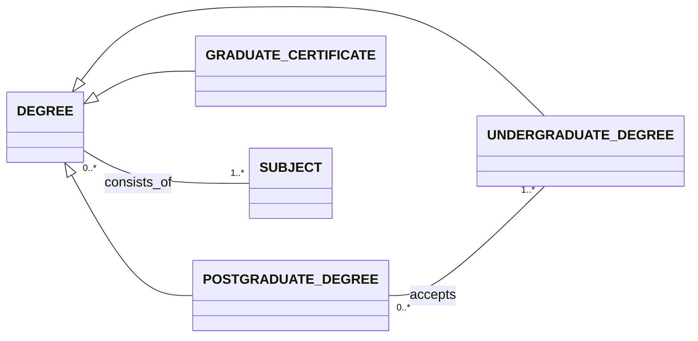
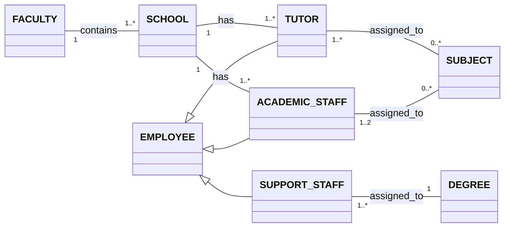
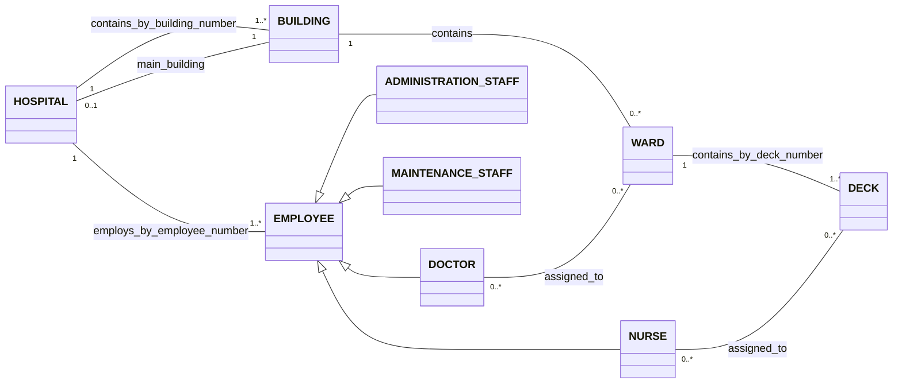
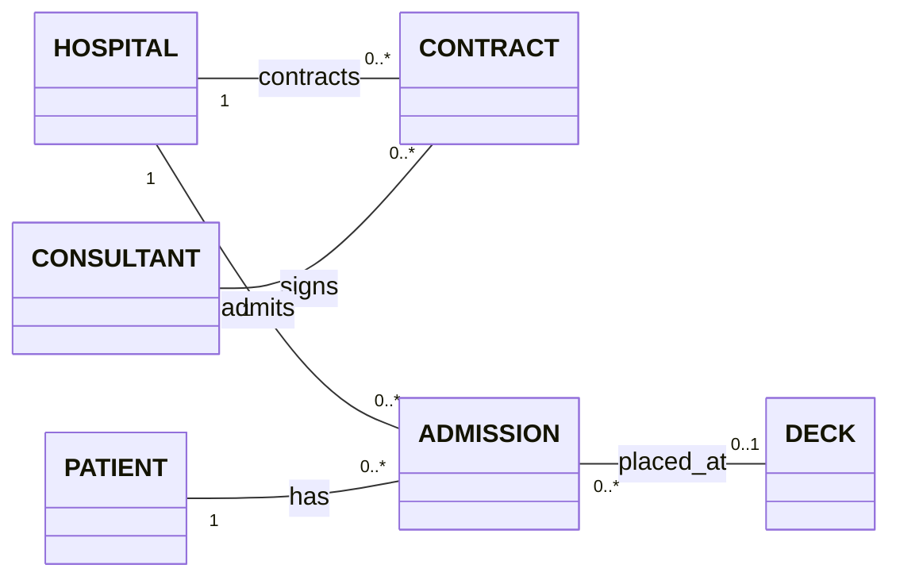
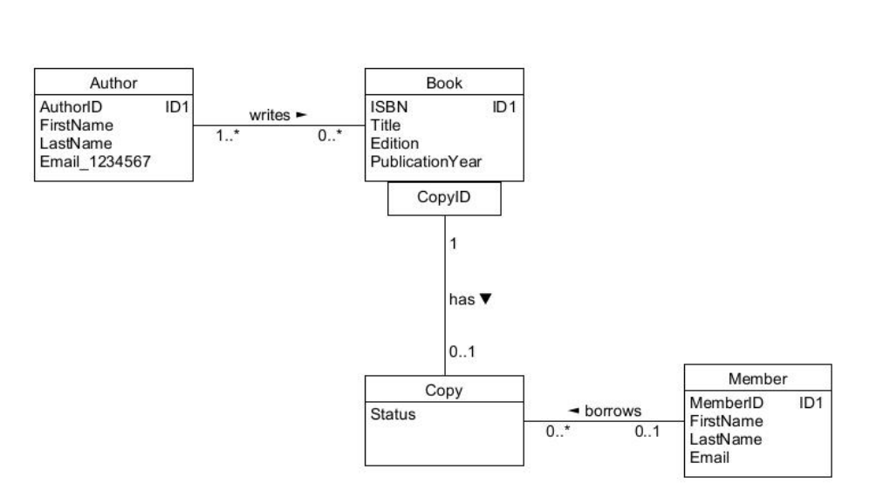
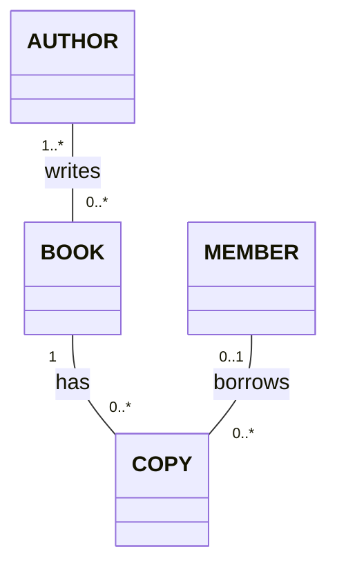
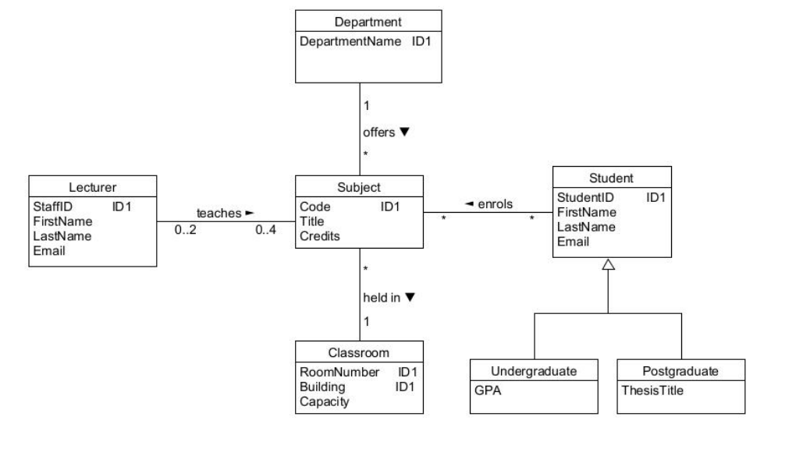
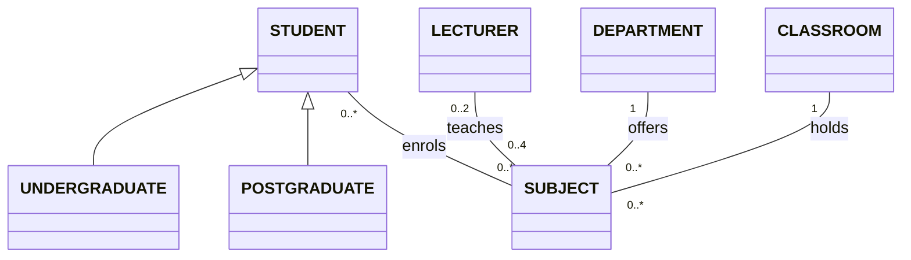
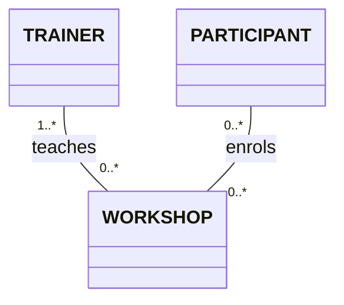
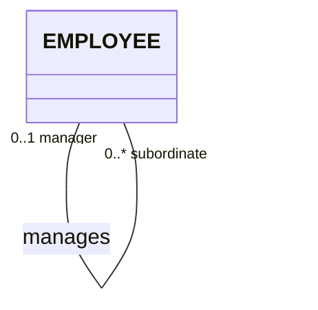

# 逐题教学与参考答案

英文原题与中文翻译见[questions.md](./questions.md)。参考答案均标来源；没有提供的官方答案不冒充教师答案。浏览器模式可隐藏答案独立练习。

<a id="m1-q1"></a>
## M1-Q1 · Mock Examination 1

独立推导参考答案；不是教师官方评分表

### 小题(1)

**任务与输入／输出**：把业务说明中的对象、属性、唯一性和数量画成完整概念图。 输入：英文题面和给定图／FD；输出：从大学业务说明生成完整conceptual schema

**必需知识**

- Class / attribute（对象类别与属性）：Class描述要记录的对象类别；attribute描述该对象的信息。概念图用association连接类别，不把foreign key当作概念关联。 当前用途：图中必须既有属性，也有连接和数量；code、title两种独立identifier与员工三项组合identifier没有混淆。
- Identifier（唯一标识）：同一个ID标签标在多列上表示组合标识；不同ID标签表示各自独立的标识。局部号码必须结合所属对象。 当前用途：图中必须既有属性，也有连接和数量；code、title两种独立identifier与员工三项组合identifier没有混淆。
- Multiplicity（关联两端的数量范围）：分别向两个方向读关联。端点上的0..1、1..*等描述这一端可以对应多少个对象。at most给上限，不能当作at least。 当前用途：图中必须既有属性，也有连接和数量；code、title两种独立identifier与员工三项组合identifier没有混淆。
- Many-to-many / association attribute（多对多与关联属性）：多对多建立配对表，完整引用两端的标识。只随某次配对变化的属性，如role或报名日期，放在配对关系中。 当前用途：图中必须既有属性，也有连接和数量；code、title两种独立identifier与员工三项组合identifier没有混淆。
- Generalization / inheritance（泛化与继承）：子类继承父类共同属性和标识，再增加自己的属性。概念图的空心三角指向父类；画概念图时不需要先选SQL实现方法。 当前用途：图中必须既有属性，也有连接和数量；code、title两种独立identifier与员工三项组合identifier没有混淆。
- Multivalued / optional / derived（多值、可选与可计算属性）：多值属性拆成逐项记录；可选属性可缺失；derived attribute由其他记录计算。配对内容如资格与日期不能拆成不对应的两个列表。 当前用途：图中必须既有属性，也有连接和数量；code、title两种独立identifier与员工三项组合identifier没有混淆。

**分步解题**

1. 先分对象种类：Degree、Subject、Employee、Faculty、School；再分Degree的三个子类、Employee的三个子类。不要因为文字提到学生，就新增没有描述要求的Student类。
2. 逐项读唯一性：Subject的code与title分别唯一；Employee除employee_number外，还有(first_name,last_name,date_of_birth)这个组合identifier。把三个姓名/日期属性标成同一个ID标签。
3. 把requirements、learning objectives表示为multivalued attributes；支持人员的qualification和acquired_date要成对，避免两个列表无法一一对应。
4. 每条association分别向两个方向读：一门科目有1–2名academic staff；一位academic staff可负责多门。Support staff恰属于一个Degree，Degree至少对应一位Support staff。
5. 将已确定的attributes、identifiers、multiplicities填进类框和关联线。a number of等未给精确下限的措辞，采用假设时单独标明，不把假设写成题面事实。

**Reference Answer**

Use the classes and associations below. Subject code and subject title are separate identifiers. Employee number is one identifier; (first_name, last_name, date_of_birth) is another. Keep each qualification paired with its acquisition date. Each subject has 1–2 academic staff. Each support staff member belongs to exactly one degree; each degree has at least one support staff member. Interpret unspecified lower bounds explicitly. Achieved degrees may come from outside this university.





验证状态：静态／人工复核；未在MySQL执行。

**考试自检点**：图中必须既有属性，也有连接和数量；code、title两种独立identifier与员工三项组合identifier没有混淆。；按原题指定的实现形式作答；不以另一种结果相同的写法代替明确要求。

**常见错误**：不要用关系表的foreign keys代替conceptual association，也不要把员工已获学位限制为必须来自本校。

**Independent Practice**：回到工作台隐藏答案，保存一轮自己的作答。

<a id="m1-q2"></a>
## M1-Q2 · Mock Examination 1

独立推导参考答案；不是教师官方评分表

### 小题(1)

**任务与输入／输出**：把图中每一种特征转换成关系模式，并完整列出键和引用。 输入：英文题面和给定图／FD；输出：按superset method把运输服务图转换成relational schemas

**必需知识**

- Primary / candidate / foreign key（主键、候选键与外键）：Candidate key是最小且非空的唯一标识组合；primary key是其中选中的一个。Foreign key引用已有对象，复合标识须完整引用。Superset中的可空子类标识要另说明为条件unique。 当前用途：最终有BUS、DRIVER、TSERVICE、SERVICE_DRIVER、STOP五个schemas；STOP每个key含4项。
- Qualified association（用局部值限定的关联）：固定所属对象与qualifier后，至多对应一个目标；不等于该所属对象总共只能有一个目标。 当前用途：最终有BUS、DRIVER、TSERVICE、SERVICE_DRIVER、STOP五个schemas；STOP每个key含4项。
- Many-to-many / association attribute（多对多与关联属性）：多对多建立配对表，完整引用两端的标识。只随某次配对变化的属性，如role或报名日期，放在配对关系中。 当前用途：最终有BUS、DRIVER、TSERVICE、SERVICE_DRIVER、STOP五个schemas；STOP每个key含4项。
- Superset method（超集法实现泛化）：把父类共有列与子类专有列放在同一表，另记录类型。子类专有列在整表常需允许NULL，并遵守分类条件。 当前用途：最终有BUS、DRIVER、TSERVICE、SERVICE_DRIVER、STOP五个schemas；STOP每个key含4项。

**分步解题**

1. TSERVICE的三个ID属性合起来才识别一项服务；先抄完整组合(departure_city,destination_city,departure_time)，后续所有引用都使用这三项。
2. 先建立不引用其他表的BUS与DRIVER。DRIVER的dlnumber、enumber分别唯一：选其中一个为primary key，另一个保留为candidate key。
3. 把较长与较短服务合入TSERVICE，增加service_type。total_days与total_hours是子类专有属性，在整表需要允许NULL，并按类别填写。
4. BUS到TSERVICE是一对多，把rego放入TSERVICE作foreign key；TSERVICE到DRIVER是many-to-many，建立SERVICE_DRIVER保存完整配对。
5. STOP受服务和snumber共同限定，所以primary key是服务三项标识再加snumber；STOP本身的到离时间与服务时间要区分命名。
6. 用课堂PRIMARY KEY =、CANDIDATE KEY =、FOREIGN KEY = ... REFERENCES ...格式列出，父表先于子表。检查minimum participation不能仅靠foreign key保证的限制。

**Reference Answer**

```text
(departure_city, destination_city, departure_time)
```

```text
BUS(rego, make)
PRIMARY KEY = (rego)
OTHER CANDIDATE KEYS = none
FOREIGN KEY1 = none
```

```text
DRIVER(dlnumber, enumber, full_name)
PRIMARY KEY = (dlnumber)
CANDIDATE KEY1 = (enumber)
FOREIGN KEY1 = none
```

```text
TSERVICE(
    departure_city,
    destination_city,
    departure_time,
    arrival_time,
    rego,
    service_type,
    total_days,
    total_hours
)

PRIMARY KEY = (departure_city, destination_city, departure_time)
OTHER CANDIDATE KEYS = none
FOREIGN KEY1 = (rego) REFERENCES BUS(rego)
```

```text
SERVICE_DRIVER(
    departure_city,
    destination_city,
    departure_time,
    dlnumber
)

PRIMARY KEY = (departure_city, destination_city, departure_time, dlnumber)
OTHER CANDIDATE KEYS = none
FOREIGN KEY1 = (departure_city, destination_city, departure_time)
     REFERENCES TSERVICE(departure_city, destination_city, departure_time)
FOREIGN KEY2 = (dlnumber) REFERENCES DRIVER(dlnumber)
```

```text
STOP(
    service_departure_city,
    service_destination_city,
    service_departure_time,
    snumber,
    stop_city,
    departure_time,
    arrival_time
)

PRIMARY KEY = (
    service_departure_city,
    service_destination_city,
    service_departure_time,
    snumber
)
OTHER CANDIDATE KEYS = none
FOREIGN KEY1 = (service_departure_city, service_destination_city, service_departure_time)
    REFERENCES TSERVICE(departure_city, destination_city, departure_time)
```

Use the complete composite identifier in every reference. Minimum participation constraints are not guaranteed by foreign keys alone. In a superset table, a nullable subtype identifier is a conditional UNIQUE constraint rather than a non-null candidate key for every row.

Use every column of the full composite identifier in foreign keys. Minimum participation needs additional enforcement. Subtype-only nullable UNIQUE values are not candidate keys for all rows.

验证状态：静态／人工复核；未在MySQL执行。

**考试自检点**：最终有BUS、DRIVER、TSERVICE、SERVICE_DRIVER、STOP五个schemas；STOP每个key含4项。；按原题指定的实现形式作答；不以另一种结果相同的写法代替明确要求。

**常见错误**：0..1针对固定(service,snumber)，不是整项服务最多一个STOP。

**Independent Practice**：回到工作台隐藏答案，保存一轮自己的作答。

<a id="m1-q3"></a>
## M1-Q3 · Mock Examination 1

独立推导参考答案；不是教师官方评分表

### 小题(1)

**任务与输入／输出**：根据指定条件找行，只输出题目要求的列，并按需要排序。 输入：共享Transport schema与题面条件；输出：返回容量区间内卡车的注册号

**必需知识**

- SELECT / projection（选择输出列）：先从题目列出需要返回的列。输出多余列可能改变DISTINCT、GROUP BY或结果形状。 当前用途：本小题输出：返回容量区间内卡车的注册号
- WHERE / predicate（逐行筛选条件）：WHERE检查每一行。AND要求条件同时成立，OR要求至少一个成立。 当前用途：WHERE条件包含两个边界；有空结果时先核对约束，不修改题目数值。
- BETWEEN / date range（区间筛选）：BETWEEN包含两端。整年或整月时间常用“包含起点、排除下个区间起点”。 当前用途：WHERE条件包含两个边界；有空结果时先核对约束，不修改题目数值。

**分步解题**

1. 输出只有注册号REGNUM，数据来自TRUCK，不需要连接其他表。
2. inclusive要求100、500都包含，使用CAPACITY BETWEEN 100 AND 500。
3. 核对CREATE TABLE中的CAPACITY CHECK；若小于100的约束生效，此查询合法但没有匹配行。

**Reference Answer**

```sql
SELECT REGNUM
FROM TRUCK
WHERE CAPACITY BETWEEN 100 AND 500;
```

验证状态：已在隔离的SQLite内存数据中核对相关查询／数据变化；涉及MySQL方言时有明确适配，不等同MySQL执行验证。

**考试自检点**：WHERE条件包含两个边界；有空结果时先核对约束，不修改题目数值。；按原题指定的实现形式作答；不以另一种结果相同的写法代替明确要求。

**常见错误**：不要把CAPACITY换成WEIGHT来“修复”原题冲突。

**Independent Practice**：回到工作台隐藏答案，保存一轮自己的作答。

### 小题(2)

**任务与输入／输出**：连接相关表；题目要求包含零匹配对象时，明确保留哪一侧。 输入：共享Transport schema与题面条件；输出：返回休假司机的名和姓

**必需知识**

- SELECT / projection（选择输出列）：先从题目列出需要返回的列。输出多余列可能改变DISTINCT、GROUP BY或结果形状。 当前用途：本小题输出：返回休假司机的名和姓
- WHERE / predicate（逐行筛选条件）：WHERE检查每一行。AND要求条件同时成立，OR要求至少一个成立。 当前用途：每个符合状态的司机贡献一行姓名。
- JOIN / join condition（连接及连接条件）：两张表通过有关联的列匹配。先判断一行代表什么，避免漏连接条件形成多余组合。 当前用途：涉及对象／命名中间结果：EMPLOYEE, DRIVER

**分步解题**

1. 姓名在EMPLOYEE，状态在DRIVER，确定两表通过ENUM匹配。
2. JOIN后筛选D.STATUS = 'ON LEAVE'，而不是筛选员工表中不存在的状态。
3. SELECT只列FNAME、LNAME。不同司机可同名，题目没有要求按姓名去重。

**Reference Answer**

```sql
SELECT E.FNAME, E.LNAME
FROM EMPLOYEE AS E
JOIN DRIVER AS D
    ON D.ENUM = E.ENUM
WHERE D.STATUS = 'ON LEAVE';
```

验证状态：已在隔离的SQLite内存数据中核对相关查询／数据变化；涉及MySQL方言时有明确适配，不等同MySQL执行验证。

**考试自检点**：每个符合状态的司机贡献一行姓名。；按原题指定的实现形式作答；不以另一种结果相同的写法代替明确要求。

**常见错误**：只查DRIVER得不到姓名，随意DISTINCT又可能合并不同司机。

**Independent Practice**：回到工作台隐藏答案，保存一轮自己的作答。

### 小题(3)

**任务与输入／输出**：用内层查询的结果筛选外层；采用题目规定的嵌套形式。 输入：共享Transport schema与题面条件；输出：返回从未执行行程的卡车

**必需知识**

- SELECT / projection（选择输出列）：先从题目列出需要返回的列。输出多余列可能改变DISTINCT、GROUP BY或结果形状。 当前用途：本小题输出：返回从未执行行程的卡车
- WHERE / predicate（逐行筛选条件）：WHERE检查每一行。AND要求条件同时成立，OR要求至少一个成立。 当前用途：没有行程的卡车必须保留；有一次或更多行程的必须排除。
- Nested query（嵌套查询）：内层查询先产生一个值或一组值，外层用它筛选。例如把全表AVG作为每行fee的比较基准。 当前用途：没有行程的卡车必须保留；有一次或更多行程的必须排除。
- EXISTS / NOT EXISTS（存在与不存在）：EXISTS只检查是否至少有一行，不需要把每条匹配记录都复制到外层。NOT EXISTS检查完全没有匹配。 当前用途：没有行程的卡车必须保留；有一次或更多行程的必须排除。

**分步解题**

1. 从TRUCK开始，才能包含没有任何TRIP的卡车。
2. 对当前卡车匹配TRIP.REGNUM = TRUCK.REGNUM。
3. 用NOT EXISTS保留完全没有匹配行程的卡车；车辆当前状态不代表历史是否使用过。

**Reference Answer**

```sql
SELECT T.REGNUM
FROM TRUCK AS T
WHERE NOT EXISTS (
    SELECT 1
    FROM TRIP AS P
    WHERE P.REGNUM = T.REGNUM
);
```

验证状态：已在隔离的SQLite内存数据中核对相关查询／数据变化；涉及MySQL方言时有明确适配，不等同MySQL执行验证。

**考试自检点**：没有行程的卡车必须保留；有一次或更多行程的必须排除。；按原题指定的实现形式作答；不以另一种结果相同的写法代替明确要求。

**常见错误**：WHERE状态AVAILABLE不能回答“从未使用”。

**Independent Practice**：回到工作台隐藏答案，保存一轮自己的作答。

### 小题(4)

**任务与输入／输出**：确定每一组对应什么对象，再计数或计算统计值。 输入：共享Transport schema与题面条件；输出：按已使用卡车统计行程次数

**必需知识**

- SELECT / projection（选择输出列）：先从题目列出需要返回的列。输出多余列可能改变DISTINCT、GROUP BY或结果形状。 当前用途：本小题输出：按已使用卡车统计行程次数
- COUNT / grain（计数与计数单位）：先确定要数的是Trip、Qualification、Enrolment还是Trainer。LEFT JOIN统计右表非空键，才能让零匹配结果为0。 当前用途：同一注册号只出一行；计数是trip数而不是leg数。
- GROUP BY / aggregate（分组与聚合）：一组对应一个对象或一个分类，再在组内COUNT、AVG、SUM等。非聚合输出列要符合分组规则。 当前用途：同一注册号只出一行；计数是trip数而不是leg数。

**分步解题**

1. TRIP中的一行是一趟行程，正是要计数的对象。
2. 按REGNUM分组，用COUNT(*)统计每组行数。
3. 直接从TRIP出发即可自动排除没有行程的卡车，不需要额外outer join。

**Reference Answer**

```sql
SELECT REGNUM, COUNT(*) AS TOTAL_TRIPS
FROM TRIP
GROUP BY REGNUM;
```

验证状态：已在隔离的SQLite内存数据中核对相关查询／数据变化；涉及MySQL方言时有明确适配，不等同MySQL执行验证。

**考试自检点**：同一注册号只出一行；计数是trip数而不是leg数。；按原题指定的实现形式作答；不以另一种结果相同的写法代替明确要求。

**常见错误**：连接TRIPLEG会把一趟多段行程放大成多行。

**Independent Practice**：回到工作台隐藏答案，保存一轮自己的作答。

### 小题(5)

**任务与输入／输出**：根据指定条件找行，只输出题目要求的列，并按需要排序。 输入：共享Transport schema与题面条件；输出：明确城市查询的结果形状，再选择SQL

**必需知识**

- SELECT / projection（选择输出列）：先从题目列出需要返回的列。输出多余列可能改变DISTINCT、GROUP BY或结果形状。 当前用途：本小题输出：明确城市查询的结果形状，再选择SQL
- UNION / UNION ALL（合并结果集）：UNION把兼容的查询结果合在一起并去重；UNION ALL保留重复。合成一列城市与保留两列出发地／目的地配对不是同一种结果。 当前用途：核对输出列数以及是否保留城市配对；两种答案不能称为含义相同。
- DISTINCT（删除重复结果行）：同一对象可能有多条符合的报名。需要每人只出现一次时，可使用EXISTS或在正确列上DISTINCT；不要用去重掩盖错误连接。 当前用途：核对输出列数以及是否保留城市配对；两种答案不能称为含义相同。

**分步解题**

1. 先区分两种可能：一列“所有城市名称”，或者两列“出发城市—目的城市配对”。原句未明确这一点。
2. 若要求合成一列名单，分别SELECT DEPARTURE、DESTINATION，用UNION合并去重。
3. 若要求配对，则SELECT DISTINCT DEPARTURE, DESTINATION，保留同一条路段上的配对关系。

**Reference Answer**

```sql
SELECT DEPARTURE AS CITY
FROM TRIPLEG
UNION
SELECT DESTINATION AS CITY
FROM TRIPLEG;
```

```sql
SELECT DISTINCT DEPARTURE, DESTINATION
FROM TRIPLEG;
```

验证状态：已在隔离的SQLite内存数据中核对相关查询／数据变化；涉及MySQL方言时有明确适配，不等同MySQL执行验证。

**考试自检点**：核对输出列数以及是否保留城市配对；两种答案不能称为含义相同。；按原题指定的实现形式作答；不以另一种结果相同的写法代替明确要求。

**常见错误**：不要不说明结果形状就把两条SQL当作完全可互换的写法。

**Independent Practice**：回到工作台隐藏答案，保存一轮自己的作答。

<a id="m1-q4"></a>
## M1-Q4 · Mock Examination 1

独立推导参考答案；不是教师官方评分表

### 小题(1)

**任务与输入／输出**：区分修改表结构与修改行；遵守数值边界、外键和执行次序。 输入：共享Transport schema与题面条件；输出：用结构表达司机与技能的many-to-many关系

**必需知识**

- Primary / candidate / foreign key（主键、候选键与外键）：Candidate key是最小且非空的唯一标识组合；primary key是其中选中的一个。Foreign key引用已有对象，复合标识须完整引用。Superset中的可空子类标识要另说明为条件unique。 当前用途：涉及对象／命名中间结果：SKILL, DRIVER_SKILL
- CHECK / UNIQUE / NOT NULL（值限制、唯一与必填）：这三种约束作用不同。CHECK限制允许的值，UNIQUE限制重复，NOT NULL要求有值。不得为使DML成功而擅自停用约束。 当前用途：可以只插入SKILL而没有DRIVER_SKILL；配对的两端必须真实存在。
- DECIMAL(p,s)（精确数值的位数）：p是总位数，s是小数位数。9999.99需要四位整数和两位小数，即DECIMAL(6,2)。 当前用途：可以只插入SKILL而没有DRIVER_SKILL；配对的两端必须真实存在。

**分步解题**

1. 技能可能没有任何司机拥有，因此SKILL必须能独立存一行。
2. DRIVER_SKILL每行保存一个司机与技能配对，两个foreign keys分别引用DRIVER和SKILL。
3. 把(ENUM,SKILL_CODE)作为composite primary key，防止重复拥有关系。若还要求每司机至少一项技能，说明这不是普通foreign key自动保证的。

**Reference Answer**

```sql
CREATE TABLE SKILL (
    SKILL_CODE VARCHAR(20) NOT NULL,
    SKILL_NAME VARCHAR(100) NOT NULL,
    CONSTRAINT SKILL_PKEY PRIMARY KEY (SKILL_CODE)
);

CREATE TABLE DRIVER_SKILL (
    ENUM DECIMAL(12) NOT NULL,
    SKILL_CODE VARCHAR(20) NOT NULL,
    CONSTRAINT DRIVER_SKILL_PKEY PRIMARY KEY (ENUM, SKILL_CODE),
    CONSTRAINT DRIVER_SKILL_DRIVER_FKEY
        FOREIGN KEY (ENUM) REFERENCES DRIVER (ENUM),
    CONSTRAINT DRIVER_SKILL_SKILL_FKEY
        FOREIGN KEY (SKILL_CODE) REFERENCES SKILL (SKILL_CODE)
);
```

验证状态：已在隔离的SQLite内存数据中核对相关查询／数据变化；涉及MySQL方言时有明确适配，不等同MySQL执行验证。

**考试自检点**：可以只插入SKILL而没有DRIVER_SKILL；配对的两端必须真实存在。；按原题指定的实现形式作答；不以另一种结果相同的写法代替明确要求。

**常见错误**：不要把多个技能用逗号塞进DRIVER的一列，也不要只建配对表而丢失无人拥有的技能。

**Independent Practice**：回到工作台隐藏答案，保存一轮自己的作答。

### 小题(2)

**任务与输入／输出**：区分修改表结构与修改行；遵守数值边界、外键和执行次序。 输入：共享Transport schema与题面条件；输出：只删除行程36的第2、3段

**必需知识**

- WHERE / predicate（逐行筛选条件）：WHERE检查每一行。AND要求条件同时成立，OR要求至少一个成立。 当前用途：其他行程的第2、3段、行程36的其他路段均保留。
- INSERT / UPDATE / DELETE（增加、修改和删除行）：INSERT先父后子；DELETE依赖记录先子后父。UPDATE中的新值通常从当前列计算，并用WHERE限定目标。 当前用途：涉及对象／命名中间结果：TRIPLEG
- Primary / candidate / foreign key（主键、候选键与外键）：Candidate key是最小且非空的唯一标识组合；primary key是其中选中的一个。Foreign key引用已有对象，复合标识须完整引用。Superset中的可空子类标识要另说明为条件unique。 当前用途：涉及对象／命名中间结果：TRIPLEG

**分步解题**

1. 操作对象是TRIPLEG中的行，不是TRIP整行。
2. TNUM = 36限定行程，LEGNUM IN (2,3)限定两个路段。
3. DELETE前可用相同WHERE写SELECT检查命中范围；正式答案保留必要DELETE即可。

**Reference Answer**

```sql
DELETE FROM TRIPLEG
WHERE TNUM = 36
  AND LEGNUM IN (2, 3);
```

验证状态：已在隔离的SQLite内存数据中核对相关查询／数据变化；涉及MySQL方言时有明确适配，不等同MySQL执行验证。

**考试自检点**：其他行程的第2、3段、行程36的其他路段均保留。；按原题指定的实现形式作答；不以另一种结果相同的写法代替明确要求。

**常见错误**：漏掉TNUM会误删所有行程的这些路段。

**Independent Practice**：回到工作台隐藏答案，保存一轮自己的作答。

### 小题(3)

**任务与输入／输出**：区分修改表结构与修改行；遵守数值边界、外键和执行次序。 输入：共享Transport schema与题面条件；输出：给行程26当前日期加一天

**必需知识**

- WHERE / predicate（逐行筛选条件）：WHERE检查每一行。AND要求条件同时成立，OR要求至少一个成立。 当前用途：原日期若为月末或年末，结果仍是正确下一天。
- INSERT / UPDATE / DELETE（增加、修改和删除行）：INSERT先父后子；DELETE依赖记录先子后父。UPDATE中的新值通常从当前列计算，并用WHERE限定目标。 当前用途：涉及对象／命名中间结果：TRIP

**分步解题**

1. WHERE TNUM=26确定唯一要更新的行。
2. 题目说present date of trip 26，基准是已存TDATE。
3. SET TDATE=DATE_ADD(TDATE,INTERVAL 1 DAY)处理跨月、跨年；检查更新后不会违反既有UNIQUE组合。

**Reference Answer**

```sql
UPDATE TRIP
SET TDATE = DATE_ADD(TDATE, INTERVAL 1 DAY)
WHERE TNUM = 26;
```

验证状态：已在隔离的SQLite内存数据中核对相关查询／数据变化；涉及MySQL方言时有明确适配，不等同MySQL执行验证。

**考试自检点**：原日期若为月末或年末，结果仍是正确下一天。；按原题指定的实现形式作答；不以另一种结果相同的写法代替明确要求。

**常见错误**：CURRENT_DATE()+1用今天作起点，与题意不同。

**Independent Practice**：回到工作台隐藏答案，保存一轮自己的作答。

### 小题(4)

**任务与输入／输出**：区分修改表结构与修改行；遵守数值边界、外键和执行次序。 输入：共享Transport schema与题面条件；输出：为行程25增加第四段返回路程

**必需知识**

- INSERT / UPDATE / DELETE（增加、修改和删除行）：INSERT先父后子；DELETE依赖记录先子后父。UPDATE中的新值通常从当前列计算，并用WHERE限定目标。 当前用途：涉及对象／命名中间结果：TRIPLEG

**分步解题**

1. 原有三段，新路段LEGNUM应为4。
2. 原终点Perth成为新路段起点，原起点Sydney成为新路段终点。
3. 向TRIPLEG插入(25,4,Perth,Sydney)，TRIP记录必须已存在。

**Reference Answer**

```sql
INSERT INTO TRIPLEG (TNUM, LEGNUM, DEPARTURE, DESTINATION)
VALUES (25, 4, 'Perth', 'Sydney');
```

验证状态：已在隔离的SQLite内存数据中核对相关查询／数据变化；涉及MySQL方言时有明确适配，不等同MySQL执行验证。

**考试自检点**：新增后最后一个目的地为Sydney，且与前一段终点接续。；按原题指定的实现形式作答；不以另一种结果相同的写法代替明确要求。

**常见错误**：不要把新增路段写成Sydney到Perth，或覆盖现有第三段。

**Independent Practice**：回到工作台隐藏答案，保存一轮自己的作答。

### 小题(5)

**任务与输入／输出**：区分修改表结构与修改行；遵守数值边界、外键和执行次序。 输入：共享Transport schema与题面条件；输出：把行程20第一段目的地改成Perth

**必需知识**

- WHERE / predicate（逐行筛选条件）：WHERE检查每一行。AND要求条件同时成立，OR要求至少一个成立。 当前用途：明确区分最低题面要求与额外连续性假设；检查UNIQUE仍满足。
- INSERT / UPDATE / DELETE（增加、修改和删除行）：INSERT先父后子；DELETE依赖记录先子后父。UPDATE中的新值通常从当前列计算，并用WHERE限定目标。 当前用途：涉及对象／命名中间结果：TRIPLEG

**分步解题**

1. 直接要求由TNUM=20且LEGNUM=1定位。
2. 第一条UPDATE只修改DESTINATION，直接完成题面要求。
3. 若额外采用“相邻路段必须首尾相接”的业务规则，再同步更新第二段DEPARTURE，并在同一transaction处理；这条规则不是原DDL强制的。

**Reference Answer**

```sql
UPDATE TRIPLEG
SET DESTINATION = 'Perth'
WHERE TNUM = 20
  AND LEGNUM = 1;

UPDATE TRIPLEG
SET DEPARTURE = 'Perth'
WHERE TNUM = 20
  AND LEGNUM = 2;
```

验证状态：已在隔离的SQLite内存数据中核对相关查询／数据变化；涉及MySQL方言时有明确适配，不等同MySQL执行验证。

**考试自检点**：明确区分最低题面要求与额外连续性假设；检查UNIQUE仍满足。；按原题指定的实现形式作答；不以另一种结果相同的写法代替明确要求。

**常见错误**：不要无说明地把修改第二段也宣称为题目明确要求。

**Independent Practice**：回到工作台隐藏答案，保存一轮自己的作答。

<a id="m1-q5"></a>
## M1-Q5 · Mock Examination 1

独立推导参考答案；不是教师官方评分表

### 小题(1)

**任务与输入／输出**：按用户、操作、对象范围和能否转授，逐项实现权限。 输入：共享Transport schema与题面条件；输出：设定默认数据库并创建两名用户

**必需知识**

- CREATE USER / account host（创建用户及主机范围）：MySQL账号由用户名和host共同区分。root数据库账号不等于操作系统用户目录。密码按题面或自行选择，公开版只提供占位文本。 当前用途：USE先于依赖默认数据库的操作；新用户名称/host前后一致。
- USE / SOURCE / client commands（选库与处理SQL脚本）：USE选择数据库；SOURCE由mysql客户端读取脚本，不是服务器SELECT。tee与notee控制客户端报告文件，不等于COMMIT。 当前用途：USE先于依赖默认数据库的操作；新用户名称/host前后一致。

**分步解题**

1. root已连接，直接USE transport，无需再次写登录命令。
2. 统一约定TRAINER_01、USER_B为localhost账号，避免后续GRANT引用不同host。
3. CREATE USER各执行一次；题目只给了root密码，不把它自动分配给新用户。

**Reference Answer**

```sql
USE transport;

CREATE USER 'USER_A'@'localhost';
CREATE USER 'USER_B'@'localhost';
```

验证状态：静态／人工复核；未在MySQL执行。

**考试自检点**：USE先于依赖默认数据库的操作；新用户名称/host前后一致。；按原题指定的实现形式作答；不以另一种结果相同的写法代替明确要求。

**常见错误**：数据库用户名root与操作系统root不是一回事。

**Independent Practice**：回到工作台隐藏答案，保存一轮自己的作答。

### 小题(2)

**任务与输入／输出**：按用户、操作、对象范围和能否转授，逐项实现权限。 输入：共享Transport schema与题面条件；输出：授予TRAINER_01读取两表且不可转授

**必需知识**

- GRANT / privilege scope（授予权限与对象范围）：区分数据库、表、列权限。只需读汇总结果时，用View限制范围，避免额外开放底表。 当前用途：只读范围包含两表，未增加INSERT或UPDATE。
- WITH GRANT OPTION（权限转授）：加上此项允许转授指定范围内已有的对象权限。权限来源会叠加；新GRANT省略此项，不会撤销旧的转授权能力。 当前用途：只读范围包含两表，未增加INSERT或UPDATE。

**分步解题**

1. 读取表的操作权限是SELECT。
2. 分别对transport.EMPLOYEE、transport.DRIVER授权。
3. 对于新建且没有其他权限来源的TRAINER_01，不带WITH GRANT OPTION。

**Reference Answer**

```sql
GRANT SELECT ON transport.EMPLOYEE
TO 'USER_A'@'localhost';

GRANT SELECT ON transport.DRIVER
TO 'USER_A'@'localhost';
```

验证状态：静态／人工复核；未在MySQL执行。

**考试自检点**：只读范围包含两表，未增加INSERT或UPDATE。；按原题指定的实现形式作答；不以另一种结果相同的写法代替明确要求。

**常见错误**：省略GRANT OPTION仅在没有其他传播权限来源时满足不可转授，不能普遍忽略旧授权。

**Independent Practice**：回到工作台隐藏答案，保存一轮自己的作答。

### 小题(3)

**任务与输入／输出**：按用户、操作、对象范围和能否转授，逐项实现权限。 输入：共享Transport schema与题面条件；输出：授予USER_B插入两表并允许转授

**必需知识**

- INSERT / UPDATE / DELETE（增加、修改和删除行）：INSERT先父后子；DELETE依赖记录先子后父。UPDATE中的新值通常从当前列计算，并用WHERE限定目标。 当前用途：两个目标表都有INSERT及转授权能力。
- GRANT / privilege scope（授予权限与对象范围）：区分数据库、表、列权限。只需读汇总结果时，用View限制范围，避免额外开放底表。 当前用途：两个目标表都有INSERT及转授权能力。
- WITH GRANT OPTION（权限转授）：加上此项允许转授指定范围内已有的对象权限。权限来源会叠加；新GRANT省略此项，不会撤销旧的转授权能力。 当前用途：两个目标表都有INSERT及转授权能力。

**分步解题**

1. 插入行使用INSERT privilege，不需要授全部权限。
2. 分别定位transport.TRIP、transport.TRIPLEG。
3. 每条GRANT加WITH GRANT OPTION，允许继续授予相同范围权限。

**Reference Answer**

```sql
GRANT INSERT ON transport.TRIP
TO 'USER_B'@'localhost'
WITH GRANT OPTION;

GRANT INSERT ON transport.TRIPLEG
TO 'USER_B'@'localhost'
WITH GRANT OPTION;
```

验证状态：静态／人工复核；未在MySQL执行。

**考试自检点**：两个目标表都有INSERT及转授权能力。；按原题指定的实现形式作答；不以另一种结果相同的写法代替明确要求。

**常见错误**：WITH ADMIN OPTION针对role成员资格，不替代对象的GRANT OPTION。

**Independent Practice**：回到工作台隐藏答案，保存一轮自己的作答。

### 小题(4)

**任务与输入／输出**：按用户、操作、对象范围和能否转授，逐项实现权限。 输入：共享Transport schema与题面条件；输出：授予TRAINER_01数据库范围的UPDATE

**必需知识**

- INSERT / UPDATE / DELETE（增加、修改和删除行）：INSERT先父后子；DELETE依赖记录先子后父。UPDATE中的新值通常从当前列计算，并用WHERE限定目标。 当前用途：涉及对象／命名中间结果：ON
- GRANT / privilege scope（授予权限与对象范围）：区分数据库、表、列权限。只需读汇总结果时，用View限制范围，避免额外开放底表。 当前用途：权限范围是数据库，不是全服务器*.*。
- WITH GRANT OPTION（权限转授）：加上此项允许转授指定范围内已有的对象权限。权限来源会叠加；新GRANT省略此项，不会撤销旧的转授权能力。 当前用途：权限范围是数据库，不是全服务器*.*。

**分步解题**

1. 原文写csit115数据库，保留这个名字，不擅自换成transport。
2. ON csit115.*表示该数据库内所有表。
3. 只授UPDATE，且不增加WITH GRANT OPTION。

**Reference Answer**

```sql
GRANT UPDATE ON csit115.*
TO 'USER_A'@'localhost';
```

验证状态：静态／人工复核；未在MySQL执行。

**考试自检点**：权限范围是数据库，不是全服务器*.*。；按原题指定的实现形式作答；不以另一种结果相同的写法代替明确要求。

**常见错误**：把root的密码csit115与本小题数据库名混为一个概念会读错范围。

**Independent Practice**：回到工作台隐藏答案，保存一轮自己的作答。

### 小题(5)

**任务与输入／输出**：按用户、操作、对象范围和能否转授，逐项实现权限。 输入：共享Transport schema与题面条件；输出：通过view开放司机行程总数

**必需知识**

- SELECT / projection（选择输出列）：先从题目列出需要返回的列。输出多余列可能改变DISTINCT、GROUP BY或结果形状。 当前用途：本小题输出：通过view开放司机行程总数
- JOIN / join condition（连接及连接条件）：两张表通过有关联的列匹配。先判断一行代表什么，避免漏连接条件形成多余组合。 当前用途：涉及对象／命名中间结果：transport.DRIVER, transport.TRIP
- COUNT / grain（计数与计数单位）：先确定要数的是Trip、Qualification、Enrolment还是Trainer。LEFT JOIN统计右表非空键，才能让零匹配结果为0。 当前用途：零次司机为0；USER_B不必取得底表直接读取权。
- GRANT / privilege scope（授予权限与对象范围）：区分数据库、表、列权限。只需读汇总结果时，用View限制范围，避免额外开放底表。 当前用途：零次司机为0；USER_B不必取得底表直接读取权。
- WITH GRANT OPTION（权限转授）：加上此项允许转授指定范围内已有的对象权限。权限来源会叠加；新GRANT省略此项，不会撤销旧的转授权能力。 当前用途：零次司机为0；USER_B不必取得底表直接读取权。
- View / dependency（视图与依赖）：View保存查询定义。依赖另一个View时，删除顺序先子后父。普通View不是一张独立保存统计结果的表。 当前用途：涉及对象／命名中间结果：transport.DRIVER, transport.TRIP
- SQL SECURITY DEFINER（由视图定义者权限读取底表）：由root创建受限View，再只授View的SELECT，可开放汇总或特定年份数据。仍要检查用户是否从其他途径已有更大权限。 当前用途：零次司机为0；USER_B不必取得底表直接读取权。
- LEFT JOIN（保留左侧未匹配行的连接）：需要包括“没有报名／要求／培训师”的对象时，从这些对象所在表出发。右表没有匹配时会补NULL。 当前用途：零次司机为0；USER_B不必取得底表直接读取权。
- GROUP BY / aggregate（分组与聚合）：一组对应一个对象或一个分类，再在组内COUNT、AVG、SUM等。非聚合输出列要符合分组规则。 当前用途：零次司机为0；USER_B不必取得底表直接读取权。

**分步解题**

1. 从DRIVER左连接TRIP，才能保留零行程司机。
2. 按司机的ENUM、LNUM分组，COUNT(T.TNUM)让未匹配者得到0。
3. 由root创建SQL SECURITY DEFINER view，再只授USER_B该view的SELECT。

**Reference Answer**

```sql
CREATE SQL SECURITY DEFINER VIEW transport.DRIVER_TRIP_TOTAL AS
SELECT D.ENUM,
       D.LNUM,
       COUNT(T.TNUM) AS TOTAL_TRIPS
FROM transport.DRIVER AS D
LEFT JOIN transport.TRIP AS T
    ON T.LNUM = D.LNUM
GROUP BY D.ENUM, D.LNUM;

GRANT SELECT ON transport.DRIVER_TRIP_TOTAL
TO 'USER_B'@'localhost';
```

验证状态：静态／人工复核；未在MySQL执行。

**考试自检点**：零次司机为0；USER_B不必取得底表直接读取权。；按原题指定的实现形式作答；不以另一种结果相同的写法代替明确要求。

**常见错误**：COUNT(*)会把outer join补出的行也算成1。

**Independent Practice**：回到工作台隐藏答案，保存一轮自己的作答。

<a id="m1-q6"></a>
## M1-Q6 · Mock Examination 1

独立推导参考答案；不是教师官方评分表

### 小题(1)

**任务与输入／输出**：区分修改表结构与修改行；遵守数值边界、外键和执行次序。 输入：共享Transport schema与题面条件；输出：创建只包含违规卡车的两列快照表

**必需知识**

- SELECT / projection（选择输出列）：先从题目列出需要返回的列。输出多余列可能改变DISTINCT、GROUP BY或结果形状。 当前用途：本小题输出：创建只包含违规卡车的两列快照表
- COUNT / grain（计数与计数单位）：先确定要数的是Trip、Qualification、Enrolment还是Trainer。LEFT JOIN统计右表非空键，才能让零匹配结果为0。 当前用途：表结构恰好两列；满足规则的卡车不在MESSAGE中。
- GROUP BY / aggregate（分组与聚合）：一组对应一个对象或一个分类，再在组内COUNT、AVG、SUM等。非聚合输出列要符合分组规则。 当前用途：表结构恰好两列；满足规则的卡车不在MESSAGE中。
- HAVING（聚合后的筛选）：“至少两次／超过三项”通常先分组计数，再用HAVING筛组。WHERE不能直接代替这种组条件。 当前用途：表结构恰好两列；满足规则的卡车不在MESSAGE中。
- Primary / candidate / foreign key（主键、候选键与外键）：Candidate key是最小且非空的唯一标识组合；primary key是其中选中的一个。Foreign key引用已有对象，复合标识须完整引用。Superset中的可空子类标识要另说明为条件unique。 当前用途：涉及对象／命名中间结果：MESSAGE, TRIP
- CHECK / UNIQUE / NOT NULL（值限制、唯一与必填）：这三种约束作用不同。CHECK限制允许的值，UNIQUE限制重复，NOT NULL要求有值。不得为使DML成功而擅自停用约束。 当前用途：表结构恰好两列；满足规则的卡车不在MESSAGE中。

**分步解题**

1. 按TRIP.REGNUM分组，对行程计数，不连接路段表。
2. HAVING COUNT(*)>100筛选违规组，100恰好不违规。
3. CREATE TABLE MESSAGE AS SELECT只选REGNUM和次数别名，保持两列。

**Reference Answer**

```sql
CREATE TABLE MESSAGE AS
SELECT REGNUM, COUNT(*) AS TOTAL_TRIPS
FROM TRIP
GROUP BY REGNUM
HAVING COUNT(*) > 100;
```

验证状态：MESSAGE筛选、100次边界及输出句式已在SQLite内存数据核对；COMMIT及MySQL DDL语义按文档静态复核。

**考试自检点**：表结构恰好两列；满足规则的卡车不在MESSAGE中。；按原题指定的实现形式作答；不以另一种结果相同的写法代替明确要求。

**常见错误**：WHERE不能直接筛选分组后的COUNT，>=100又会多报边界。

**Independent Practice**：回到工作台隐藏答案，保存一轮自己的作答。

### 小题(2)

**任务与输入／输出**：区分修改表结构与修改行；遵守数值边界、外键和执行次序。 输入：共享Transport schema与题面条件；输出：按要求构造一列英文消息

**必需知识**

- SELECT / projection（选择输出列）：先从题目列出需要返回的列。输出多余列可能改变DISTINCT、GROUP BY或结果形状。 当前用途：本小题输出：按要求构造一列英文消息
- CONCAT / column alias（合成姓名与输出列别名）：Participant存的是fname和lname，不是fullName列。CONCAT把两列与空格合成结果，再用AS指定输出名称。 当前用途：示例应为Truck PKR856 has been used for 120 trips.。

**分步解题**

1. 从已经建立的MESSAGE读REGNUM与TOTAL_TRIPS。
2. CONCAT拼接固定文字、注册号和次数。
3. 保留空格和末尾句号，使输出与题目示例一致。

**Reference Answer**

```sql
SELECT CONCAT(
           'Truck ', REGNUM,
           ' has been used for ', TOTAL_TRIPS,
           ' trips.'
       ) AS MESSAGE_TEXT
FROM MESSAGE;
```

验证状态：MESSAGE筛选、100次边界及输出句式已在SQLite内存数据核对；COMMIT及MySQL DDL语义按文档静态复核。

**考试自检点**：示例应为Truck PKR856 has been used for 120 trips.。；按原题指定的实现形式作答；不以另一种结果相同的写法代替明确要求。

**常见错误**：不是SELECT三个分开的列，也不需要修改数据库里的注册号。

**Independent Practice**：回到工作台隐藏答案，保存一轮自己的作答。

### 小题(3)

**任务与输入／输出**：区分修改表结构与修改行；遵守数值边界、外键和执行次序。 输入：共享Transport schema与题面条件；输出：提交未提交修改

**必需知识**

- COMMIT / ROLLBACK（提交与回滚）：COMMIT使当前事务的数据修改持久化。MySQL有些DDL会隐式提交，不能把DROP、TRUNCATE当作可随意ROLLBACK的DELETE。 当前用途：知道题面操作与MySQL implicit commit的区别。

**分步解题**

1. make permanent在事务题中对应COMMIT。
2. 按题目顺序在检查输出之后列出COMMIT。
3. 说明MySQL普通CTAS有隐式提交，不能把此COMMIT描述成它首次永久建表的唯一条件。

**Reference Answer**

```sql
COMMIT;
```

验证状态：MESSAGE筛选、100次边界及输出句式已在SQLite内存数据核对；COMMIT及MySQL DDL语义按文档静态复核。

**考试自检点**：知道题面操作与MySQL implicit commit的区别。；按原题指定的实现形式作答；不以另一种结果相同的写法代替明确要求。

**常见错误**：把所有DDL都当成可以由后续ROLLBACK恢复会产生错误。

**Independent Practice**：回到工作台隐藏答案，保存一轮自己的作答。

### 小题(4)

**任务与输入／输出**：区分修改表结构与修改行；遵守数值边界、外键和执行次序。 输入：共享Transport schema与题面条件；输出：最后删除MESSAGE表

**必需知识**

- ALTER TABLE（修改表结构）：增加列、改类型或加约束属于DDL，不是修改某几行数据。先确认现有类型能否容纳目标边界。 当前用途：涉及对象／命名中间结果：MESSAGE
- INSERT / UPDATE / DELETE（增加、修改和删除行）：INSERT先父后子；DELETE依赖记录先子后父。UPDATE中的新值通常从当前列计算，并用WHERE限定目标。 当前用途：涉及对象／命名中间结果：MESSAGE
- Primary / candidate / foreign key（主键、候选键与外键）：Candidate key是最小且非空的唯一标识组合；primary key是其中选中的一个。Foreign key引用已有对象，复合标识须完整引用。Superset中的可空子类标识要另说明为条件unique。 当前用途：涉及对象／命名中间结果：MESSAGE
- CHECK / UNIQUE / NOT NULL（值限制、唯一与必填）：这三种约束作用不同。CHECK限制允许的值，UNIQUE限制重复，NOT NULL要求有值。不得为使DML成功而擅自停用约束。 当前用途：DROP完成后表不存在，而不只是表内变空。

**分步解题**

1. 删除整个临时报告结构用DROP TABLE MESSAGE。
2. 这与DELETE全部行不同，后者还保留定义。
3. 之前COMMIT不阻止之后执行DROP；MESSAGE也不会自动追踪后续TRIP改变。

**Reference Answer**

```sql
DROP TABLE MESSAGE;
```

验证状态：MESSAGE筛选、100次边界及输出句式已在SQLite内存数据核对；COMMIT及MySQL DDL语义按文档静态复核。

**考试自检点**：DROP完成后表不存在，而不只是表内变空。；按原题指定的实现形式作答；不以另一种结果相同的写法代替明确要求。

**常见错误**：把“永久保存”理解成表以后无法删除。

**Independent Practice**：回到工作台隐藏答案，保存一轮自己的作答。

<a id="m2-q1"></a>
## M2-Q1 · Mock Examination 2

独立推导参考答案；不是教师官方评分表

### 小题(1)

**任务与输入／输出**：把业务说明中的对象、属性、唯一性和数量画成完整概念图。 输入：英文题面和给定图／FD；输出：建立医院的局部标识、合同与反复入院模型

**必需知识**

- Class / attribute（对象类别与属性）：Class描述要记录的对象类别；attribute描述该对象的信息。概念图用association连接类别，不把foreign key当作概念关联。 当前用途：最终UML类框里有全部attributes/IDs，局部identifier通过qualifier表达；同一次入院的检查和位置不串到其他事件。
- Identifier（唯一标识）：同一个ID标签标在多列上表示组合标识；不同ID标签表示各自独立的标识。局部号码必须结合所属对象。 当前用途：最终UML类框里有全部attributes/IDs，局部identifier通过qualifier表达；同一次入院的检查和位置不串到其他事件。
- Multiplicity（关联两端的数量范围）：分别向两个方向读关联。端点上的0..1、1..*等描述这一端可以对应多少个对象。at most给上限，不能当作at least。 当前用途：最终UML类框里有全部attributes/IDs，局部identifier通过qualifier表达；同一次入院的检查和位置不串到其他事件。
- Many-to-many / association attribute（多对多与关联属性）：多对多建立配对表，完整引用两端的标识。只随某次配对变化的属性，如role或报名日期，放在配对关系中。 当前用途：最终UML类框里有全部attributes/IDs，局部identifier通过qualifier表达；同一次入院的检查和位置不串到其他事件。
- Generalization / inheritance（泛化与继承）：子类继承父类共同属性和标识，再增加自己的属性。概念图的空心三角指向父类；画概念图时不需要先选SQL实现方法。 当前用途：最终UML类框里有全部attributes/IDs，局部identifier通过qualifier表达；同一次入院的检查和位置不串到其他事件。
- Multivalued / optional / derived（多值、可选与可计算属性）：多值属性拆成逐项记录；可选属性可缺失；derived attribute由其他记录计算。配对内容如资格与日期不能拆成不对应的两个列表。 当前用途：最终UML类框里有全部attributes/IDs，局部identifier通过qualifier表达；同一次入院的检查和位置不串到其他事件。
- Qualified association（用局部值限定的关联）：固定所属对象与qualifier后，至多对应一个目标；不等于该所属对象总共只能有一个目标。 当前用途：最终UML类框里有全部attributes/IDs，局部identifier通过qualifier表达；同一次入院的检查和位置不串到其他事件。

**分步解题**

1. 从HOSPITAL、BUILDING、WARD、DECK、EMPLOYEE、CONSULTANT、PATIENT七类主对象开始；员工细分四种，另外用CONTRACT、ADMISSION保存具有时间边界的事件。
2. 按作用范围处理identifier：building_number与employee_number要结合医院；deck_number结合病区。病人使用保险公司与保单号的组合。医院电话、传真、邮箱分别是可用的独立标识方式。
3. 每次ADMISSION保存入院date/time、这次检查的名称与结果；同一病人的不同入院不能共用一份检查列表。
4. 把顾问与医院的合同独立表示，收费和起止时间按合同记录。顾问可以同时为多家医院工作，不把它加入医生的病区分配关联。
5. 用BUILDING地址和DECK楼层确定位置；主楼属于本医院，病人分配的分区也必须属于入院医院。疾病未确定时允许暂未安置。
6. 顾问唯一属性、合同开始时间组合及入院时间组合在原题未充分声明唯一性。把使用phone等自然标识的假设明确列出；不新建consultant_id或admission_id。

**Reference Answer**

Use natural and local identifiers only. Identify a building by (hospital, building_number), a deck by (ward, deck_number), and an employee by (hospital, employee_number). Patient identification is (insurance_company_name, insurance_policy_number). A phone uniquely identifying a consultant is an explicit assumption, not a stated fact. Also assume that (hospital, consultant, contract_start) and (patient, hospital, admission_date, admission_time) identify their respective events. A main building must belong to its hospital; a deck must lie in its ward's building and levels; the admission and assigned deck must belong to the same hospital. Admission tests belong to a particular admission. Consultants do not participate in ward assignments.





验证状态：静态／人工复核；未在MySQL执行。

**考试自检点**：最终UML类框里有全部attributes/IDs，局部identifier通过qualifier表达；同一次入院的检查和位置不串到其他事件。；按原题指定的实现形式作答；不以另一种结果相同的写法代替明确要求。

**常见错误**：不能用人工ID掩盖题目信息不足，也不能把未记录的discharge_time当成必需属性。

**Independent Practice**：回到工作台隐藏答案，保存一轮自己的作答。

<a id="m2-q2"></a>
## M2-Q2 · Mock Examination 2

独立推导参考答案；不是教师官方评分表

### 小题(1)

**任务与输入／输出**：把图中每一种特征转换成关系模式，并完整列出键和引用。 输入：英文题面和给定图／FD；输出：把航班图按superset转换成六个schemas

**必需知识**

- Primary / candidate / foreign key（主键、候选键与外键）：Candidate key是最小且非空的唯一标识组合；primary key是其中选中的一个。Foreign key引用已有对象，复合标识须完整引用。Superset中的可空子类标识要另说明为条件unique。 当前用途：六表为FLIGHT、AIRPLANE、FLIGHT_INSTANCE、CREW、STEWARD_QUALIFICATION、SERVICE_CREW。
- Qualified association（用局部值限定的关联）：固定所属对象与qualifier后，至多对应一个目标；不等于该所属对象总共只能有一个目标。 当前用途：六表为FLIGHT、AIRPLANE、FLIGHT_INSTANCE、CREW、STEWARD_QUALIFICATION、SERVICE_CREW。
- Many-to-many / association attribute（多对多与关联属性）：多对多建立配对表，完整引用两端的标识。只随某次配对变化的属性，如role或报名日期，放在配对关系中。 当前用途：六表为FLIGHT、AIRPLANE、FLIGHT_INSTANCE、CREW、STEWARD_QUALIFICATION、SERVICE_CREW。
- Superset method（超集法实现泛化）：把父类共有列与子类专有列放在同一表，另记录类型。子类专有列在整表常需允许NULL，并遵守分类条件。 当前用途：六表为FLIGHT、AIRPLANE、FLIGHT_INSTANCE、CREW、STEWARD_QUALIFICATION、SERVICE_CREW。
- Multivalued / optional / derived（多值、可选与可计算属性）：多值属性拆成逐项记录；可选属性可缺失；derived attribute由其他记录计算。配对内容如资格与日期不能拆成不对应的两个列表。 当前用途：六表为FLIGHT、AIRPLANE、FLIGHT_INSTANCE、CREW、STEWARD_QUALIFICATION、SERVICE_CREW。

**分步解题**

1. FLIGHT用flight_number识别；date是限定符，因此FLIGHT_INSTANCE用(flight_number,flight_date)组合识别。
2. AIRPLANE单独以registration作primary key；实例中保存registration foreign key。实际出发和到达时间可空，计划时间仍留在FLIGHT。
3. CREW的airline与employee_number共同标识人员。按superset把PILOT的licence_number放回CREW，用crew_type分类。
4. licence_number保留非空值唯一；课程格式可列为可选candidate key，但说明它只识别飞行员，不识别无执照号的乘务员行。
5. STEWARD的qualifications是multivalued，单独建STEWARD_QUALIFICATION。SERVICE_CREW处理实例与机组人员的many-to-many，role属于这次分配。
6. 所有foreign keys都带完整组合；列出父表再列引用表。检查每实例至少一名机组、每乘务员至少一项资格等最低数量没有被普通foreign key自动实现。

**Reference Answer**

```text
FLIGHT(
    flight_number, origin, destination,
    planned_departure_time, planned_arrival_time
)
PRIMARY KEY = (flight_number)
OTHER CANDIDATE KEYS = none
FOREIGN KEY1 = none
```

```text
AIRPLANE(registration, type, total_seats)
PRIMARY KEY = (registration)
OTHER CANDIDATE KEYS = none
FOREIGN KEY1 = none
```

```text
FLIGHT_INSTANCE(
    flight_number, flight_date, gate, boarding_time,
    departure_time, arrival_time, registration
)
PRIMARY KEY = (flight_number, flight_date)
OTHER CANDIDATE KEYS = none
FOREIGN KEY1 = (flight_number) REFERENCES FLIGHT(flight_number)
FOREIGN KEY2 = (registration) REFERENCES AIRPLANE(registration)
```

```text
CREW(
    airline, employee_number, first_name, last_name,
    crew_type, licence_number
)
PRIMARY KEY = (airline, employee_number)
OTHER CANDIDATE KEYS = none
UNIQUE = (licence_number), nullable for STEWARD rows
FOREIGN KEY1 = none
```

```text
STEWARD_QUALIFICATION(airline, employee_number, qualification)
PRIMARY KEY = (airline, employee_number, qualification)
OTHER CANDIDATE KEYS = none
FOREIGN KEY1 = (airline, employee_number)
    REFERENCES CREW(airline, employee_number)
```

```text
SERVICE_CREW(flight_number, flight_date, airline, employee_number, role)
PRIMARY KEY = (flight_number, flight_date, airline, employee_number)
OTHER CANDIDATE KEYS = none
FOREIGN KEY1 = (flight_number, flight_date)
     REFERENCES FLIGHT_INSTANCE(flight_number, flight_date)
FOREIGN KEY2 = (airline, employee_number)
     REFERENCES CREW(airline, employee_number)
```

Use the complete composite identifier in every reference. Minimum participation constraints are not guaranteed by foreign keys alone. In a superset table, a nullable subtype identifier is a conditional UNIQUE constraint rather than a non-null candidate key for every row.

Use every column of the full composite identifier in foreign keys. Minimum participation needs additional enforcement. Subtype-only nullable UNIQUE values are not candidate keys for all rows.

验证状态：静态／人工复核；未在MySQL执行。

**考试自检点**：六表为FLIGHT、AIRPLANE、FLIGHT_INSTANCE、CREW、STEWARD_QUALIFICATION、SERVICE_CREW。；按原题指定的实现形式作答；不以另一种结果相同的写法代替明确要求。

**常见错误**：不要给FLIGHT_INSTANCE仅用date作primary key，或把role固定在CREW上。

**Independent Practice**：回到工作台隐藏答案，保存一轮自己的作答。

<a id="m2-q3"></a>
## M2-Q3 · Mock Examination 2

独立推导参考答案；不是教师官方评分表

### 小题(1)

**任务与输入／输出**：连接相关表；题目要求包含零匹配对象时，明确保留哪一侧。 输入：共享Bank schema与题面条件；输出：每家银行的分行数，含0

**必需知识**

- SELECT / projection（选择输出列）：先从题目列出需要返回的列。输出多余列可能改变DISTINCT、GROUP BY或结果形状。 当前用途：本小题输出：每家银行的分行数，含0
- JOIN / join condition（连接及连接条件）：两张表通过有关联的列匹配。先判断一行代表什么，避免漏连接条件形成多余组合。 当前用途：涉及对象／命名中间结果：BANK, BRANCH
- COUNT / grain（计数与计数单位）：先确定要数的是Trip、Qualification、Enrolment还是Trainer。LEFT JOIN统计右表非空键，才能让零匹配结果为0。 当前用途：无分行的银行一行且计数0。
- LEFT JOIN（保留左侧未匹配行的连接）：需要包括“没有报名／要求／培训师”的对象时，从这些对象所在表出发。右表没有匹配时会补NULL。 当前用途：无分行的银行一行且计数0。
- GROUP BY / aggregate（分组与聚合）：一组对应一个对象或一个分类，再在组内COUNT、AVG、SUM等。非聚合输出列要符合分组规则。 当前用途：无分行的银行一行且计数0。

**分步解题**

1. BANK是必须完整保留的集合，从它出发。
2. LEFT JOIN BRANCH，按bank_name分组。
3. 统计右表非空bank_name，只数真正存在的分行。

**Reference Answer**

```sql
SELECT B.bank_name, COUNT(R.bank_name) AS total_branches
FROM BANK AS B
LEFT JOIN BRANCH AS R
    ON R.bank_name = B.bank_name
GROUP BY B.bank_name;
```

验证状态：已在隔离的SQLite内存数据中核对相关查询／数据变化；涉及MySQL方言时有明确适配，不等同MySQL执行验证。

**考试自检点**：无分行的银行一行且计数0。；按原题指定的实现形式作答；不以另一种结果相同的写法代替明确要求。

**常见错误**：COUNT(*)会错误地把未匹配银行算成1。

**Independent Practice**：回到工作台隐藏答案，保存一轮自己的作答。

### 小题(2)

**任务与输入／输出**：用内层查询的结果筛选外层；采用题目规定的嵌套形式。 输入：共享Bank schema与题面条件；输出：找2021年无交易账户

**必需知识**

- SELECT / projection（选择输出列）：先从题目列出需要返回的列。输出多余列可能改变DISTINCT、GROUP BY或结果形状。 当前用途：本小题输出：找2021年无交易账户
- WHERE / predicate（逐行筛选条件）：WHERE检查每一行。AND要求条件同时成立，OR要求至少一个成立。 当前用途：边界2022年1月1日不算2021交易；其他年份有交易不影响入选。
- Nested query（嵌套查询）：内层查询先产生一个值或一组值，外层用它筛选。例如把全表AVG作为每行fee的比较基准。 当前用途：边界2022年1月1日不算2021交易；其他年份有交易不影响入选。
- EXISTS / NOT EXISTS（存在与不存在）：EXISTS只检查是否至少有一行，不需要把每条匹配记录都复制到外层。NOT EXISTS检查完全没有匹配。 当前用途：边界2022年1月1日不算2021交易；其他年份有交易不影响入选。

**分步解题**

1. 用ACCOUNT作为外层，包括从未有任何交易的账户。
2. 交易匹配同时比较acc_num/account_num和bank_name，避免跨银行同账号串联。
3. NOT EXISTS内限定时间>=2021-01-01且<2022-01-01，外层取账户号和余额。

**Reference Answer**

```sql
SELECT A.account_num, A.balance
FROM ACCOUNT AS A
WHERE NOT EXISTS (
    SELECT 1
    FROM `TRANSACTION` AS T
    WHERE T.acc_num = A.account_num
      AND T.bank_name = A.bank_name
      AND T.tr_date_time >= '2021-01-01'
      AND T.tr_date_time <  '2022-01-01'
);
```

验证状态：已在隔离的SQLite内存数据中核对相关查询／数据变化；涉及MySQL方言时有明确适配，不等同MySQL执行验证。

**考试自检点**：边界2022年1月1日不算2021交易；其他年份有交易不影响入选。；按原题指定的实现形式作答；不以另一种结果相同的写法代替明确要求。

**常见错误**：只比较账号或用tr_date_time<>某一天都会改变问题。

**Independent Practice**：回到工作台隐藏答案，保存一轮自己的作答。

### 小题(3)

**任务与输入／输出**：用内层查询的结果筛选外层；采用题目规定的嵌套形式。 输入：共享Bank schema与题面条件；输出：找有员工数未知分行的银行

**必需知识**

- SELECT / projection（选择输出列）：先从题目列出需要返回的列。输出多余列可能改变DISTINCT、GROUP BY或结果形状。 当前用途：本小题输出：找有员工数未知分行的银行
- WHERE / predicate（逐行筛选条件）：WHERE检查每一行。AND要求条件同时成立，OR要求至少一个成立。 当前用途：员工数0不等于未知，多家未知分行不重复输出银行。
- Nested query（嵌套查询）：内层查询先产生一个值或一组值，外层用它筛选。例如把全表AVG作为每行fee的比较基准。 当前用途：员工数0不等于未知，多家未知分行不重复输出银行。
- NULL / IS NULL（未知值及空值判断）：NULL表示没有已知值，不等于0或空字符串。用IS NULL判断；= NULL不会得到TRUE。 当前用途：员工数0不等于未知，多家未知分行不重复输出银行。
- EXISTS / NOT EXISTS（存在与不存在）：EXISTS只检查是否至少有一行，不需要把每条匹配记录都复制到外层。NOT EXISTS检查完全没有匹配。 当前用途：员工数0不等于未知，多家未知分行不重复输出银行。

**分步解题**

1. “至少一家分行”用EXISTS表达。
2. 关联银行名，筛选BRANCH.total_emps IS NULL。
3. 从外层BANK取银行名和邮箱，一家银行只出现一次。

**Reference Answer**

```sql
SELECT B.bank_name, B.email
FROM BANK AS B
WHERE EXISTS (
    SELECT 1
    FROM BRANCH AS R
    WHERE R.bank_name = B.bank_name
      AND R.total_emps IS NULL
);
```

验证状态：已在隔离的SQLite内存数据中核对相关查询／数据变化；涉及MySQL方言时有明确适配，不等同MySQL执行验证。

**考试自检点**：员工数0不等于未知，多家未知分行不重复输出银行。；按原题指定的实现形式作答；不以另一种结果相同的写法代替明确要求。

**常见错误**：total_emps = NULL不会得到普通TRUE。

**Independent Practice**：回到工作台隐藏答案，保存一轮自己的作答。

### 小题(4)

**任务与输入／输出**：区分修改表结构与修改行；遵守数值边界、外键和执行次序。 输入：共享Bank schema与题面条件；输出：保存并初始化每账户交易数

**必需知识**

- SELECT / projection（选择输出列）：先从题目列出需要返回的列。输出多余列可能改变DISTINCT、GROUP BY或结果形状。 当前用途：本小题输出：保存并初始化每账户交易数
- WHERE / predicate（逐行筛选条件）：WHERE检查每一行。AND要求条件同时成立，OR要求至少一个成立。 当前用途：所有账户有计数，未交易者为0。
- COUNT / grain（计数与计数单位）：先确定要数的是Trip、Qualification、Enrolment还是Trainer。LEFT JOIN统计右表非空键，才能让零匹配结果为0。 当前用途：所有账户有计数，未交易者为0。
- INSERT / UPDATE / DELETE（增加、修改和删除行）：INSERT先父后子；DELETE依赖记录先子后父。UPDATE中的新值通常从当前列计算，并用WHERE限定目标。 当前用途：涉及对象／命名中间结果：ACCOUNT, TRANSACTION
- ALTER TABLE（修改表结构）：增加列、改类型或加约束属于DDL，不是修改某几行数据。先确认现有类型能否容纳目标边界。 当前用途：涉及对象／命名中间结果：ACCOUNT, TRANSACTION
- DECIMAL(p,s)（精确数值的位数）：p是总位数，s是小数位数。9999.99需要四位整数和两位小数，即DECIMAL(6,2)。 当前用途：所有账户有计数，未交易者为0。
- CHECK / UNIQUE / NOT NULL（值限制、唯一与必填）：这三种约束作用不同。CHECK限制允许的值，UNIQUE限制重复，NOT NULL要求有值。不得为使DML成功而擅自停用约束。 当前用途：所有账户有计数，未交易者为0。

**分步解题**

1. 按结构修改要求在ACCOUNT加total_transactions，给合适的整数类型及默认0。
2. 对每个账户用完整复合键关联TRANSACTION，相关COUNT(*)在无匹配时返回0。
3. 初始化只反映此时数据；以后新增/删除交易后需重新维护该stored derived value。

**Reference Answer**

```sql
ALTER TABLE ACCOUNT
ADD COLUMN total_transactions BIGINT UNSIGNED NOT NULL DEFAULT 0;

UPDATE ACCOUNT AS A
SET total_transactions = (
    SELECT COUNT(*)
    FROM `TRANSACTION` AS T
    WHERE T.acc_num = A.account_num
      AND T.bank_name = A.bank_name
);
```

验证状态：已在隔离的SQLite内存数据中核对相关查询／数据变化；涉及MySQL方言时有明确适配，不等同MySQL执行验证。

**考试自检点**：所有账户有计数，未交易者为0。；按原题指定的实现形式作答；不以另一种结果相同的写法代替明确要求。

**常见错误**：建立view是实时计算的另一种设计，不等于本解的新增列并填充。

**Independent Practice**：回到工作台隐藏答案，保存一轮自己的作答。

### 小题(5)

**任务与输入／输出**：区分修改表结构与修改行；遵守数值边界、外键和执行次序。 输入：共享Bank schema与题面条件；输出：删除2019年交易

**必需知识**

- WHERE / predicate（逐行筛选条件）：WHERE检查每一行。AND要求条件同时成立，OR要求至少一个成立。 当前用途：边界2020年1月1日保留；其他年份不受影响。
- INSERT / UPDATE / DELETE（增加、修改和删除行）：INSERT先父后子；DELETE依赖记录先子后父。UPDATE中的新值通常从当前列计算，并用WHERE限定目标。 当前用途：涉及对象／命名中间结果：TRANSACTION
- Primary / candidate / foreign key（主键、候选键与外键）：Candidate key是最小且非空的唯一标识组合；primary key是其中选中的一个。Foreign key引用已有对象，复合标识须完整引用。Superset中的可空子类标识要另说明为条件unique。 当前用途：涉及对象／命名中间结果：TRANSACTION

**分步解题**

1. 目标表是交易子表TRANSACTION，不删除其所属账户。
2. 用>=2019-01-01且<2020-01-01覆盖整年所有时间。
3. 直接删除子记录不要求关闭foreign keys；若已保存(4)计数，随后应重算。

**Reference Answer**

```sql
DELETE FROM `TRANSACTION`
WHERE tr_date_time >= '2019-01-01'
  AND tr_date_time <  '2020-01-01';
```

验证状态：已在隔离的SQLite内存数据中核对相关查询／数据变化；涉及MySQL方言时有明确适配，不等同MySQL执行验证。

**考试自检点**：边界2020年1月1日保留；其他年份不受影响。；按原题指定的实现形式作答；不以另一种结果相同的写法代替明确要求。

**常见错误**：删除父账户会误删业务信息，并可能先遇到foreign key限制。

**Independent Practice**：回到工作台隐藏答案，保存一轮自己的作答。

<a id="m2-q4"></a>
## M2-Q4 · Mock Examination 2

独立推导参考答案；不是教师官方评分表

### 小题(1)

**任务与输入／输出**：编写带作用说明的SQL，记录指定用户对指定表的DML语句。 输入：共享Bank schema与题面条件；输出：说明简单语句日志审计的完整工作流

**必需知识**

- Statement auditing（语句活动审计）：选定用户、对象和时间范围，保存收到的DML语句并解释日志设置。语句被记录不代表修改成功或事务已提交。 当前用途：每条SQL都有解释，并保留“语句审计”和“触发器行审计”的差别。
- GRANT / privilege scope（授予权限与对象范围）：区分数据库、表、列权限。只需读汇总结果时，用View限制范围，避免额外开放底表。 当前用途：每条SQL都有解释，并保留“语句审计”和“触发器行审计”的差别。
- SELECT / projection（选择输出列）：先从题目列出需要返回的列。输出多余列可能改变DISTINCT、GROUP BY或结果形状。 当前用途：本小题输出：说明简单语句日志审计的完整工作流
- WHERE / predicate（逐行筛选条件）：WHERE检查每一行。AND要求条件同时成立，OR要求至少一个成立。 当前用途：每条SQL都有解释，并保留“语句审计”和“触发器行审计”的差别。
- INSERT / UPDATE / DELETE（增加、修改和删除行）：INSERT先父后子；DELETE依赖记录先子后父。UPDATE中的新值通常从当前列计算，并用WHERE限定目标。 当前用途：涉及对象／命名中间结果：banks.AUDIT_REPORT, mysql.general_log
- Primary / candidate / foreign key（主键、候选键与外键）：Candidate key是最小且非空的唯一标识组合；primary key是其中选中的一个。Foreign key引用已有对象，复合标识须完整引用。Superset中的可空子类标识要另说明为条件unique。 当前用途：涉及对象／命名中间结果：banks.AUDIT_REPORT, mysql.general_log
- ORDER BY（结果排序）：多个排序列按书写顺序比较。ASC升序，DESC降序；每列可有不同方向。 当前用途：每条SQL都有解释，并保留“语句审计”和“触发器行审计”的差别。
- CHECK / UNIQUE / NOT NULL（值限制、唯一与必填）：这三种约束作用不同。CHECK限制允许的值，UNIQUE限制重复，NOT NULL要求有值。不得为使DML成功而擅自停用约束。 当前用途：每条SQL都有解释，并保留“语句审计”和“触发器行审计”的差别。

**分步解题**

1. 先界定审计对象是收到的INSERT/UPDATE/DELETE语句，而非已提交行变化；给出选定用户和表的具体示例。
2. 管理员保存当前general_log与log_output配置，在审计起点启用TABLE输出。
3. 让被审计用户在各自连接中处理操作，结束后记录截止时间并停止写入。不能在root连接冒充这些用户操作。
4. 从mysql.general_log按期间、用户、语句类别、目标表筛选，保存报告并查看。
5. 恢复原设置，说明文本筛选的限制：复杂语句、跨库同名表、prepared statements等可能漏选误选。日志不等同于提交成功证明。

**Reference Answer**

Example assumptions: audit users admin and clerk, tables banks.ACCOUNT and banks.TRANSACTION, ordinary single-table DML, and access only to banks during this window. The users execute in their own connections. This simple text filter is not a general SQL parser.

```sql
-- Save the original logging switch for restoration.

SET @old_general_log = @@GLOBAL.general_log;

-- Save the original log output destination.

SET @old_log_output = @@GLOBAL.log_output;

-- Pause log collection before changing or reading the audit setup.

SET GLOBAL general_log = 'OFF';

-- Write the general query log into mysql.general_log for SQL inspection.

SET GLOBAL log_output = 'TABLE';

-- Mark the start of the audit window.

SET @audit_start = NOW(6);

-- Start collecting statements; selected users now execute DML in their own connections.

SET GLOBAL general_log = 'ON';

-- Pause log collection before changing or reading the audit setup.

SET GLOBAL general_log = 'OFF';

-- Mark the end of the audit window.

SET @audit_end = NOW(6);

-- Copy received DML for the selected users, tables and time window into a DBA report.

CREATE TABLE banks.AUDIT_REPORT AS
SELECT event_time,
       user_host,
       thread_id,
       CONVERT(argument USING utf8mb4) AS statement_text
FROM mysql.general_log
WHERE event_time >= @audit_start
  AND event_time <= @audit_end
  AND command_type = 'Query'
  AND SUBSTRING_INDEX(user_host, '[', 1) IN ('admin', 'clerk')
  AND REGEXP_LIKE(
      CONVERT(argument USING utf8mb4),
      '^[[:space:]]*(INSERT|UPDATE|DELETE)[[:space:]]', 'i'
  )
  AND REGEXP_LIKE(
      CONVERT(argument USING utf8mb4),
      '(^|[^[:alnum:]_])(ACCOUNT|TRANSACTION)([^[:alnum:]_]|$)', 'i'
  );

-- Read the report in event order. A logged statement is not proof of successful commit.

SELECT event_time, user_host, thread_id, statement_text
FROM banks.AUDIT_REPORT
ORDER BY event_time, thread_id;

-- Restore the original logging configuration.

SET GLOBAL log_output = @old_log_output;

-- Restore the original logging configuration.

SET GLOBAL general_log = @old_general_log;
```

验证状态：静态／人工复核；未在MySQL执行。

**考试自检点**：每条SQL都有解释，并保留“语句审计”和“触发器行审计”的差别。；按原题指定的实现形式作答；不以另一种结果相同的写法代替明确要求。

**常见错误**：触发器对零行修改不触发，回滚也影响行审计，不能宣称它记录所有收到的SQL语句。

**Independent Practice**：回到工作台隐藏答案，保存一轮自己的作答。

<a id="m2-q5"></a>
## M2-Q5 · Mock Examination 2

独立推导参考答案；不是教师官方评分表

### 小题(1)

**任务与输入／输出**：按用户、操作、对象范围和能否转授，逐项实现权限。 输入：共享Bank schema与题面条件；输出：创建banks并设为默认

**必需知识**

- USE / SOURCE / client commands（选库与处理SQL脚本）：USE选择数据库；SOURCE由mysql客户端读取脚本，不是服务器SELECT。tee与notee控制客户端报告文件，不等于COMMIT。 当前用途：两条语句顺序正确。

**分步解题**

1. root已连接，CREATE DATABASE banks即可创建。
2. 再USE banks，把后续无数据库前缀的操作指向它。
3. root密码用于连接验证，不是CREATE DATABASE的参数。

**Reference Answer**

```sql
CREATE DATABASE banks;
USE banks;
```

验证状态：静态／人工复核；未在MySQL执行。

**考试自检点**：两条语句顺序正确。；按原题指定的实现形式作答；不以另一种结果相同的写法代替明确要求。

**常见错误**：不要把操作系统文件夹创建命令当作建数据库。

**Independent Practice**：回到工作台隐藏答案，保存一轮自己的作答。

### 小题(2)

**任务与输入／输出**：按用户、操作、对象范围和能否转授，逐项实现权限。 输入：共享Bank schema与题面条件；输出：处理dbcreate.sql脚本

**必需知识**

- USE / SOURCE / client commands（选库与处理SQL脚本）：USE选择数据库；SOURCE由mysql客户端读取脚本，不是服务器SELECT。tee与notee控制客户端报告文件，不等于COMMIT。 当前用途：脚本中的表创建在已选定banks中。

**分步解题**

1. 操作在mysql命令行客户端中，不是普通SELECT语句。
2. SOURCE指向运行客户端的操作系统用户主目录下bank/sql/dbcreate.sql。
3. 客户端不支持路径展开时，用真实绝对路径替换~；不要假定数据库root意味着/root。

**Reference Answer**

```text
SOURCE ~/bank/sql/dbcreate.sql;
```

验证状态：静态／人工复核；未在MySQL执行。

**考试自检点**：脚本中的表创建在已选定banks中。；按原题指定的实现形式作答；不以另一种结果相同的写法代替明确要求。

**常见错误**：$HOME字面量不保证像shell变量一样被mysql客户端展开。

**Independent Practice**：回到工作台隐藏答案，保存一轮自己的作答。

### 小题(3)

**任务与输入／输出**：按用户、操作、对象范围和能否转授，逐项实现权限。 输入：共享Bank schema与题面条件；输出：创建admin账号

**必需知识**

- CREATE USER / account host（创建用户及主机范围）：MySQL账号由用户名和host共同区分。root数据库账号不等于操作系统用户目录。密码按题面或自行选择，公开版只提供占位文本。 当前用途：后续GRANT使用相同用户名和host。

**分步解题**

1. 使用CREATE USER，而不是往mysql.user手工插入。
2. 统一账号host为localhost。
3. IDENTIFIED BY填写题目指定admin；环境密码策略是另外的运行条件。

**Reference Answer**

```sql
CREATE USER 'admin'@'localhost' IDENTIFIED BY '[CHOOSE_PASSWORD]';
```

验证状态：静态／人工复核；未在MySQL执行。

**考试自检点**：后续GRANT使用相同用户名和host。；按原题指定的实现形式作答；不以另一种结果相同的写法代替明确要求。

**常见错误**：题面root密码与新用户密码不能相互替代。

**Independent Practice**：回到工作台隐藏答案，保存一轮自己的作答。

### 小题(4)

**任务与输入／输出**：按用户、操作、对象范围和能否转授，逐项实现权限。 输入：共享Bank schema与题面条件；输出：授予建表/建view及转授权

**必需知识**

- GRANT / privilege scope（授予权限与对象范围）：区分数据库、表、列权限。只需读汇总结果时，用View限制范围，避免额外开放底表。 当前用途：既可CREATE TABLE，又可CREATE VIEW。
- WITH GRANT OPTION（权限转授）：加上此项允许转授指定范围内已有的对象权限。权限来源会叠加；新GRANT省略此项，不会撤销旧的转授权能力。 当前用途：既可CREATE TABLE，又可CREATE VIEW。
- View / dependency（视图与依赖）：View保存查询定义。依赖另一个View时，删除顺序先子后父。普通View不是一张独立保存统计结果的表。 当前用途：既可CREATE TABLE，又可CREATE VIEW。
- SQL SECURITY DEFINER（由视图定义者权限读取底表）：由root创建受限View，再只授View的SELECT，可开放汇总或特定年份数据。仍要检查用户是否从其他途径已有更大权限。 当前用途：既可CREATE TABLE，又可CREATE VIEW。

**分步解题**

1. CREATE与CREATE VIEW是两个privileges，分别列出。
2. 目标范围banks.*，不需要把权限扩大到*.*。
3. WITH GRANT OPTION使admin可以转授该层级所拥有的权限。

**Reference Answer**

```sql
GRANT CREATE, CREATE VIEW ON banks.*
TO 'admin'@'localhost'
WITH GRANT OPTION;
```

验证状态：静态／人工复核；未在MySQL执行。

**考试自检点**：既可CREATE TABLE，又可CREATE VIEW。；按原题指定的实现形式作答；不以另一种结果相同的写法代替明确要求。

**常见错误**：GRANT OPTION的已有范围会影响下一个小题，不能把各GRANT永远孤立看待。

**Independent Practice**：回到工作台隐藏答案，保存一轮自己的作答。

### 小题(5)

**任务与输入／输出**：按用户、操作、对象范围和能否转授，逐项实现权限。 输入：共享Bank schema与题面条件；输出：开放2021交易且不可再转授

**必需知识**

- SELECT / projection（选择输出列）：先从题目列出需要返回的列。输出多余列可能改变DISTINCT、GROUP BY或结果形状。 当前用途：本小题输出：开放2021交易且不可再转授
- WHERE / predicate（逐行筛选条件）：WHERE检查每一行。AND要求条件同时成立，OR要求至少一个成立。 当前用途：按连续执行的小题理解，同时满足可转授DDL和不可转授这份报告。
- GRANT / privilege scope（授予权限与对象范围）：区分数据库、表、列权限。只需读汇总结果时，用View限制范围，避免额外开放底表。 当前用途：按连续执行的小题理解，同时满足可转授DDL和不可转授这份报告。
- WITH GRANT OPTION（权限转授）：加上此项允许转授指定范围内已有的对象权限。权限来源会叠加；新GRANT省略此项，不会撤销旧的转授权能力。 当前用途：按连续执行的小题理解，同时满足可转授DDL和不可转授这份报告。
- View / dependency（视图与依赖）：View保存查询定义。依赖另一个View时，删除顺序先子后父。普通View不是一张独立保存统计结果的表。 当前用途：涉及对象／命名中间结果：banks
- SQL SECURITY DEFINER（由视图定义者权限读取底表）：由root创建受限View，再只授View的SELECT，可开放汇总或特定年份数据。仍要检查用户是否从其他途径已有更大权限。 当前用途：按连续执行的小题理解，同时满足可转授DDL和不可转授这份报告。

**分步解题**

1. 先用view的WHERE限定2021时间范围，不开放整张TRANSACTION。
2. 考虑admin在banks.*已有GRANT OPTION；仅省略新语句的WITH GRANT OPTION未必能禁止传播。
3. 本解由root在独立bank_reports建立SQL SECURITY DEFINER view，只授该view的SELECT，不授bank_reports的GRANT OPTION。

**Reference Answer**

```sql
CREATE DATABASE bank_reports;

CREATE SQL SECURITY DEFINER VIEW bank_reports.TRANSACTIONS_2021 AS
SELECT acc_num, bank_name, tr_date_time, amount, type
FROM banks.`TRANSACTION`
WHERE tr_date_time >= '2021-01-01'
  AND tr_date_time <  '2022-01-01';

GRANT SELECT ON bank_reports.TRANSACTIONS_2021
TO 'admin'@'localhost';
```

验证状态：静态／人工复核；未在MySQL执行。

**考试自检点**：按连续执行的小题理解，同时满足可转授DDL和不可转授这份报告。；按原题指定的实现形式作答；不以另一种结果相同的写法代替明确要求。

**常见错误**：把报告view也放在已获数据库级GRANT OPTION的banks中，容易造成意外可转授。

**Independent Practice**：回到工作台隐藏答案，保存一轮自己的作答。

<a id="m2-q6"></a>
## M2-Q6 · Mock Examination 2

独立推导参考答案；不是教师官方评分表

### 小题(1)

**任务与输入／输出**：按给定交错顺序记录账户余额，并说明锁、提交和引擎假设。 输入：共享Bank schema与题面条件；输出：追踪同账户写冲突，并写明数据库模型

**必需知识**

- Isolation level / row lock（隔离级别与行锁）：并发修改同一行可能等待或发生冲突失败。先列事务顺序与提交点，再讨论所假定数据库的行为。 当前用途：对140或120写明条件；原SQL失败不能当成功更新。
- COMMIT / ROLLBACK（提交与回滚）：COMMIT使当前事务的数据修改持久化。MySQL有些DDL会隐式提交，不能把DROP、TRUNCATE当作可随意ROLLBACK的DELETE。 当前用途：对140或120写明条件；原SQL失败不能当成功更新。
- WHERE / predicate（逐行筛选条件）：WHERE检查每一行。AND要求条件同时成立，OR要求至少一个成立。 当前用途：对140或120写明条件；原SQL失败不能当成功更新。
- INSERT / UPDATE / DELETE（增加、修改和删除行）：INSERT先父后子；DELETE依赖记录先子后父。UPDATE中的新值通常从当前列计算，并用WHERE限定目标。 当前用途：涉及对象／命名中间结果：ACCOUNT

**分步解题**

1. 分别记录两个事务的操作，不把等待的UPDATE算作已经成功。T1先将账户1从100变110。
2. T2请求同一行，在T1持锁时等待；T1第二次能读自己的110，再写120并提交。
3. MySQL InnoDB合法等价SQL下，等待未超时则T2随后在120上加20得到140；课件Oracle SERIALIZABLE模型可能发生serialization error，未重试则保持120。
4. 账户2未被任何语句修改，始终200。最后区分题意事务与字面MySQL SQL：原文缺START TRANSACTION，且同表子查询UPDATE可能Error1093。

**Reference Answer**

Assume explicit transactions and equivalent executable MySQL InnoDB updates. After T1's first UPDATE: account 1 = 110, account 2 = 200. T2 waits for account 1. After T1's next successful UPDATE: 120, 200. T1 commits; T2 can then add 20, giving 140, 200. Under the lecture's Oracle serializable-conflict model without retry, T2 can fail, leaving 120, 200. The original same-table subquery UPDATE has a MySQL restriction, and SET TRANSACTION does not itself start an explicit transaction. State these execution assumptions; do not present a single unconditional result.

```sql
UPDATE ACCOUNT
SET balance = balance + 10
WHERE account_num = 1
  AND bank_name = 'NAB';
```

验证状态：静态／人工复核；未在MySQL执行。

**考试自检点**：对140或120写明条件；原SQL失败不能当成功更新。；按原题指定的实现形式作答；不以另一种结果相同的写法代替明确要求。

**常见错误**：SERIALIZABLE规定可串行化语义，不承诺每种DBMS用完全相同的等待/重试机制。

**Independent Practice**：回到工作台隐藏答案，保存一轮自己的作答。

### 小题(2)

**任务与输入／输出**：按给定交错顺序记录账户余额，并说明锁、提交和引擎假设。 输入：共享Bank schema与题面条件；输出：追踪跨账户赋值

**必需知识**

- Isolation level / row lock（隔离级别与行锁）：并发修改同一行可能等待或发生冲突失败。先列事务顺序与提交点，再讨论所假定数据库的行为。 当前用途：READ UNCOMMITTED允许某些现象，不代表本次一定读取到未提交数据。
- COMMIT / ROLLBACK（提交与回滚）：COMMIT使当前事务的数据修改持久化。MySQL有些DDL会隐式提交，不能把DROP、TRUNCATE当作可随意ROLLBACK的DELETE。 当前用途：READ UNCOMMITTED允许某些现象，不代表本次一定读取到未提交数据。
- WHERE / predicate（逐行筛选条件）：WHERE检查每一行。AND要求条件同时成立，OR要求至少一个成立。 当前用途：READ UNCOMMITTED允许某些现象，不代表本次一定读取到未提交数据。
- JOIN / join condition（连接及连接条件）：两张表通过有关联的列匹配。先判断一行代表什么，避免漏连接条件形成多余组合。 当前用途：涉及对象／命名中间结果：ACCOUNT
- INSERT / UPDATE / DELETE（增加、修改和删除行）：INSERT先父后子；DELETE依赖记录先子后父。UPDATE中的新值通常从当前列计算，并用WHERE限定目标。 当前用途：涉及对象／命名中间结果：ACCOUNT

**分步解题**

1. 本小题重新从100、200开始，不沿用上一题余额。
2. T1把账户1加到110，T2把账户2加到220并提交。
3. T1再读取账户2的220，把220+10整个结果赋给账户1，所以得到230，而非120。
4. T1提交后余额为230、220；读取发生在T2提交后，这条顺序没有dirty read。实际MySQL示范使用合法self-join并显式开事务。

**Reference Answer**

After T1 updates account 1: 110, 200. After T2 updates account 2: 110, 220. T2 commits. T1 reads the committed 220 and assigns 220+10 to account 1: 230, 220. T1 commits. This is assignment from account 2, not addition to account 1. There is no dirty read in this schedule. These values assume explicit transactions and an equivalent executable statement; the original direct same-table subquery is subject to MySQL's restriction.

```sql
UPDATE ACCOUNT AS A1
JOIN ACCOUNT AS A2
    ON A2.account_num = 2
   AND A2.bank_name = 'NAB'
SET A1.balance = A2.balance + 10
WHERE A1.account_num = 1
  AND A1.bank_name = 'NAB';
```

验证状态：静态／人工复核；未在MySQL执行。

**考试自检点**：READ UNCOMMITTED允许某些现象，不代表本次一定读取到未提交数据。；按原题指定的实现形式作答；不以另一种结果相同的写法代替明确要求。

**常见错误**：把SET balance=(账户2+10)误算成“账户1再加10”。

**Independent Practice**：回到工作台隐藏答案，保存一轮自己的作答。

<a id="m3-q1"></a>
## M3-Q1 · Mock Examination 3

独立推导参考答案；不是教师官方评分表

### 小题(1)

**任务与输入／输出**：把业务说明中的对象、属性、唯一性和数量画成完整概念图。 输入：英文题面和给定图／FD；输出：从大学业务说明生成完整conceptual schema

**必需知识**

- Class / attribute（对象类别与属性）：Class描述要记录的对象类别；attribute描述该对象的信息。概念图用association连接类别，不把foreign key当作概念关联。 当前用途：图中必须既有属性，也有连接和数量；code、title两种独立identifier与员工三项组合identifier没有混淆。
- Identifier（唯一标识）：同一个ID标签标在多列上表示组合标识；不同ID标签表示各自独立的标识。局部号码必须结合所属对象。 当前用途：图中必须既有属性，也有连接和数量；code、title两种独立identifier与员工三项组合identifier没有混淆。
- Multiplicity（关联两端的数量范围）：分别向两个方向读关联。端点上的0..1、1..*等描述这一端可以对应多少个对象。at most给上限，不能当作at least。 当前用途：图中必须既有属性，也有连接和数量；code、title两种独立identifier与员工三项组合identifier没有混淆。
- Many-to-many / association attribute（多对多与关联属性）：多对多建立配对表，完整引用两端的标识。只随某次配对变化的属性，如role或报名日期，放在配对关系中。 当前用途：图中必须既有属性，也有连接和数量；code、title两种独立identifier与员工三项组合identifier没有混淆。
- Generalization / inheritance（泛化与继承）：子类继承父类共同属性和标识，再增加自己的属性。概念图的空心三角指向父类；画概念图时不需要先选SQL实现方法。 当前用途：图中必须既有属性，也有连接和数量；code、title两种独立identifier与员工三项组合identifier没有混淆。
- Multivalued / optional / derived（多值、可选与可计算属性）：多值属性拆成逐项记录；可选属性可缺失；derived attribute由其他记录计算。配对内容如资格与日期不能拆成不对应的两个列表。 当前用途：图中必须既有属性，也有连接和数量；code、title两种独立identifier与员工三项组合identifier没有混淆。

**分步解题**

1. 先分对象种类：Degree、Subject、Employee、Faculty、School；再分Degree的三个子类、Employee的三个子类。不要因为文字提到学生，就新增没有描述要求的Student类。
2. 逐项读唯一性：Subject的code与title分别唯一；Employee除employee_number外，还有(first_name,last_name,date_of_birth)这个组合identifier。把三个姓名/日期属性标成同一个ID标签。
3. 把requirements、learning objectives表示为multivalued attributes；支持人员的qualification和acquired_date要成对，避免两个列表无法一一对应。
4. 每条association分别向两个方向读：一门科目有1–2名academic staff；一位academic staff可负责多门。Support staff恰属于一个Degree，Degree至少对应一位Support staff。
5. 将已确定的attributes、identifiers、multiplicities填进类框和关联线。a number of等未给精确下限的措辞，采用假设时单独标明，不把假设写成题面事实。

**Reference Answer**

Use the classes and associations below. Subject code and subject title are separate identifiers. Employee number is one identifier; (first_name, last_name, date_of_birth) is another. Keep each qualification paired with its acquisition date. Each subject has 1–2 academic staff. Each support staff member belongs to exactly one degree; each degree has at least one support staff member. Interpret unspecified lower bounds explicitly. Achieved degrees may come from outside this university.


验证状态：静态／人工复核；未在MySQL执行。

**考试自检点**：图中必须既有属性，也有连接和数量；code、title两种独立identifier与员工三项组合identifier没有混淆。；按原题指定的实现形式作答；不以另一种结果相同的写法代替明确要求。

**常见错误**：不要用关系表的foreign keys代替conceptual association，也不要把员工已获学位限制为必须来自本校。

**Independent Practice**：回到工作台隐藏答案，保存一轮自己的作答。

<a id="m3-q2"></a>
## M3-Q2 · Mock Examination 3

独立推导参考答案；不是教师官方评分表

### 小题(1)

**任务与输入／输出**：把图中每一种特征转换成关系模式，并完整列出键和引用。 输入：英文题面和给定图／FD；输出：按superset method把运输服务图转换成relational schemas

**必需知识**

- Primary / candidate / foreign key（主键、候选键与外键）：Candidate key是最小且非空的唯一标识组合；primary key是其中选中的一个。Foreign key引用已有对象，复合标识须完整引用。Superset中的可空子类标识要另说明为条件unique。 当前用途：最终有BUS、DRIVER、TSERVICE、SERVICE_DRIVER、STOP五个schemas；STOP每个key含4项。
- Qualified association（用局部值限定的关联）：固定所属对象与qualifier后，至多对应一个目标；不等于该所属对象总共只能有一个目标。 当前用途：最终有BUS、DRIVER、TSERVICE、SERVICE_DRIVER、STOP五个schemas；STOP每个key含4项。
- Many-to-many / association attribute（多对多与关联属性）：多对多建立配对表，完整引用两端的标识。只随某次配对变化的属性，如role或报名日期，放在配对关系中。 当前用途：最终有BUS、DRIVER、TSERVICE、SERVICE_DRIVER、STOP五个schemas；STOP每个key含4项。
- Superset method（超集法实现泛化）：把父类共有列与子类专有列放在同一表，另记录类型。子类专有列在整表常需允许NULL，并遵守分类条件。 当前用途：最终有BUS、DRIVER、TSERVICE、SERVICE_DRIVER、STOP五个schemas；STOP每个key含4项。

**分步解题**

1. TSERVICE的三个ID属性合起来才识别一项服务；先抄完整组合(departure_city,destination_city,departure_time)，后续所有引用都使用这三项。
2. 先建立不引用其他表的BUS与DRIVER。DRIVER的dlnumber、enumber分别唯一：选其中一个为primary key，另一个保留为candidate key。
3. 把较长与较短服务合入TSERVICE，增加service_type。total_days与total_hours是子类专有属性，在整表需要允许NULL，并按类别填写。
4. BUS到TSERVICE是一对多，把rego放入TSERVICE作foreign key；TSERVICE到DRIVER是many-to-many，建立SERVICE_DRIVER保存完整配对。
5. STOP受服务和snumber共同限定，所以primary key是服务三项标识再加snumber；STOP本身的到离时间与服务时间要区分命名。
6. 用课堂PRIMARY KEY =、CANDIDATE KEY =、FOREIGN KEY = ... REFERENCES ...格式列出，父表先于子表。检查minimum participation不能仅靠foreign key保证的限制。

**Reference Answer**

```text
(departure_city, destination_city, departure_time)
```

```text
BUS(rego, make)
PRIMARY KEY = (rego)
OTHER CANDIDATE KEYS = none
FOREIGN KEY1 = none
```

```text
DRIVER(dlnumber, enumber, full_name)
PRIMARY KEY = (dlnumber)
CANDIDATE KEY1 = (enumber)
FOREIGN KEY1 = none
```

```text
TSERVICE(
    departure_city,
    destination_city,
    departure_time,
    arrival_time,
    rego,
    service_type,
    total_days,
    total_hours
)

PRIMARY KEY = (departure_city, destination_city, departure_time)
OTHER CANDIDATE KEYS = none
FOREIGN KEY1 = (rego) REFERENCES BUS(rego)
```

```text
SERVICE_DRIVER(
    departure_city,
    destination_city,
    departure_time,
    dlnumber
)

PRIMARY KEY = (departure_city, destination_city, departure_time, dlnumber)
OTHER CANDIDATE KEYS = none
FOREIGN KEY1 = (departure_city, destination_city, departure_time)
     REFERENCES TSERVICE(departure_city, destination_city, departure_time)
FOREIGN KEY2 = (dlnumber) REFERENCES DRIVER(dlnumber)
```

```text
STOP(
    service_departure_city,
    service_destination_city,
    service_departure_time,
    snumber,
    stop_city,
    departure_time,
    arrival_time
)

PRIMARY KEY = (
    service_departure_city,
    service_destination_city,
    service_departure_time,
    snumber
)
OTHER CANDIDATE KEYS = none
FOREIGN KEY1 = (service_departure_city, service_destination_city, service_departure_time)
    REFERENCES TSERVICE(departure_city, destination_city, departure_time)
```

Use the complete composite identifier in every reference. Minimum participation constraints are not guaranteed by foreign keys alone. In a superset table, a nullable subtype identifier is a conditional UNIQUE constraint rather than a non-null candidate key for every row.

Use every column of the full composite identifier in foreign keys. Minimum participation needs additional enforcement. Subtype-only nullable UNIQUE values are not candidate keys for all rows.

验证状态：静态／人工复核；未在MySQL执行。

**考试自检点**：最终有BUS、DRIVER、TSERVICE、SERVICE_DRIVER、STOP五个schemas；STOP每个key含4项。；按原题指定的实现形式作答；不以另一种结果相同的写法代替明确要求。

**常见错误**：0..1针对固定(service,snumber)，不是整项服务最多一个STOP。

**Independent Practice**：回到工作台隐藏答案，保存一轮自己的作答。

<a id="m3-q3"></a>
## M3-Q3 · Mock Examination 3

独立推导参考答案；不是教师官方评分表

### 小题(1)

**任务与输入／输出**：根据指定条件找行，只输出题目要求的列，并按需要排序。 输入：共享Transport schema与题面条件；输出：返回容量区间内卡车的注册号

**必需知识**

- SELECT / projection（选择输出列）：先从题目列出需要返回的列。输出多余列可能改变DISTINCT、GROUP BY或结果形状。 当前用途：本小题输出：返回容量区间内卡车的注册号
- WHERE / predicate（逐行筛选条件）：WHERE检查每一行。AND要求条件同时成立，OR要求至少一个成立。 当前用途：WHERE条件包含两个边界；有空结果时先核对约束，不修改题目数值。
- BETWEEN / date range（区间筛选）：BETWEEN包含两端。整年或整月时间常用“包含起点、排除下个区间起点”。 当前用途：WHERE条件包含两个边界；有空结果时先核对约束，不修改题目数值。

**分步解题**

1. 输出只有注册号REGNUM，数据来自TRUCK，不需要连接其他表。
2. inclusive要求100、500都包含，使用CAPACITY BETWEEN 100 AND 500。
3. 核对CREATE TABLE中的CAPACITY CHECK；若小于100的约束生效，此查询合法但没有匹配行。

**Reference Answer**

```sql
SELECT REGNUM
FROM TRUCK
WHERE CAPACITY BETWEEN 100 AND 500;
```

验证状态：已在隔离的SQLite内存数据中核对相关查询／数据变化；涉及MySQL方言时有明确适配，不等同MySQL执行验证。

**考试自检点**：WHERE条件包含两个边界；有空结果时先核对约束，不修改题目数值。；按原题指定的实现形式作答；不以另一种结果相同的写法代替明确要求。

**常见错误**：不要把CAPACITY换成WEIGHT来“修复”原题冲突。

**Independent Practice**：回到工作台隐藏答案，保存一轮自己的作答。

### 小题(2)

**任务与输入／输出**：连接相关表；题目要求包含零匹配对象时，明确保留哪一侧。 输入：共享Transport schema与题面条件；输出：返回休假司机的名和姓

**必需知识**

- SELECT / projection（选择输出列）：先从题目列出需要返回的列。输出多余列可能改变DISTINCT、GROUP BY或结果形状。 当前用途：本小题输出：返回休假司机的名和姓
- WHERE / predicate（逐行筛选条件）：WHERE检查每一行。AND要求条件同时成立，OR要求至少一个成立。 当前用途：每个符合状态的司机贡献一行姓名。
- JOIN / join condition（连接及连接条件）：两张表通过有关联的列匹配。先判断一行代表什么，避免漏连接条件形成多余组合。 当前用途：涉及对象／命名中间结果：EMPLOYEE, DRIVER

**分步解题**

1. 姓名在EMPLOYEE，状态在DRIVER，确定两表通过ENUM匹配。
2. JOIN后筛选D.STATUS = 'ON LEAVE'，而不是筛选员工表中不存在的状态。
3. SELECT只列FNAME、LNAME。不同司机可同名，题目没有要求按姓名去重。

**Reference Answer**

```sql
SELECT E.FNAME, E.LNAME
FROM EMPLOYEE AS E
JOIN DRIVER AS D
    ON D.ENUM = E.ENUM
WHERE D.STATUS = 'ON LEAVE';
```

验证状态：已在隔离的SQLite内存数据中核对相关查询／数据变化；涉及MySQL方言时有明确适配，不等同MySQL执行验证。

**考试自检点**：每个符合状态的司机贡献一行姓名。；按原题指定的实现形式作答；不以另一种结果相同的写法代替明确要求。

**常见错误**：只查DRIVER得不到姓名，随意DISTINCT又可能合并不同司机。

**Independent Practice**：回到工作台隐藏答案，保存一轮自己的作答。

### 小题(3)

**任务与输入／输出**：用内层查询的结果筛选外层；采用题目规定的嵌套形式。 输入：共享Transport schema与题面条件；输出：返回从未执行行程的卡车

**必需知识**

- SELECT / projection（选择输出列）：先从题目列出需要返回的列。输出多余列可能改变DISTINCT、GROUP BY或结果形状。 当前用途：本小题输出：返回从未执行行程的卡车
- WHERE / predicate（逐行筛选条件）：WHERE检查每一行。AND要求条件同时成立，OR要求至少一个成立。 当前用途：没有行程的卡车必须保留；有一次或更多行程的必须排除。
- Nested query（嵌套查询）：内层查询先产生一个值或一组值，外层用它筛选。例如把全表AVG作为每行fee的比较基准。 当前用途：没有行程的卡车必须保留；有一次或更多行程的必须排除。
- EXISTS / NOT EXISTS（存在与不存在）：EXISTS只检查是否至少有一行，不需要把每条匹配记录都复制到外层。NOT EXISTS检查完全没有匹配。 当前用途：没有行程的卡车必须保留；有一次或更多行程的必须排除。

**分步解题**

1. 从TRUCK开始，才能包含没有任何TRIP的卡车。
2. 对当前卡车匹配TRIP.REGNUM = TRUCK.REGNUM。
3. 用NOT EXISTS保留完全没有匹配行程的卡车；车辆当前状态不代表历史是否使用过。

**Reference Answer**

```sql
SELECT T.REGNUM
FROM TRUCK AS T
WHERE NOT EXISTS (
    SELECT 1
    FROM TRIP AS P
    WHERE P.REGNUM = T.REGNUM
);
```

验证状态：已在隔离的SQLite内存数据中核对相关查询／数据变化；涉及MySQL方言时有明确适配，不等同MySQL执行验证。

**考试自检点**：没有行程的卡车必须保留；有一次或更多行程的必须排除。；按原题指定的实现形式作答；不以另一种结果相同的写法代替明确要求。

**常见错误**：WHERE状态AVAILABLE不能回答“从未使用”。

**Independent Practice**：回到工作台隐藏答案，保存一轮自己的作答。

### 小题(4)

**任务与输入／输出**：确定每一组对应什么对象，再计数或计算统计值。 输入：共享Transport schema与题面条件；输出：按已使用卡车统计行程次数

**必需知识**

- SELECT / projection（选择输出列）：先从题目列出需要返回的列。输出多余列可能改变DISTINCT、GROUP BY或结果形状。 当前用途：本小题输出：按已使用卡车统计行程次数
- COUNT / grain（计数与计数单位）：先确定要数的是Trip、Qualification、Enrolment还是Trainer。LEFT JOIN统计右表非空键，才能让零匹配结果为0。 当前用途：同一注册号只出一行；计数是trip数而不是leg数。
- GROUP BY / aggregate（分组与聚合）：一组对应一个对象或一个分类，再在组内COUNT、AVG、SUM等。非聚合输出列要符合分组规则。 当前用途：同一注册号只出一行；计数是trip数而不是leg数。

**分步解题**

1. TRIP中的一行是一趟行程，正是要计数的对象。
2. 按REGNUM分组，用COUNT(*)统计每组行数。
3. 直接从TRIP出发即可自动排除没有行程的卡车，不需要额外outer join。

**Reference Answer**

```sql
SELECT REGNUM, COUNT(*) AS TOTAL_TRIPS
FROM TRIP
GROUP BY REGNUM;
```

验证状态：已在隔离的SQLite内存数据中核对相关查询／数据变化；涉及MySQL方言时有明确适配，不等同MySQL执行验证。

**考试自检点**：同一注册号只出一行；计数是trip数而不是leg数。；按原题指定的实现形式作答；不以另一种结果相同的写法代替明确要求。

**常见错误**：连接TRIPLEG会把一趟多段行程放大成多行。

**Independent Practice**：回到工作台隐藏答案，保存一轮自己的作答。

### 小题(5)

**任务与输入／输出**：根据指定条件找行，只输出题目要求的列，并按需要排序。 输入：共享Transport schema与题面条件；输出：明确城市查询的结果形状，再选择SQL

**必需知识**

- SELECT / projection（选择输出列）：先从题目列出需要返回的列。输出多余列可能改变DISTINCT、GROUP BY或结果形状。 当前用途：本小题输出：明确城市查询的结果形状，再选择SQL
- UNION / UNION ALL（合并结果集）：UNION把兼容的查询结果合在一起并去重；UNION ALL保留重复。合成一列城市与保留两列出发地／目的地配对不是同一种结果。 当前用途：核对输出列数以及是否保留城市配对；两种答案不能称为含义相同。
- DISTINCT（删除重复结果行）：同一对象可能有多条符合的报名。需要每人只出现一次时，可使用EXISTS或在正确列上DISTINCT；不要用去重掩盖错误连接。 当前用途：核对输出列数以及是否保留城市配对；两种答案不能称为含义相同。

**分步解题**

1. 先区分两种可能：一列“所有城市名称”，或者两列“出发城市—目的城市配对”。原句未明确这一点。
2. 若要求合成一列名单，分别SELECT DEPARTURE、DESTINATION，用UNION合并去重。
3. 若要求配对，则SELECT DISTINCT DEPARTURE, DESTINATION，保留同一条路段上的配对关系。

**Reference Answer**

```sql
SELECT DEPARTURE AS CITY
FROM TRIPLEG
UNION
SELECT DESTINATION AS CITY
FROM TRIPLEG;
```

```sql
SELECT DISTINCT DEPARTURE, DESTINATION
FROM TRIPLEG;
```

验证状态：已在隔离的SQLite内存数据中核对相关查询／数据变化；涉及MySQL方言时有明确适配，不等同MySQL执行验证。

**考试自检点**：核对输出列数以及是否保留城市配对；两种答案不能称为含义相同。；按原题指定的实现形式作答；不以另一种结果相同的写法代替明确要求。

**常见错误**：不要不说明结果形状就把两条SQL当作完全可互换的写法。

**Independent Practice**：回到工作台隐藏答案，保存一轮自己的作答。

<a id="m3-q4"></a>
## M3-Q4 · Mock Examination 3

独立推导参考答案；不是教师官方评分表

### 小题(1)

**任务与输入／输出**：区分修改表结构与修改行；遵守数值边界、外键和执行次序。 输入：共享Transport schema与题面条件；输出：用结构表达司机与技能的many-to-many关系

**必需知识**

- Primary / candidate / foreign key（主键、候选键与外键）：Candidate key是最小且非空的唯一标识组合；primary key是其中选中的一个。Foreign key引用已有对象，复合标识须完整引用。Superset中的可空子类标识要另说明为条件unique。 当前用途：涉及对象／命名中间结果：SKILL, DRIVER_SKILL
- CHECK / UNIQUE / NOT NULL（值限制、唯一与必填）：这三种约束作用不同。CHECK限制允许的值，UNIQUE限制重复，NOT NULL要求有值。不得为使DML成功而擅自停用约束。 当前用途：可以只插入SKILL而没有DRIVER_SKILL；配对的两端必须真实存在。
- DECIMAL(p,s)（精确数值的位数）：p是总位数，s是小数位数。9999.99需要四位整数和两位小数，即DECIMAL(6,2)。 当前用途：可以只插入SKILL而没有DRIVER_SKILL；配对的两端必须真实存在。

**分步解题**

1. 技能可能没有任何司机拥有，因此SKILL必须能独立存一行。
2. DRIVER_SKILL每行保存一个司机与技能配对，两个foreign keys分别引用DRIVER和SKILL。
3. 把(ENUM,SKILL_CODE)作为composite primary key，防止重复拥有关系。若还要求每司机至少一项技能，说明这不是普通foreign key自动保证的。

**Reference Answer**

```sql
CREATE TABLE SKILL (
    SKILL_CODE VARCHAR(20) NOT NULL,
    SKILL_NAME VARCHAR(100) NOT NULL,
    CONSTRAINT SKILL_PKEY PRIMARY KEY (SKILL_CODE)
);

CREATE TABLE DRIVER_SKILL (
    ENUM DECIMAL(12) NOT NULL,
    SKILL_CODE VARCHAR(20) NOT NULL,
    CONSTRAINT DRIVER_SKILL_PKEY PRIMARY KEY (ENUM, SKILL_CODE),
    CONSTRAINT DRIVER_SKILL_DRIVER_FKEY
        FOREIGN KEY (ENUM) REFERENCES DRIVER (ENUM),
    CONSTRAINT DRIVER_SKILL_SKILL_FKEY
        FOREIGN KEY (SKILL_CODE) REFERENCES SKILL (SKILL_CODE)
);
```

验证状态：已在隔离的SQLite内存数据中核对相关查询／数据变化；涉及MySQL方言时有明确适配，不等同MySQL执行验证。

**考试自检点**：可以只插入SKILL而没有DRIVER_SKILL；配对的两端必须真实存在。；按原题指定的实现形式作答；不以另一种结果相同的写法代替明确要求。

**常见错误**：不要把多个技能用逗号塞进DRIVER的一列，也不要只建配对表而丢失无人拥有的技能。

**Independent Practice**：回到工作台隐藏答案，保存一轮自己的作答。

### 小题(2)

**任务与输入／输出**：区分修改表结构与修改行；遵守数值边界、外键和执行次序。 输入：共享Transport schema与题面条件；输出：只删除行程36的第2、3段

**必需知识**

- WHERE / predicate（逐行筛选条件）：WHERE检查每一行。AND要求条件同时成立，OR要求至少一个成立。 当前用途：其他行程的第2、3段、行程36的其他路段均保留。
- INSERT / UPDATE / DELETE（增加、修改和删除行）：INSERT先父后子；DELETE依赖记录先子后父。UPDATE中的新值通常从当前列计算，并用WHERE限定目标。 当前用途：涉及对象／命名中间结果：TRIPLEG
- Primary / candidate / foreign key（主键、候选键与外键）：Candidate key是最小且非空的唯一标识组合；primary key是其中选中的一个。Foreign key引用已有对象，复合标识须完整引用。Superset中的可空子类标识要另说明为条件unique。 当前用途：涉及对象／命名中间结果：TRIPLEG

**分步解题**

1. 操作对象是TRIPLEG中的行，不是TRIP整行。
2. TNUM = 36限定行程，LEGNUM IN (2,3)限定两个路段。
3. DELETE前可用相同WHERE写SELECT检查命中范围；正式答案保留必要DELETE即可。

**Reference Answer**

```sql
DELETE FROM TRIPLEG
WHERE TNUM = 36
  AND LEGNUM IN (2, 3);
```

验证状态：已在隔离的SQLite内存数据中核对相关查询／数据变化；涉及MySQL方言时有明确适配，不等同MySQL执行验证。

**考试自检点**：其他行程的第2、3段、行程36的其他路段均保留。；按原题指定的实现形式作答；不以另一种结果相同的写法代替明确要求。

**常见错误**：漏掉TNUM会误删所有行程的这些路段。

**Independent Practice**：回到工作台隐藏答案，保存一轮自己的作答。

### 小题(3)

**任务与输入／输出**：区分修改表结构与修改行；遵守数值边界、外键和执行次序。 输入：共享Transport schema与题面条件；输出：给行程26当前日期加一天

**必需知识**

- WHERE / predicate（逐行筛选条件）：WHERE检查每一行。AND要求条件同时成立，OR要求至少一个成立。 当前用途：原日期若为月末或年末，结果仍是正确下一天。
- INSERT / UPDATE / DELETE（增加、修改和删除行）：INSERT先父后子；DELETE依赖记录先子后父。UPDATE中的新值通常从当前列计算，并用WHERE限定目标。 当前用途：涉及对象／命名中间结果：TRIP

**分步解题**

1. WHERE TNUM=26确定唯一要更新的行。
2. 题目说present date of trip 26，基准是已存TDATE。
3. SET TDATE=DATE_ADD(TDATE,INTERVAL 1 DAY)处理跨月、跨年；检查更新后不会违反既有UNIQUE组合。

**Reference Answer**

```sql
UPDATE TRIP
SET TDATE = DATE_ADD(TDATE, INTERVAL 1 DAY)
WHERE TNUM = 26;
```

验证状态：已在隔离的SQLite内存数据中核对相关查询／数据变化；涉及MySQL方言时有明确适配，不等同MySQL执行验证。

**考试自检点**：原日期若为月末或年末，结果仍是正确下一天。；按原题指定的实现形式作答；不以另一种结果相同的写法代替明确要求。

**常见错误**：CURRENT_DATE()+1用今天作起点，与题意不同。

**Independent Practice**：回到工作台隐藏答案，保存一轮自己的作答。

### 小题(4)

**任务与输入／输出**：区分修改表结构与修改行；遵守数值边界、外键和执行次序。 输入：共享Transport schema与题面条件；输出：为行程25增加第四段返回路程

**必需知识**

- INSERT / UPDATE / DELETE（增加、修改和删除行）：INSERT先父后子；DELETE依赖记录先子后父。UPDATE中的新值通常从当前列计算，并用WHERE限定目标。 当前用途：涉及对象／命名中间结果：TRIPLEG

**分步解题**

1. 原有三段，新路段LEGNUM应为4。
2. 原终点Perth成为新路段起点，原起点Sydney成为新路段终点。
3. 向TRIPLEG插入(25,4,Perth,Sydney)，TRIP记录必须已存在。

**Reference Answer**

```sql
INSERT INTO TRIPLEG (TNUM, LEGNUM, DEPARTURE, DESTINATION)
VALUES (25, 4, 'Perth', 'Sydney');
```

验证状态：已在隔离的SQLite内存数据中核对相关查询／数据变化；涉及MySQL方言时有明确适配，不等同MySQL执行验证。

**考试自检点**：新增后最后一个目的地为Sydney，且与前一段终点接续。；按原题指定的实现形式作答；不以另一种结果相同的写法代替明确要求。

**常见错误**：不要把新增路段写成Sydney到Perth，或覆盖现有第三段。

**Independent Practice**：回到工作台隐藏答案，保存一轮自己的作答。

### 小题(5)

**任务与输入／输出**：区分修改表结构与修改行；遵守数值边界、外键和执行次序。 输入：共享Transport schema与题面条件；输出：把行程20第一段目的地改成Perth

**必需知识**

- WHERE / predicate（逐行筛选条件）：WHERE检查每一行。AND要求条件同时成立，OR要求至少一个成立。 当前用途：明确区分最低题面要求与额外连续性假设；检查UNIQUE仍满足。
- INSERT / UPDATE / DELETE（增加、修改和删除行）：INSERT先父后子；DELETE依赖记录先子后父。UPDATE中的新值通常从当前列计算，并用WHERE限定目标。 当前用途：涉及对象／命名中间结果：TRIPLEG

**分步解题**

1. 直接要求由TNUM=20且LEGNUM=1定位。
2. 第一条UPDATE只修改DESTINATION，直接完成题面要求。
3. 若额外采用“相邻路段必须首尾相接”的业务规则，再同步更新第二段DEPARTURE，并在同一transaction处理；这条规则不是原DDL强制的。

**Reference Answer**

```sql
UPDATE TRIPLEG
SET DESTINATION = 'Perth'
WHERE TNUM = 20
  AND LEGNUM = 1;

UPDATE TRIPLEG
SET DEPARTURE = 'Perth'
WHERE TNUM = 20
  AND LEGNUM = 2;
```

验证状态：已在隔离的SQLite内存数据中核对相关查询／数据变化；涉及MySQL方言时有明确适配，不等同MySQL执行验证。

**考试自检点**：明确区分最低题面要求与额外连续性假设；检查UNIQUE仍满足。；按原题指定的实现形式作答；不以另一种结果相同的写法代替明确要求。

**常见错误**：不要无说明地把修改第二段也宣称为题目明确要求。

**Independent Practice**：回到工作台隐藏答案，保存一轮自己的作答。

<a id="m3-q5"></a>
## M3-Q5 · Mock Examination 3

独立推导参考答案；不是教师官方评分表

### 小题(1)

**任务与输入／输出**：按用户、操作、对象范围和能否转授，逐项实现权限。 输入：共享Transport schema与题面条件；输出：设定默认数据库并创建两名用户

**必需知识**

- CREATE USER / account host（创建用户及主机范围）：MySQL账号由用户名和host共同区分。root数据库账号不等于操作系统用户目录。密码按题面或自行选择，公开版只提供占位文本。 当前用途：USE先于依赖默认数据库的操作；新用户名称/host前后一致。
- USE / SOURCE / client commands（选库与处理SQL脚本）：USE选择数据库；SOURCE由mysql客户端读取脚本，不是服务器SELECT。tee与notee控制客户端报告文件，不等于COMMIT。 当前用途：USE先于依赖默认数据库的操作；新用户名称/host前后一致。

**分步解题**

1. root已连接，直接USE transport，无需再次写登录命令。
2. 统一约定TRAINER_01、USER_B为localhost账号，避免后续GRANT引用不同host。
3. CREATE USER各执行一次；题目只给了root密码，不把它自动分配给新用户。

**Reference Answer**

```sql
USE transport;

CREATE USER 'USER_A'@'localhost';
CREATE USER 'USER_B'@'localhost';
```

验证状态：静态／人工复核；未在MySQL执行。

**考试自检点**：USE先于依赖默认数据库的操作；新用户名称/host前后一致。；按原题指定的实现形式作答；不以另一种结果相同的写法代替明确要求。

**常见错误**：数据库用户名root与操作系统root不是一回事。

**Independent Practice**：回到工作台隐藏答案，保存一轮自己的作答。

### 小题(2)

**任务与输入／输出**：按用户、操作、对象范围和能否转授，逐项实现权限。 输入：共享Transport schema与题面条件；输出：授予TRAINER_01读取两表且不可转授

**必需知识**

- GRANT / privilege scope（授予权限与对象范围）：区分数据库、表、列权限。只需读汇总结果时，用View限制范围，避免额外开放底表。 当前用途：只读范围包含两表，未增加INSERT或UPDATE。
- WITH GRANT OPTION（权限转授）：加上此项允许转授指定范围内已有的对象权限。权限来源会叠加；新GRANT省略此项，不会撤销旧的转授权能力。 当前用途：只读范围包含两表，未增加INSERT或UPDATE。

**分步解题**

1. 读取表的操作权限是SELECT。
2. 分别对transport.EMPLOYEE、transport.DRIVER授权。
3. 对于新建且没有其他权限来源的TRAINER_01，不带WITH GRANT OPTION。

**Reference Answer**

```sql
GRANT SELECT ON transport.EMPLOYEE
TO 'USER_A'@'localhost';

GRANT SELECT ON transport.DRIVER
TO 'USER_A'@'localhost';
```

验证状态：静态／人工复核；未在MySQL执行。

**考试自检点**：只读范围包含两表，未增加INSERT或UPDATE。；按原题指定的实现形式作答；不以另一种结果相同的写法代替明确要求。

**常见错误**：省略GRANT OPTION仅在没有其他传播权限来源时满足不可转授，不能普遍忽略旧授权。

**Independent Practice**：回到工作台隐藏答案，保存一轮自己的作答。

### 小题(3)

**任务与输入／输出**：按用户、操作、对象范围和能否转授，逐项实现权限。 输入：共享Transport schema与题面条件；输出：授予USER_B插入两表并允许转授

**必需知识**

- INSERT / UPDATE / DELETE（增加、修改和删除行）：INSERT先父后子；DELETE依赖记录先子后父。UPDATE中的新值通常从当前列计算，并用WHERE限定目标。 当前用途：两个目标表都有INSERT及转授权能力。
- GRANT / privilege scope（授予权限与对象范围）：区分数据库、表、列权限。只需读汇总结果时，用View限制范围，避免额外开放底表。 当前用途：两个目标表都有INSERT及转授权能力。
- WITH GRANT OPTION（权限转授）：加上此项允许转授指定范围内已有的对象权限。权限来源会叠加；新GRANT省略此项，不会撤销旧的转授权能力。 当前用途：两个目标表都有INSERT及转授权能力。

**分步解题**

1. 插入行使用INSERT privilege，不需要授全部权限。
2. 分别定位transport.TRIP、transport.TRIPLEG。
3. 每条GRANT加WITH GRANT OPTION，允许继续授予相同范围权限。

**Reference Answer**

```sql
GRANT INSERT ON transport.TRIP
TO 'USER_B'@'localhost'
WITH GRANT OPTION;

GRANT INSERT ON transport.TRIPLEG
TO 'USER_B'@'localhost'
WITH GRANT OPTION;
```

验证状态：静态／人工复核；未在MySQL执行。

**考试自检点**：两个目标表都有INSERT及转授权能力。；按原题指定的实现形式作答；不以另一种结果相同的写法代替明确要求。

**常见错误**：WITH ADMIN OPTION针对role成员资格，不替代对象的GRANT OPTION。

**Independent Practice**：回到工作台隐藏答案，保存一轮自己的作答。

### 小题(4)

**任务与输入／输出**：按用户、操作、对象范围和能否转授，逐项实现权限。 输入：共享Transport schema与题面条件；输出：授予TRAINER_01数据库范围的UPDATE

**必需知识**

- INSERT / UPDATE / DELETE（增加、修改和删除行）：INSERT先父后子；DELETE依赖记录先子后父。UPDATE中的新值通常从当前列计算，并用WHERE限定目标。 当前用途：涉及对象／命名中间结果：ON
- GRANT / privilege scope（授予权限与对象范围）：区分数据库、表、列权限。只需读汇总结果时，用View限制范围，避免额外开放底表。 当前用途：权限范围是数据库，不是全服务器*.*。
- WITH GRANT OPTION（权限转授）：加上此项允许转授指定范围内已有的对象权限。权限来源会叠加；新GRANT省略此项，不会撤销旧的转授权能力。 当前用途：权限范围是数据库，不是全服务器*.*。

**分步解题**

1. 原文写csit115数据库，保留这个名字，不擅自换成transport。
2. ON csit115.*表示该数据库内所有表。
3. 只授UPDATE，且不增加WITH GRANT OPTION。

**Reference Answer**

```sql
GRANT UPDATE ON csit115.*
TO 'USER_A'@'localhost';
```

验证状态：静态／人工复核；未在MySQL执行。

**考试自检点**：权限范围是数据库，不是全服务器*.*。；按原题指定的实现形式作答；不以另一种结果相同的写法代替明确要求。

**常见错误**：把root的密码csit115与本小题数据库名混为一个概念会读错范围。

**Independent Practice**：回到工作台隐藏答案，保存一轮自己的作答。

### 小题(5)

**任务与输入／输出**：按用户、操作、对象范围和能否转授，逐项实现权限。 输入：共享Transport schema与题面条件；输出：通过view开放司机行程总数

**必需知识**

- SELECT / projection（选择输出列）：先从题目列出需要返回的列。输出多余列可能改变DISTINCT、GROUP BY或结果形状。 当前用途：本小题输出：通过view开放司机行程总数
- JOIN / join condition（连接及连接条件）：两张表通过有关联的列匹配。先判断一行代表什么，避免漏连接条件形成多余组合。 当前用途：涉及对象／命名中间结果：transport.DRIVER, transport.TRIP
- COUNT / grain（计数与计数单位）：先确定要数的是Trip、Qualification、Enrolment还是Trainer。LEFT JOIN统计右表非空键，才能让零匹配结果为0。 当前用途：零次司机为0；USER_B不必取得底表直接读取权。
- GRANT / privilege scope（授予权限与对象范围）：区分数据库、表、列权限。只需读汇总结果时，用View限制范围，避免额外开放底表。 当前用途：零次司机为0；USER_B不必取得底表直接读取权。
- WITH GRANT OPTION（权限转授）：加上此项允许转授指定范围内已有的对象权限。权限来源会叠加；新GRANT省略此项，不会撤销旧的转授权能力。 当前用途：零次司机为0；USER_B不必取得底表直接读取权。
- View / dependency（视图与依赖）：View保存查询定义。依赖另一个View时，删除顺序先子后父。普通View不是一张独立保存统计结果的表。 当前用途：涉及对象／命名中间结果：transport.DRIVER, transport.TRIP
- SQL SECURITY DEFINER（由视图定义者权限读取底表）：由root创建受限View，再只授View的SELECT，可开放汇总或特定年份数据。仍要检查用户是否从其他途径已有更大权限。 当前用途：零次司机为0；USER_B不必取得底表直接读取权。
- LEFT JOIN（保留左侧未匹配行的连接）：需要包括“没有报名／要求／培训师”的对象时，从这些对象所在表出发。右表没有匹配时会补NULL。 当前用途：零次司机为0；USER_B不必取得底表直接读取权。
- GROUP BY / aggregate（分组与聚合）：一组对应一个对象或一个分类，再在组内COUNT、AVG、SUM等。非聚合输出列要符合分组规则。 当前用途：零次司机为0；USER_B不必取得底表直接读取权。

**分步解题**

1. 从DRIVER左连接TRIP，才能保留零行程司机。
2. 按司机的ENUM、LNUM分组，COUNT(T.TNUM)让未匹配者得到0。
3. 由root创建SQL SECURITY DEFINER view，再只授USER_B该view的SELECT。

**Reference Answer**

```sql
CREATE SQL SECURITY DEFINER VIEW transport.DRIVER_TRIP_TOTAL AS
SELECT D.ENUM,
       D.LNUM,
       COUNT(T.TNUM) AS TOTAL_TRIPS
FROM transport.DRIVER AS D
LEFT JOIN transport.TRIP AS T
    ON T.LNUM = D.LNUM
GROUP BY D.ENUM, D.LNUM;

GRANT SELECT ON transport.DRIVER_TRIP_TOTAL
TO 'USER_B'@'localhost';
```

验证状态：静态／人工复核；未在MySQL执行。

**考试自检点**：零次司机为0；USER_B不必取得底表直接读取权。；按原题指定的实现形式作答；不以另一种结果相同的写法代替明确要求。

**常见错误**：COUNT(*)会把outer join补出的行也算成1。

**Independent Practice**：回到工作台隐藏答案，保存一轮自己的作答。

<a id="m3-q6"></a>
## M3-Q6 · Mock Examination 3

独立推导参考答案；不是教师官方评分表

### 小题(1)

**任务与输入／输出**：区分修改表结构与修改行；遵守数值边界、外键和执行次序。 输入：共享Transport schema与题面条件；输出：创建只包含违规卡车的两列快照表

**必需知识**

- SELECT / projection（选择输出列）：先从题目列出需要返回的列。输出多余列可能改变DISTINCT、GROUP BY或结果形状。 当前用途：本小题输出：创建只包含违规卡车的两列快照表
- COUNT / grain（计数与计数单位）：先确定要数的是Trip、Qualification、Enrolment还是Trainer。LEFT JOIN统计右表非空键，才能让零匹配结果为0。 当前用途：表结构恰好两列；满足规则的卡车不在MESSAGE中。
- GROUP BY / aggregate（分组与聚合）：一组对应一个对象或一个分类，再在组内COUNT、AVG、SUM等。非聚合输出列要符合分组规则。 当前用途：表结构恰好两列；满足规则的卡车不在MESSAGE中。
- HAVING（聚合后的筛选）：“至少两次／超过三项”通常先分组计数，再用HAVING筛组。WHERE不能直接代替这种组条件。 当前用途：表结构恰好两列；满足规则的卡车不在MESSAGE中。
- Primary / candidate / foreign key（主键、候选键与外键）：Candidate key是最小且非空的唯一标识组合；primary key是其中选中的一个。Foreign key引用已有对象，复合标识须完整引用。Superset中的可空子类标识要另说明为条件unique。 当前用途：涉及对象／命名中间结果：MESSAGE, TRIP
- CHECK / UNIQUE / NOT NULL（值限制、唯一与必填）：这三种约束作用不同。CHECK限制允许的值，UNIQUE限制重复，NOT NULL要求有值。不得为使DML成功而擅自停用约束。 当前用途：表结构恰好两列；满足规则的卡车不在MESSAGE中。

**分步解题**

1. 按TRIP.REGNUM分组，对行程计数，不连接路段表。
2. HAVING COUNT(*)>100筛选违规组，100恰好不违规。
3. CREATE TABLE MESSAGE AS SELECT只选REGNUM和次数别名，保持两列。

**Reference Answer**

```sql
CREATE TABLE MESSAGE AS
SELECT REGNUM, COUNT(*) AS TOTAL_TRIPS
FROM TRIP
GROUP BY REGNUM
HAVING COUNT(*) > 100;
```

验证状态：MESSAGE筛选、100次边界及输出句式已在SQLite内存数据核对；COMMIT及MySQL DDL语义按文档静态复核。

**考试自检点**：表结构恰好两列；满足规则的卡车不在MESSAGE中。；按原题指定的实现形式作答；不以另一种结果相同的写法代替明确要求。

**常见错误**：WHERE不能直接筛选分组后的COUNT，>=100又会多报边界。

**Independent Practice**：回到工作台隐藏答案，保存一轮自己的作答。

### 小题(2)

**任务与输入／输出**：区分修改表结构与修改行；遵守数值边界、外键和执行次序。 输入：共享Transport schema与题面条件；输出：按要求构造一列英文消息

**必需知识**

- SELECT / projection（选择输出列）：先从题目列出需要返回的列。输出多余列可能改变DISTINCT、GROUP BY或结果形状。 当前用途：本小题输出：按要求构造一列英文消息
- CONCAT / column alias（合成姓名与输出列别名）：Participant存的是fname和lname，不是fullName列。CONCAT把两列与空格合成结果，再用AS指定输出名称。 当前用途：示例应为Truck PKR856 has been used for 120 trips.。

**分步解题**

1. 从已经建立的MESSAGE读REGNUM与TOTAL_TRIPS。
2. CONCAT拼接固定文字、注册号和次数。
3. 保留空格和末尾句号，使输出与题目示例一致。

**Reference Answer**

```sql
SELECT CONCAT(
           'Truck ', REGNUM,
           ' has been used for ', TOTAL_TRIPS,
           ' trips.'
       ) AS MESSAGE_TEXT
FROM MESSAGE;
```

验证状态：MESSAGE筛选、100次边界及输出句式已在SQLite内存数据核对；COMMIT及MySQL DDL语义按文档静态复核。

**考试自检点**：示例应为Truck PKR856 has been used for 120 trips.。；按原题指定的实现形式作答；不以另一种结果相同的写法代替明确要求。

**常见错误**：不是SELECT三个分开的列，也不需要修改数据库里的注册号。

**Independent Practice**：回到工作台隐藏答案，保存一轮自己的作答。

### 小题(3)

**任务与输入／输出**：区分修改表结构与修改行；遵守数值边界、外键和执行次序。 输入：共享Transport schema与题面条件；输出：提交未提交修改

**必需知识**

- COMMIT / ROLLBACK（提交与回滚）：COMMIT使当前事务的数据修改持久化。MySQL有些DDL会隐式提交，不能把DROP、TRUNCATE当作可随意ROLLBACK的DELETE。 当前用途：知道题面操作与MySQL implicit commit的区别。

**分步解题**

1. make permanent在事务题中对应COMMIT。
2. 按题目顺序在检查输出之后列出COMMIT。
3. 说明MySQL普通CTAS有隐式提交，不能把此COMMIT描述成它首次永久建表的唯一条件。

**Reference Answer**

```sql
COMMIT;
```

验证状态：MESSAGE筛选、100次边界及输出句式已在SQLite内存数据核对；COMMIT及MySQL DDL语义按文档静态复核。

**考试自检点**：知道题面操作与MySQL implicit commit的区别。；按原题指定的实现形式作答；不以另一种结果相同的写法代替明确要求。

**常见错误**：把所有DDL都当成可以由后续ROLLBACK恢复会产生错误。

**Independent Practice**：回到工作台隐藏答案，保存一轮自己的作答。

### 小题(4)

**任务与输入／输出**：区分修改表结构与修改行；遵守数值边界、外键和执行次序。 输入：共享Transport schema与题面条件；输出：最后删除MESSAGE表

**必需知识**

- ALTER TABLE（修改表结构）：增加列、改类型或加约束属于DDL，不是修改某几行数据。先确认现有类型能否容纳目标边界。 当前用途：涉及对象／命名中间结果：MESSAGE
- INSERT / UPDATE / DELETE（增加、修改和删除行）：INSERT先父后子；DELETE依赖记录先子后父。UPDATE中的新值通常从当前列计算，并用WHERE限定目标。 当前用途：涉及对象／命名中间结果：MESSAGE
- Primary / candidate / foreign key（主键、候选键与外键）：Candidate key是最小且非空的唯一标识组合；primary key是其中选中的一个。Foreign key引用已有对象，复合标识须完整引用。Superset中的可空子类标识要另说明为条件unique。 当前用途：涉及对象／命名中间结果：MESSAGE
- CHECK / UNIQUE / NOT NULL（值限制、唯一与必填）：这三种约束作用不同。CHECK限制允许的值，UNIQUE限制重复，NOT NULL要求有值。不得为使DML成功而擅自停用约束。 当前用途：DROP完成后表不存在，而不只是表内变空。

**分步解题**

1. 删除整个临时报告结构用DROP TABLE MESSAGE。
2. 这与DELETE全部行不同，后者还保留定义。
3. 之前COMMIT不阻止之后执行DROP；MESSAGE也不会自动追踪后续TRIP改变。

**Reference Answer**

```sql
DROP TABLE MESSAGE;
```

验证状态：MESSAGE筛选、100次边界及输出句式已在SQLite内存数据核对；COMMIT及MySQL DDL语义按文档静态复核。

**考试自检点**：DROP完成后表不存在，而不只是表内变空。；按原题指定的实现形式作答；不以另一种结果相同的写法代替明确要求。

**常见错误**：把“永久保存”理解成表以后无法删除。

**Independent Practice**：回到工作台隐藏答案，保存一轮自己的作答。

<a id="a1-t1"></a>
## A1-T1 · Assignment 1

独立推导参考答案；不是教师官方评分表

随附参考：课程目录随附Solution.pdf，Task 1图；作者未独立核实

附图把CopyID画为qualifier；题面同时声明CopyID唯一。本版显式保留全局唯一条件，不能因临摹图而丢掉该限制。



### 小题(1)

**任务与输入／输出**：把业务说明中的对象、属性、唯一性和数量画成完整概念图。 输入：英文题面和给定图／FD；输出：把书目、实体副本、作者与会员分开建模

**必需知识**

- Class / attribute（对象类别与属性）：Class描述要记录的对象类别；attribute描述该对象的信息。概念图用association连接类别，不把foreign key当作概念关联。 当前用途：图中有四类、全部原属性、identifiers与双向multiplicities。
- Identifier（唯一标识）：同一个ID标签标在多列上表示组合标识；不同ID标签表示各自独立的标识。局部号码必须结合所属对象。 当前用途：图中有四类、全部原属性、identifiers与双向multiplicities。
- Multiplicity（关联两端的数量范围）：分别向两个方向读关联。端点上的0..1、1..*等描述这一端可以对应多少个对象。at most给上限，不能当作at least。 当前用途：图中有四类、全部原属性、identifiers与双向multiplicities。
- Many-to-many / association attribute（多对多与关联属性）：多对多建立配对表，完整引用两端的标识。只随某次配对变化的属性，如role或报名日期，放在配对关系中。 当前用途：图中有四类、全部原属性、identifiers与双向multiplicities。

**分步解题**

1. 同一种书的ISBN、Title、Edition、PublicationYear属于BOOK；图书馆实际持有的某一本属于COPY，有CopyID和Status。
2. AUTHOR用AuthorID、MEMBER用MemberID识别；COPY的CopyID按文字是全局唯一。
3. BOOK到AUTHOR：每书目至少一作者，作者可暂未有书目。BOOK到COPY：每副本只对应一书目，一书目可有多副本。
4. MEMBER到COPY：会员可借零到多本；同一副本同一时刻至多借给一人。原题只表达当前借阅，不擅加历史LoanID。
5. 最后按这道作业特有要求，增加一项有意义且带本人学号后缀的attribute。不能把这个要求套进禁止额外属性的医院题。

**Reference Answer**

ISBN, AuthorID, CopyID and MemberID are identifiers. CopyID is globally unique as stated in the specification. Each book has at least one author. Each copy refers to one book. A member may borrow many copies, and a copy has at most one current borrower. Add one meaningful attribute with the required student-ID suffix. The supplied solution uses a qualified CopyID; preserve the stated global uniqueness explicitly when using that notation.



验证状态：静态／人工复核；未在MySQL执行。

**考试自检点**：图中有四类、全部原属性、identifiers与双向multiplicities。；按原题指定的实现形式作答；不以另一种结果相同的写法代替明确要求。

**常见错误**：随附参考图若把CopyID当局部编号，仍须保留文字声明的唯一性。

**Independent Practice**：回到工作台隐藏答案，保存一轮自己的作答。

<a id="a1-t2"></a>
## A1-T2 · Assignment 1

独立推导参考答案；不是教师官方评分表

随附参考：课程目录随附Solution.pdf，Task 2图；本版依此采用0..2

DepartmentName以及(RoomNumber,Building)的标识方式来自随附图。图中的DepartmentName对应文字规则的Name，不是另增第二个名称属性。



### 小题(1)

**任务与输入／输出**：把业务说明中的对象、属性、唯一性和数量画成完整概念图。 输入：英文题面和给定图／FD；输出：按业务文字逐项纠正错误图

**必需知识**

- Class / attribute（对象类别与属性）：Class描述要记录的对象类别；attribute描述该对象的信息。概念图用association连接类别，不把foreign key当作概念关联。 当前用途：方向、上下限、缺失类与缺失属性都得到修正。
- Identifier（唯一标识）：同一个ID标签标在多列上表示组合标识；不同ID标签表示各自独立的标识。局部号码必须结合所属对象。 当前用途：方向、上下限、缺失类与缺失属性都得到修正。
- Multiplicity（关联两端的数量范围）：分别向两个方向读关联。端点上的0..1、1..*等描述这一端可以对应多少个对象。at most给上限，不能当作at least。 当前用途：方向、上下限、缺失类与缺失属性都得到修正。
- Many-to-many / association attribute（多对多与关联属性）：多对多建立配对表，完整引用两端的标识。只随某次配对变化的属性，如role或报名日期，放在配对关系中。 当前用途：方向、上下限、缺失类与缺失属性都得到修正。
- Generalization / inheritance（泛化与继承）：子类继承父类共同属性和标识，再增加自己的属性。概念图的空心三角指向父类；画概念图时不需要先选SQL实现方法。 当前用途：方向、上下限、缺失类与缺失属性都得到修正。

**分步解题**

1. 以文字为标准，而不是把错误图上的端点数量当作事实；补齐UNDERGRADUATE、DEPARTMENT和CLASSROOM.RoomNumber。
2. 本科生和研究生继承STUDENT；空心三角指向父类，GPA与ThesisTitle留在各自子类。
3. 一讲师每学期可教0–4科，数量写在SUBJECT端；每科最多2名讲师，数量写在LECTURER端。随附参考图采用0..2，本版依此展示，不自行增加下限1。
4. 每科恰在一教室，教室可用于0到多科；每科由一系开设，系独立用Name描述。
5. 学生选课为0到多；检查StaffID、StudentID、Code及教室标识假设。保留所有原属性，不把图中错误DepartmentName当作唯一修复方式。

**Reference Answer**

Use the corrected classes and attributes below. Undergraduate and Postgraduate specialize Student. Follow the supplied solution's 0..2 at the Lecturer end and 0..4 at the Subject end. Each subject belongs to one Department and one Classroom. Student–Subject is many-to-many. The supplied solution identifies a classroom by (RoomNumber, Building); uniqueness of department name is an explicit modelling assumption.



验证状态：静态／人工复核；未在MySQL执行。

**考试自检点**：方向、上下限、缺失类与缺失属性都得到修正。；按原题指定的实现形式作答；不以另一种结果相同的写法代替明确要求。

**常见错误**：“最多四门”不是恰好四门，关联端点也不能按句子主语位置直接填。

**Independent Practice**：回到工作台隐藏答案，保存一轮自己的作答。

<a id="a2-t1"></a>
## A2-T1 · Assignment 2

依据随附Assignment2_Solution整理；匿名版示例值已替换，并保留技术注释

随附参考：课程目录随附Assignment2_Solution.pdf pp1–2；原文保留

随附解将可空receiptNo称为candidate key。课堂格式保留该写法；严格关系理论中应解释为有值时唯一的条件unique。

--- PAGE 1 ---
Task 1 (8 Marks) 
(1) Features requiring transformation 
1. Multivalued attribute AMENITY[*] in HOTEL 
The multivalued attribute amenity is reified into a new class AMENITY. Because the same amenity may be 
offered by many hotels and a hotel may offer many amenities, the resulting association between HOTEL and 
AMENITY is many-to-many. The many-to-many association is then transformed into an associative class 
HOTEL_AMENITY. 
2. Many-to-many association Includes between Guest and RESERVATION 
The multiplicities 1..* at both ends make Includes a many-to-many association. A new associative class 
GUEST_RESERVATION is created. The identifiers of GUEST and RESERVATION are copied to 
GUEST_RESERVATION and together form its composite identifier (passportNo, reservationNo). 
3. Qualified association Has between HOTEL and ROOM 
The qualification by room# is replaced with a one-to-many association. The identifier code of HOTEL and the 
qualifier room# are copied to ROOM. Together they form the composite identifier (hotelCode, roomNo). 
hotelCode also becomes a foreign key referencing HOTEL(code). 
4. Association Has between ROOM and RESERVATION 
One room can be associated with many reservations, while each reservation is associated with one room. 
Therefore, the identifier of ROOM, (hotelCode, roomNo), is copied to RESERVATION and becomes a 
composite foreign key referencing ROOM(hotelCode, roomNo). 
5. One-to-one association Related to between RESERVATION and PAYMENT 
The one-to-one association is removed by merging the two classes. Because PAYMENT is on the optional 
0..1 side, its attributes receiptNo, amount, method and paidDate are copied to RESERVATION as optional 
attributes. The former identifier receiptNo becomes a candidate key in RESERVATION and may contain 
NULL. 
6. Generalisation HOTEL → RESORT_HOTEL and BUSINESS_HOTEL 
The required superset method is applied. The subtype attributes poolCount and conferenceRooms are copied 
to HOTEL and become optional attributes. A discriminator attribute typeOfHotel is added to HOTEL. The 
classes RESORT_HOTEL and BUSINESS_HOTEL are then removed. 
(2) Final relational schemas 
 
GUEST(passportNo, firstName, lastName, email, phone) 
PRIMARY KEY = (passportNo) 
AMENITY(amenity) 
PRIMARY KEY = (amenity) 
HOTEL(code, name, rating, typeOfHotel, poolCount, conferenceRooms) 
PRIMARY KEY = (code) 
ROOM(hotelCode, roomNo, capacity, bedType, pricePerNight) 
PRIMARY KEY = (hotelCode, roomNo) 
FOREIGN KEY1 = (hotelCode) REFERENCES HOTEL(code) 

--- PAGE 2 ---
RESERVATION(reservationNo, checkIn, checkOut, bookingDate, status, 
            hotelCode, roomNo, receiptNo, amount, method, paidDate) 
PRIMARY KEY = (reservationNo) 
CANDIDATE KEY1 = (receiptNo) 
FOREIGN KEY1 = (hotelCode, roomNo) REFERENCES ROOM(hotelCode, roomNo) 
HOTEL_AMENITY(hotelCode, amenity) 
PRIMARY KEY = (hotelCode, amenity) 
FOREIGN KEY1 = (hotelCode) REFERENCES HOTEL(code) 
FOREIGN KEY2 = (amenity) REFERENCES AMENITY(amenity) 
GUEST_RESERVATION (passportNo, reservationNo) 
PRIMARY KEY = (passportNo, reservationNo) 
FOREIGN KEY1 = (passportNo) REFERENCES GUEST(passportNo) 
FOREIGN KEY2 = (reservationNo) REFERENCES RESERVATION(reservationNo) 
  


### 小题(1)

**任务与输入／输出**：把图中每一种特征转换成关系模式，并完整列出键和引用。 输入：英文题面和给定图／FD；输出：说明每一种概念特征如何转换

**必需知识**

- Primary / candidate / foreign key（主键、候选键与外键）：Candidate key是最小且非空的唯一标识组合；primary key是其中选中的一个。Foreign key引用已有对象，复合标识须完整引用。Superset中的可空子类标识要另说明为条件unique。 当前用途：每个需要转换的特征都有对应方法，不只给最终表名。
- Qualified association（用局部值限定的关联）：固定所属对象与qualifier后，至多对应一个目标；不等于该所属对象总共只能有一个目标。 当前用途：每个需要转换的特征都有对应方法，不只给最终表名。
- Many-to-many / association attribute（多对多与关联属性）：多对多建立配对表，完整引用两端的标识。只随某次配对变化的属性，如role或报名日期，放在配对关系中。 当前用途：每个需要转换的特征都有对应方法，不只给最终表名。
- Superset method（超集法实现泛化）：把父类共有列与子类专有列放在同一表，另记录类型。子类专有列在整表常需允许NULL，并遵守分类条件。 当前用途：每个需要转换的特征都有对应方法，不只给最终表名。
- Multivalued / optional / derived（多值、可选与可计算属性）：多值属性拆成逐项记录；可选属性可缺失；derived attribute由其他记录计算。配对内容如资格与日期不能拆成不对应的两个列表。 当前用途：每个需要转换的特征都有对应方法，不只给最终表名。

**分步解题**

1. 先列多值amenity、GUEST到RESERVATION的many-to-many、HOTEL到ROOM的qualification。
2. 再列ROOM到RESERVATION的one-to-many、RESERVATION到PAYMENT的可选one-to-one，以及HOTEL的generalization。
3. 逐项写采用的转换：多值表/关联表、复制完整owner key、复制foreign key、按课程示例合并可选付款、按superset合并酒店子类。

**Reference Answer**

Transform: (1) multivalued amenity to AMENITY and HOTEL_AMENITY; (2) Guest–Reservation to GUEST_RESERVATION; (3) room qualifier to composite ROOM key; (4) copy the full ROOM key into RESERVATION; (5) merge optional Payment into Reservation; (6) apply the superset method to Hotel subtypes.

验证状态：静态／人工复核；未在MySQL执行。

**考试自检点**：每个需要转换的特征都有对应方法，不只给最终表名。；按原题指定的实现形式作答；不以另一种结果相同的写法代替明确要求。

**常见错误**：不要把图中[*]直接变成一列逗号分隔的文本。

**Independent Practice**：回到工作台隐藏答案，保存一轮自己的作答。

### 小题(2)

**任务与输入／输出**：把图中每一种特征转换成关系模式，并完整列出键和引用。 输入：英文题面和给定图／FD；输出：写全部relational schemas及键

**必需知识**

- Primary / candidate / foreign key（主键、候选键与外键）：Candidate key是最小且非空的唯一标识组合；primary key是其中选中的一个。Foreign key引用已有对象，复合标识须完整引用。Superset中的可空子类标识要另说明为条件unique。 当前用途：七张表、两个关联表的组合键、每条foreign key与其目标完整一致。
- Qualified association（用局部值限定的关联）：固定所属对象与qualifier后，至多对应一个目标；不等于该所属对象总共只能有一个目标。 当前用途：七张表、两个关联表的组合键、每条foreign key与其目标完整一致。
- Many-to-many / association attribute（多对多与关联属性）：多对多建立配对表，完整引用两端的标识。只随某次配对变化的属性，如role或报名日期，放在配对关系中。 当前用途：七张表、两个关联表的组合键、每条foreign key与其目标完整一致。
- Superset method（超集法实现泛化）：把父类共有列与子类专有列放在同一表，另记录类型。子类专有列在整表常需允许NULL，并遵守分类条件。 当前用途：七张表、两个关联表的组合键、每条foreign key与其目标完整一致。
- Multivalued / optional / derived（多值、可选与可计算属性）：多值属性拆成逐项记录；可选属性可缺失；derived attribute由其他记录计算。配对内容如资格与日期不能拆成不对应的两个列表。 当前用途：七张表、两个关联表的组合键、每条foreign key与其目标完整一致。

**分步解题**

1. 先列GUEST、AMENITY、HOTEL；再列ROOM、RESERVATION、HOTEL_AMENITY、GUEST_RESERVATION。
2. ROOM primary key为(hotelCode,roomNo)；RESERVATION同时引用这两项，不只引用房号。
3. PAYMENT合并后用可空receiptNo保存付款唯一标识；课程把它列作CK，解析单独说明可空标识与严格candidate key定义差异。
4. 按课件格式写PRIMARY KEY、CANDIDATE KEY、FOREIGN KEY REFERENCES；父表在前。

**Reference Answer**

```text
GUEST(passportNo, firstName, lastName, email, phone) 
PRIMARY KEY = (passportNo) 
AMENITY(amenity) 
PRIMARY KEY = (amenity) 
HOTEL(code, name, rating, typeOfHotel, poolCount, conferenceRooms) 
PRIMARY KEY = (code) 
ROOM(hotelCode, roomNo, capacity, bedType, pricePerNight) 
PRIMARY KEY = (hotelCode, roomNo) 
FOREIGN KEY1 = (hotelCode) REFERENCES HOTEL(code) 

RESERVATION(reservationNo, checkIn, checkOut, bookingDate, status, 
            hotelCode, roomNo, receiptNo, amount, method, paidDate) 
PRIMARY KEY = (reservationNo) 
CANDIDATE KEY1 = (receiptNo) 
FOREIGN KEY1 = (hotelCode, roomNo) REFERENCES ROOM(hotelCode, roomNo) 
HOTEL_AMENITY(hotelCode, amenity) 
PRIMARY KEY = (hotelCode, amenity) 
FOREIGN KEY1 = (hotelCode) REFERENCES HOTEL(code) 
FOREIGN KEY2 = (amenity) REFERENCES AMENITY(amenity) 
GUEST_RESERVATION (passportNo, reservationNo) 
PRIMARY KEY = (passportNo, reservationNo) 
FOREIGN KEY1 = (passportNo) REFERENCES GUEST(passportNo) 
FOREIGN KEY2 = (reservationNo) REFERENCES RESERVATION(reservationNo)
```

Use the complete composite identifier in every reference. Minimum participation constraints are not guaranteed by foreign keys alone. In a superset table, a nullable subtype identifier is a conditional UNIQUE constraint rather than a non-null candidate key for every row.

The supplied course solution calls receiptNo a candidate key. With unpaid reservations, it is nullable: strictly, use UNIQUE(receiptNo) for non-null receipt values, rather than a non-null identifier of every reservation.

验证状态：静态／人工复核；未在MySQL执行。

**考试自检点**：七张表、两个关联表的组合键、每条foreign key与其目标完整一致。；按原题指定的实现形式作答；不以另一种结果相同的写法代替明确要求。

**常见错误**：email的唯一性是下一Task新增规则，不要把Task2(2)提前当成原图已有identifier。

**Independent Practice**：回到工作台隐藏答案，保存一轮自己的作答。

<a id="a2-t2"></a>
## A2-T2 · Assignment 2

依据随附Assignment2_Solution整理；匿名版示例值已替换，并保留技术注释

### 小题(1)

**任务与输入／输出**：区分修改表结构与修改行；遵守数值边界、外键和执行次序。 输入：英文题面和给定图／FD；输出：建立与你的logical design一致的空表

**必需知识**

- Primary / candidate / foreign key（主键、候选键与外键）：Candidate key是最小且非空的唯一标识组合；primary key是其中选中的一个。Foreign key引用已有对象，复合标识须完整引用。Superset中的可空子类标识要另说明为条件unique。 当前用途：涉及对象／命名中间结果：GUEST, AMENITY, HOTEL, ROOM, RESERVATION, HOTEL_AMENITY, GUEST_RESERVATION
- CHECK / UNIQUE / NOT NULL（值限制、唯一与必填）：这三种约束作用不同。CHECK限制允许的值，UNIQUE限制重复，NOT NULL要求有值。不得为使DML成功而擅自停用约束。 当前用途：建表顺序不会引用尚不存在的父表，且与Task1名称一致。
- DECIMAL(p,s)（精确数值的位数）：p是总位数，s是小数位数。9999.99需要四位整数和两位小数，即DECIMAL(6,2)。 当前用途：建表顺序不会引用尚不存在的父表，且与Task1名称一致。

**分步解题**

1. 先确定各列类型和mandatory/optional条件；id、邮箱/电话等用合适字符串长度，价格用精确DECIMAL。
2. 先建独立父表，再建ROOM和RESERVATION等引用表。复合foreign key两端列数、顺序、类型要匹配。
3. 为关联表建立完整composite primary key，付款标识加UNIQUE；此步不装载数据。

**Reference Answer**

```sql
CREATE TABLE GUEST ( 
    passportNo VARCHAR(20) NOT NULL, 
    firstName  VARCHAR(50) NOT NULL, 
    lastName   VARCHAR(50) NOT NULL, 
    email      VARCHAR(100) NOT NULL, 
    phone      VARCHAR(20) NOT NULL, 
    CONSTRAINT guest_pkey PRIMARY KEY (passportNo) 
); 
CREATE TABLE AMENITY ( 
    amenity VARCHAR(50) NOT NULL, 
    CONSTRAINT amenity_pkey PRIMARY KEY (amenity) 
); 
CREATE TABLE HOTEL ( 
    code             CHAR(5) NOT NULL, 
    name             VARCHAR(100) NOT NULL, 
    rating           DECIMAL(2,1) NULL, 
    typeOfHotel      VARCHAR(20) NULL, 
    poolCount        DECIMAL(3) NULL, 
    conferenceRooms  DECIMAL(3) NULL, 
    CONSTRAINT hotel_pkey PRIMARY KEY (code) 
); 
CREATE TABLE ROOM ( 
    hotelCode      CHAR(5) NOT NULL, 
    roomNo         VARCHAR(10) NOT NULL, 
    capacity       DECIMAL(2) NOT NULL, 
    bedType        VARCHAR(30) NOT NULL, 
    pricePerNight  DECIMAL(8,2) NOT NULL, 
    CONSTRAINT room_pkey PRIMARY KEY (hotelCode, roomNo), 
    CONSTRAINT room_fkey1 FOREIGN KEY (hotelCode) 
        REFERENCES HOTEL(code) 
); 
CREATE TABLE RESERVATION ( 
    reservationNo  CHAR(6) NOT NULL, 
    checkIn        DATE NOT NULL, 
    checkOut       DATE NOT NULL, 
    bookingDate    DATE NOT NULL, 
    status         VARCHAR(20) NOT NULL, 
    hotelCode      CHAR(5) NOT NULL, 
    roomNo         VARCHAR(10) NOT NULL, 
    receiptNo      VARCHAR(20) NULL, 
    amount         DECIMAL(8,2) NULL, 
    method         VARCHAR(20) NULL, 
    paidDate       DATE NULL, 
    CONSTRAINT reservation_pkey PRIMARY KEY (reservationNo), 
    CONSTRAINT reservation_ckey1 UNIQUE (receiptNo), 
    CONSTRAINT reservation_fkey1 FOREIGN KEY (hotelCode, roomNo) 
        REFERENCES ROOM(hotelCode, roomNo) 
); 
CREATE TABLE HOTEL_AMENITY ( 
    hotelCode  CHAR(5) NOT NULL, 
    amenity    VARCHAR(50) NOT NULL, 
    CONSTRAINT hotel_amenity_pkey PRIMARY KEY (hotelCode, amenity), 
    CONSTRAINT hotel_amenity_fkey1 FOREIGN KEY (hotelCode) 
        REFERENCES HOTEL(code), 
    CONSTRAINT hotel_amenity_fkey2 FOREIGN KEY (amenity) 
        REFERENCES AMENITY(amenity) 
); 

CREATE TABLE GUEST_RESERVATION ( 
    passportNo      VARCHAR(20) NOT NULL, 
    reservationNo   CHAR(6) NOT NULL, 
    CONSTRAINT guest_reservation_pkey PRIMARY KEY (passportNo, reservationNo), 
    CONSTRAINT guest_reservation_fkey1 FOREIGN KEY (passportNo) 
        REFERENCES GUEST(passportNo), 
    CONSTRAINT guest_reservation_fkey2 FOREIGN KEY (reservationNo) 
        REFERENCES RESERVATION(reservationNo) 
);
```

验证状态：静态／人工复核；未在MySQL执行。

**考试自检点**：建表顺序不会引用尚不存在的父表，且与Task1名称一致。；按原题指定的实现形式作答；不以另一种结果相同的写法代替明确要求。

**常见错误**：房号不在全局唯一，不能只用roomNo作ROOM的primary key。

**Independent Practice**：回到工作台隐藏答案，保存一轮自己的作答。

### 小题(2)

**任务与输入／输出**：区分修改表结构与修改行；遵守数值边界、外键和执行次序。 输入：英文题面和给定图／FD；输出：表建好后新增邮箱唯一约束

**必需知识**

- ALTER TABLE（修改表结构）：增加列、改类型或加约束属于DDL，不是修改某几行数据。先确认现有类型能否容纳目标边界。 当前用途：涉及对象／命名中间结果：GUEST
- DECIMAL(p,s)（精确数值的位数）：p是总位数，s是小数位数。9999.99需要四位整数和两位小数，即DECIMAL(6,2)。 当前用途：不是把email改成每行都相同的默认值，也不是只在应用界面验证。
- CHECK / UNIQUE / NOT NULL（值限制、唯一与必填）：这三种约束作用不同。CHECK限制允许的值，UNIQUE限制重复，NOT NULL要求有值。不得为使DML成功而擅自停用约束。 当前用途：不是把email改成每行都相同的默认值，也不是只在应用界面验证。

**分步解题**

1. 规则要求任意两位住客的email不同，目标是GUEST.email。
2. 使用ALTER TABLE ... ADD CONSTRAINT ... UNIQUE(email)。
3. 这是新增约束，不是重新CREATE整个GUEST；若已有重复邮件，实际加约束会失败，需要先核对数据。

**Reference Answer**

```sql
ALTER TABLE GUEST 
ADD CONSTRAINT guest_ckey1 UNIQUE (email);
```

验证状态：静态／人工复核；未在MySQL执行。

**考试自检点**：不是把email改成每行都相同的默认值，也不是只在应用界面验证。；按原题指定的实现形式作答；不以另一种结果相同的写法代替明确要求。

**常见错误**：UNIQUE和NOT NULL含义不同，不能互相代替。

**Independent Practice**：回到工作台隐藏答案，保存一轮自己的作答。

### 小题(3)

**任务与输入／输出**：区分修改表结构与修改行；遵守数值边界、外键和执行次序。 输入：英文题面和给定图／FD；输出：按父子顺序装载满足数量的数据

**必需知识**

- INSERT / UPDATE / DELETE（增加、修改和删除行）：INSERT先父后子；DELETE依赖记录先子后父。UPDATE中的新值通常从当前列计算，并用WHERE限定目标。 当前用途：涉及对象／命名中间结果：GUEST, AMENITY, HOTEL, ROOM, RESERVATION, HOTEL_AMENITY, GUEST_RESERVATION

**分步解题**

1. 先插至少两位住客、两酒店及设施，再给每家酒店至少两间房。
2. 至少两条预订必须引用已存在的房间；关联住客与预订，按设计补设施关联和可选付款。
3. 检查ISBN等无关属性不要带入酒店；所有primary/foreign/unique keys都满足，样例值自选。

**Reference Answer**

```sql
INSERT INTO GUEST 
VALUES ('P10001', 'GUEST_01', 'SAMPLE', 
        'EMAIL_TOKEN_02', 'PHONE_TOKEN_01'); 
 
INSERT INTO GUEST 
VALUES ('P10002', 'GUEST_02', 'SAMPLE', 
        'EMAIL_TOKEN_05', 'PHONE_TOKEN_14'); 
INSERT INTO AMENITY VALUES ('WiFi'); 
INSERT INTO AMENITY VALUES ('Parking'); 
INSERT INTO AMENITY VALUES ('Gym'); 
INSERT INTO HOTEL 
VALUES ('H001', 'Ocean Resort', 4.5, 'Resort', 2, NULL); 
 
INSERT INTO HOTEL 
VALUES ('H002', 'Central Business Hotel', 4.0, 'Business', NULL, 6); 
INSERT INTO ROOM 
VALUES ('H001', '101', 2, 'Queen', 200.00); 
 
INSERT INTO ROOM 
VALUES ('H001', '102', 4, 'Twin', 260.00); 
 
INSERT INTO ROOM 
VALUES ('H002', '201', 2, 'King', 180.00); 
 
INSERT INTO ROOM 
VALUES ('H002', '202', 1, 'Single', 140.00); 
INSERT INTO RESERVATION 
VALUES ('R00001', '2026-09-10', '2026-09-13', '2026-08-20', 
        'Confirmed', 'H001', '101', 
        'RC001', 600.00, 'Card', '2026-08-20'); 
 
INSERT INTO RESERVATION 
VALUES ('R00002', '2026-10-05', '2026-10-07', '2026-08-21', 
        'Confirmed', 'H002', '201', 
        NULL, NULL, NULL, NULL); 
INSERT INTO HOTEL_AMENITY VALUES ('H001', 'WiFi'); 
INSERT INTO HOTEL_AMENITY VALUES ('H001', 'Gym'); 
INSERT INTO HOTEL_AMENITY VALUES ('H002', 'WiFi'); 
INSERT INTO HOTEL_AMENITY VALUES ('H002', 'Parking'); 

INSERT INTO GUEST_RESERVATION VALUES ('P10001', 'R00001'); 
INSERT INTO GUEST_RESERVATION VALUES ('P10002', 'R00002');
```

验证状态：静态／人工复核；未在MySQL执行。

**考试自检点**：两酒店、四房间、两住客、两预订是最低数量；每个父对象都先存在。；按原题指定的实现形式作答；不以另一种结果相同的写法代替明确要求。

**常见错误**：只插两间房、每酒店一间，不满足“two rooms for each hotel”。

**Independent Practice**：回到工作台隐藏答案，保存一轮自己的作答。

### 小题(4)

**任务与输入／输出**：区分修改表结构与修改行；遵守数值边界、外键和执行次序。 输入：英文题面和给定图／FD；输出：选一家酒店的全部房间提价10%

**必需知识**

- WHERE / predicate（逐行筛选条件）：WHERE检查每一行。AND要求条件同时成立，OR要求至少一个成立。 当前用途：例如200变220，不是变210。
- INSERT / UPDATE / DELETE（增加、修改和删除行）：INSERT先父后子；DELETE依赖记录先子后父。UPDATE中的新值通常从当前列计算，并用WHERE限定目标。 当前用途：涉及对象／命名中间结果：ROOM

**分步解题**

1. 用该酒店code筛选ROOM，不按一个roomNo筛选。
2. 新pricePerNight=原pricePerNight*1.10，保留原有精确小数类型。
3. 用相同酒店条件检查所有房间，另一酒店价格保持不变。

**Reference Answer**

```sql
UPDATE ROOM 
SET pricePerNight = pricePerNight * 1.10 
WHERE hotelCode = 'H001';
```

验证状态：静态／人工复核；未在MySQL执行。

**考试自检点**：例如200变220，不是变210。；按原题指定的实现形式作答；不以另一种结果相同的写法代替明确要求。

**常见错误**：加10和加10%是不同操作。

**Independent Practice**：回到工作台隐藏答案，保存一轮自己的作答。

### 小题(5)

**任务与输入／输出**：区分修改表结构与修改行；遵守数值边界、外键和执行次序。 输入：英文题面和给定图／FD；输出：删除一家酒店及必须先清理的引用记录

**必需知识**

- WHERE / predicate（逐行筛选条件）：WHERE检查每一行。AND要求条件同时成立，OR要求至少一个成立。 当前用途：即使选定酒店有多条预订，仍能完整删除相关记录。
- JOIN / join condition（连接及连接条件）：两张表通过有关联的列匹配。先判断一行代表什么，避免漏连接条件形成多余组合。 当前用途：涉及对象／命名中间结果：GUEST_RESERVATION, RESERVATION, HOTEL_AMENITY, ROOM, HOTEL
- INSERT / UPDATE / DELETE（增加、修改和删除行）：INSERT先父后子；DELETE依赖记录先子后父。UPDATE中的新值通常从当前列计算，并用WHERE限定目标。 当前用途：涉及对象／命名中间结果：GUEST_RESERVATION, RESERVATION, HOTEL_AMENITY, ROOM, HOTEL
- Primary / candidate / foreign key（主键、候选键与外键）：Candidate key是最小且非空的唯一标识组合；primary key是其中选中的一个。Foreign key引用已有对象，复合标识须完整引用。Superset中的可空子类标识要另说明为条件unique。 当前用途：涉及对象／命名中间结果：GUEST_RESERVATION, RESERVATION, HOTEL_AMENITY, ROOM, HOTEL

**分步解题**

1. 先找到该酒店的全部RESERVATION，删除GUEST_RESERVATION里对它们的引用。
2. 再删这些RESERVATION、HOTEL_AMENITY和ROOM，最后删HOTEL。
3. 保留独立GUEST、AMENITY以及另一酒店的信息，不DROP表，不关闭foreign key检查。

**Reference Answer**

```sql
DELETE GR
FROM GUEST_RESERVATION AS GR
JOIN RESERVATION AS R ON R.reservationNo = GR.reservationNo
WHERE R.hotelCode = 'H001';

DELETE FROM RESERVATION WHERE hotelCode = 'H001';
DELETE FROM HOTEL_AMENITY WHERE hotelCode = 'H001';
DELETE FROM ROOM WHERE hotelCode = 'H001';
DELETE FROM HOTEL WHERE code = 'H001';
```

验证状态：静态／人工复核；未在MySQL执行。

**考试自检点**：即使选定酒店有多条预订，仍能完整删除相关记录。；按原题指定的实现形式作答；不以另一种结果相同的写法代替明确要求。

**常见错误**：只把样例预订号R00001写死，不能保证处理该酒店的所有预订。

**Independent Practice**：回到工作台隐藏答案，保存一轮自己的作答。

<a id="a3-t1"></a>
## A3-T1 · Assignment 3

独立推导参考答案；不是教师官方评分表

### 小题(1)

**任务与输入／输出**：区分修改表结构与修改行；遵守数值边界、外键和执行次序。 输入：共享Professional training workshops schema与题面条件；输出：让费用能存下且只允许合法范围

**必需知识**

- ALTER TABLE（修改表结构）：增加列、改类型或加约束属于DDL，不是修改某几行数据。先确认现有类型能否容纳目标边界。 当前用途：涉及对象／命名中间结果：Workshop
- DECIMAL(p,s)（精确数值的位数）：p是总位数，s是小数位数。9999.99需要四位整数和两位小数，即DECIMAL(6,2)。 当前用途：9999.99合法，0及10000都不合法。
- CHECK / UNIQUE / NOT NULL（值限制、唯一与必填）：这三种约束作用不同。CHECK限制允许的值，UNIQUE限制重复，NOT NULL要求有值。不得为使DML成功而擅自停用约束。 当前用途：9999.99合法，0及10000都不合法。

**分步解题**

1. 原fee DECIMAL(5,2)总共5位，小数2位，整数仅3位；9999.99需要4位整数。
2. MODIFY为DECIMAL(6,2) NOT NULL，保留必填条件。
3. 再加CHECK(fee>0 AND fee<=9999.99)，类型容量与业务范围两者缺一不可。

**Reference Answer**

```sql
ALTER TABLE Workshop
    MODIFY COLUMN fee DECIMAL(6,2) NOT NULL,
    ADD CONSTRAINT workshop_fee_check CHECK (fee > 0 AND fee <= 9999.99);
```

验证状态：静态／人工复核；未在MySQL执行。

**考试自检点**：9999.99合法，0及10000都不合法。；按原题指定的实现形式作答；不以另一种结果相同的写法代替明确要求。

**常见错误**：只加CHECK而不扩DECIMAL无法存10以内之外所需的四位费用。

**Independent Practice**：回到工作台隐藏答案，保存一轮自己的作答。

### 小题(2)

**任务与输入／输出**：区分修改表结构与修改行；遵守数值边界、外键和执行次序。 输入：共享Professional training workshops schema与题面条件；输出：同时修改两种资格等级

**必需知识**

- ALTER TABLE（修改表结构）：增加列、改类型或加约束属于DDL，不是修改某几行数据。先确认现有类型能否容纳目标边界。 当前用途：涉及对象／命名中间结果：Qualification, Requirement
- DECIMAL(p,s)（精确数值的位数）：p是总位数，s是小数位数。9999.99需要四位整数和两位小数，即DECIMAL(6,2)。 当前用途：10可存，0、负值和11受限制。
- CHECK / UNIQUE / NOT NULL（值限制、唯一与必填）：这三种约束作用不同。CHECK限制允许的值，UNIQUE限制重复，NOT NULL要求有值。不得为使DML成功而擅自停用约束。 当前用途：10可存，0、负值和11受限制。

**分步解题**

1. 已具备等级在Qualification.qlevel，所需等级在Requirement.requiredLevel，不是同一列。
2. 原DECIMAL(1)只能容纳一位数字，先把两列都扩成DECIMAL(2,0) NOT NULL。
3. 分别增加>0且<=10的CHECK，整数类型保证等级不会出现小数。

**Reference Answer**

```sql
ALTER TABLE Qualification
    MODIFY COLUMN qlevel DECIMAL(2,0) NOT NULL,
    ADD CONSTRAINT qualification_level_check CHECK (qlevel > 0 AND qlevel <= 10);

ALTER TABLE Requirement
    MODIFY COLUMN requiredLevel DECIMAL(2,0) NOT NULL,
    ADD CONSTRAINT requirement_level_check
        CHECK (requiredLevel > 0 AND requiredLevel <= 10);
```

验证状态：静态／人工复核；未在MySQL执行。

**考试自检点**：10可存，0、负值和11受限制。；按原题指定的实现形式作答；不以另一种结果相同的写法代替明确要求。

**常见错误**：只改其中一表，或写<10排除合法边界10。

**Independent Practice**：回到工作台隐藏答案，保存一轮自己的作答。

### 小题(3)

**任务与输入／输出**：区分修改表结构与修改行；遵守数值边界、外键和执行次序。 输入：共享Professional training workshops schema与题面条件；输出：新增工作坊9并添加两条要求

**必需知识**

- INSERT / UPDATE / DELETE（增加、修改和删除行）：INSERT先父后子；DELETE依赖记录先子后父。UPDATE中的新值通常从当前列计算，并用WHERE限定目标。 当前用途：涉及对象／命名中间结果：Workshop, Requirement

**分步解题**

1. 先INSERT Workshop，给定9及自行选择但合法的title/category/date/fee/capacity。
2. 再INSERT Requirement两行，引用workshopNo=9，并使两qname不同以满足composite primary key。
3. requiredLevel、mandatory选择有效业务值；qname没有引用资格目录的foreign key，不先给其他参与者添加资格。

**Reference Answer**

```sql
INSERT INTO Workshop
    (workshopNo, title, category, `date`, fee, capacity)
VALUES (9, 'DATABASE PRACTICE', 'TECHNOLOGY', '2026-11-06', 200.00, 30);

INSERT INTO Requirement (workshopNo, qname, requiredLevel, mandatory)
VALUES (9, 'PYTHON PROGRAMMING', 3, 'Y'),
       (9, 'DATA ANALYSIS', 2, 'N');
```

验证状态：已在隔离的SQLite内存数据中核对相关查询／数据变化；涉及MySQL方言时有明确适配，不等同MySQL执行验证。

**考试自检点**：新工作坊有恰好本次增加的两条要求，父记录先存在。；按原题指定的实现形式作答；不以另一种结果相同的写法代替明确要求。

**常见错误**：先插Requirement会引用不存在的workshop。

**Independent Practice**：回到工作台隐藏答案，保存一轮自己的作答。

### 小题(4)

**任务与输入／输出**：区分修改表结构与修改行；遵守数值边界、外键和执行次序。 输入：共享Professional training workshops schema与题面条件；输出：参与者3的所有资格等级增加1

**必需知识**

- WHERE / predicate（逐行筛选条件）：WHERE检查每一行。AND要求条件同时成立，OR要求至少一个成立。 当前用途：只影响该参与者的资格，其他人不变。
- INSERT / UPDATE / DELETE（增加、修改和删除行）：INSERT先父后子；DELETE依赖记录先子后父。UPDATE中的新值通常从当前列计算，并用WHERE限定目标。 当前用途：涉及对象／命名中间结果：Qualification

**分步解题**

1. UPDATE目标是Qualification，而不是Participant。
2. WHERE participantNo=3，SET qlevel=qlevel+1使每条资格各自在原值上增加。
3. 原数据4、3变成5、4。更新仍要通过新增等级CHECK，不能为DML解除约束。

**Reference Answer**

```sql
UPDATE Qualification
SET qlevel = qlevel + 1
WHERE participantNo = 3;
```

验证状态：已在隔离的SQLite内存数据中核对相关查询／数据变化；涉及MySQL方言时有明确适配，不等同MySQL执行验证。

**考试自检点**：只影响该参与者的资格，其他人不变。；按原题指定的实现形式作答；不以另一种结果相同的写法代替明确要求。

**常见错误**：把全部qlevel设为1会覆盖而不是增加。

**Independent Practice**：回到工作台隐藏答案，保存一轮自己的作答。

### 小题(5)

**任务与输入／输出**：区分修改表结构与修改行；遵守数值边界、外键和执行次序。 输入：共享Professional training workshops schema与题面条件；输出：删除参与者10与其相关信息

**必需知识**

- WHERE / predicate（逐行筛选条件）：WHERE检查每一行。AND要求条件同时成立，OR要求至少一个成立。 当前用途：不存在该人的资格、报名或参与者行，其他业务对象仍在。
- INSERT / UPDATE / DELETE（增加、修改和删除行）：INSERT先父后子；DELETE依赖记录先子后父。UPDATE中的新值通常从当前列计算，并用WHERE限定目标。 当前用途：涉及对象／命名中间结果：Enrolment, Qualification, Participant
- Primary / candidate / foreign key（主键、候选键与外键）：Candidate key是最小且非空的唯一标识组合；primary key是其中选中的一个。Foreign key引用已有对象，复合标识须完整引用。Superset中的可空子类标识要另说明为条件unique。 当前用途：涉及对象／命名中间结果：Enrolment, Qualification, Participant

**分步解题**

1. 检查哪些表引用Participant：Qualification和Enrolment。
2. 先删这两表中participantNo=10的行，再删Participant本行。
3. 工作坊、培训师等独立对象保留，所有foreign keys保持生效。

**Reference Answer**

```sql
DELETE FROM Enrolment WHERE participantNo = 10;
DELETE FROM Qualification WHERE participantNo = 10;
DELETE FROM Participant WHERE participantNo = 10;
```

验证状态：已在隔离的SQLite内存数据中核对相关查询／数据变化；涉及MySQL方言时有明确适配，不等同MySQL执行验证。

**考试自检点**：不存在该人的资格、报名或参与者行，其他业务对象仍在。；按原题指定的实现形式作答；不以另一种结果相同的写法代替明确要求。

**常见错误**：不能为绕过父表删除限制而DROP FOREIGN KEY。

**Independent Practice**：回到工作台隐藏答案，保存一轮自己的作答。

<a id="a3-t2"></a>
## A3-T2 · Assignment 3

独立推导参考答案；不是教师官方评分表

### 小题(1)

**任务与输入／输出**：根据指定条件找行，只输出题目要求的列，并按需要排序。 输入：共享Professional training workshops schema与题面条件；输出：筛选150到220费用并取四列

**必需知识**

- SELECT / projection（选择输出列）：先从题目列出需要返回的列。输出多余列可能改变DISTINCT、GROUP BY或结果形状。 当前用途：本小题输出：筛选150到220费用并取四列
- WHERE / predicate（逐行筛选条件）：WHERE检查每一行。AND要求条件同时成立，OR要求至少一个成立。 当前用途：原数据编号1、2、3、5符合。
- BETWEEN / date range（区间筛选）：BETWEEN包含两端。整年或整月时间常用“包含起点、排除下个区间起点”。 当前用途：原数据编号1、2、3、5符合。

**分步解题**

1. 四列来自Workshop，无需JOIN。
2. WHERE fee BETWEEN 150.00 AND 220.00包含两端。
3. SELECT按题目列workshopNo,title,category,fee。

**Reference Answer**

```sql
SELECT workshopNo, title, category, fee
FROM Workshop
WHERE fee BETWEEN 150.00 AND 220.00;
```

验证状态：已在隔离的SQLite内存数据中核对相关查询／数据变化；涉及MySQL方言时有明确适配，不等同MySQL执行验证。

**考试自检点**：原数据编号1、2、3、5符合。；按原题指定的实现形式作答；不以另一种结果相同的写法代替明确要求。

**常见错误**：筛选费用不要用capacity，且不要把220排除。

**Independent Practice**：回到工作台隐藏答案，保存一轮自己的作答。

### 小题(2)

**任务与输入／输出**：根据指定条件找行，只输出题目要求的列，并按需要排序。 输入：共享Professional training workshops schema与题面条件；输出：查Sydney参与者全名

**必需知识**

- SELECT / projection（选择输出列）：先从题目列出需要返回的列。输出多余列可能改变DISTINCT、GROUP BY或结果形状。 当前用途：本小题输出：查Sydney参与者全名
- WHERE / predicate（逐行筛选条件）：WHERE检查每一行。AND要求条件同时成立，OR要求至少一个成立。 当前用途：原数据1、4、7符合，姓名中间有空格。
- CONCAT / column alias（合成姓名与输出列别名）：Participant存的是fname和lname，不是fullName列。CONCAT把两列与空格合成结果，再用AS指定输出名称。 当前用途：原数据1、4、7符合，姓名中间有空格。

**分步解题**

1. 目标表Participant，城市列city。
2. 用UPPER(city)=SYDNEY消除大小写比较环境差异。
3. CONCAT(fname,空格,lname)生成fullName，另取participantNo。

**Reference Answer**

```sql
SELECT participantNo, CONCAT(fname, ' ', lname) AS fullName
FROM Participant
WHERE UPPER(city) = 'SYDNEY';
```

验证状态：已在隔离的SQLite内存数据中核对相关查询／数据变化；涉及MySQL方言时有明确适配，不等同MySQL执行验证。

**考试自检点**：原数据1、4、7符合，姓名中间有空格。；按原题指定的实现形式作答；不以另一种结果相同的写法代替明确要求。

**常见错误**：不是只输出fname而遗漏姓。

**Independent Practice**：回到工作台隐藏答案，保存一轮自己的作答。

### 小题(3)

**任务与输入／输出**：确定每一组对应什么对象，再计数或计算统计值。 输入：共享Professional training workshops schema与题面条件；输出：资格条数超过3的参与者编号

**必需知识**

- SELECT / projection（选择输出列）：先从题目列出需要返回的列。输出多余列可能改变DISTINCT、GROUP BY或结果形状。 当前用途：本小题输出：资格条数超过3的参与者编号
- COUNT / grain（计数与计数单位）：先确定要数的是Trip、Qualification、Enrolment还是Trainer。LEFT JOIN统计右表非空键，才能让零匹配结果为0。 当前用途：恰好3项不符合。
- GROUP BY / aggregate（分组与聚合）：一组对应一个对象或一个分类，再在组内COUNT、AVG、SUM等。非聚合输出列要符合分组规则。 当前用途：恰好3项不符合。
- HAVING（聚合后的筛选）：“至少两次／超过三项”通常先分组计数，再用HAVING筛组。WHERE不能直接代替这种组条件。 当前用途：恰好3项不符合。

**分步解题**

1. Qualification每行是一人一种资格，其组合键防止重复资格行。
2. GROUP BY participantNo，然后HAVING COUNT(*)>3。
3. 输出只需编号，原数据只有参与者7。

**Reference Answer**

```sql
SELECT participantNo
FROM Qualification
GROUP BY participantNo
HAVING COUNT(*) > 3;
```

验证状态：已在隔离的SQLite内存数据中核对相关查询／数据变化；涉及MySQL方言时有明确适配，不等同MySQL执行验证。

**考试自检点**：恰好3项不符合。；按原题指定的实现形式作答；不以另一种结果相同的写法代替明确要求。

**常见错误**：不能在WHERE里写COUNT(*)>3。

**Independent Practice**：回到工作台隐藏答案，保存一轮自己的作答。

### 小题(4)

**任务与输入／输出**：根据指定条件找行，只输出题目要求的列，并按需要排序。 输入：共享Professional training workshops schema与题面条件；输出：按类别升序、费用降序排列

**必需知识**

- SELECT / projection（选择输出列）：先从题目列出需要返回的列。输出多余列可能改变DISTINCT、GROUP BY或结果形状。 当前用途：本小题输出：按类别升序、费用降序排列
- ORDER BY（结果排序）：多个排序列按书写顺序比较。ASC升序，DESC降序；每列可有不同方向。 当前用途：BUSINESS内部160、140、120按从高到低。

**分步解题**

1. 从Workshop取四个指定列。
2. ORDER BY category ASC先比较类别。
3. 再fee DESC只在相同类别内比较费用，不反转主次。

**Reference Answer**

```sql
SELECT workshopNo, title, fee, category
FROM Workshop
ORDER BY category ASC, fee DESC;
```

验证状态：已在隔离的SQLite内存数据中核对相关查询／数据变化；涉及MySQL方言时有明确适配，不等同MySQL执行验证。

**考试自检点**：BUSINESS内部160、140、120按从高到低。；按原题指定的实现形式作答；不以另一种结果相同的写法代替明确要求。

**常见错误**：ORDER BY fee DESC,category ASC会得到不同排序优先级。

**Independent Practice**：回到工作台隐藏答案，保存一轮自己的作答。

### 小题(5)

**任务与输入／输出**：确定每一组对应什么对象，再计数或计算统计值。 输入：共享Professional training workshops schema与题面条件；输出：计算技术类平均费用

**必需知识**

- SELECT / projection（选择输出列）：先从题目列出需要返回的列。输出多余列可能改变DISTINCT、GROUP BY或结果形状。 当前用途：本小题输出：计算技术类平均费用
- WHERE / predicate（逐行筛选条件）：WHERE检查每一行。AND要求条件同时成立，OR要求至少一个成立。 当前用途：约216.6667，具体小数显示位数由类型决定。
- AVG / MAX / SUM（对选定行计算统计值）：AVG求平均、MAX求最大值、SUM求总和。先用正确条件确定参与计算的行；不需要逐对象统计时不额外GROUP BY。 当前用途：约216.6667，具体小数显示位数由类型决定。

**分步解题**

1. WHERE category=TECHNOLOGY先确定参与计算的行。
2. AVG(fee)对180、220、250取平均，不是对全部工作坊。
3. 返回单个聚合值650/3；不要人为取整，除非题面另要求。

**Reference Answer**

```sql
SELECT AVG(fee) AS averageFee
FROM Workshop
WHERE category = 'TECHNOLOGY';
```

验证状态：已在隔离的SQLite内存数据中核对相关查询／数据变化；涉及MySQL方言时有明确适配，不等同MySQL执行验证。

**考试自检点**：约216.6667，具体小数显示位数由类型决定。；按原题指定的实现形式作答；不以另一种结果相同的写法代替明确要求。

**常见错误**：把SUM(fee)当作平均值，或在没有GROUP BY时同时随意选title。

**Independent Practice**：回到工作台隐藏答案，保存一轮自己的作答。

<a id="a3-t3"></a>
## A3-T3 · Assignment 3

独立推导参考答案；不是教师官方评分表

### 小题(1)

**任务与输入／输出**：确定每一组对应什么对象，再计数或计算统计值。 输入：共享Professional training workshops schema与题面条件；输出：用JOIN查询超过2项资格者的姓名和电话

**必需知识**

- SELECT / projection（选择输出列）：先从题目列出需要返回的列。输出多余列可能改变DISTINCT、GROUP BY或结果形状。 当前用途：本小题输出：用JOIN查询超过2项资格者的姓名和电话
- JOIN / join condition（连接及连接条件）：两张表通过有关联的列匹配。先判断一行代表什么，避免漏连接条件形成多余组合。 当前用途：涉及对象／命名中间结果：Participant, Qualification
- COUNT / grain（计数与计数单位）：先确定要数的是Trip、Qualification、Enrolment还是Trainer。LEFT JOIN统计右表非空键，才能让零匹配结果为0。 当前用途：原数据PARTICIPANT_02和PARTICIPANT_07符合。
- CONCAT / column alias（合成姓名与输出列别名）：Participant存的是fname和lname，不是fullName列。CONCAT把两列与空格合成结果，再用AS指定输出名称。 当前用途：原数据PARTICIPANT_02和PARTICIPANT_07符合。
- GROUP BY / aggregate（分组与聚合）：一组对应一个对象或一个分类，再在组内COUNT、AVG、SUM等。非聚合输出列要符合分组规则。 当前用途：原数据PARTICIPANT_02和PARTICIPANT_07符合。
- HAVING（聚合后的筛选）：“至少两次／超过三项”通常先分组计数，再用HAVING筛组。WHERE不能直接代替这种组条件。 当前用途：原数据PARTICIPANT_02和PARTICIPANT_07符合。
- ORDER BY（结果排序）：多个排序列按书写顺序比较。ASC升序，DESC降序；每列可有不同方向。 当前用途：原数据PARTICIPANT_02和PARTICIPANT_07符合。

**分步解题**

1. Participant JOIN Qualification使用participantNo。
2. 按参与者编号及输出姓名电话字段分组，再HAVING COUNT(Q.qname)>2。
3. ORDER BY lname,fname，确保同名不同参与者不被错误合并。

**Reference Answer**

```sql
SELECT CONCAT(P.fname, ' ', P.lname) AS fullName, P.phone
FROM Participant AS P
JOIN Qualification AS Q ON Q.participantNo = P.participantNo
GROUP BY P.participantNo, P.fname, P.lname, P.phone
HAVING COUNT(Q.qname) > 2
ORDER BY P.lname ASC, P.fname ASC;
```

验证状态：已在隔离的SQLite内存数据中核对相关查询／数据变化；涉及MySQL方言时有明确适配，不等同MySQL执行验证。

**考试自检点**：原数据PARTICIPANT_02和PARTICIPANT_07符合。；按原题指定的实现形式作答；不以另一种结果相同的写法代替明确要求。

**常见错误**：本题指定JOIN/OUTER JOIN，不能只改用IN虽结果相同却不满足形式要求。

**Independent Practice**：回到工作台隐藏答案，保存一轮自己的作答。

### 小题(2)

**任务与输入／输出**：连接相关表；题目要求包含零匹配对象时，明确保留哪一侧。 输入：共享Professional training workshops schema与题面条件；输出：用outer join找没有资格要求的工作坊

**必需知识**

- SELECT / projection（选择输出列）：先从题目列出需要返回的列。输出多余列可能改变DISTINCT、GROUP BY或结果形状。 当前用途：本小题输出：用outer join找没有资格要求的工作坊
- WHERE / predicate（逐行筛选条件）：WHERE检查每一行。AND要求条件同时成立，OR要求至少一个成立。 当前用途：原数据工作坊6符合。
- JOIN / join condition（连接及连接条件）：两张表通过有关联的列匹配。先判断一行代表什么，避免漏连接条件形成多余组合。 当前用途：涉及对象／命名中间结果：Workshop, Requirement
- LEFT JOIN（保留左侧未匹配行的连接）：需要包括“没有报名／要求／培训师”的对象时，从这些对象所在表出发。右表没有匹配时会补NULL。 当前用途：原数据工作坊6符合。
- COUNT / grain（计数与计数单位）：先确定要数的是Trip、Qualification、Enrolment还是Trainer。LEFT JOIN统计右表非空键，才能让零匹配结果为0。 当前用途：原数据工作坊6符合。
- NULL / IS NULL（未知值及空值判断）：NULL表示没有已知值，不等于0或空字符串。用IS NULL判断；= NULL不会得到TRUE。 当前用途：原数据工作坊6符合。

**分步解题**

1. 以Workshop为左表LEFT JOIN Requirement。
2. 连接条件workshopNo相等。
3. WHERE R.workshopNo IS NULL表示整条右侧不存在；选择W的编号、标题、类别。

**Reference Answer**

```sql
SELECT W.workshopNo, W.title, W.category
FROM Workshop AS W
LEFT JOIN Requirement AS R ON R.workshopNo = W.workshopNo
WHERE R.workshopNo IS NULL;
```

验证状态：已在隔离的SQLite内存数据中核对相关查询／数据变化；涉及MySQL方言时有明确适配，不等同MySQL执行验证。

**考试自检点**：原数据工作坊6符合。；按原题指定的实现形式作答；不以另一种结果相同的写法代替明确要求。

**常见错误**：不要检查一个本来允许NULL的非键字段来判断右侧是否存在。

**Independent Practice**：回到工作台隐藏答案，保存一轮自己的作答。

### 小题(3)

**任务与输入／输出**：连接相关表；题目要求包含零匹配对象时，明确保留哪一侧。 输入：共享Professional training workshops schema与题面条件；输出：统计所有参与者报名数，包括0

**必需知识**

- SELECT / projection（选择输出列）：先从题目列出需要返回的列。输出多余列可能改变DISTINCT、GROUP BY或结果形状。 当前用途：本小题输出：统计所有参与者报名数，包括0
- JOIN / join condition（连接及连接条件）：两张表通过有关联的列匹配。先判断一行代表什么，避免漏连接条件形成多余组合。 当前用途：涉及对象／命名中间结果：Participant, Enrolment
- COUNT / grain（计数与计数单位）：先确定要数的是Trip、Qualification、Enrolment还是Trainer。LEFT JOIN统计右表非空键，才能让零匹配结果为0。 当前用途：参与者11得到0，其余次数与Enrolment行数一致。
- CONCAT / column alias（合成姓名与输出列别名）：Participant存的是fname和lname，不是fullName列。CONCAT把两列与空格合成结果，再用AS指定输出名称。 当前用途：参与者11得到0，其余次数与Enrolment行数一致。
- LEFT JOIN（保留左侧未匹配行的连接）：需要包括“没有报名／要求／培训师”的对象时，从这些对象所在表出发。右表没有匹配时会补NULL。 当前用途：参与者11得到0，其余次数与Enrolment行数一致。
- GROUP BY / aggregate（分组与聚合）：一组对应一个对象或一个分类，再在组内COUNT、AVG、SUM等。非聚合输出列要符合分组规则。 当前用途：参与者11得到0，其余次数与Enrolment行数一致。
- ORDER BY（结果排序）：多个排序列按书写顺序比较。ASC升序，DESC降序；每列可有不同方向。 当前用途：参与者11得到0，其余次数与Enrolment行数一致。

**分步解题**

1. Participant LEFT JOIN Enrolment，保留完整参与者集合。
2. 按参与者分组，COUNT(E.workshopNo)只计实际匹配的报名。
3. ORDER BY totalEnrolments ASC。题面没有要求排除CANCELLED，因此计入这些报名记录。

**Reference Answer**

```sql
SELECT P.participantNo, CONCAT(P.fname, ' ', P.lname) AS fullName,
       COUNT(E.workshopNo) AS totalEnrolments
FROM Participant AS P
LEFT JOIN Enrolment AS E ON E.participantNo = P.participantNo
GROUP BY P.participantNo, P.fname, P.lname
ORDER BY totalEnrolments ASC;
```

验证状态：已在隔离的SQLite内存数据中核对相关查询／数据变化；涉及MySQL方言时有明确适配，不等同MySQL执行验证。

**考试自检点**：参与者11得到0，其余次数与Enrolment行数一致。；按原题指定的实现形式作答；不以另一种结果相同的写法代替明确要求。

**常见错误**：COUNT(*)会让未报名者变成1。

**Independent Practice**：回到工作台隐藏答案，保存一轮自己的作答。

### 小题(4)

**任务与输入／输出**：连接相关表；题目要求包含零匹配对象时，明确保留哪一侧。 输入：共享Professional training workshops schema与题面条件；输出：统计所有工作坊的培训师人数，包括0

**必需知识**

- SELECT / projection（选择输出列）：先从题目列出需要返回的列。输出多余列可能改变DISTINCT、GROUP BY或结果形状。 当前用途：本小题输出：统计所有工作坊的培训师人数，包括0
- JOIN / join condition（连接及连接条件）：两张表通过有关联的列匹配。先判断一行代表什么，避免漏连接条件形成多余组合。 当前用途：涉及对象／命名中间结果：Workshop, WorkshopTrainer
- COUNT / grain（计数与计数单位）：先确定要数的是Trip、Qualification、Enrolment还是Trainer。LEFT JOIN统计右表非空键，才能让零匹配结果为0。 当前用途：工作坊3、7各2位，8为0。
- LEFT JOIN（保留左侧未匹配行的连接）：需要包括“没有报名／要求／培训师”的对象时，从这些对象所在表出发。右表没有匹配时会补NULL。 当前用途：工作坊3、7各2位，8为0。
- GROUP BY / aggregate（分组与聚合）：一组对应一个对象或一个分类，再在组内COUNT、AVG、SUM等。非聚合输出列要符合分组规则。 当前用途：工作坊3、7各2位，8为0。
- ORDER BY（结果排序）：多个排序列按书写顺序比较。ASC升序，DESC降序；每列可有不同方向。 当前用途：工作坊3、7各2位，8为0。

**分步解题**

1. Workshop LEFT JOIN WorkshopTrainer，不连接Enrolment。
2. 按工作坊分组，COUNT(WT.trainerNo)计真实分配行。
3. 按总数升序排列，未分配培训师的工作坊8为0。

**Reference Answer**

```sql
SELECT W.workshopNo, W.title, COUNT(WT.trainerNo) AS totalTrainers
FROM Workshop AS W
LEFT JOIN WorkshopTrainer AS WT ON WT.workshopNo = W.workshopNo
GROUP BY W.workshopNo, W.title
ORDER BY totalTrainers ASC;
```

验证状态：已在隔离的SQLite内存数据中核对相关查询／数据变化；涉及MySQL方言时有明确适配，不等同MySQL执行验证。

**考试自检点**：工作坊3、7各2位，8为0。；按原题指定的实现形式作答；不以另一种结果相同的写法代替明确要求。

**常见错误**：加入报名表会使培训师被每条报名重复计数。

**Independent Practice**：回到工作台隐藏答案，保存一轮自己的作答。

### 小题(5)

**任务与输入／输出**：连接相关表；题目要求包含零匹配对象时，明确保留哪一侧。 输入：共享Professional training workshops schema与题面条件；输出：找完全未获分配的培训师

**必需知识**

- SELECT / projection（选择输出列）：先从题目列出需要返回的列。输出多余列可能改变DISTINCT、GROUP BY或结果形状。 当前用途：本小题输出：找完全未获分配的培训师
- WHERE / predicate（逐行筛选条件）：WHERE检查每一行。AND要求条件同时成立，OR要求至少一个成立。 当前用途：原数据为培训师8。
- JOIN / join condition（连接及连接条件）：两张表通过有关联的列匹配。先判断一行代表什么，避免漏连接条件形成多余组合。 当前用途：涉及对象／命名中间结果：Trainer, WorkshopTrainer
- CONCAT / column alias（合成姓名与输出列别名）：Participant存的是fname和lname，不是fullName列。CONCAT把两列与空格合成结果，再用AS指定输出名称。 当前用途：原数据为培训师8。
- LEFT JOIN（保留左侧未匹配行的连接）：需要包括“没有报名／要求／培训师”的对象时，从这些对象所在表出发。右表没有匹配时会补NULL。 当前用途：原数据为培训师8。
- COUNT / grain（计数与计数单位）：先确定要数的是Trip、Qualification、Enrolment还是Trainer。LEFT JOIN统计右表非空键，才能让零匹配结果为0。 当前用途：原数据为培训师8。
- NULL / IS NULL（未知值及空值判断）：NULL表示没有已知值，不等于0或空字符串。用IS NULL判断；= NULL不会得到TRUE。 当前用途：原数据为培训师8。

**分步解题**

1. 从Trainer出发LEFT JOIN WorkshopTrainer。
2. 用WT.trainerNo IS NULL筛出没有任何匹配的培训师。
3. 从Trainer取编号和组合全名，不只取右表的空值。

**Reference Answer**

```sql
SELECT T.trainerNo, CONCAT(T.fname, ' ', T.lname) AS fullName
FROM Trainer AS T
LEFT JOIN WorkshopTrainer AS WT ON WT.trainerNo = T.trainerNo
WHERE WT.trainerNo IS NULL;
```

验证状态：已在隔离的SQLite内存数据中核对相关查询／数据变化；涉及MySQL方言时有明确适配，不等同MySQL执行验证。

**考试自检点**：原数据为培训师8。；按原题指定的实现形式作答；不以另一种结果相同的写法代替明确要求。

**常见错误**：检查organisation IS NULL是在问机构未知，不是在问没有授课分配。

**Independent Practice**：回到工作台隐藏答案，保存一轮自己的作答。

<a id="a4-t1"></a>
## A4-T1 · Assignment 4

独立推导参考答案；不是教师官方评分表

### 小题(1)

**任务与输入／输出**：用内层查询的结果筛选外层；采用题目规定的嵌套形式。 输入：共享Professional training workshops schema与题面条件；输出：用nested query比较全体平均费用

**必需知识**

- SELECT / projection（选择输出列）：先从题目列出需要返回的列。输出多余列可能改变DISTINCT、GROUP BY或结果形状。 当前用途：本小题输出：用nested query比较全体平均费用
- WHERE / predicate（逐行筛选条件）：WHERE检查每一行。AND要求条件同时成立，OR要求至少一个成立。 当前用途：使用了题目指定的nested query。
- AVG / MAX / SUM（对选定行计算统计值）：AVG求平均、MAX求最大值、SUM求总和。先用正确条件确定参与计算的行；不需要逐对象统计时不额外GROUP BY。 当前用途：使用了题目指定的nested query。
- Nested query（嵌套查询）：内层查询先产生一个值或一组值，外层用它筛选。例如把全表AVG作为每行fee的比较基准。 当前用途：使用了题目指定的nested query。

**分步解题**

1. 内层SELECT AVG(fee) FROM Workshop只产生一个数。
2. 外层逐工作坊比较fee>这个平均值；大于不是大于等于。
3. 取workshopNo,title,fee；原数据平均168.75，符合1、2、5、7。

**Reference Answer**

```sql
SELECT workshopNo, title, fee
FROM Workshop
WHERE fee > (SELECT AVG(fee) FROM Workshop);
```

验证状态：已在隔离的SQLite内存数据中核对相关查询／数据变化；涉及MySQL方言时有明确适配，不等同MySQL执行验证。

**考试自检点**：使用了题目指定的nested query。；按原题指定的实现形式作答；不以另一种结果相同的写法代替明确要求。

**常见错误**：把平均按category分组会改变比较基准。

**Independent Practice**：回到工作台隐藏答案，保存一轮自己的作答。

### 小题(2)

**任务与输入／输出**：用内层查询的结果筛选外层；采用题目规定的嵌套形式。 输入：共享Professional training workshops schema与题面条件；输出：同时满足技术类和商务类已完成条件

**必需知识**

- SELECT / projection（选择输出列）：先从题目列出需要返回的列。输出多余列可能改变DISTINCT、GROUP BY或结果形状。 当前用途：本小题输出：同时满足技术类和商务类已完成条件
- WHERE / predicate（逐行筛选条件）：WHERE检查每一行。AND要求条件同时成立，OR要求至少一个成立。 当前用途：原数据为1、4、9；取消记录不满足任一完成条件。
- CONCAT / column alias（合成姓名与输出列别名）：Participant存的是fname和lname，不是fullName列。CONCAT把两列与空格合成结果，再用AS指定输出名称。 当前用途：原数据为1、4、9；取消记录不满足任一完成条件。
- Nested query（嵌套查询）：内层查询先产生一个值或一组值，外层用它筛选。例如把全表AVG作为每行fee的比较基准。 当前用途：原数据为1、4、9；取消记录不满足任一完成条件。

**分步解题**

1. 内层先各找TECHNOLOGY、BUSINESS工作坊集合。
2. 在Enrolment中分别找这些课程且status=COMPLETED的参与者集合。
3. 外层对同一参与者同时满足两个IN，用AND连接，不只满足其一。

**Reference Answer**

```sql
SELECT P.participantNo, CONCAT(P.fname, ' ', P.lname) AS fullName
FROM Participant AS P
WHERE P.participantNo IN (
    SELECT E.participantNo
    FROM Enrolment AS E
    WHERE E.status = 'COMPLETED'
      AND E.workshopNo IN (
          SELECT workshopNo FROM Workshop WHERE category = 'TECHNOLOGY'
      )
)
AND P.participantNo IN (
    SELECT E.participantNo
    FROM Enrolment AS E
    WHERE E.status = 'COMPLETED'
      AND E.workshopNo IN (
          SELECT workshopNo FROM Workshop WHERE category = 'BUSINESS'
      )
);
```

验证状态：已在隔离的SQLite内存数据中核对相关查询／数据变化；涉及MySQL方言时有明确适配，不等同MySQL执行验证。

**考试自检点**：原数据为1、4、9；取消记录不满足任一完成条件。；按原题指定的实现形式作答；不以另一种结果相同的写法代替明确要求。

**常见错误**：OR只要求完成某一种类别，不是both。

**Independent Practice**：回到工作台隐藏答案，保存一轮自己的作答。

### 小题(3)

**任务与输入／输出**：用内层查询的结果筛选外层；采用题目规定的嵌套形式。 输入：共享Professional training workshops schema与题面条件；输出：按工作分配次数选培训师

**必需知识**

- SELECT / projection（选择输出列）：先从题目列出需要返回的列。输出多余列可能改变DISTINCT、GROUP BY或结果形状。 当前用途：本小题输出：按工作分配次数选培训师
- WHERE / predicate（逐行筛选条件）：WHERE检查每一行。AND要求条件同时成立，OR要求至少一个成立。 当前用途：数的是不同工作坊分配，不是学生报名。
- COUNT / grain（计数与计数单位）：先确定要数的是Trip、Qualification、Enrolment还是Trainer。LEFT JOIN统计右表非空键，才能让零匹配结果为0。 当前用途：数的是不同工作坊分配，不是学生报名。
- CONCAT / column alias（合成姓名与输出列别名）：Participant存的是fname和lname，不是fullName列。CONCAT把两列与空格合成结果，再用AS指定输出名称。 当前用途：数的是不同工作坊分配，不是学生报名。
- Nested query（嵌套查询）：内层查询先产生一个值或一组值，外层用它筛选。例如把全表AVG作为每行fee的比较基准。 当前用途：数的是不同工作坊分配，不是学生报名。
- GROUP BY / aggregate（分组与聚合）：一组对应一个对象或一个分类，再在组内COUNT、AVG、SUM等。非聚合输出列要符合分组规则。 当前用途：数的是不同工作坊分配，不是学生报名。
- HAVING（聚合后的筛选）：“至少两次／超过三项”通常先分组计数，再用HAVING筛组。WHERE不能直接代替这种组条件。 当前用途：数的是不同工作坊分配，不是学生报名。

**分步解题**

1. 在WorkshopTrainer按trainerNo分组。
2. HAVING COUNT(*)>=2保留至少两项分配。
3. 用nested IN在Trainer取编号和全名，原数据1、7。

**Reference Answer**

```sql
SELECT T.trainerNo, CONCAT(T.fname, ' ', T.lname) AS fullName
FROM Trainer AS T
WHERE T.trainerNo IN (
    SELECT WT.trainerNo
    FROM WorkshopTrainer AS WT
    GROUP BY WT.trainerNo
    HAVING COUNT(*) >= 2
);
```

验证状态：已在隔离的SQLite内存数据中核对相关查询／数据变化；涉及MySQL方言时有明确适配，不等同MySQL执行验证。

**考试自检点**：数的是不同工作坊分配，不是学生报名。；按原题指定的实现形式作答；不以另一种结果相同的写法代替明确要求。

**常见错误**：用Enrolment计人数与题目要的trainer assignments无关。

**Independent Practice**：回到工作台隐藏答案，保存一轮自己的作答。

### 小题(4)

**任务与输入／输出**：让内层查询引用当前外层对象，对每个对象单独检查条件。 输入：共享Professional training workshops schema与题面条件；输出：用correlated query保留每项资格的最高等级

**必需知识**

- SELECT / projection（选择输出列）：先从题目列出需要返回的列。输出多余列可能改变DISTINCT、GROUP BY或结果形状。 当前用途：本小题输出：用correlated query保留每项资格的最高等级
- WHERE / predicate（逐行筛选条件）：WHERE检查每一行。AND要求条件同时成立，OR要求至少一个成立。 当前用途：新增一个同等级并列者，结果应多出该人而不是替换旧人。
- JOIN / join condition（连接及连接条件）：两张表通过有关联的列匹配。先判断一行代表什么，避免漏连接条件形成多余组合。 当前用途：涉及对象／命名中间结果：Participant, Qualification
- AVG / MAX / SUM（对选定行计算统计值）：AVG求平均、MAX求最大值、SUM求总和。先用正确条件确定参与计算的行；不需要逐对象统计时不额外GROUP BY。 当前用途：新增一个同等级并列者，结果应多出该人而不是替换旧人。
- CONCAT / column alias（合成姓名与输出列别名）：Participant存的是fname和lname，不是fullName列。CONCAT把两列与空格合成结果，再用AS指定输出名称。 当前用途：新增一个同等级并列者，结果应多出该人而不是替换旧人。
- MAX / ties（最大值与并列）：最高等级按同一qname比较。用等于该组MAX可保留全部并列；LIMIT 1只取一行通常不够。 当前用途：新增一个同等级并列者，结果应多出该人而不是替换旧人。
- Correlated subquery（相关子查询）：内层引用当前外层行的别名，按这个对象单独检查。少写相关条件会把逐对象问题变成全局问题。 当前用途：新增一个同等级并列者，结果应多出该人而不是替换旧人。
- ORDER BY（结果排序）：多个排序列按书写顺序比较。ASC升序，DESC降序；每列可有不同方向。 当前用途：新增一个同等级并列者，结果应多出该人而不是替换旧人。

**分步解题**

1. 外层Participant连接Qualification，当前行已有qname与qlevel。
2. 内层仅在Q2.qname=外层Q.qname的同一种资格里取MAX(qlevel)。
3. 当前qlevel等于最大值就保留，因此并列最高全部保留。
4. ORDER BY qname,participantNo，输出指定四项。

**Reference Answer**

```sql
SELECT P.participantNo, CONCAT(P.fname, ' ', P.lname) AS fullName,
       Q.qname, Q.qlevel
FROM Participant AS P
JOIN Qualification AS Q ON Q.participantNo = P.participantNo
WHERE Q.qlevel = (
    SELECT MAX(Q2.qlevel)
    FROM Qualification AS Q2
    WHERE Q2.qname = Q.qname
)
ORDER BY Q.qname, P.participantNo;
```

验证状态：已在隔离的SQLite内存数据中核对相关查询／数据变化；涉及MySQL方言时有明确适配，不等同MySQL执行验证。

**考试自检点**：新增一个同等级并列者，结果应多出该人而不是替换旧人。；按原题指定的实现形式作答；不以另一种结果相同的写法代替明确要求。

**常见错误**：全表MAX会把不同资格混在一起；LIMIT 1也会漏并列。

**Independent Practice**：回到工作台隐藏答案，保存一轮自己的作答。

### 小题(5)

**任务与输入／输出**：让内层查询引用当前外层对象，对每个对象单独检查条件。 输入：共享Professional training workshops schema与题面条件；输出：用correlated EXISTS检查高费用已完成课程

**必需知识**

- SELECT / projection（选择输出列）：先从题目列出需要返回的列。输出多余列可能改变DISTINCT、GROUP BY或结果形状。 当前用途：本小题输出：用correlated EXISTS检查高费用已完成课程
- WHERE / predicate（逐行筛选条件）：WHERE检查每一行。AND要求条件同时成立，OR要求至少一个成立。 当前用途：原数据1、4、7、9，200边界包含。
- JOIN / join condition（连接及连接条件）：两张表通过有关联的列匹配。先判断一行代表什么，避免漏连接条件形成多余组合。 当前用途：涉及对象／命名中间结果：Participant, Enrolment, Workshop
- CONCAT / column alias（合成姓名与输出列别名）：Participant存的是fname和lname，不是fullName列。CONCAT把两列与空格合成结果，再用AS指定输出名称。 当前用途：原数据1、4、7、9，200边界包含。
- Correlated subquery（相关子查询）：内层引用当前外层行的别名，按这个对象单独检查。少写相关条件会把逐对象问题变成全局问题。 当前用途：原数据1、4、7、9，200边界包含。
- EXISTS / NOT EXISTS（存在与不存在）：EXISTS只检查是否至少有一行，不需要把每条匹配记录都复制到外层。NOT EXISTS检查完全没有匹配。 当前用途：原数据1、4、7、9，200边界包含。

**分步解题**

1. 对当前参与者，内层Enrolment用participantNo关联。
2. 连接Workshop获得当前fee，限定COMPLETED且fee>=200。
3. EXISTS满足一次就足够，外层每人只一行。

**Reference Answer**

```sql
SELECT P.participantNo, CONCAT(P.fname, ' ', P.lname) AS fullName
FROM Participant AS P
WHERE EXISTS (
    SELECT 1
    FROM Enrolment AS E
    JOIN Workshop AS W ON W.workshopNo = E.workshopNo
    WHERE E.participantNo = P.participantNo
      AND E.status = 'COMPLETED'
      AND W.fee >= 200.00
);
```

验证状态：已在隔离的SQLite内存数据中核对相关查询／数据变化；涉及MySQL方言时有明确适配，不等同MySQL执行验证。

**考试自检点**：原数据1、4、7、9，200边界包含。；按原题指定的实现形式作答；不以另一种结果相同的写法代替明确要求。

**常见错误**：不能用历史付款假设替代原表中的当前fee。

**Independent Practice**：回到工作台隐藏答案，保存一轮自己的作答。

<a id="a4-t2"></a>
## A4-T2 · Assignment 4

独立推导参考答案；不是教师官方评分表

### 小题(1)

**任务与输入／输出**：按原题建立有名称的中间结果；同时满足WITH和CTE数量要求。 输入：共享Professional training workshops schema与题面条件；输出：用至少两个CTE分阶段查UOW培训参与者

**必需知识**

- SELECT / projection（选择输出列）：先从题目列出需要返回的列。输出多余列可能改变DISTINCT、GROUP BY或结果形状。 当前用途：本小题输出：用至少两个CTE分阶段查UOW培训参与者
- WHERE / predicate（逐行筛选条件）：WHERE检查每一行。AND要求条件同时成立，OR要求至少一个成立。 当前用途：有两个named CTE，原数据参与者1、2、4、7、8、12。
- JOIN / join condition（连接及连接条件）：两张表通过有关联的列匹配。先判断一行代表什么，避免漏连接条件形成多余组合。 当前用途：涉及对象／命名中间结果：WorkshopTrainer, Trainer, Enrolment, UOWWorkshops, Participant, EligibleParticipants
- CONCAT / column alias（合成姓名与输出列别名）：Participant存的是fname和lname，不是fullName列。CONCAT把两列与空格合成结果，再用AS指定输出名称。 当前用途：有两个named CTE，原数据参与者1、2、4、7、8、12。
- WITH / CTE（命名公共表表达式）：把中间查询命名，供同一条语句后续部分使用。A4-T2(1)必须有至少两个有名称的CTE。 当前用途：涉及对象／命名中间结果：WorkshopTrainer, Trainer, Enrolment, UOWWorkshops, Participant, EligibleParticipants
- DISTINCT（删除重复结果行）：同一对象可能有多条符合的报名。需要每人只出现一次时，可使用EXISTS或在正确列上DISTINCT；不要用去重掩盖错误连接。 当前用途：有两个named CTE，原数据参与者1、2、4、7、8、12。

**分步解题**

1. CTE一把Trainer与WorkshopTrainer连接，筛organisation=UOW，再对workshopNo去重。
2. CTE二连接Enrolment，得到报名过这些workshops的participantNo并去重。
3. 最终连接Participant取编号、全名、邮箱；不筛status，保留取消报名。

**Reference Answer**

```sql
WITH UOWWorkshops AS (
    SELECT DISTINCT WT.workshopNo
    FROM WorkshopTrainer AS WT
    JOIN Trainer AS T ON T.trainerNo = WT.trainerNo
    WHERE T.organisation = 'UOW'
),
EligibleParticipants AS (
    SELECT DISTINCT E.participantNo
    FROM Enrolment AS E
    JOIN UOWWorkshops AS U ON U.workshopNo = E.workshopNo
)
SELECT P.participantNo, CONCAT(P.fname, ' ', P.lname) AS fullName, P.email
FROM Participant AS P
JOIN EligibleParticipants AS EP ON EP.participantNo = P.participantNo;
```

验证状态：已在隔离的SQLite内存数据中核对相关查询／数据变化；涉及MySQL方言时有明确适配，不等同MySQL执行验证。

**考试自检点**：有两个named CTE，原数据参与者1、2、4、7、8、12。；按原题指定的实现形式作答；不以另一种结果相同的写法代替明确要求。

**常见错误**：只定义一个CTE或者悄悄加COMPLETED都不符合题面。

**Independent Practice**：回到工作台隐藏答案，保存一轮自己的作答。

### 小题(2)

**任务与输入／输出**：建立并使用视图，显示结果，再按依赖顺序处理视图。 输入：共享Professional training workshops schema与题面条件；输出：用至少两个相互依赖的views查PARTICIPANT_02报名

**必需知识**

- SELECT / projection（选择输出列）：先从题目列出需要返回的列。输出多余列可能改变DISTINCT、GROUP BY或结果形状。 当前用途：本小题输出：用至少两个相互依赖的views查PARTICIPANT_02报名
- WHERE / predicate（逐行筛选条件）：WHERE检查每一行。AND要求条件同时成立，OR要求至少一个成立。 当前用途：原数据workshops1、6，最后两个views均删除。
- JOIN / join condition（连接及连接条件）：两张表通过有关联的列匹配。先判断一行代表什么，避免漏连接条件形成多余组合。 当前用途：涉及对象／命名中间结果：Enrolment, Participant, Workshop, TargetEnrolments, TargetWorkshops
- View / dependency（视图与依赖）：View保存查询定义。依赖另一个View时，删除顺序先子后父。普通View不是一张独立保存统计结果的表。 当前用途：涉及对象／命名中间结果：Enrolment, Participant, Workshop, TargetEnrolments, TargetWorkshops
- SQL SECURITY DEFINER（由视图定义者权限读取底表）：由root创建受限View，再只授View的SELECT，可开放汇总或特定年份数据。仍要检查用户是否从其他途径已有更大权限。 当前用途：原数据workshops1、6，最后两个views均删除。
- DISTINCT（删除重复结果行）：同一对象可能有多条符合的报名。需要每人只出现一次时，可使用EXISTS或在正确列上DISTINCT；不要用去重掩盖错误连接。 当前用途：原数据workshops1、6，最后两个views均删除。

**分步解题**

1. 第一个view根据Participant姓名连接Enrolment，只保留所报workshopNo。
2. 第二个view引用第一个并连接Workshop，得到编号、标题、类别，避免重复。
3. SELECT显示结果后，先DROP第二个依赖view，再DROP第一个。

**Reference Answer**

```sql
CREATE VIEW TargetEnrolments AS
SELECT E.workshopNo
FROM Enrolment AS E
JOIN Participant AS P ON P.participantNo = E.participantNo
WHERE P.fname = 'PARTICIPANT_02' AND P.lname = 'SAMPLE';

CREATE VIEW TargetWorkshops AS
SELECT DISTINCT W.workshopNo, W.title, W.category
FROM Workshop AS W
JOIN TargetEnrolments AS L ON L.workshopNo = W.workshopNo;

SELECT workshopNo, title, category FROM TargetWorkshops;

DROP VIEW TargetWorkshops;
DROP VIEW TargetEnrolments;
```

验证状态：已在隔离的SQLite内存数据中核对相关查询／数据变化；涉及MySQL方言时有明确适配，不等同MySQL执行验证。

**考试自检点**：原数据workshops1、6，最后两个views均删除。；按原题指定的实现形式作答；不以另一种结果相同的写法代替明确要求。

**常见错误**：同时创建两个互不使用的views并不能说明它们共同实现了题目。

**Independent Practice**：回到工作台隐藏答案，保存一轮自己的作答。

### 小题(3)

**任务与输入／输出**：区分修改表结构与修改行；遵守数值边界、外键和执行次序。 输入：共享Professional training workshops schema与题面条件；输出：一条CTAS建资格统计快照，再加PK/FK

**必需知识**

- SELECT / projection（选择输出列）：先从题目列出需要返回的列。输出多余列可能改变DISTINCT、GROUP BY或结果形状。 当前用途：本小题输出：一条CTAS建资格统计快照，再加PK/FK
- JOIN / join condition（连接及连接条件）：两张表通过有关联的列匹配。先判断一行代表什么，避免漏连接条件形成多余组合。 当前用途：涉及对象／命名中间结果：ParticipantQualifications, Participant, Qualification
- COUNT / grain（计数与计数单位）：先确定要数的是Trip、Qualification、Enrolment还是Trainer。LEFT JOIN统计右表非空键，才能让零匹配结果为0。 当前用途：恰好四列；参与者11有一行且总数0。
- CONCAT / column alias（合成姓名与输出列别名）：Participant存的是fname和lname，不是fullName列。CONCAT把两列与空格合成结果，再用AS指定输出名称。 当前用途：恰好四列；参与者11有一行且总数0。
- LEFT JOIN（保留左侧未匹配行的连接）：需要包括“没有报名／要求／培训师”的对象时，从这些对象所在表出发。右表没有匹配时会补NULL。 当前用途：恰好四列；参与者11有一行且总数0。
- GROUP BY / aggregate（分组与聚合）：一组对应一个对象或一个分类，再在组内COUNT、AVG、SUM等。非聚合输出列要符合分组规则。 当前用途：恰好四列；参与者11有一行且总数0。
- Primary / candidate / foreign key（主键、候选键与外键）：Candidate key是最小且非空的唯一标识组合；primary key是其中选中的一个。Foreign key引用已有对象，复合标识须完整引用。Superset中的可空子类标识要另说明为条件unique。 当前用途：涉及对象／命名中间结果：ParticipantQualifications, Participant, Qualification
- CHECK / UNIQUE / NOT NULL（值限制、唯一与必填）：这三种约束作用不同。CHECK限制允许的值，UNIQUE限制重复，NOT NULL要求有值。不得为使DML成功而擅自停用约束。 当前用途：恰好四列；参与者11有一行且总数0。
- ALTER TABLE（修改表结构）：增加列、改类型或加约束属于DDL，不是修改某几行数据。先确认现有类型能否容纳目标边界。 当前用途：涉及对象／命名中间结果：ParticipantQualifications, Participant, Qualification
- DECIMAL(p,s)（精确数值的位数）：p是总位数，s是小数位数。9999.99需要四位整数和两位小数，即DECIMAL(6,2)。 当前用途：恰好四列；参与者11有一行且总数0。

**分步解题**

1. Participant LEFT JOIN Qualification，按参与者分组；COUNT(Q.qname)给无资格者0。
2. 给四个SELECT表达式准确命名participantNo/fullName/email/totalQualifications。
3. CREATE TABLE ... AS SELECT一次完成建表与装载；再ALTER添加participantNo primary key和指向Participant的foreign key。
4. SELECT全部行，再DROP表。原表约束不会自动从CTAS复制。

**Reference Answer**

```sql
CREATE TABLE ParticipantQualifications AS
SELECT P.participantNo,
       CONCAT(P.fname, ' ', P.lname) AS fullName,
       P.email,
       COUNT(Q.qname) AS totalQualifications
FROM Participant AS P
LEFT JOIN Qualification AS Q ON Q.participantNo = P.participantNo
GROUP BY P.participantNo, P.fname, P.lname, P.email;

ALTER TABLE ParticipantQualifications
    ADD CONSTRAINT pq_pkey PRIMARY KEY (participantNo),
    ADD CONSTRAINT pq_fkey FOREIGN KEY (participantNo)
        REFERENCES Participant(participantNo);

SELECT participantNo, fullName, email, totalQualifications
FROM ParticipantQualifications;

DROP TABLE ParticipantQualifications;
```

验证状态：静态／人工复核；未在MySQL执行。

**考试自检点**：恰好四列；参与者11有一行且总数0。；按原题指定的实现形式作答；不以另一种结果相同的写法代替明确要求。

**常见错误**：先建空表再INSERT虽然能实现统计，却不满足本题“一条CTAS”的指定形式。

**Independent Practice**：回到工作台隐藏答案，保存一轮自己的作答。

### 小题(4)

**任务与输入／输出**：区分修改表结构与修改行；遵守数值边界、外键和执行次序。 输入：共享Professional training workshops schema与题面条件；输出：对至少两培训师的工作坊容量加10

**必需知识**

- SELECT / projection（选择输出列）：先从题目列出需要返回的列。输出多余列可能改变DISTINCT、GROUP BY或结果形状。 当前用途：本小题输出：对至少两培训师的工作坊容量加10
- WHERE / predicate（逐行筛选条件）：WHERE检查每一行。AND要求条件同时成立，OR要求至少一个成立。 当前用途：3号50→60，7号35→45，其他不变；重复执行会再次增加。
- COUNT / grain（计数与计数单位）：先确定要数的是Trip、Qualification、Enrolment还是Trainer。LEFT JOIN统计右表非空键，才能让零匹配结果为0。 当前用途：3号50→60，7号35→45，其他不变；重复执行会再次增加。
- INSERT / UPDATE / DELETE（增加、修改和删除行）：INSERT先父后子；DELETE依赖记录先子后父。UPDATE中的新值通常从当前列计算，并用WHERE限定目标。 当前用途：涉及对象／命名中间结果：Workshop, WorkshopTrainer
- GROUP BY / aggregate（分组与聚合）：一组对应一个对象或一个分类，再在组内COUNT、AVG、SUM等。非聚合输出列要符合分组规则。 当前用途：3号50→60，7号35→45，其他不变；重复执行会再次增加。
- HAVING（聚合后的筛选）：“至少两次／超过三项”通常先分组计数，再用HAVING筛组。WHERE不能直接代替这种组条件。 当前用途：3号50→60，7号35→45，其他不变；重复执行会再次增加。

**分步解题**

1. WorkshopTrainer按workshopNo GROUP BY，HAVING COUNT(*)>=2。
2. 在UPDATE Workshop的WHERE使用这个子查询集合，不硬编码3或7。
3. SET capacity=capacity+10；再按相同分配条件SELECT展示更新后的容量。

**Reference Answer**

```sql
UPDATE Workshop
SET capacity = capacity + 10
WHERE workshopNo IN (
    SELECT workshopNo
    FROM WorkshopTrainer
    GROUP BY workshopNo
    HAVING COUNT(*) >= 2
);

SELECT W.workshopNo, W.title, W.capacity
FROM Workshop AS W
WHERE W.workshopNo IN (
    SELECT workshopNo
    FROM WorkshopTrainer
    GROUP BY workshopNo
    HAVING COUNT(*) >= 2
);
```

验证状态：已在隔离的SQLite内存数据中核对相关查询／数据变化；涉及MySQL方言时有明确适配，不等同MySQL执行验证。

**考试自检点**：3号50→60，7号35→45，其他不变；重复执行会再次增加。；按原题指定的实现形式作答；不以另一种结果相同的写法代替明确要求。

**常见错误**：不能改fee，也不是容量增加10%。

**Independent Practice**：回到工作台隐藏答案，保存一轮自己的作答。

### 小题(5)

**任务与输入／输出**：区分修改表结构与修改行；遵守数值边界、外键和执行次序。 输入：共享Professional training workshops schema与题面条件；输出：先删引用，再删低费用BUSINESS工作坊

**必需知识**

- SELECT / projection（选择输出列）：先从题目列出需要返回的列。输出多余列可能改变DISTINCT、GROUP BY或结果形状。 当前用途：本小题输出：先删引用，再删低费用BUSINESS工作坊
- WHERE / predicate（逐行筛选条件）：WHERE检查每一行。AND要求条件同时成立，OR要求至少一个成立。 当前用途：原数据仅workshops4、8被移除，foreign keys始终生效。
- INSERT / UPDATE / DELETE（增加、修改和删除行）：INSERT先父后子；DELETE依赖记录先子后父。UPDATE中的新值通常从当前列计算，并用WHERE限定目标。 当前用途：涉及对象／命名中间结果：Enrolment, Workshop, Requirement, WorkshopTrainer
- Primary / candidate / foreign key（主键、候选键与外键）：Candidate key是最小且非空的唯一标识组合；primary key是其中选中的一个。Foreign key引用已有对象，复合标识须完整引用。Superset中的可空子类标识要另说明为条件unique。 当前用途：涉及对象／命名中间结果：Enrolment, Workshop, Requirement, WorkshopTrainer

**分步解题**

1. 目标条件category=BUSINESS AND fee<150，边界150不删。
2. 对Enrolment、Requirement、WorkshopTrainer分别删除引用目标工作坊的行。
3. 最后DELETE Workshop本身；不要删除Participant或Trainer目录对象。

**Reference Answer**

```sql
DELETE FROM Enrolment
WHERE workshopNo IN (
    SELECT workshopNo FROM Workshop
    WHERE category = 'BUSINESS' AND fee < 150.00
);

DELETE FROM Requirement
WHERE workshopNo IN (
    SELECT workshopNo FROM Workshop
    WHERE category = 'BUSINESS' AND fee < 150.00
);

DELETE FROM WorkshopTrainer
WHERE workshopNo IN (
    SELECT workshopNo FROM Workshop
    WHERE category = 'BUSINESS' AND fee < 150.00
);

DELETE FROM Workshop
WHERE category = 'BUSINESS' AND fee < 150.00;
```

验证状态：已在隔离的SQLite内存数据中核对相关查询／数据变化；涉及MySQL方言时有明确适配，不等同MySQL执行验证。

**考试自检点**：原数据仅workshops4、8被移除，foreign keys始终生效。；按原题指定的实现形式作答；不以另一种结果相同的写法代替明确要求。

**常见错误**：先删父表、使用OR、或关闭foreign key检查都会有问题。

**Independent Practice**：回到工作台隐藏答案，保存一轮自己的作答。

<a id="a4-t3"></a>
## A4-T3 · Assignment 4

独立推导参考答案；不是教师官方评分表

### 小题(1)

**任务与输入／输出**：按用户、操作、对象范围和能否转授，逐项实现权限。 输入：共享Professional training workshops schema与题面条件；输出：用邮箱前缀创建两用户

**必需知识**

- CREATE USER / account host（创建用户及主机范围）：MySQL账号由用户名和host共同区分。root数据库账号不等于操作系统用户目录。密码按题面或自行选择，公开版只提供占位文本。 当前用途：两个用户名不同，后续引用完全一致。

**分步解题**

1. root权限执行；用户名按本人的email-prefix加_1、_2。
2. 保持host为localhost，密码自行选择，不能把示例邮箱当成本人的固定用户名。
3. 两条CREATE USER先于后续GRANT，默认数据库为csit882。

**Reference Answer**

```sql
CREATE USER 'STUDENT_CODE_1'@'localhost' IDENTIFIED BY '[CHOOSE_PASSWORD]';
CREATE USER 'STUDENT_CODE_2'@'localhost' IDENTIFIED BY '[CHOOSE_PASSWORD]';
```

验证状态：静态／人工复核；未在MySQL执行。

**考试自检点**：两个用户名不同，后续引用完全一致。；按原题指定的实现形式作答；不以另一种结果相同的写法代替明确要求。

**常见错误**：直接按csit882普通用户运行可能没有创建账号或授权权限。

**Independent Practice**：回到工作台隐藏答案，保存一轮自己的作答。

### 小题(2)

**任务与输入／输出**：按用户、操作、对象范围和能否转授，逐项实现权限。 输入：共享Professional training workshops schema与题面条件；输出：给第一用户所有表的读取权

**必需知识**

- GRANT / privilege scope（授予权限与对象范围）：区分数据库、表、列权限。只需读汇总结果时，用View限制范围，避免额外开放底表。 当前用途：范围是当前数据库，不是整个服务器。
- WITH GRANT OPTION（权限转授）：加上此项允许转授指定范围内已有的对象权限。权限来源会叠加；新GRANT省略此项，不会撤销旧的转授权能力。 当前用途：范围是当前数据库，不是整个服务器。

**分步解题**

1. 使用GRANT SELECT ON csit882.*。
2. 目标为第一个新账号。
3. 不加WITH GRANT OPTION，并按新用户没有其他权限来源理解。

**Reference Answer**

```sql
GRANT SELECT ON csit882.* TO 'STUDENT_CODE_1'@'localhost';
```

验证状态：静态／人工复核；未在MySQL执行。

**考试自检点**：范围是当前数据库，不是整个服务器。；按原题指定的实现形式作答；不以另一种结果相同的写法代替明确要求。

**常见错误**：USAGE不是读取权限。

**Independent Practice**：回到工作台隐藏答案，保存一轮自己的作答。

### 小题(3)

**任务与输入／输出**：按用户、操作、对象范围和能否转授，逐项实现权限。 输入：共享Professional training workshops schema与题面条件；输出：给第一用户Enrolment写权限

**必需知识**

- INSERT / UPDATE / DELETE（增加、修改和删除行）：INSERT先父后子；DELETE依赖记录先子后父。UPDATE中的新值通常从当前列计算，并用WHERE限定目标。 当前用途：三个写权限齐全，已有读取权仍保留。
- GRANT / privilege scope（授予权限与对象范围）：区分数据库、表、列权限。只需读汇总结果时，用View限制范围，避免额外开放底表。 当前用途：三个写权限齐全，已有读取权仍保留。
- WITH GRANT OPTION（权限转授）：加上此项允许转授指定范围内已有的对象权限。权限来源会叠加；新GRANT省略此项，不会撤销旧的转授权能力。 当前用途：三个写权限齐全，已有读取权仍保留。
- Primary / candidate / foreign key（主键、候选键与外键）：Candidate key是最小且非空的唯一标识组合；primary key是其中选中的一个。Foreign key引用已有对象，复合标识须完整引用。Superset中的可空子类标识要另说明为条件unique。 当前用途：三个写权限齐全，已有读取权仍保留。

**分步解题**

1. write具体展开为INSERT、UPDATE、DELETE。
2. ON csit882.Enrolment限定表。
3. 不附WITH GRANT OPTION，不扩到其他表。

**Reference Answer**

```sql
GRANT INSERT, UPDATE, DELETE ON csit882.Enrolment
TO 'STUDENT_CODE_1'@'localhost';
```

验证状态：静态／人工复核；未在MySQL执行。

**考试自检点**：三个写权限齐全，已有读取权仍保留。；按原题指定的实现形式作答；不以另一种结果相同的写法代替明确要求。

**常见错误**：GRANT ALL会给出题目之外的其他权限。

**Independent Practice**：回到工作台隐藏答案，保存一轮自己的作答。

### 小题(4)

**任务与输入／输出**：按用户、操作、对象范围和能否转授，逐项实现权限。 输入：共享Professional training workshops schema与题面条件；输出：给第二用户指定四列读取及转授

**必需知识**

- GRANT / privilege scope（授予权限与对象范围）：区分数据库、表、列权限。只需读汇总结果时，用View限制范围，避免额外开放底表。 当前用途：date和capacity不在授权列中。
- WITH GRANT OPTION（权限转授）：加上此项允许转授指定范围内已有的对象权限。权限来源会叠加；新GRANT省略此项，不会撤销旧的转授权能力。 当前用途：date和capacity不在授权列中。

**分步解题**

1. GRANT SELECT后在括号中列workshopNo,title,category,fee。
2. ON csit882.Workshop，不授整表SELECT。
3. WITH GRANT OPTION允许转授这项列级权限。

**Reference Answer**

```sql
GRANT SELECT (workshopNo, title, category, fee)
ON csit882.Workshop
TO 'STUDENT_CODE_2'@'localhost'
WITH GRANT OPTION;
```

验证状态：静态／人工复核；未在MySQL执行。

**考试自检点**：date和capacity不在授权列中。；按原题指定的实现形式作答；不以另一种结果相同的写法代替明确要求。

**常见错误**：在ON后写四列不是正确column privilege位置。

**Independent Practice**：回到工作台隐藏答案，保存一轮自己的作答。

### 小题(5)

**任务与输入／输出**：按用户、操作、对象范围和能否转授，逐项实现权限。 输入：共享Professional training workshops schema与题面条件；输出：通过指定汇总view开放参与者资格总数

**必需知识**

- SELECT / projection（选择输出列）：先从题目列出需要返回的列。输出多余列可能改变DISTINCT、GROUP BY或结果形状。 当前用途：本小题输出：通过指定汇总view开放参与者资格总数
- JOIN / join condition（连接及连接条件）：两张表通过有关联的列匹配。先判断一行代表什么，避免漏连接条件形成多余组合。 当前用途：涉及对象／命名中间结果：csit882.Participant, csit882.Qualification
- COUNT / grain（计数与计数单位）：先确定要数的是Trip、Qualification、Enrolment还是Trainer。LEFT JOIN统计右表非空键，才能让零匹配结果为0。 当前用途：输出编号、全名、资格总数，且无资格者为0。
- CONCAT / column alias（合成姓名与输出列别名）：Participant存的是fname和lname，不是fullName列。CONCAT把两列与空格合成结果，再用AS指定输出名称。 当前用途：输出编号、全名、资格总数，且无资格者为0。
- GRANT / privilege scope（授予权限与对象范围）：区分数据库、表、列权限。只需读汇总结果时，用View限制范围，避免额外开放底表。 当前用途：输出编号、全名、资格总数，且无资格者为0。
- WITH GRANT OPTION（权限转授）：加上此项允许转授指定范围内已有的对象权限。权限来源会叠加；新GRANT省略此项，不会撤销旧的转授权能力。 当前用途：输出编号、全名、资格总数，且无资格者为0。
- View / dependency（视图与依赖）：View保存查询定义。依赖另一个View时，删除顺序先子后父。普通View不是一张独立保存统计结果的表。 当前用途：涉及对象／命名中间结果：csit882.Participant, csit882.Qualification
- SQL SECURITY DEFINER（由视图定义者权限读取底表）：由root创建受限View，再只授View的SELECT，可开放汇总或特定年份数据。仍要检查用户是否从其他途径已有更大权限。 当前用途：输出编号、全名、资格总数，且无资格者为0。
- LEFT JOIN（保留左侧未匹配行的连接）：需要包括“没有报名／要求／培训师”的对象时，从这些对象所在表出发。右表没有匹配时会补NULL。 当前用途：输出编号、全名、资格总数，且无资格者为0。
- GROUP BY / aggregate（分组与聚合）：一组对应一个对象或一个分类，再在组内COUNT、AVG、SUM等。非聚合输出列要符合分组规则。 当前用途：输出编号、全名、资格总数，且无资格者为0。

**分步解题**

1. root创建ParticipantQualificationSummary，Participant LEFT JOIN Qualification。
2. COUNT(Q.qname)且按参与者分组，完整保留零资格者。
3. 只授第二用户view的SELECT，不加GRANT OPTION；Workshop上的table-level传播范围不会自动覆盖这张view。

**Reference Answer**

```sql
CREATE SQL SECURITY DEFINER VIEW csit882.ParticipantQualificationSummary AS
SELECT P.participantNo,
       CONCAT(P.fname, ' ', P.lname) AS fullName,
       COUNT(Q.qname) AS totalQualifications
FROM csit882.Participant AS P
LEFT JOIN csit882.Qualification AS Q ON Q.participantNo = P.participantNo
GROUP BY P.participantNo, P.fname, P.lname;

GRANT SELECT ON csit882.ParticipantQualificationSummary
TO 'STUDENT_CODE_2'@'localhost';
```

验证状态：静态／人工复核；未在MySQL执行。

**考试自检点**：输出编号、全名、资格总数，且无资格者为0。；按原题指定的实现形式作答；不以另一种结果相同的写法代替明确要求。

**常见错误**：不要为了能读view而额外开放所有底表。

**Independent Practice**：回到工作台隐藏答案，保存一轮自己的作答。

<a id="a4-t4"></a>
## A4-T4 · Assignment 4

独立推导参考答案；不是教师官方评分表

### 小题(1)

**任务与输入／输出**：根据给定FD推导全部最小键，并逐项证明最高范式。 输入：英文题面和给定图／FD；输出：全部candidate keys、prime／non-prime、逐项NF检查与最高范式证明

**必需知识**

- Functional dependency（函数依赖）：X→Y表示相同X值必定有相同Y值，不表示X与Y值相等。若右侧完全包含在左侧中，称trivial（平凡）FD；范式检查关注non-trivial（非平凡）FD。 当前用途：R={A, B, C, D}；F={A→B, A→C, C→D}。已知1NF；保持原属性不变。
- Attribute closure X⁺（属性闭包）：从X开始，反复应用可用FD，把能确定的属性加入，直到不再增加。若包含R的全部属性，X是superkey。 当前用途：候选键为{A}。按属性数从小到大检查全部子集，并剔除包含更小key的superkey。
- Superkey / candidate key（超键与候选键）：Superkey能决定全部属性；candidate key还必须最小，删除任何一项就不再足够。最小不是只选属性数最少的组合：单属性键与复合键可以并存。找到一个key不代表找全。 当前用途：候选键为{A}。按属性数从小到大检查全部子集，并剔除包含更小key的superkey。
- Prime / non-prime attribute（主属性与非主属性）：出现在任意一个candidate key中的属性就是prime。不能只看选作primary key的那一个key。 当前用途：Prime={A}；Non-prime={B, C, D}。取所有candidate keys的并集，不只取一个选定key。
- Partial dependency / 2NF（部分依赖与第二范式）：已在1NF时，若non-prime attribute依赖某个candidate key的真子集，就违反2NF。判断要检查全部candidate keys。 当前用途：成立：检查全部candidate keys的真子集，没有发现其能决定non-prime attribute的partial dependency。 真子集闭包：{}⁺={}。
- Transitive dependency / 3NF（传递依赖与第三范式）：A→C且C→D，可传递推出A→D。但不能只见链式FD就判失败。3NF检查每个非平凡X→a：X是superkey，或a是prime，至少满足一个。 当前用途：不成立：C → D，左侧闭包为{C, D}，不是superkey；右侧不是prime，因此两个3NF条件都不成立。
- BCNF（Boyce–Codd范式）：每个非平凡FD的左侧都必须是superkey；没有“右侧是prime就可以”的例外。不能要求左侧必须最小key，superkey已足够。 当前用途：不成立：C → D，左侧闭包为{C, D}，不是superkey。BCNF不允许用右侧prime作为例外。

**分步解题**

1. 分析FD：R={A, B, C, D}；F={A→B, A→C, C→D}。已知1NF；保持原属性不变。
2. 闭包与全部candidate keys：候选键为{A}。按属性数从小到大检查全部子集，并剔除包含更小key的superkey。 {A}⁺：A → AB → ABC → ABCD；删除任一项后：{}⁺={}
3. 识别prime / non-prime：Prime={A}；Non-prime={B, C, D}。取所有candidate keys的并集，不只取一个选定key。
4. 检查2NF：成立：检查全部candidate keys的真子集，没有发现其能决定non-prime attribute的partial dependency。 真子集闭包：{}⁺={}。
5. 检查3NF：不成立：C → D，左侧闭包为{C, D}，不是superkey；右侧不是prime，因此两个3NF条件都不成立。
6. 检查BCNF：不成立：C → D，左侧闭包为{C, D}，不是superkey。BCNF不允许用右侧prime作为例外。
7. 最高范式及理由：最高为2NF。较低要求成立，但下一层的条件失败；用上面的具体FD和闭包作证据。

**Reference Answer**

Candidate keys: {A}.

A+ = {A, B, C, D}. Every proper subset fails to determine R, so the key is minimal.

Prime attributes: {A}. Non-prime attributes: {B, C, D}.

2NF holds: no non-prime attribute depends on a proper subset of any candidate key.

3NF fails: C → D, where {C} is not a superkey ({C, D} != R) and D is non-prime.

BCNF fails: C → D has a determinant that is not a superkey.

The highest normal form is 2NF.

验证状态：已穷举全部属性子集复核closure、所有最小candidate keys及F⁺中的范式条件。

**考试自检点**：指出具体违规FD C→D，而不只说有传递依赖。；按原题指定的实现形式作答；不以另一种结果相同的写法代替明确要求。

**常见错误**：不能把A→C也判为3NF违规，因为A是key。

**Independent Practice**：回到工作台隐藏答案，保存一轮自己的作答。

### 小题(2)

**任务与输入／输出**：根据给定FD推导全部最小键，并逐项证明最高范式。 输入：英文题面和给定图／FD；输出：全部candidate keys、prime／non-prime、逐项NF检查与最高范式证明

**必需知识**

- Functional dependency（函数依赖）：X→Y表示相同X值必定有相同Y值，不表示X与Y值相等。若右侧完全包含在左侧中，称trivial（平凡）FD；范式检查关注non-trivial（非平凡）FD。 当前用途：R={A, B, C, D}；F={A→C, B→D}。已知1NF；保持原属性不变。
- Attribute closure X⁺（属性闭包）：从X开始，反复应用可用FD，把能确定的属性加入，直到不再增加。若包含R的全部属性，X是superkey。 当前用途：候选键为{A, B}。按属性数从小到大检查全部子集，并剔除包含更小key的superkey。
- Superkey / candidate key（超键与候选键）：Superkey能决定全部属性；candidate key还必须最小，删除任何一项就不再足够。最小不是只选属性数最少的组合：单属性键与复合键可以并存。找到一个key不代表找全。 当前用途：候选键为{A, B}。按属性数从小到大检查全部子集，并剔除包含更小key的superkey。
- Prime / non-prime attribute（主属性与非主属性）：出现在任意一个candidate key中的属性就是prime。不能只看选作primary key的那一个key。 当前用途：Prime={A, B}；Non-prime={C, D}。取所有candidate keys的并集，不只取一个选定key。
- Partial dependency / 2NF（部分依赖与第二范式）：已在1NF时，若non-prime attribute依赖某个candidate key的真子集，就违反2NF。判断要检查全部candidate keys。 当前用途：不成立：A → C，左侧闭包为{A, C}；右侧是non-prime，左侧是某candidate key的真子集。
- Transitive dependency / 3NF（传递依赖与第三范式）：A→C且C→D，可传递推出A→D。但不能只见链式FD就判失败。3NF检查每个非平凡X→a：X是superkey，或a是prime，至少满足一个。 当前用途：不成立：A → C，左侧闭包为{A, C}，不是superkey；右侧不是prime，因此两个3NF条件都不成立。
- BCNF（Boyce–Codd范式）：每个非平凡FD的左侧都必须是superkey；没有“右侧是prime就可以”的例外。不能要求左侧必须最小key，superkey已足够。 当前用途：不成立：A → C，左侧闭包为{A, C}，不是superkey。BCNF不允许用右侧prime作为例外。

**分步解题**

1. 分析FD：R={A, B, C, D}；F={A→C, B→D}。已知1NF；保持原属性不变。
2. 闭包与全部candidate keys：候选键为{A, B}。按属性数从小到大检查全部子集，并剔除包含更小key的superkey。 {A, B}⁺：AB → ABC → ABCD；删除任一项后：{B}⁺={B, D}；{A}⁺={A, C}
3. 识别prime / non-prime：Prime={A, B}；Non-prime={C, D}。取所有candidate keys的并集，不只取一个选定key。
4. 检查2NF：不成立：A → C，左侧闭包为{A, C}；右侧是non-prime，左侧是某candidate key的真子集。
5. 检查3NF：不成立：A → C，左侧闭包为{A, C}，不是superkey；右侧不是prime，因此两个3NF条件都不成立。
6. 检查BCNF：不成立：A → C，左侧闭包为{A, C}，不是superkey。BCNF不允许用右侧prime作为例外。
7. 最高范式及理由：最高为1NF。较低要求成立，但下一层的条件失败；用上面的具体FD和闭包作证据。

**Reference Answer**

Candidate keys: {A, B}.

AB+ = {A, B, C, D}. Every proper subset fails to determine R, so the key is minimal.

Prime attributes: {A, B}. Non-prime attributes: {C, D}.

2NF fails: A → C is a partial dependency of a non-prime attribute on a proper subset of a candidate key.

3NF fails: A → C, where {A} is not a superkey ({A, C} != R) and C is non-prime.

BCNF fails: A → C has a determinant that is not a superkey.

The highest normal form is 1NF.

验证状态：已穷举全部属性子集复核closure、所有最小candidate keys及F⁺中的范式条件。

**考试自检点**：列出AB，并同时证明A或B单独不够。；按原题指定的实现形式作答；不以另一种结果相同的写法代替明确要求。

**常见错误**：“含P/Q”这类斜线写法可能读成二选一；应写同时包含。

**Independent Practice**：回到工作台隐藏答案，保存一轮自己的作答。

### 小题(3)

**任务与输入／输出**：根据给定FD推导全部最小键，并逐项证明最高范式。 输入：英文题面和给定图／FD；输出：全部candidate keys、prime／non-prime、逐项NF检查与最高范式证明

**必需知识**

- Functional dependency（函数依赖）：X→Y表示相同X值必定有相同Y值，不表示X与Y值相等。若右侧完全包含在左侧中，称trivial（平凡）FD；范式检查关注non-trivial（非平凡）FD。 当前用途：R={A, B, C, D}；F={A→B, B→C, C→A, C→D}。已知1NF；保持原属性不变。
- Attribute closure X⁺（属性闭包）：从X开始，反复应用可用FD，把能确定的属性加入，直到不再增加。若包含R的全部属性，X是superkey。 当前用途：候选键为{A}, {B}, {C}。按属性数从小到大检查全部子集，并剔除包含更小key的superkey。
- Superkey / candidate key（超键与候选键）：Superkey能决定全部属性；candidate key还必须最小，删除任何一项就不再足够。最小不是只选属性数最少的组合：单属性键与复合键可以并存。找到一个key不代表找全。 当前用途：候选键为{A}, {B}, {C}。按属性数从小到大检查全部子集，并剔除包含更小key的superkey。
- Prime / non-prime attribute（主属性与非主属性）：出现在任意一个candidate key中的属性就是prime。不能只看选作primary key的那一个key。 当前用途：Prime={A, B, C}；Non-prime={D}。取所有candidate keys的并集，不只取一个选定key。
- Partial dependency / 2NF（部分依赖与第二范式）：已在1NF时，若non-prime attribute依赖某个candidate key的真子集，就违反2NF。判断要检查全部candidate keys。 当前用途：成立：检查全部candidate keys的真子集，没有发现其能决定non-prime attribute的partial dependency。 真子集闭包：{}⁺={}。
- Transitive dependency / 3NF（传递依赖与第三范式）：A→C且C→D，可传递推出A→D。但不能只见链式FD就判失败。3NF检查每个非平凡X→a：X是superkey，或a是prime，至少满足一个。 当前用途：成立：每个非平凡FD都满足“左侧为superkey，或右侧为prime”。
- BCNF（Boyce–Codd范式）：每个非平凡FD的左侧都必须是superkey；没有“右侧是prime就可以”的例外。不能要求左侧必须最小key，superkey已足够。 当前用途：成立：每个非平凡FD的左侧都是superkey。

**分步解题**

1. 分析FD：R={A, B, C, D}；F={A→B, B→C, C→A, C→D}。已知1NF；保持原属性不变。
2. 闭包与全部candidate keys：候选键为{A}, {B}, {C}。按属性数从小到大检查全部子集，并剔除包含更小key的superkey。 {A}⁺：A → AB → ABC → ABCD；删除任一项后：{}⁺={}；{B}⁺：B → BC → ABC → ABCD；删除任一项后：{}⁺={}；{C}⁺：C → AC → ACD → ABCD；删除任一项后：{}⁺={}
3. 识别prime / non-prime：Prime={A, B, C}；Non-prime={D}。取所有candidate keys的并集，不只取一个选定key。
4. 检查2NF：成立：检查全部candidate keys的真子集，没有发现其能决定non-prime attribute的partial dependency。 真子集闭包：{}⁺={}。
5. 检查3NF：成立：每个非平凡FD都满足“左侧为superkey，或右侧为prime”。
6. 检查BCNF：成立：每个非平凡FD的左侧都是superkey。
7. 最高范式及理由：最高为BCNF。BCNF成立，因而也满足3NF与2NF。

**Reference Answer**

Candidate keys: {A}, {B}, {C}.

A+ = {A, B, C, D}. Every proper subset fails to determine R, so the key is minimal.

B+ = {A, B, C, D}. Every proper subset fails to determine R, so the key is minimal.

C+ = {A, B, C, D}. Every proper subset fails to determine R, so the key is minimal.

Prime attributes: {A, B, C}. Non-prime attributes: {D}.

2NF holds: no non-prime attribute depends on a proper subset of any candidate key.

3NF holds: every non-trivial dependency has a superkey determinant or a prime right-hand attribute.

BCNF holds: every non-trivial dependency has a superkey determinant.

The highest normal form is BCNF.

验证状态：已穷举全部属性子集复核closure、所有最小candidate keys及F⁺中的范式条件。

**考试自检点**：区分三个单属性keys，不是一个三属性key。；按原题指定的实现形式作答；不以另一种结果相同的写法代替明确要求。

**常见错误**：出现依赖链不自动意味着不满足3NF。

**Independent Practice**：回到工作台隐藏答案，保存一轮自己的作答。

### 小题(4)

**任务与输入／输出**：根据给定FD推导全部最小键，并逐项证明最高范式。 输入：英文题面和给定图／FD；输出：全部candidate keys、prime／non-prime、逐项NF检查与最高范式证明

**必需知识**

- Functional dependency（函数依赖）：X→Y表示相同X值必定有相同Y值，不表示X与Y值相等。若右侧完全包含在左侧中，称trivial（平凡）FD；范式检查关注non-trivial（非平凡）FD。 当前用途：R={A, B, C, D}；F={AB→C, AB→D, C→B}。已知1NF；保持原属性不变。
- Attribute closure X⁺（属性闭包）：从X开始，反复应用可用FD，把能确定的属性加入，直到不再增加。若包含R的全部属性，X是superkey。 当前用途：候选键为{A, B}, {A, C}。按属性数从小到大检查全部子集，并剔除包含更小key的superkey。
- Superkey / candidate key（超键与候选键）：Superkey能决定全部属性；candidate key还必须最小，删除任何一项就不再足够。最小不是只选属性数最少的组合：单属性键与复合键可以并存。找到一个key不代表找全。 当前用途：候选键为{A, B}, {A, C}。按属性数从小到大检查全部子集，并剔除包含更小key的superkey。
- Prime / non-prime attribute（主属性与非主属性）：出现在任意一个candidate key中的属性就是prime。不能只看选作primary key的那一个key。 当前用途：Prime={A, B, C}；Non-prime={D}。取所有candidate keys的并集，不只取一个选定key。
- Partial dependency / 2NF（部分依赖与第二范式）：已在1NF时，若non-prime attribute依赖某个candidate key的真子集，就违反2NF。判断要检查全部candidate keys。 当前用途：成立：检查全部candidate keys的真子集，没有发现其能决定non-prime attribute的partial dependency。 真子集闭包：{}⁺={}；{A}⁺={A}；{B}⁺={B}；{C}⁺={B, C}。
- Transitive dependency / 3NF（传递依赖与第三范式）：A→C且C→D，可传递推出A→D。但不能只见链式FD就判失败。3NF检查每个非平凡X→a：X是superkey，或a是prime，至少满足一个。 当前用途：成立：每个非平凡FD都满足“左侧为superkey，或右侧为prime”。 特别是C → B：左侧不是superkey，但B属于候选键{A, B}，是prime，所以3NF仍成立。
- BCNF（Boyce–Codd范式）：每个非平凡FD的左侧都必须是superkey；没有“右侧是prime就可以”的例外。不能要求左侧必须最小key，superkey已足够。 当前用途：不成立：C → B，左侧闭包为{B, C}，不是superkey。BCNF不允许用右侧prime作为例外。

**分步解题**

1. 分析FD：R={A, B, C, D}；F={AB→C, AB→D, C→B}。已知1NF；保持原属性不变。
2. 闭包与全部candidate keys：候选键为{A, B}, {A, C}。按属性数从小到大检查全部子集，并剔除包含更小key的superkey。 {A, B}⁺：AB → ABC → ABCD；删除任一项后：{B}⁺={B}；{A}⁺={A}；{A, C}⁺：AC → ABC → ABCD；删除任一项后：{C}⁺={B, C}；{A}⁺={A}
3. 识别prime / non-prime：Prime={A, B, C}；Non-prime={D}。取所有candidate keys的并集，不只取一个选定key。
4. 检查2NF：成立：检查全部candidate keys的真子集，没有发现其能决定non-prime attribute的partial dependency。 真子集闭包：{}⁺={}；{A}⁺={A}；{B}⁺={B}；{C}⁺={B, C}。
5. 检查3NF：成立：每个非平凡FD都满足“左侧为superkey，或右侧为prime”。 特别是C → B：左侧不是superkey，但B属于候选键{A, B}，是prime，所以3NF仍成立。
6. 检查BCNF：不成立：C → B，左侧闭包为{B, C}，不是superkey。BCNF不允许用右侧prime作为例外。
7. 最高范式及理由：最高为3NF。较低要求成立，但下一层的条件失败；用上面的具体FD和闭包作证据。

**Reference Answer**

Candidate keys: {A, B}, {A, C}.

AB+ = {A, B, C, D}. Every proper subset fails to determine R, so the key is minimal.

AC+ = {A, B, C, D}. Every proper subset fails to determine R, so the key is minimal.

Prime attributes: {A, B, C}. Non-prime attributes: {D}.

2NF holds: no non-prime attribute depends on a proper subset of any candidate key.

3NF holds: every non-trivial dependency has a superkey determinant or a prime right-hand attribute.

In particular, C → B is allowed by 3NF because B is prime, even though its determinant is not a superkey.

BCNF fails: C → B has a determinant that is not a superkey.

The highest normal form is 3NF.

验证状态：已穷举全部属性子集复核closure、所有最小candidate keys及F⁺中的范式条件。

**考试自检点**：给出C⁺=BC作为非superkey证据。；按原题指定的实现形式作答；不以另一种结果相同的写法代替明确要求。

**常见错误**：只看选中AB而漏AC，会把C的prime属性判断错。

**Independent Practice**：回到工作台隐藏答案，保存一轮自己的作答。

<a id="s01"></a>
## S01 · Supplementary practice

独立推导参考答案；不是教师官方评分表

三个类为WORKSHOP、TRAINER、PARTICIPANT。分别用题目给出的编号识别，记录各自的属性。学习目标是工作坊的multivalued attribute，邮箱是参与者的optional attribute，报名总数可由报名记录计算得到，标为derived attribute。

培训主题topic属于“某位培训师教授某个工作坊”的一次分配，不是培训师不随工作坊变化的永久属性。报名日期和状态同样属于参与者与工作坊之间的报名关联。

本参考图按同一参与者与同一工作坊之间只记录一次报名理解。若需要重复报名历史，还要明确如何区分多次事件，不能直接认为原关联已经表达全部历史。


| 类 | 属性 |
| --- | --- |
| WORKSHOP | workshopNo [ID]、title、learningObjectives [1..*]、/totalEnrolments |
| TRAINER | trainerNo [ID]、name |
| PARTICIPANT | participantNo [ID]、name、email [0..1] |



<a id="s02"></a>
## S02 · Supplementary practice

独立推导参考答案；不是教师官方评分表

(1) 完整identifier如下。括号内各项需要合起来使用。

| 对象 | 完整identifier |
| --- | --- |
| BUILDING | 医院名称+建筑编号 |
| WARD | 病区名称，因为本题已声明全局唯一 |
| DECK | 病区名称+分区编号 |
| EMPLOYEE | 医院名称+员工号 |
| PATIENT | 保险公司名称+保险单号 |
| ADMISSION | 保险公司名称+保险单号+医院名称+入院日期+入院时间 |

(2) 两种情况都允许。号码只在各自所属医院或病区的范围内唯一，跨所属范围可以相同。

(3) 病人identifier只区分“是谁”，不能区分同一人“哪一次入院”。日期、时间和医院一起区分多次入院；它们的组合唯一性依赖本补充题已经给出的不同时重复入院假设。

<a id="s03"></a>
## S03 · Supplementary practice

独立推导参考答案；不是教师官方评分表

ROOM的完整primary key是酒店编号与房号的组合。STAY记录住客与房间的配对，并保存入住、退房日期。按第一版需求，一个配对最多一条住宿记录，所以配对本身可以作primary key。

如果允许重复住宿，再把checkIn加入STAY的primary key。这个改变成立的依据是新需求明确保证同一配对中checkIn唯一，不是随意增加一个属性。

设施多值可直接用HOTEL_AMENITY逐项记录。若采用课程中的目录类做法，也可先建AMENITY，再让关联表引用它。两种写法都要避免将多个设施塞进一个单值列。


```text
HOTEL(code, name)
PRIMARY KEY = (code)
OTHER CANDIDATE KEYS = none
FOREIGN KEYS = none

GUEST(passportNo, email)
PRIMARY KEY = (passportNo)
CANDIDATE KEY1 = (email)
FOREIGN KEYS = none

ROOM(hotelCode, roomNo, pricePerNight)
PRIMARY KEY = (hotelCode, roomNo)
OTHER CANDIDATE KEYS = none
FOREIGN KEY1 = (hotelCode) REFERENCES HOTEL(code)

HOTEL_AMENITY(hotelCode, amenity)
PRIMARY KEY = (hotelCode, amenity)
OTHER CANDIDATE KEYS = none
FOREIGN KEY1 = (hotelCode) REFERENCES HOTEL(code)

STAY(passportNo, hotelCode, roomNo, checkIn, checkOut)
PRIMARY KEY = (passportNo, hotelCode, roomNo)
OTHER CANDIDATE KEYS = none
FOREIGN KEY1 = (passportNo) REFERENCES GUEST(passportNo)
FOREIGN KEY2 = (hotelCode, roomNo) REFERENCES ROOM(hotelCode, roomNo)
```

<a id="s04"></a>
## S04 · Supplementary practice

独立推导参考答案；不是教师官方评分表

### (1) 超集表和资格明细表

EMPLOYEE保存所有员工，并用employeeType区分类型。licenceNo对司机必填，对支持人员为空。支持人员的多项资格单独存表。非空licenceNo须唯一，但它不能识别整表中没有驾照号的支持人员行。

```text
EMPLOYEE(employeeNo, name, employeeType, licenceNo)
PRIMARY KEY = (employeeNo)
OTHER CANDIDATE KEYS = none for all rows
CONDITIONAL UNIQUE = non-NULL licenceNo must be unique
FOREIGN KEYS = none

SUPPORT_QUALIFICATION(employeeNo, qualification)
PRIMARY KEY = (employeeNo, qualification)
OTHER CANDIDATE KEYS = none
FOREIGN KEY1 = (employeeNo) REFERENCES EMPLOYEE(employeeNo)
```

### (2) 检查类别与驾照号是否相符

员工类型列本身设为NOT NULL，再用此CHECK规定DRIVER必须有驾照号、SUPPORT必须没有驾照号。另外为licenceNo定义UNIQUE。

(3) 普通foreign key只能保证资格明细所引用的员工存在，不能单独保证这位员工属于SUPPORT，也不能保证每位支持人员至少已有一条资格。

```sql
CHECK ((employeeType = 'DRIVER' AND licenceNo IS NOT NULL)
    OR (employeeType = 'SUPPORT' AND licenceNo IS NULL))
```

<a id="s05"></a>
## S05 · Supplementary practice

独立推导参考答案；不是教师官方评分表

### (1) 三个attribute closure

从A出发，先由$A	o B$得到B，再由$B	o C$得到C。集合中没有D，不能使用$CD	o E$。所以$A^+={A,B,C}$。

从D出发，没有可用的functional dependency增加新属性，所以$D^+={D}$。

从AD出发，先由A取得B、C，再由C和已有D一起取得E：$(AD)^+={A,B,C,D,E}$。

### (2) 全部minimal key

D没有出现在给定依赖的右侧，任何键都必须包含D。只用D或DE不能得到A、B、C；还需要从A、B、C中至少取一个。A、B、C能互相推出，因此AD、BD、CD都能取得全部属性。

这三组都不能再删属性：删D就无法得到D；删另一个属性就只剩D。因此全部minimal key是${A,D}$、${B,D}$、${C,D}$。

### (3) 两条待判断的依赖

$AD	o E$成立，因为E属于$(AD)^+$。$A	o E$不成立，因为E不属于$A^+$。从AD能决定E，不能直接删掉D后声称A仍能决定E。

<a id="s06"></a>
## S06 · Supplementary practice

独立推导参考答案；不是教师官方评分表

(1) hobbies的一个位置保存了多项独立爱好，形成重复值集合，不符合这里要求的单一atomic value。

(2) 员工基本信息和员工爱好分开记录，键如下。

(3) EMPLOYEE有两行：(101,PARTICIPANT_07)、(102,PARTICIPANT_02)。EMPLOYEE_HOBBY只有两行：(101,reading)、(101,swimming)。PARTICIPANT_02仍保存在员工表中，但没有爱好明细行，不为他编造一个“无爱好”的普通爱好值。


```text
EMPLOYEE(employeeNo, name)
PRIMARY KEY = (employeeNo)

EMPLOYEE_HOBBY(employeeNo, hobby)
PRIMARY KEY = (employeeNo, hobby)
FOREIGN KEY = (employeeNo) REFERENCES EMPLOYEE(employeeNo)
```

<a id="s07"></a>
## S07 · Supplementary practice

独立推导参考答案；不是教师官方评分表

### 小题(1)

**任务与输入／输出**：根据给定FD推导全部最小键，并逐项证明最高范式。 输入：英文题面和给定图／FD；输出：全部candidate keys、prime／non-prime、逐项NF检查与最高范式证明

**必需知识**

- Functional dependency（函数依赖）：X→Y表示相同X值必定有相同Y值，不表示X与Y值相等。若右侧完全包含在左侧中，称trivial（平凡）FD；范式检查关注non-trivial（非平凡）FD。 当前用途：R={P, Q, R, S}；F={P→Q, Q→R, P→S}。已知1NF；保持原属性不变。
- Attribute closure X⁺（属性闭包）：从X开始，反复应用可用FD，把能确定的属性加入，直到不再增加。若包含R的全部属性，X是superkey。 当前用途：候选键为{P}。按属性数从小到大检查全部子集，并剔除包含更小key的superkey。
- Superkey / candidate key（超键与候选键）：Superkey能决定全部属性；candidate key还必须最小，删除任何一项就不再足够。最小不是只选属性数最少的组合：单属性键与复合键可以并存。找到一个key不代表找全。 当前用途：候选键为{P}。按属性数从小到大检查全部子集，并剔除包含更小key的superkey。
- Prime / non-prime attribute（主属性与非主属性）：出现在任意一个candidate key中的属性就是prime。不能只看选作primary key的那一个key。 当前用途：Prime={P}；Non-prime={Q, R, S}。取所有candidate keys的并集，不只取一个选定key。
- Partial dependency / 2NF（部分依赖与第二范式）：已在1NF时，若non-prime attribute依赖某个candidate key的真子集，就违反2NF。判断要检查全部candidate keys。 当前用途：成立：检查全部candidate keys的真子集，没有发现其能决定non-prime attribute的partial dependency。 真子集闭包：{}⁺={}。
- Transitive dependency / 3NF（传递依赖与第三范式）：A→C且C→D，可传递推出A→D。但不能只见链式FD就判失败。3NF检查每个非平凡X→a：X是superkey，或a是prime，至少满足一个。 当前用途：不成立：Q → R，左侧闭包为{Q, R}，不是superkey；右侧不是prime，因此两个3NF条件都不成立。
- BCNF（Boyce–Codd范式）：每个非平凡FD的左侧都必须是superkey；没有“右侧是prime就可以”的例外。不能要求左侧必须最小key，superkey已足够。 当前用途：不成立：Q → R，左侧闭包为{Q, R}，不是superkey。BCNF不允许用右侧prime作为例外。

**分步解题**

1. 分析FD：R={P, Q, R, S}；F={P→Q, Q→R, P→S}。已知1NF；保持原属性不变。
2. 闭包与全部candidate keys：候选键为{P}。按属性数从小到大检查全部子集，并剔除包含更小key的superkey。 {P}⁺：P → PQ → PQR → PQRS；删除任一项后：{}⁺={}
3. 识别prime / non-prime：Prime={P}；Non-prime={Q, R, S}。取所有candidate keys的并集，不只取一个选定key。
4. 检查2NF：成立：检查全部candidate keys的真子集，没有发现其能决定non-prime attribute的partial dependency。 真子集闭包：{}⁺={}。
5. 检查3NF：不成立：Q → R，左侧闭包为{Q, R}，不是superkey；右侧不是prime，因此两个3NF条件都不成立。
6. 检查BCNF：不成立：Q → R，左侧闭包为{Q, R}，不是superkey。BCNF不允许用右侧prime作为例外。
7. 最高范式及理由：最高为2NF。较低要求成立，但下一层的条件失败；用上面的具体FD和闭包作证据。

**Reference Answer**

Candidate keys: {P}.

P+ = {P, Q, R, S}. Every proper subset fails to determine R, so the key is minimal.

Prime attributes: {P}. Non-prime attributes: {Q, R, S}.

2NF holds: no non-prime attribute depends on a proper subset of any candidate key.

3NF fails: Q → R, where {Q} is not a superkey ({Q, R} != R) and R is non-prime.

BCNF fails: Q → R has a determinant that is not a superkey.

The highest normal form is 2NF.

验证状态：已穷举全部属性子集复核closure、所有最小candidate keys及F⁺中的范式条件。

**考试自检点**：指出具体违规FD R→S，而不只说有传递依赖。；按原题指定的实现形式作答；不以另一种结果相同的写法代替明确要求。

**常见错误**：不能把P→R也判为3NF违规，因为P是key。

**Independent Practice**：回到工作台隐藏答案，保存一轮自己的作答。

### 小题(2)

**任务与输入／输出**：根据给定FD推导全部最小键，并逐项证明最高范式。 输入：英文题面和给定图／FD；输出：全部candidate keys、prime／non-prime、逐项NF检查与最高范式证明

**必需知识**

- Functional dependency（函数依赖）：X→Y表示相同X值必定有相同Y值，不表示X与Y值相等。若右侧完全包含在左侧中，称trivial（平凡）FD；范式检查关注non-trivial（非平凡）FD。 当前用途：R={P, Q, R, S}；F={PQ→R, P→S}。已知1NF；保持原属性不变。
- Attribute closure X⁺（属性闭包）：从X开始，反复应用可用FD，把能确定的属性加入，直到不再增加。若包含R的全部属性，X是superkey。 当前用途：候选键为{P, Q}。按属性数从小到大检查全部子集，并剔除包含更小key的superkey。
- Superkey / candidate key（超键与候选键）：Superkey能决定全部属性；candidate key还必须最小，删除任何一项就不再足够。最小不是只选属性数最少的组合：单属性键与复合键可以并存。找到一个key不代表找全。 当前用途：候选键为{P, Q}。按属性数从小到大检查全部子集，并剔除包含更小key的superkey。
- Prime / non-prime attribute（主属性与非主属性）：出现在任意一个candidate key中的属性就是prime。不能只看选作primary key的那一个key。 当前用途：Prime={P, Q}；Non-prime={R, S}。取所有candidate keys的并集，不只取一个选定key。
- Partial dependency / 2NF（部分依赖与第二范式）：已在1NF时，若non-prime attribute依赖某个candidate key的真子集，就违反2NF。判断要检查全部candidate keys。 当前用途：不成立：P → S，左侧闭包为{P, S}；右侧是non-prime，左侧是某candidate key的真子集。
- Transitive dependency / 3NF（传递依赖与第三范式）：A→C且C→D，可传递推出A→D。但不能只见链式FD就判失败。3NF检查每个非平凡X→a：X是superkey，或a是prime，至少满足一个。 当前用途：不成立：P → S，左侧闭包为{P, S}，不是superkey；右侧不是prime，因此两个3NF条件都不成立。
- BCNF（Boyce–Codd范式）：每个非平凡FD的左侧都必须是superkey；没有“右侧是prime就可以”的例外。不能要求左侧必须最小key，superkey已足够。 当前用途：不成立：P → S，左侧闭包为{P, S}，不是superkey。BCNF不允许用右侧prime作为例外。

**分步解题**

1. 分析FD：R={P, Q, R, S}；F={PQ→R, P→S}。已知1NF；保持原属性不变。
2. 闭包与全部candidate keys：候选键为{P, Q}。按属性数从小到大检查全部子集，并剔除包含更小key的superkey。 {P, Q}⁺：PQ → PQR → PQRS；删除任一项后：{Q}⁺={Q}；{P}⁺={P, S}
3. 识别prime / non-prime：Prime={P, Q}；Non-prime={R, S}。取所有candidate keys的并集，不只取一个选定key。
4. 检查2NF：不成立：P → S，左侧闭包为{P, S}；右侧是non-prime，左侧是某candidate key的真子集。
5. 检查3NF：不成立：P → S，左侧闭包为{P, S}，不是superkey；右侧不是prime，因此两个3NF条件都不成立。
6. 检查BCNF：不成立：P → S，左侧闭包为{P, S}，不是superkey。BCNF不允许用右侧prime作为例外。
7. 最高范式及理由：最高为1NF。较低要求成立，但下一层的条件失败；用上面的具体FD和闭包作证据。

**Reference Answer**

Candidate keys: {P, Q}.

PQ+ = {P, Q, R, S}. Every proper subset fails to determine R, so the key is minimal.

Prime attributes: {P, Q}. Non-prime attributes: {R, S}.

2NF fails: P → S is a partial dependency of a non-prime attribute on a proper subset of a candidate key.

3NF fails: P → S, where {P} is not a superkey ({P, S} != R) and S is non-prime.

BCNF fails: P → S has a determinant that is not a superkey.

The highest normal form is 1NF.

验证状态：已穷举全部属性子集复核closure、所有最小candidate keys及F⁺中的范式条件。

**考试自检点**：列出PQ，并同时证明P或Q单独不够。；按原题指定的实现形式作答；不以另一种结果相同的写法代替明确要求。

**常见错误**：“含P/Q”这类斜线写法可能读成二选一；应写同时包含。

**Independent Practice**：回到工作台隐藏答案，保存一轮自己的作答。

### 小题(3)

**任务与输入／输出**：根据给定FD推导全部最小键，并逐项证明最高范式。 输入：英文题面和给定图／FD；输出：全部candidate keys、prime／non-prime、逐项NF检查与最高范式证明

**必需知识**

- Functional dependency（函数依赖）：X→Y表示相同X值必定有相同Y值，不表示X与Y值相等。若右侧完全包含在左侧中，称trivial（平凡）FD；范式检查关注non-trivial（非平凡）FD。 当前用途：R={P, Q, R, S}；F={P→Q, Q→R, R→P, R→S}。已知1NF；保持原属性不变。
- Attribute closure X⁺（属性闭包）：从X开始，反复应用可用FD，把能确定的属性加入，直到不再增加。若包含R的全部属性，X是superkey。 当前用途：候选键为{P}, {Q}, {R}。按属性数从小到大检查全部子集，并剔除包含更小key的superkey。
- Superkey / candidate key（超键与候选键）：Superkey能决定全部属性；candidate key还必须最小，删除任何一项就不再足够。最小不是只选属性数最少的组合：单属性键与复合键可以并存。找到一个key不代表找全。 当前用途：候选键为{P}, {Q}, {R}。按属性数从小到大检查全部子集，并剔除包含更小key的superkey。
- Prime / non-prime attribute（主属性与非主属性）：出现在任意一个candidate key中的属性就是prime。不能只看选作primary key的那一个key。 当前用途：Prime={P, Q, R}；Non-prime={S}。取所有candidate keys的并集，不只取一个选定key。
- Partial dependency / 2NF（部分依赖与第二范式）：已在1NF时，若non-prime attribute依赖某个candidate key的真子集，就违反2NF。判断要检查全部candidate keys。 当前用途：成立：检查全部candidate keys的真子集，没有发现其能决定non-prime attribute的partial dependency。 真子集闭包：{}⁺={}。
- Transitive dependency / 3NF（传递依赖与第三范式）：A→C且C→D，可传递推出A→D。但不能只见链式FD就判失败。3NF检查每个非平凡X→a：X是superkey，或a是prime，至少满足一个。 当前用途：成立：每个非平凡FD都满足“左侧为superkey，或右侧为prime”。
- BCNF（Boyce–Codd范式）：每个非平凡FD的左侧都必须是superkey；没有“右侧是prime就可以”的例外。不能要求左侧必须最小key，superkey已足够。 当前用途：成立：每个非平凡FD的左侧都是superkey。

**分步解题**

1. 分析FD：R={P, Q, R, S}；F={P→Q, Q→R, R→P, R→S}。已知1NF；保持原属性不变。
2. 闭包与全部candidate keys：候选键为{P}, {Q}, {R}。按属性数从小到大检查全部子集，并剔除包含更小key的superkey。 {P}⁺：P → PQ → PQR → PQRS；删除任一项后：{}⁺={}；{Q}⁺：Q → QR → PQR → PQRS；删除任一项后：{}⁺={}；{R}⁺：R → PR → PRS → PQRS；删除任一项后：{}⁺={}
3. 识别prime / non-prime：Prime={P, Q, R}；Non-prime={S}。取所有candidate keys的并集，不只取一个选定key。
4. 检查2NF：成立：检查全部candidate keys的真子集，没有发现其能决定non-prime attribute的partial dependency。 真子集闭包：{}⁺={}。
5. 检查3NF：成立：每个非平凡FD都满足“左侧为superkey，或右侧为prime”。
6. 检查BCNF：成立：每个非平凡FD的左侧都是superkey。
7. 最高范式及理由：最高为BCNF。BCNF成立，因而也满足3NF与2NF。

**Reference Answer**

Candidate keys: {P}, {Q}, {R}.

P+ = {P, Q, R, S}. Every proper subset fails to determine R, so the key is minimal.

Q+ = {P, Q, R, S}. Every proper subset fails to determine R, so the key is minimal.

R+ = {P, Q, R, S}. Every proper subset fails to determine R, so the key is minimal.

Prime attributes: {P, Q, R}. Non-prime attributes: {S}.

2NF holds: no non-prime attribute depends on a proper subset of any candidate key.

3NF holds: every non-trivial dependency has a superkey determinant or a prime right-hand attribute.

BCNF holds: every non-trivial dependency has a superkey determinant.

The highest normal form is BCNF.

验证状态：已穷举全部属性子集复核closure、所有最小candidate keys及F⁺中的范式条件。

**考试自检点**：区分三个单属性keys，不是一个三属性key。；按原题指定的实现形式作答；不以另一种结果相同的写法代替明确要求。

**常见错误**：出现依赖链不自动意味着不满足3NF。

**Independent Practice**：回到工作台隐藏答案，保存一轮自己的作答。

### 小题(4)

**任务与输入／输出**：根据给定FD推导全部最小键，并逐项证明最高范式。 输入：英文题面和给定图／FD；输出：全部candidate keys、prime／non-prime、逐项NF检查与最高范式证明

**必需知识**

- Functional dependency（函数依赖）：X→Y表示相同X值必定有相同Y值，不表示X与Y值相等。若右侧完全包含在左侧中，称trivial（平凡）FD；范式检查关注non-trivial（非平凡）FD。 当前用途：R={P, Q, R, S}；F={PQ→R, PQ→S, R→Q}。已知1NF；保持原属性不变。
- Attribute closure X⁺（属性闭包）：从X开始，反复应用可用FD，把能确定的属性加入，直到不再增加。若包含R的全部属性，X是superkey。 当前用途：候选键为{P, Q}, {P, R}。按属性数从小到大检查全部子集，并剔除包含更小key的superkey。
- Superkey / candidate key（超键与候选键）：Superkey能决定全部属性；candidate key还必须最小，删除任何一项就不再足够。最小不是只选属性数最少的组合：单属性键与复合键可以并存。找到一个key不代表找全。 当前用途：候选键为{P, Q}, {P, R}。按属性数从小到大检查全部子集，并剔除包含更小key的superkey。
- Prime / non-prime attribute（主属性与非主属性）：出现在任意一个candidate key中的属性就是prime。不能只看选作primary key的那一个key。 当前用途：Prime={P, Q, R}；Non-prime={S}。取所有candidate keys的并集，不只取一个选定key。
- Partial dependency / 2NF（部分依赖与第二范式）：已在1NF时，若non-prime attribute依赖某个candidate key的真子集，就违反2NF。判断要检查全部candidate keys。 当前用途：成立：检查全部candidate keys的真子集，没有发现其能决定non-prime attribute的partial dependency。 真子集闭包：{}⁺={}；{P}⁺={P}；{Q}⁺={Q}；{R}⁺={Q, R}。
- Transitive dependency / 3NF（传递依赖与第三范式）：A→C且C→D，可传递推出A→D。但不能只见链式FD就判失败。3NF检查每个非平凡X→a：X是superkey，或a是prime，至少满足一个。 当前用途：成立：每个非平凡FD都满足“左侧为superkey，或右侧为prime”。 特别是R → Q：左侧不是superkey，但Q属于候选键{P, Q}，是prime，所以3NF仍成立。
- BCNF（Boyce–Codd范式）：每个非平凡FD的左侧都必须是superkey；没有“右侧是prime就可以”的例外。不能要求左侧必须最小key，superkey已足够。 当前用途：不成立：R → Q，左侧闭包为{Q, R}，不是superkey。BCNF不允许用右侧prime作为例外。

**分步解题**

1. 分析FD：R={P, Q, R, S}；F={PQ→R, PQ→S, R→Q}。已知1NF；保持原属性不变。
2. 闭包与全部candidate keys：候选键为{P, Q}, {P, R}。按属性数从小到大检查全部子集，并剔除包含更小key的superkey。 {P, Q}⁺：PQ → PQR → PQRS；删除任一项后：{Q}⁺={Q}；{P}⁺={P}；{P, R}⁺：PR → PQR → PQRS；删除任一项后：{R}⁺={Q, R}；{P}⁺={P}
3. 识别prime / non-prime：Prime={P, Q, R}；Non-prime={S}。取所有candidate keys的并集，不只取一个选定key。
4. 检查2NF：成立：检查全部candidate keys的真子集，没有发现其能决定non-prime attribute的partial dependency。 真子集闭包：{}⁺={}；{P}⁺={P}；{Q}⁺={Q}；{R}⁺={Q, R}。
5. 检查3NF：成立：每个非平凡FD都满足“左侧为superkey，或右侧为prime”。 特别是R → Q：左侧不是superkey，但Q属于候选键{P, Q}，是prime，所以3NF仍成立。
6. 检查BCNF：不成立：R → Q，左侧闭包为{Q, R}，不是superkey。BCNF不允许用右侧prime作为例外。
7. 最高范式及理由：最高为3NF。较低要求成立，但下一层的条件失败；用上面的具体FD和闭包作证据。

**Reference Answer**

Candidate keys: {P, Q}, {P, R}.

PQ+ = {P, Q, R, S}. Every proper subset fails to determine R, so the key is minimal.

PR+ = {P, Q, R, S}. Every proper subset fails to determine R, so the key is minimal.

Prime attributes: {P, Q, R}. Non-prime attributes: {S}.

2NF holds: no non-prime attribute depends on a proper subset of any candidate key.

3NF holds: every non-trivial dependency has a superkey determinant or a prime right-hand attribute.

In particular, R → Q is allowed by 3NF because Q is prime, even though its determinant is not a superkey.

BCNF fails: R → Q has a determinant that is not a superkey.

The highest normal form is 3NF.

验证状态：已穷举全部属性子集复核closure、所有最小candidate keys及F⁺中的范式条件。

**考试自检点**：给出R⁺=QR作为非superkey证据。；按原题指定的实现形式作答；不以另一种结果相同的写法代替明确要求。

**常见错误**：只看选中PQ而漏PR，会把R的prime属性判断错。

**Independent Practice**：回到工作台隐藏答案，保存一轮自己的作答。

<a id="s08"></a>
## S08 · Supplementary practice

独立推导参考答案；不是教师官方评分表

(1) A不在给定依赖的右侧，任何键都必须包含A。$(AB)^+={A,B,C}$，$(AC)^+={A,B,C}$，而$A^+={A}$。全部minimal key是${A,B}$和${A,C}$。A、B、C都属于至少一个candidate key，所以都是prime attribute。

(2) 学生的判断不正确。对non-trivial functional dependency$X	o Y$，3NF允许左侧是superkey，或者右侧各属性是prime attribute。虽然C不是superkey，但$C	o B$的右侧B是prime attribute，所以这条依赖不违反3NF。

(3) 没有non-prime attribute，因此不存在违反2NF的partial dependency。$AB	o C$的左侧是superkey，$C	o B$的右侧是prime attribute，所以满足3NF。C不能决定A，不是superkey；non-trivial functional dependency$C	o B$违反BCNF。因此最高范式是3NF。

<a id="s09"></a>
## S09 · Supplementary practice

独立推导参考答案；不是教师官方评分表

(1) $A^+={A,B,C,D}$，$(BC)^+={A,B,C,D}$。$B^+={B,D}$，$C^+={C}$，所以B或C单独都不是键。

若不包含A，必须同时包含B、C才能使用$BC	o A$取得A。因此全部minimal key是${A}$和${B,C}$。prime attribute为A、B、C；non-prime attribute为D。

(2) 只检查选中的primary keyA不够，还要检查另一个candidate key${B,C}$。$B	o D$说明non-prime attributeD只依赖这个candidate key中的一部分B，已经违反2NF。

(3) 最高范式是题目已保证的1NF。$B	o D$还违反3NF，因为B不是superkey、D非主；同样违反BCNF，因为左侧B不是superkey。

可以使用的结论是“所有candidate key都是单属性时，满足这里的2NF条件”。不能把它改成“只要选了一个单属性primary key，就一定满足2NF”。

<a id="s10"></a>
## S10 · Supplementary practice

独立推导参考答案；不是教师官方评分表

(1) C的closure只有B、C，不是整个关系，所以C不是superkey。non-trivial functional dependency$C	o B$违反BCNF。按这条依赖分为$R_1=(C,B)$、$R_2=(A,C)$。

(2) 在$R_1$中，投影出的non-trivial functional dependency为$C	o B$及其逻辑后果，candidate key是${C}$。在$R_2$中，没有非平凡functional dependency，candidate key是${A,C}$。两个关系都满足BCNF。

(3) **无损性成立**：两个关系共同的属性是C，且C能决定$R_1$的全部属性。按二元lossless decomposition的检验条件，这次分解无损。

**dependency preservation不成立**：分解后的局部依赖不能推出原来的$AB	o C$。仅凭$C	o B$，从AB出发仍得不到C。因此不能只通过分别检查两个分表的依赖来保证原来的全部依赖。

无损和dependency preservation是两项分别检查的性质，不能用其中一个结论代替另一个。本补充题练习分解方法，不表示老师已经明确承诺考这两项证明。

<a id="s11"></a>
## S11 · Supplementary practice

独立推导参考答案；不是教师官方评分表

(1) 用IS NULL查未知邮箱，不能用等号与NULL比较。原数据符合者为4、8、12。

(2) 先用UPPER统一标题大小写，再用LIKE查包含DATABASE的文本，同时限定类别。原装载数据没有符合记录，零行结果是正常的。

(3) 用“日期不早于6月1日，并且早于7月1日”的范围覆盖整个6月。原数据符合工作坊7、8。

(4) COALESCE只在邮箱为NULL时替换为NO EMAIL。空字符串不是NULL，因此仍保留为空字符串。


```sql
-- (1)
SELECT participantNo, CONCAT(fname, ' ', lname) AS fullName
FROM Participant WHERE email IS NULL;

-- (2)
SELECT workshopNo, title
FROM Workshop
WHERE UPPER(title) LIKE '%DATABASE%'
  AND category IN ('TECHNOLOGY', 'BUSINESS');

-- (3)
SELECT workshopNo, `date`
FROM Workshop
WHERE `date` >= '2026-06-01' AND `date` < '2026-07-01';

-- (4)
SELECT participantNo, COALESCE(email, 'NO EMAIL') AS displayedEmail
FROM Participant;
```

<a id="s12"></a>
## S12 · Supplementary practice

独立推导参考答案；不是教师官方评分表

(1) 把Participant用两个别名连接，要求同城市，且第一个编号小于第二个。这样既排除自身，也只保留一对中的一个方向。原数据有(1,4)、(1,7)、(4,7)。若只写编号不等，仍会同时得到正反两个方向。

(2) UNION把两个来源的名称合并，重复名称只留一行。

(3) UNION ALL保留每条来源记录贡献的行，同一个名称可能出现多次。因此(2)是一种资格名称一行，(3)是一个来源记录一行；它不表示一位参与者或一个工作坊一行。


```sql
-- (1)
SELECT P1.participantNo AS participant1, P2.participantNo AS participant2,
       P1.city
FROM Participant AS P1
JOIN Participant AS P2
  ON P1.city = P2.city AND P1.participantNo < P2.participantNo;

-- (2)
SELECT qname FROM Qualification
UNION
SELECT qname FROM Requirement;

-- (3)
SELECT qname FROM Qualification
UNION ALL
SELECT qname FROM Requirement;
```

<a id="s13"></a>
## S13 · Supplementary practice

独立推导参考答案；不是教师官方评分表

(1) “完成每一门技术类工作坊”等价于“找不到任何一门技术类工作坊是这个人没有完成的”。外层NOT EXISTS寻找反例；内层NOT EXISTS检查该人是否缺少这门工作坊的已完成报名。没有技术类工作坊时不存在反例，所以全部人满足。原数据中没有人完成全部技术类工作坊，结果为零行。

(2) 先分别统计每个工作坊的报名次数与培训师人数，再把两份每工作坊一行的结果连接回来。这样不会把多条报名与多位培训师相乘。LEFT JOIN保留没有对应明细的工作坊，COALESCE把缺失的统计值显示为0。


```sql
-- (1)
SELECT P.participantNo, CONCAT(P.fname, ' ', P.lname) AS fullName
FROM Participant AS P
WHERE NOT EXISTS (
    SELECT 1
    FROM Workshop AS W
    WHERE W.category = 'TECHNOLOGY'
      AND NOT EXISTS (
          SELECT 1
          FROM Enrolment AS E
          WHERE E.participantNo = P.participantNo
            AND E.workshopNo = W.workshopNo
            AND E.status = 'COMPLETED'
      )
);

-- (2)
SELECT W.workshopNo,
       COALESCE(EC.totalEnrolments, 0) AS totalEnrolments,
       COALESCE(TC.totalTrainers, 0) AS totalTrainers
FROM Workshop AS W
LEFT JOIN (
    SELECT workshopNo, COUNT(*) AS totalEnrolments
    FROM Enrolment GROUP BY workshopNo
) AS EC ON EC.workshopNo = W.workshopNo
LEFT JOIN (
    SELECT workshopNo, COUNT(*) AS totalTrainers
    FROM WorkshopTrainer GROUP BY workshopNo
) AS TC ON TC.workshopNo = W.workshopNo;
```

<a id="s14"></a>
## S14 · Supplementary practice

独立推导参考答案；不是教师官方评分表

(1) 先创建空表，并显式定义primary key和foreign key。

(2) INSERT ... SELECT把查询得到的统计行填入已建表。LEFT JOIN保留没有报名的工作坊，统计右侧参与者编号得到0。

(3) 本写法在建空表时已经定义键；CREATE TABLE ... AS SELECT不会自动继承源表键，需要自己定义相应约束。不能误解为这种语句在任何情况下都不允许显式定义约束。

(4) 在题目给定的事务条件下，本事务更新后暂时看到45；ROLLBACK后恢复为40。有效的CHECK(capacity > 0)会拒绝把容量改为0。这个CHECK是本补充题的假设，不是说原始Workshop表已经定义它。DDL的隐式提交也不能被最后的ROLLBACK一并撤回。


```sql
-- (1)
CREATE TABLE WorkshopLoad (
    workshopNo DECIMAL(6) NOT NULL,
    totalEnrolments BIGINT NOT NULL,
    CONSTRAINT wl_pkey PRIMARY KEY (workshopNo),
    CONSTRAINT wl_fkey FOREIGN KEY (workshopNo)
        REFERENCES Workshop(workshopNo)
);

-- (2)
INSERT INTO WorkshopLoad (workshopNo, totalEnrolments)
SELECT W.workshopNo, COUNT(E.participantNo)
FROM Workshop AS W
LEFT JOIN Enrolment AS E ON E.workshopNo = W.workshopNo
GROUP BY W.workshopNo;

-- (4)
START TRANSACTION;
UPDATE Workshop SET capacity = capacity + 5 WHERE workshopNo = 1;
ROLLBACK;
```

<a id="s15"></a>
## S15 · Supplementary practice

独立推导参考答案；不是教师官方评分表

以下按MySQL8编写，分清root连接和用户自己的连接。

先把SELECT授给角色，再把角色授给用户，这是两个不同的授权动作。SET DEFAULT ROLE设置以后登录时默认启用的角色；用户在已打开的连接中可用SET ROLE启用。

授予对象权限时没有WITH GRANT OPTION，就没有因此获得转授这些对象权限的能力。授予角色时没有WITH ADMIN OPTION，也没有因此获得再授这个角色的能力。

最后用REVOKE撤销这名用户的角色成员资格，角色本身仍保留，不影响其他用户的成员资格。


```sql
-- root: (1)
CREATE USER 'practice_reader'@'localhost' IDENTIFIED BY '[CHOOSE_PASSWORD]';
CREATE ROLE 'workshop_reader';

-- root: (2)
GRANT SELECT ON csit882.Workshop TO 'workshop_reader';
GRANT SELECT ON csit882.Enrolment TO 'workshop_reader';
GRANT 'workshop_reader' TO 'practice_reader'@'localhost';

-- root: (3), default for subsequent connections
SET DEFAULT ROLE 'workshop_reader' TO 'practice_reader'@'localhost';

-- practice_reader, in that user's current connection
SET ROLE 'workshop_reader';

-- root: (4)
REVOKE 'workshop_reader' FROM 'practice_reader'@'localhost';
```

<a id="s16"></a>
## S16 · Supplementary practice

独立推导参考答案；不是教师官方评分表

(1) 不能。u的直接读取权限来自整个数据库csit882.*，不是某一张表的直接授权；角色r还提供另一条读取来源。表级REVOKE可能因不存在对应直接授权而失败。即使有表级授权可撤，数据库级权限和角色权限仍不会因此消失。普通REVOKE不是优先覆盖所有授权的“禁止”规则。

(2) 撤销u的数据库级SELECT，并只撤销u与r的成员关系，再分别授回其他六张表的SELECT。这样保留r和它对其他用户的作用。

(3) 对独立场景中的v，只撤销GRANT OPTION，保留SELECT。

以上按题目给定的普通权限模型处理，不额外假设启用了partial_revokes等功能，也不将表级REVOKE当作通用的拒绝规则。


```sql
-- (2) remove the two SELECT sources for u
REVOKE SELECT ON csit882.* FROM 'u'@'localhost';
REVOKE 'r' FROM 'u'@'localhost';

-- grant back only the other six tables
GRANT SELECT ON csit882.Participant TO 'u'@'localhost';
GRANT SELECT ON csit882.Qualification TO 'u'@'localhost';
GRANT SELECT ON csit882.Requirement TO 'u'@'localhost';
GRANT SELECT ON csit882.Trainer TO 'u'@'localhost';
GRANT SELECT ON csit882.Enrolment TO 'u'@'localhost';
GRANT SELECT ON csit882.WorkshopTrainer TO 'u'@'localhost';

-- (3) keep SELECT, remove GRANT OPTION
REVOKE GRANT OPTION ON csit882.Workshop FROM 'v'@'localhost';
```

<a id="l01"></a>
## L01 · SELECT lectures

独立推导参考答案；不是教师官方评分表

这些题分别练习row functions、算术表达式、group functions和日期函数。这里的DEPARTMENT.budget允许NULL，和其他讲义里不可空的版本不同。

```sql
-- (1)
SELECT UPPER(name) AS departmentName FROM DEPARTMENT;
-- (2)
SELECT SUBSTR(cnum, 1, 3) AS prefix, title FROM COURSE;
-- (3) Follow the lecture's explicit IFNULL convention for missing budget.
SELECT name, 1.10 * IFNULL(budget, 0) AS increasedBudget FROM DEPARTMENT;
-- (4)
SELECT SUM(total_staff_number) AS totalStaff FROM DEPARTMENT;
-- (5)
SELECT MAX(total_staff_number) AS largestDepartment FROM DEPARTMENT;
-- (6)
SELECT DATEDIFF(CURRENT_DATE(), '2001-01-01') AS daysPassed;
```

(3)是SELECT，显示增加后的数值，不会把budget改写回表。课件用IFNULL把缺失预算按0显示；这是课件示例的处理约定，不能推广成“未知金额总等于0”。(4)是人数总和，不是部门数；(5)是最大人数，不是最大部门名。(6)的结果随运行日期变化，不在答案中写死天数。

<a id="l02"></a>
## L02 · SELECT lectures

独立推导参考答案；不是教师官方评分表

每行结果是一种学分值，不是科目编号。分别求两边的学分集合，再求交集或差集。

```sql
-- (1)
SELECT DISTINCT P.credits
FROM COURSE AS P
WHERE P.offered_by = 'Physics'
  AND P.credits IN (
      SELECT M.credits FROM COURSE AS M WHERE M.offered_by = 'Mathematics'
  );
-- (2)
SELECT DISTINCT P.credits
FROM COURSE AS P
WHERE P.offered_by = 'Physics'
  AND NOT EXISTS (
      SELECT 1 FROM COURSE AS M
      WHERE M.offered_by = 'Mathematics' AND M.credits = P.credits
  );
```

DISTINCT防止同一学分值因多门课重复出现。测试样例中(1)为6，(2)为12。credits在此schema中NOT NULL，因此课件的NOT IN版本也能使用；对可能含NULL的列，要另外处理三值逻辑。

课件称MySQL不支持INTERSECT/MINUS，不能当作所有版本的现状。当前MySQL文档提供INTERSECT和EXCEPT；本解沿用课件的IN/NOT EXISTS方法，不依赖较新语法。[MySQL set operations](https://dev.mysql.com/doc/refman/8.4/en/set-operations.html)。

<a id="l03"></a>
## L03 · SELECT lectures

独立推导参考答案；不是教师官方评分表

“没有开课”要从DEPARTMENT出发，检查不存在引用这个部门的COURSE记录。未分配部门的课程不属于任何具体部门，不应使所有部门都消失。

```sql
SELECT D.chair
FROM DEPARTMENT AS D
WHERE NOT EXISTS (
    SELECT 1 FROM COURSE AS C WHERE C.offered_by = D.name
);
```

测试fixture中Biology没有课程，所以保留它的一行；其chair恰好为NULL，不能因此把部门删掉。课件直接使用name NOT IN (SELECT offered_by FROM COURSE)，当子查询包含NULL时会产生UNKNOWN，导致预期的未开课部门也被过滤。也可先在子查询排除NULL再用NOT IN。

<a id="l04"></a>
## L04 · DDL and advanced DDL/DML

独立推导参考答案；不是教师官方评分表

```sql
-- (1)
CREATE TABLE PracticeParent (
    id INT NOT NULL, CONSTRAINT pp_pkey PRIMARY KEY (id)
) ENGINE=InnoDB;
CREATE TABLE PracticeChild (
    id INT NOT NULL, parentId INT NOT NULL, qty INT NOT NULL,
    CONSTRAINT pc_pkey PRIMARY KEY (id),
    CONSTRAINT pc_qty_check CHECK (qty > 0),
    CONSTRAINT pc_parent_fkey FOREIGN KEY (parentId) REFERENCES PracticeParent(id)
        ON UPDATE CASCADE ON DELETE CASCADE
) ENGINE=InnoDB;
-- (2)
INSERT INTO PracticeParent VALUES (1);
INSERT INTO PracticeChild VALUES (101, 1, 2);
-- (3)
UPDATE PracticeParent SET id = 2 WHERE id = 1;
SELECT id, parentId, qty FROM PracticeChild;
-- (4)
DELETE FROM PracticeParent WHERE id = 2;
SELECT id, parentId, qty FROM PracticeChild;
-- (5)
INSERT INTO PracticeParent VALUES (3);
INSERT INTO PracticeChild VALUES (102, 3, 2);
COMMIT;
START TRANSACTION;
UPDATE PracticeChild SET qty = 3 WHERE id = 102;
TRUNCATE TABLE PracticeChild;
ROLLBACK;
SELECT id, parentId, qty FROM PracticeChild;
-- (6)
ALTER TABLE PracticeChild ADD COLUMN note VARCHAR(100) NULL;
ALTER TABLE PracticeChild MODIFY COLUMN note VARCHAR(200) NULL;
ALTER TABLE PracticeChild RENAME TO PracticeItems;
ALTER TABLE PracticeItems DROP COLUMN note;
ALTER TABLE PracticeItems DROP FOREIGN KEY pc_parent_fkey;
ALTER TABLE PracticeItems DROP CHECK pc_qty_check;
```

(3)子记录变为(101,2,2)，因为ON UPDATE CASCADE跟随被引用键变化。(4)子记录也被删除，因为ON DELETE CASCADE已写在这个练习的定义中；不能把该行为套给没有CASCADE的原作业表。

(5)TRUNCATE是DDL，有隐式提交，后面的ROLLBACK不能恢复被清空的子记录，也不能撤回它之前已经隐式提交的更新。TRUNCATE保留表定义，不能带WHERE；它与DELETE和DROP TABLE不同。不要对仍被其他表引用的父表直接照搬TRUNCATE。

(6)使用实际定义的constraint names。原Assignment3对DML不得修改约束的限制仍只在原题对应小题适用，不能拿本题的最后操作去规避原题限制。

<a id="l05"></a>
## L05 · Logical Design

独立推导参考答案；不是教师官方评分表

### (1) Superset method

```text
STUDENT(s#, first-name, last-name, dob, student-type, project, thesis)
PRIMARY KEY = (s#)
OTHER CANDIDATE KEYS = none
FOREIGN KEYS = none
```

所有类型放一张表，student-type区分子类；不适用的专有属性为空。原题如果指定superset，必须用此方法。

### (2) Subset method

```text
UNDERGRADUATE_STUDENT(s#, first-name, last-name, dob, project)
PRIMARY KEY = (s#)
OTHER CANDIDATE KEYS = none
FOREIGN KEYS = none

POSTGRADUATE_STUDENT(s#, first-name, last-name, dob, thesis)
PRIMARY KEY = (s#)
OTHER CANDIDATE KEYS = none
FOREIGN KEYS = none
```

只保留子类表，共有属性下移。若s#原本全局唯一，分别在两表定义primary key并不会单独防止跨表重复，仍需维护原类型互斥和全局标识规则。

### (3) Association method

```text
STUDENT(s#, first-name, last-name, dob)
PRIMARY KEY = (s#)
OTHER CANDIDATE KEYS = none
FOREIGN KEYS = none

UNDERGRADUATE_STUDENT(s#, project)
PRIMARY KEY = (s#)
FOREIGN KEY1 = (s#) REFERENCES STUDENT(s#)

POSTGRADUATE_STUDENT(s#, thesis)
PRIMARY KEY = (s#)
FOREIGN KEY1 = (s#) REFERENCES STUDENT(s#)
```

共有属性只在父类表，专有属性只在各自子类表。子类的s#同时是primary key和foreign key。普通foreign key本身不能保证每名学生恰好出现在一个子类表中，类型规则需另行维护。

<a id="l06"></a>
## L06 · Discretionary Access Control

独立推导参考答案；不是教师官方评分表

```sql
-- (1)
CREATE ROLE 'CUSTOMER';
GRANT SELECT ON university.ITEM TO 'CUSTOMER';
GRANT INSERT, UPDATE, DELETE ON university.ORDERS TO 'CUSTOMER';
-- (2)
CREATE ROLE 'FREQUENT_CUSTOMER';
GRANT INSERT, UPDATE, DELETE ON university.DISCOUNT TO 'FREQUENT_CUSTOMER';
GRANT 'CUSTOMER' TO 'FREQUENT_CUSTOMER';
-- (3)
GRANT 'FREQUENT_CUSTOMER' TO 'ROLE_USER'@'localhost' WITH ADMIN OPTION;
SET DEFAULT ROLE 'FREQUENT_CUSTOMER' TO 'ROLE_USER'@'localhost';
SHOW GRANTS FOR 'ROLE_USER'@'localhost' USING 'FREQUENT_CUSTOMER';
-- (4)
ALTER USER 'ROLE_USER'@'localhost' IDENTIFIED BY '[CHOOSE_PASSWORD]';
REVOKE 'FREQUENT_CUSTOMER' FROM 'ROLE_USER'@'localhost';
DROP USER 'ROLE_USER'@'localhost';
DROP ROLE 'FREQUENT_CUSTOMER', 'CUSTOMER';
```

GRANT CUSTOMER TO FREQUENT_CUSTOMER的方向是“高级角色继承普通角色”。反过来写会让普通角色取得不该有的权限。WITH ADMIN OPTION允许再授予role；WITH GRANT OPTION用于再授予对象权限，二者不是同一个授权动作。DROP USER/ROLE不删除业务表。SHOW GRANTS比只看mysql.user的全局Y/N列更适合检查实际授权层次。

<a id="l07"></a>
## L07 · Functional dependencies and normalization

独立推导参考答案；不是教师官方评分表

### (1) BCNF

$(AB)^+=\{A,B,C\}$，$C^+=\{A,B,C\}$。候选键是$\{A,B\}$、$\{C\}$；A、B单独都不能得到全部属性，所以二者组合最小。所有属性都是prime attributes，不存在对non-prime attribute的partial dependency，满足2NF。每条非平凡functional dependency的左侧都是superkey，所以满足3NF和BCNF。

### (2) 1NF

A、C不出现在右侧，每个key必须同时包含A和C。$(AC)^+=\{A,B,C,D\}$，$A^+=\{A,B,D\}$、$C^+=\{B,C,D\}$，所以唯一candidate key是$\{A,C\}$。B、D是non-prime attributes。$A\to B$和$C\to B$构成partial dependency，因此不满足2NF；它们和$B\to D$也违反3NF、BCNF。最高1NF。

一种lossless BCNF decomposition为$R_1=(A,B)$、$R_2=(A,C)$、$R_3=(B,D)$：先按$B\to D$分出BD，再在ABC中按$A\to B$分出AB和AC，每一步都满足交集决定一侧的lossless条件。此三表分解不单独保持$C\to B$，需跨表检查；若还要求dependency preservation，可额外保留投影$R_4=(C,B)$。

课件p15给出AB、BC、BD，但缺少保存A与C配对的关系。仅凭表都是二元关系不能保证lossless，不能直接照抄该分解。

### (3) BCNF

$C^+=\{A,B,C,D\}$、$D^+=\{A,B,C,D\}$、$(AB)^+=\{A,B,C,D\}$。全部candidate keys是$\{C\}$、$\{D\}$、$\{A,B\}$。所有属性都是prime attributes，因此满足2NF。给定的每个非平凡functional dependency左侧都是superkey；派生出新属性的决定因素也必定包含C、D或AB，所以满足3NF和BCNF。

<a id="l08"></a>
## L08 · SELECT lectures

独立推导参考答案；不是教师官方评分表

```sql
-- (1)
SELECT D.name, C.title
FROM DEPARTMENT AS D
LEFT OUTER JOIN COURSE AS C ON D.name = C.offered_by;
-- (2)
SELECT D.name, C.title
FROM DEPARTMENT AS D
RIGHT OUTER JOIN COURSE AS C ON D.name = C.offered_by;
-- (3) MySQL: preserve both sides without unsupported FULL OUTER JOIN syntax.
SELECT D.name, C.title
FROM DEPARTMENT AS D
LEFT JOIN COURSE AS C ON D.name = C.offered_by
UNION ALL
SELECT D.name, C.title
FROM DEPARTMENT AS D
RIGHT JOIN COURSE AS C ON D.name = C.offered_by
WHERE D.name IS NULL;
```

(1)保留DEPARTMENT一侧，即使Biology没有课程，也有(Biology,NULL)一行。(2)保留COURSE一侧，即使Unassigned没有所属部门，也有(NULL,Unassigned)一行。LEFT/RIGHT由FROM中的左右顺序决定；把两个表调换顺序后用LEFT JOIN，也能表达同样的保留方向。

若把右表必须存在的条件放进WHERE，可能重新过滤掉外连接补出的NULL行。应先确定要保留哪一边，再决定筛选条件放在ON还是WHERE。

(3)要同时保留两侧。MySQL没有原生FULL OUTER JOIN语法：先取完整LEFT JOIN，再只追加右边未匹配的课程。D.name是非空primary key，所以第二部分的IS NULL可靠地识别未匹配行。UNION ALL保留本来可能相同的结果行；第二部分排除已匹配行，因此不会把每个匹配关系重复添加一次。此fixture共6行，包括(Biology,NULL)与(NULL,Unassigned)。

<a id="l09"></a>
## L09 · SELECT lectures

独立推导参考答案；不是教师官方评分表

```sql
-- (1)
SELECT M.name
FROM EMPLOYEE AS E
JOIN EMPLOYEE AS M ON E.manager = M.enum
WHERE E.enum = 40;
-- (2)
SELECT E.name
FROM EMPLOYEE AS E
JOIN EMPLOYEE AS M ON E.manager = M.enum
WHERE M.name = 'STAFF_50';
```

E和M是同一张表的不同角色，分别表示下属和经理。不能把E.enum=M.enum作为连接条件，否则会连接成同一位员工。原数据中(1)为STAFF_20，(2)为STAFF_60、STAFF_70；这里只查直接下属，不递归查整个组织树。



EMPLOYEE的attributes是enum [ID]和name；manager这个关系在概念图中用self-association表达，不另建一套经理编号。经理端0..1表示一名下属最多一个直接经理，下属端0..*表示一名经理可以管理多人。

<a id="v01"></a>
## V01 · AI-generated Variant

独立推导参考答案；不是教师官方评分表

### 小题(1)

**任务与输入／输出**：让内层查询引用当前外层对象，对每个对象单独检查条件。 输入：共享Professional training workshops schema与题面条件；输出：筛选完成过指定类别高费用Workshop的人

**必需知识**

- SELECT / projection（选择输出列）：先从题目列出需要返回的列。输出多余列可能改变DISTINCT、GROUP BY或结果形状。 当前用途：本小题输出：筛选完成过指定类别高费用Workshop的人
- WHERE / predicate（逐行筛选条件）：WHERE检查每一行。AND要求条件同时成立，OR要求至少一个成立。 当前用途：只有至少一条同时满足全部条件的报名才符合。
- JOIN / join condition（连接及连接条件）：两张表通过有关联的列匹配。先判断一行代表什么，避免漏连接条件形成多余组合。 当前用途：涉及对象／命名中间结果：Participant, Enrolment, Workshop
- CONCAT / column alias（合成姓名与输出列别名）：Participant存的是fname和lname，不是fullName列。CONCAT把两列与空格合成结果，再用AS指定输出名称。 当前用途：只有至少一条同时满足全部条件的报名才符合。
- Correlated subquery（相关子查询）：内层引用当前外层行的别名，按这个对象单独检查。少写相关条件会把逐对象问题变成全局问题。 当前用途：只有至少一条同时满足全部条件的报名才符合。
- EXISTS / NOT EXISTS（存在与不存在）：EXISTS只检查是否至少有一行，不需要把每条匹配记录都复制到外层。NOT EXISTS检查完全没有匹配。 当前用途：只有至少一条同时满足全部条件的报名才符合。

**分步解题**

1. 从Participant出发，用EXISTS判断是否有符合报名。
2. 用E.participantNo=P.participantNo关联外层，再把报名连接到Workshop。
3. 同时限定COMPLETED、TECHNOLOGY及fee>=220；EXISTS避免同一人被多次输出。

**Reference Answer**

```sql
SELECT P.participantNo, CONCAT(P.fname, ' ', P.lname) AS fullName
FROM Participant AS P
WHERE EXISTS (
 SELECT 1 FROM Enrolment AS E
 JOIN Workshop AS W ON W.workshopNo = E.workshopNo
 WHERE E.participantNo = P.participantNo
 AND E.status = 'COMPLETED'
 AND W.category = 'TECHNOLOGY' AND W.fee >= 220.00
);
```

验证状态：已在隔离的SQLite内存数据中核对相关查询／数据变化；涉及MySQL方言时有明确适配，不等同MySQL执行验证。

**考试自检点**：只有至少一条同时满足全部条件的报名才符合。；按原题指定的实现形式作答；不以另一种结果相同的写法代替明确要求。

**常见错误**：不能把状态与类别条件分别放在不相关的存在性查询中。

**Independent Practice**：回到工作台隐藏答案，保存一轮自己的作答。

### 小题(2)

**任务与输入／输出**：用内层查询的结果筛选外层；采用题目规定的嵌套形式。 输入：共享Professional training workshops schema与题面条件；输出：与BUSINESS类别的平均费用比较

**必需知识**

- SELECT / projection（选择输出列）：先从题目列出需要返回的列。输出多余列可能改变DISTINCT、GROUP BY或结果形状。 当前用途：本小题输出：与BUSINESS类别的平均费用比较
- WHERE / predicate（逐行筛选条件）：WHERE检查每一行。AND要求条件同时成立，OR要求至少一个成立。 当前用途：比较基准是BUSINESS平均值，输出目标不限类别。
- AVG / MAX / SUM（对选定行计算统计值）：AVG求平均、MAX求最大值、SUM求总和。先用正确条件确定参与计算的行；不需要逐对象统计时不额外GROUP BY。 当前用途：比较基准是BUSINESS平均值，输出目标不限类别。
- Nested query（嵌套查询）：内层查询先产生一个值或一组值，外层用它筛选。例如把全表AVG作为每行fee的比较基准。 当前用途：比较基准是BUSINESS平均值，输出目标不限类别。

**分步解题**

1. 内层只取BUSINESS Workshop计算AVG。
2. 外层仍检查全部Workshop，不把外层也误限制为BUSINESS。
3. 严格低于使用<；若BUSINESS集合为空，AVG为NULL，没有比较为TRUE的行。

**Reference Answer**

```sql
SELECT workshopNo, title, fee FROM Workshop
WHERE fee < (SELECT AVG(fee) FROM Workshop WHERE category = 'BUSINESS');
```

验证状态：已在隔离的SQLite内存数据中核对相关查询／数据变化；涉及MySQL方言时有明确适配，不等同MySQL执行验证。

**考试自检点**：比较基准是BUSINESS平均值，输出目标不限类别。；按原题指定的实现形式作答；不以另一种结果相同的写法代替明确要求。

**常见错误**：不要把“低于某类平均值”误读为“只输出该类”。

**Independent Practice**：回到工作台隐藏答案，保存一轮自己的作答。

### 小题(3)

**任务与输入／输出**：让内层查询引用当前外层对象，对每个对象单独检查条件。 输入：共享Professional training workshops schema与题面条件；输出：保留EXCEL资格的全部并列最高者

**必需知识**

- SELECT / projection（选择输出列）：先从题目列出需要返回的列。输出多余列可能改变DISTINCT、GROUP BY或结果形状。 当前用途：本小题输出：保留EXCEL资格的全部并列最高者
- WHERE / predicate（逐行筛选条件）：WHERE检查每一行。AND要求条件同时成立，OR要求至少一个成立。 当前用途：新增另一位同等级EXCEL持有人时，两人都应保留。
- JOIN / join condition（连接及连接条件）：两张表通过有关联的列匹配。先判断一行代表什么，避免漏连接条件形成多余组合。 当前用途：涉及对象／命名中间结果：Participant, Qualification
- AVG / MAX / SUM（对选定行计算统计值）：AVG求平均、MAX求最大值、SUM求总和。先用正确条件确定参与计算的行；不需要逐对象统计时不额外GROUP BY。 当前用途：新增另一位同等级EXCEL持有人时，两人都应保留。
- CONCAT / column alias（合成姓名与输出列别名）：Participant存的是fname和lname，不是fullName列。CONCAT把两列与空格合成结果，再用AS指定输出名称。 当前用途：新增另一位同等级EXCEL持有人时，两人都应保留。
- MAX / ties（最大值与并列）：最高等级按同一qname比较。用等于该组MAX可保留全部并列；LIMIT 1只取一行通常不够。 当前用途：新增另一位同等级EXCEL持有人时，两人都应保留。
- Correlated subquery（相关子查询）：内层引用当前外层行的别名，按这个对象单独检查。少写相关条件会把逐对象问题变成全局问题。 当前用途：新增另一位同等级EXCEL持有人时，两人都应保留。
- ORDER BY（结果排序）：多个排序列按书写顺序比较。ASC升序，DESC降序；每列可有不同方向。 当前用途：新增另一位同等级EXCEL持有人时，两人都应保留。

**分步解题**

1. 外层筛选qname=EXCEL。
2. 相关内层按相同qname求MAX(qlevel)。
3. 用等号保留所有达到MAX的行，并按participantNo排序。

**Reference Answer**

```sql
SELECT P.participantNo, CONCAT(P.fname, ' ', P.lname) AS fullName, Q.qlevel
FROM Participant AS P JOIN Qualification AS Q ON Q.participantNo=P.participantNo
WHERE Q.qname='EXCEL' AND Q.qlevel=(
 SELECT MAX(Q2.qlevel) FROM Qualification AS Q2 WHERE Q2.qname=Q.qname
) ORDER BY P.participantNo;
```

验证状态：已在隔离的SQLite内存数据中核对相关查询／数据变化；涉及MySQL方言时有明确适配，不等同MySQL执行验证。

**考试自检点**：新增另一位同等级EXCEL持有人时，两人都应保留。；按原题指定的实现形式作答；不以另一种结果相同的写法代替明确要求。

**常见错误**：不能用LIMIT 1丢掉并列者。

**Independent Practice**：回到工作台隐藏答案，保存一轮自己的作答。

<a id="v02"></a>
## V02 · AI-generated Variant

独立推导参考答案；不是教师官方评分表

### 小题(1)

**任务与输入／输出**：根据指定条件找行，只输出题目要求的列，并按需要排序。 输入：共享Professional training workshops schema与题面条件；输出：练习新的包含边界区间

**必需知识**

- SELECT / projection（选择输出列）：先从题目列出需要返回的列。输出多余列可能改变DISTINCT、GROUP BY或结果形状。 当前用途：本小题输出：练习新的包含边界区间
- WHERE / predicate（逐行筛选条件）：WHERE检查每一行。AND要求条件同时成立，OR要求至少一个成立。 当前用途：边界180和220均应保留。
- BETWEEN / date range（区间筛选）：BETWEEN包含两端。整年或整月时间常用“包含起点、排除下个区间起点”。 当前用途：边界180和220均应保留。

**分步解题**

1. 数据来自Workshop。
2. 输出workshopNo、title和fee。
3. BETWEEN包含180与220两个边界。

**Reference Answer**

```sql
SELECT workshopNo, title, fee FROM Workshop WHERE fee BETWEEN 180.00 AND 220.00;
```

验证状态：已在隔离的SQLite内存数据中核对相关查询／数据变化；涉及MySQL方言时有明确适配，不等同MySQL执行验证。

**考试自检点**：边界180和220均应保留。；按原题指定的实现形式作答；不以另一种结果相同的写法代替明确要求。

**常见错误**：不要写成两个严格不等号。

**Independent Practice**：回到工作台隐藏答案，保存一轮自己的作答。

### 小题(2)

**任务与输入／输出**：连接相关表；题目要求包含零匹配对象时，明确保留哪一侧。 输入：共享Professional training workshops schema与题面条件；输出：只数已完成报名，但保留所有Participant

**必需知识**

- SELECT / projection（选择输出列）：先从题目列出需要返回的列。输出多余列可能改变DISTINCT、GROUP BY或结果形状。 当前用途：本小题输出：只数已完成报名，但保留所有Participant
- JOIN / join condition（连接及连接条件）：两张表通过有关联的列匹配。先判断一行代表什么，避免漏连接条件形成多余组合。 当前用途：涉及对象／命名中间结果：Participant, Enrolment
- COUNT / grain（计数与计数单位）：先确定要数的是Trip、Qualification、Enrolment还是Trainer。LEFT JOIN统计右表非空键，才能让零匹配结果为0。 当前用途：只有Cancelled报名的人也应出现，完成次数为0。
- CONCAT / column alias（合成姓名与输出列别名）：Participant存的是fname和lname，不是fullName列。CONCAT把两列与空格合成结果，再用AS指定输出名称。 当前用途：只有Cancelled报名的人也应出现，完成次数为0。
- LEFT JOIN（保留左侧未匹配行的连接）：需要包括“没有报名／要求／培训师”的对象时，从这些对象所在表出发。右表没有匹配时会补NULL。 当前用途：只有Cancelled报名的人也应出现，完成次数为0。
- GROUP BY / aggregate（分组与聚合）：一组对应一个对象或一个分类，再在组内COUNT、AVG、SUM等。非聚合输出列要符合分组规则。 当前用途：只有Cancelled报名的人也应出现，完成次数为0。
- ORDER BY（结果排序）：多个排序列按书写顺序比较。ASC升序，DESC降序；每列可有不同方向。 当前用途：只有Cancelled报名的人也应出现，完成次数为0。

**分步解题**

1. Participant放在LEFT JOIN左侧。
2. COMPLETED条件放进ON，避免WHERE删除零匹配Participant。
3. 按参与者分组，COUNT右侧workshopNo，按participantNo排序。

**Reference Answer**

```sql
SELECT P.participantNo, CONCAT(P.fname, ' ', P.lname) AS fullName, COUNT(E.workshopNo) AS completedCount
FROM Participant AS P LEFT JOIN Enrolment AS E
 ON E.participantNo=P.participantNo AND E.status='COMPLETED'
GROUP BY P.participantNo,P.fname,P.lname ORDER BY P.participantNo;
```

验证状态：已在隔离的SQLite内存数据中核对相关查询／数据变化；涉及MySQL方言时有明确适配，不等同MySQL执行验证。

**考试自检点**：只有Cancelled报名的人也应出现，完成次数为0。；按原题指定的实现形式作答；不以另一种结果相同的写法代替明确要求。

**常见错误**：COUNT(*)会把补出的空匹配行误计为1。

**Independent Practice**：回到工作台隐藏答案，保存一轮自己的作答。

### 小题(3)

**任务与输入／输出**：确定每一组对应什么对象，再计数或计算统计值。 输入：共享Professional training workshops schema与题面条件；输出：筛选至少两位Trainer的Workshop

**必需知识**

- SELECT / projection（选择输出列）：先从题目列出需要返回的列。输出多余列可能改变DISTINCT、GROUP BY或结果形状。 当前用途：本小题输出：筛选至少两位Trainer的Workshop
- JOIN / join condition（连接及连接条件）：两张表通过有关联的列匹配。先判断一行代表什么，避免漏连接条件形成多余组合。 当前用途：涉及对象／命名中间结果：Workshop, WorkshopTrainer
- COUNT / grain（计数与计数单位）：先确定要数的是Trip、Qualification、Enrolment还是Trainer。LEFT JOIN统计右表非空键，才能让零匹配结果为0。 当前用途：计数单位是Trainer assignments。
- GROUP BY / aggregate（分组与聚合）：一组对应一个对象或一个分类，再在组内COUNT、AVG、SUM等。非聚合输出列要符合分组规则。 当前用途：计数单位是Trainer assignments。
- HAVING（聚合后的筛选）：“至少两次／超过三项”通常先分组计数，再用HAVING筛组。WHERE不能直接代替这种组条件。 当前用途：计数单位是Trainer assignments。

**分步解题**

1. Workshop与WorkshopTrainer按workshopNo连接。
2. 按Workshop分组并COUNT(trainerNo)。
3. 用HAVING COUNT(...)>=2筛组选中对象，不连接Enrolment。

**Reference Answer**

```sql
SELECT W.workshopNo,W.title,COUNT(WT.trainerNo) AS trainerCount
FROM Workshop AS W JOIN WorkshopTrainer AS WT ON WT.workshopNo=W.workshopNo
GROUP BY W.workshopNo,W.title HAVING COUNT(WT.trainerNo)>=2;
```

验证状态：已在隔离的SQLite内存数据中核对相关查询／数据变化；涉及MySQL方言时有明确适配，不等同MySQL执行验证。

**考试自检点**：计数单位是Trainer assignments。；按原题指定的实现形式作答；不以另一种结果相同的写法代替明确要求。

**常见错误**：先连接报名表会把每位Trainer重复多次。

**Independent Practice**：回到工作台隐藏答案，保存一轮自己的作答。
