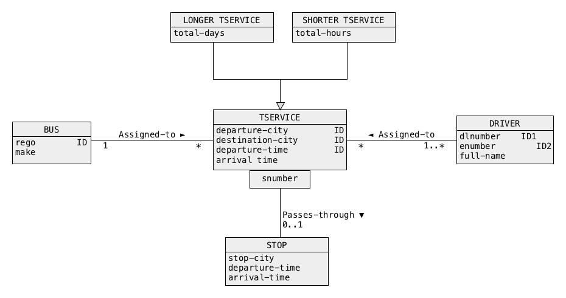
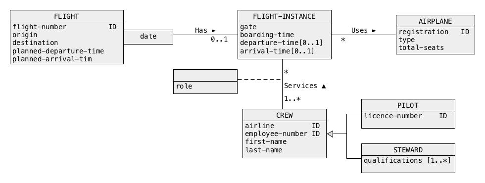
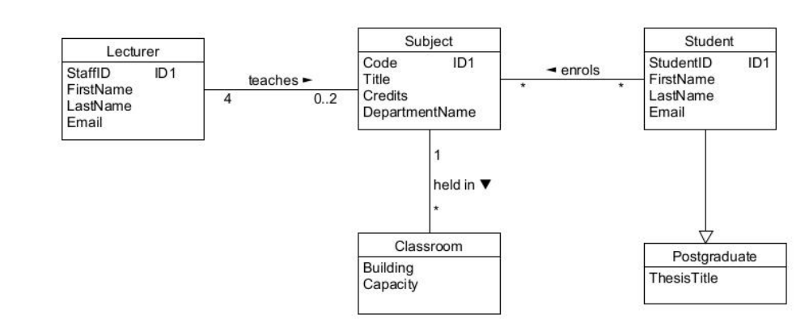
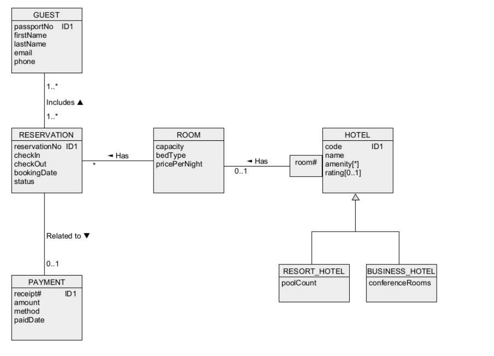

# CSIT882 · English questions

Questions from Mock Examinations 1–3 and Assignments 1–4 are kept in English. Supplementary tasks are clearly labelled. Public-edition sample identities, contact values and password literals are anonymized consistently. Mock 3 repeats the received Mock 1.

## Shared schemas and data

### Transport

```sql
CREATE TABLE EMPLOYEE (
    ENUM DECIMAL(12) NOT NULL,
    FNAME VARCHAR(50) NOT NULL,
    LNAME VARCHAR(50) NOT NULL,
    DOB DATE NULL,
    CONSTRAINT EMPLOYEE_PKEY PRIMARY KEY (ENUM)
);

CREATE TABLE DRIVER (
    ENUM DECIMAL(12) NOT NULL,
    LNUM DECIMAL(8) NOT NULL,
    STATUS VARCHAR(10) NOT NULL,
    CONSTRAINT DRIVER_PKEY PRIMARY KEY (ENUM),
    CONSTRAINT DRIVER_UNIQUE UNIQUE (LNUM),
    CONSTRAINT DRIVER_FKEY FOREIGN KEY (ENUM)
        REFERENCES EMPLOYEE (ENUM),
    CONSTRAINT DRIVER_STATUS CHECK (
        STATUS IN ('AVAILABLE', 'BUSY', 'ON LEAVE')
    )
);

CREATE TABLE TRUCK (
    REGNUM VARCHAR(10) NOT NULL,
    CAPACITY DECIMAL(7) NOT NULL,
    WEIGHT DECIMAL(7) NOT NULL,
    STATUS VARCHAR(10) NOT NULL,
    CONSTRAINT TRUCK_PKEY PRIMARY KEY (REGNUM),
    CONSTRAINT TRUCK_STATUS CHECK (
        STATUS IN ('AVAILABLE', 'USED', 'MAINTAINED')
    ),
    CONSTRAINT TRUCK_WEIGHT CHECK (WEIGHT > 0.0 AND WEIGHT < 500),
    CONSTRAINT TRUCK_CAPACITY CHECK (CAPACITY > 0.0 AND CAPACITY < 100)
);

CREATE TABLE TRIP (
    TNUM DECIMAL(10) NOT NULL,
    LNUM DECIMAL(8) NOT NULL,
    REGNUM VARCHAR(10) NOT NULL,
    TDATE DATE NOT NULL,
    CONSTRAINT TRIP_PKEY PRIMARY KEY (TNUM),
    CONSTRAINT TRIP_CKEY UNIQUE (LNUM, REGNUM, TDATE),
    CONSTRAINT TRIP_FKEY1 FOREIGN KEY (LNUM)
        REFERENCES DRIVER (LNUM),
    CONSTRAINT TRIP_FKEY2 FOREIGN KEY (REGNUM)
        REFERENCES TRUCK (REGNUM)
);

CREATE TABLE TRIPLEG (
    TNUM DECIMAL(10) NOT NULL,
    LEGNUM DECIMAL(2) NOT NULL,
    DEPARTURE VARCHAR(30) NOT NULL,
    DESTINATION VARCHAR(30) NOT NULL,
    CONSTRAINT TRIPLEG_PKEY PRIMARY KEY (TNUM, LEGNUM),
    CONSTRAINT TRIPLEG_UNIQUE UNIQUE (TNUM, DEPARTURE, DESTINATION),
    CONSTRAINT TRIPLEG_FKEY1 FOREIGN KEY (TNUM)
        REFERENCES TRIP (TNUM)
);
```

### Bank

```sql
CREATE TABLE BANK(
 bank_name     VARCHAR(50)  NOT NULL,  /* Bank name                                    */
 hq_country    VARCHAR(30)  NOT NULL,  /* Country part of headquarters address         */
 hq_city       VARCHAR(30)  NOT NULL,  /* City part of headquarters address            */
 hq_street     VARCHAR(30)  NOT NULL,  /* Street part of headquarters address          */
 hq_bldg_num   DECIMAL(4)   NOT NULL,  /* Building number part of headquarters address */
 web_site      VARCHAR(200) NOT NULL,  /* Link to Web site                             */
 email         VARCHAR(100) NOT NULL,  /* Email address                                */
 bank_type     VARCHAR(30)      NULL,  /* Bank type                                    */
  CONSTRAINT BANK_PK PRIMARY KEY (bank_name),
  CONSTRAINT BANK_CK1 UNIQUE (hq_country, hq_city, hq_street, hq_bldg_num),
  CONSTRAINT BANK_CK2 UNIQUE (web_site),
  CONSTRAINT BANK_CK3 UNIQUE (email),
  CONSTRAINT BANK_CHECK CHECK (bank_type IN ('investment', 'commercial', 'central', 'agriculture', 'construction', 'industrial') ) );
CREATE TABLE BRANCH(
  bank_name     VARCHAR(50)  NOT NULL, /* Bank name                                   */
  br_name       VARCHAR(50)  NOT NULL, /* Branch name                                 */
  br_country    VARCHAR(30)  NOT NULL, /* Country part of branch address              */
  br_city       VARCHAR(30)  NOT NULL, /* City part of branch address                 */
  br_street     VARCHAR(30)  NOT NULL, /* Street part of branch address               */
  br_bldg_num   DECIMAL(4)   NOT NULL, /* Building number part of branch address      */
  total_emps    DECIMAL(3)        NULL, /* Total number of employees at a branch      */
   CONSTRAINT BRANCH_PK PRIMARY KEY (bank_name, br_name, br_country, br_city),
   CONSTRAINT BRANCH_CK1 UNIQUE (br_country, br_city, br_street, br_bldg_num),
   CONSTRAINT BRANCH_FK1 FOREIGN KEY (bank_name) REFERENCES BANK(bank_name) );
CREATE TABLE EMPLOYEE(
  emp_num       DECIMAL(7)   NOT NULL,  /* Employee number                            */
  first_name    VARCHAR(20)      NULL, /* Employee first name                         */
  last_name     VARCHAR(20)  NOT NULL, /* Employee last name                          */
  date_of_birth DATE         NOT NULL, /* Date of birth                               */
  position      VARCHAR(100) NOT NULL, /* Position occupied                           */
  bank_name     VARCHAR(50)  NOT NULL, /* Bank name                                   */
  br_name       VARCHAR(50)      NULL, /* Branch name                                 */
  br_country    VARCHAR(30)      NULL, /* Country location of a branch                */
  br_city       VARCHAR(30)      NULL, /* City location of a branch                   */
   CONSTRAINT EMPLOYEE_PK PRIMARY KEY (bank_name, emp_num),
   CONSTRAINT EMPLOYEE_FK1 FOREIGN KEY (bank_name, br_name, br_country, br_city)
                           REFERENCES BRANCH(bank_name, br_name, br_country, br_city) );
CREATE TABLE ACCOUNT(
 account_num   DECIMAL(10)  NOT NULL,   /* Account number                             */
 bank_name     VARCHAR(50)  NOT NULL,   /* Bank name                                  */
 balance       DECIMAL(9,2) NOT NULL,   /* Account balance                            */
 account_type  VARCHAR(8)   NOT NULL,   /* Account type: savings, checking, loan      */
  CONSTRAINT ACCOUNT_PK PRIMARY KEY (account_num, bank_name),
  CONSTRAINT ACCOUNT_FK1 FOREIGN KEY (bank_name) REFERENCES BANK(bank_name),
  CONSTRAINT ACCOUNT_CHK1 CHECK( balance >= 0 ),
  CONSTRAINT ACCOUNT_CHK2 CHECK( account_type IN ('savings','checking','loan') ) );
CREATE TABLE TRANSACTION(
 acc_num       DECIMAL(10)  NOT NULL,  /* Account number                             */
 bank_name     VARCHAR(50)  NOT NULL,  /* Bank name                                  */
 tr_date_time  DATETIME     NOT NULL,  /* Transaction date                           */
 amount        DECIMAL(7,2) NOT NULL,  /* Amount involved                            */
 type          VARCHAR(10)  NOT NULL,  /* Transaction type                           */
  CONSTRAINT TRANSACTION_PK PRIMARY KEY(acc_num, bank_name, tr_date_time),
  CONSTRAINT TRANSACTION_FK2 FOREIGN KEY(acc_num, bank_name) 
                             REFERENCES ACCOUNT(account_num, bank_name),
  CONSTRAINT TRANSACTION_CHK1 CHECK( amount >= 0 ),
  CONSTRAINT TRANSACTION_CHK2 CHECK( type IN ('deposit', 'withdrawal' ) ) );
```

### Professional training workshops

```sql
/* ~~~~~~~~~~~~~~~~~~~~~~~~~~~~~~~~~~~~~~~~~~~~~~~~~~~~~~~~~~~~~~~~~~~~ */
/* Professional Training Workshops - Create database                  */
/* ~~~~~~~~~~~~~~~~~~~~~~~~~~~~~~~~~~~~~~~~~~~~~~~~~~~~~~~~~~~~~~~~~~~~ */

CREATE TABLE Participant (
    participantNo DECIMAL(6)   NOT NULL,
    fname         VARCHAR(20)  NOT NULL,
    lname         VARCHAR(30)  NOT NULL,
    city          VARCHAR(30)  NOT NULL,
    state         VARCHAR(20)  NOT NULL,
    phone         VARCHAR(15)  NOT NULL,
    email         VARCHAR(80),
    CONSTRAINT Participant_pkey PRIMARY KEY (participantNo)
);

CREATE TABLE Qualification (
    participantNo DECIMAL(6)   NOT NULL,
    qname         VARCHAR(50)  NOT NULL,
    qlevel        DECIMAL(1)   NOT NULL,
    awardYear     DECIMAL(4),
    CONSTRAINT Qualification_pkey PRIMARY KEY (participantNo, qname),
    CONSTRAINT Qualification_fkey1 FOREIGN KEY (participantNo)
        REFERENCES Participant (participantNo)
);

CREATE TABLE Workshop (
    workshopNo DECIMAL(6)    NOT NULL,
    title      VARCHAR(100)  NOT NULL,
    category   VARCHAR(30)   NOT NULL,
    `date`     DATE          NOT NULL,
    fee        DECIMAL(5,2)  NOT NULL,
    capacity   DECIMAL(4)    NOT NULL,
    CONSTRAINT Workshop_pkey PRIMARY KEY (workshopNo)
);

CREATE TABLE Requirement (
    workshopNo   DECIMAL(6)   NOT NULL,
    qname        VARCHAR(50)  NOT NULL,
    requiredLevel DECIMAL(1)  NOT NULL,
    mandatory    CHAR(1)      NOT NULL,
    CONSTRAINT Requirement_pkey PRIMARY KEY (workshopNo, qname),
    CONSTRAINT Requirement_fkey1 FOREIGN KEY (workshopNo)
        REFERENCES Workshop (workshopNo)
);

CREATE TABLE Trainer (
    trainerNo    DECIMAL(6)   NOT NULL,
    fname        VARCHAR(20)  NOT NULL,
    lname        VARCHAR(30)  NOT NULL,
    organisation VARCHAR(80),
    expertise    VARCHAR(60)  NOT NULL,
    CONSTRAINT Trainer_pkey PRIMARY KEY (trainerNo)
);

CREATE TABLE Enrolment (
    participantNo DECIMAL(6)   NOT NULL,
    workshopNo    DECIMAL(6)   NOT NULL,
    enroldate     DATE         NOT NULL,
    status        VARCHAR(15)  NOT NULL,
    CONSTRAINT Enrolment_pkey PRIMARY KEY (participantNo, workshopNo),
    CONSTRAINT Enrolment_fkey1 FOREIGN KEY (participantNo)
        REFERENCES Participant (participantNo),
    CONSTRAINT Enrolment_fkey2 FOREIGN KEY (workshopNo)
        REFERENCES Workshop (workshopNo)
);

CREATE TABLE WorkshopTrainer (
    workshopNo DECIMAL(6)    NOT NULL,
    trainerNo  DECIMAL(6)    NOT NULL,
    topic      VARCHAR(100)  NOT NULL,
    CONSTRAINT WorkshopTrainer_pkey PRIMARY KEY (workshopNo, trainerNo),
    CONSTRAINT WorkshopTrainer_fkey1 FOREIGN KEY (workshopNo)
        REFERENCES Workshop (workshopNo),
    CONSTRAINT WorkshopTrainer_fkey2 FOREIGN KEY (trainerNo)
        REFERENCES Trainer (trainerNo)
);

COMMIT;
/* ~~~~~~~~~~~~~~~~~~~~~~~~~~~~~~~~~~~~~~~~~~~~~~~~~~~~~~~~~~~~~~~~~~~~ */
/* End of script                                                       */
/* ~~~~~~~~~~~~~~~~~~~~~~~~~~~~~~~~~~~~~~~~~~~~~~~~~~~~~~~~~~~~~~~~~~~~ */
```

Data:

```sql
/* ~~~~~~~~~~~~~~~~~~~~~~~~~~~~~~~~~~~~~~~~~~~~~~~~~~~~~~~~~~~~~~~~~~~~ */
/* Professional Training Workshops - Load database                    */
/* ~~~~~~~~~~~~~~~~~~~~~~~~~~~~~~~~~~~~~~~~~~~~~~~~~~~~~~~~~~~~~~~~~~~~ */

INSERT INTO Participant VALUES
(1, 'PARTICIPANT_01', 'SAMPLE', 'SYDNEY', 'NSW', 'PHONE_TOKEN_02', 'EMAIL_TOKEN_07'),
(2, 'PARTICIPANT_02', 'SAMPLE', 'WOLLONGONG', 'NSW', 'PHONE_TOKEN_03', 'EMAIL_TOKEN_10'),
(3, 'PARTICIPANT_03', 'SAMPLE', 'MELBOURNE', 'VIC', 'PHONE_TOKEN_04', 'EMAIL_TOKEN_14'),
(4, 'PARTICIPANT_04', 'SAMPLE', 'SYDNEY', 'NSW', 'PHONE_TOKEN_05', NULL),
(5, 'PARTICIPANT_05', 'SAMPLE', 'BRISBANE', 'QLD', 'PHONE_TOKEN_06', 'EMAIL_TOKEN_03'),
(6, 'PARTICIPANT_06', 'SAMPLE', 'ADELAIDE', 'SA', 'PHONE_TOKEN_07', 'EMAIL_TOKEN_08'),
(7, 'PARTICIPANT_07', 'SAMPLE', 'SYDNEY', 'NSW', 'PHONE_TOKEN_08', 'EMAIL_TOKEN_11'),
(8, 'PARTICIPANT_08', 'SAMPLE', 'PERTH', 'WA', 'PHONE_TOKEN_09', NULL),
(9, 'PARTICIPANT_09', 'SAMPLE', 'CANBERRA', 'ACT', 'PHONE_TOKEN_10', 'EMAIL_TOKEN_15'),
(10, 'PARTICIPANT_10', 'SAMPLE', 'NEWCASTLE', 'NSW', 'PHONE_TOKEN_11', 'EMAIL_TOKEN_09'),
(11, 'PARTICIPANT_11', 'SAMPLE', 'HOBART', 'TAS', 'PHONE_TOKEN_12', 'EMAIL_TOKEN_04'),
(12, 'PARTICIPANT_12', 'SAMPLE', 'DARWIN', 'NT', 'PHONE_TOKEN_13', NULL);

INSERT INTO Qualification VALUES
(1, 'PYTHON PROGRAMMING', 5, 2025),
(1, 'DATA ANALYSIS', 4, 2025),
(2, 'PYTHON PROGRAMMING', 3, 2024),
(2, 'EXCEL', 4, 2023),
(2, 'PRESENTATION SKILLS', 2, NULL),
(3, 'PROJECT MANAGEMENT', 4, 2024),
(3, 'COMMUNICATION', 3, NULL),
(4, 'CYBERSECURITY', 5, 2025),
(5, 'DIGITAL MARKETING', 4, 2024),
(5, 'COMMUNICATION', 3, 2023),
(6, 'PROJECT MANAGEMENT', 5, 2025),
(6, 'EXCEL', 4, 2024),
(7, 'UX DESIGN', 5, 2025),
(7, 'PYTHON PROGRAMMING', 4, 2024),
(7, 'CLOUD COMPUTING', 3, NULL),
(7, 'DATA ANALYSIS', 4, 2025),
(8, 'CLOUD COMPUTING', 2, NULL),
(9, 'CYBERSECURITY', 4, 2025),
(9, 'DIGITAL MARKETING', 3, 2024),
(10, 'EXCEL', 5, 2025),
(10, 'PROJECT MANAGEMENT', 3, 2024),
(12, 'PYTHON PROGRAMMING', 2, NULL);

INSERT INTO Workshop VALUES
(1, 'PYTHON FOR DATA ANALYSIS', 'TECHNOLOGY', STR_TO_DATE('14-MAR-2026','%d-%M-%Y'), 180.00, 40),
(2, 'CYBERSECURITY ESSENTIALS', 'TECHNOLOGY', STR_TO_DATE('28-MAR-2026','%d-%M-%Y'), 220.00, 35),
(3, 'PROJECT MANAGEMENT BASICS', 'BUSINESS', STR_TO_DATE('11-APR-2026','%d-%M-%Y'), 160.00, 50),
(4, 'DIGITAL MARKETING STRATEGY', 'BUSINESS', STR_TO_DATE('25-APR-2026','%d-%M-%Y'), 140.00, 45),
(5, 'UX DESIGN FUNDAMENTALS', 'DESIGN', STR_TO_DATE('09-MAY-2026','%d-%M-%Y'), 190.00, 30),
(6, 'PUBLIC SPEAKING', 'COMMUNICATION', STR_TO_DATE('23-MAY-2026','%d-%M-%Y'), 90.00, 60),
(7, 'CLOUD COMPUTING FOUNDATIONS', 'TECHNOLOGY', STR_TO_DATE('06-JUN-2026','%d-%M-%Y'), 250.00, 35),
(8, 'EXCEL FOR BUSINESS', 'BUSINESS', STR_TO_DATE('20-JUN-2026','%d-%M-%Y'), 120.00, 50);

INSERT INTO Requirement VALUES
(1, 'PYTHON PROGRAMMING', 3, 'Y'),
(1, 'DATA ANALYSIS', 2, 'Y'),
(2, 'CYBERSECURITY', 4, 'Y'),
(2, 'NETWORKING', 2, 'N'),
(3, 'PROJECT MANAGEMENT', 3, 'Y'),
(3, 'COMMUNICATION', 2, 'N'),
(4, 'DIGITAL MARKETING', 3, 'Y'),
(5, 'UX DESIGN', 4, 'Y'),
(7, 'CLOUD COMPUTING', 3, 'Y'),
(7, 'PYTHON PROGRAMMING', 2, 'N'),
(8, 'EXCEL', 3, 'Y');

INSERT INTO Trainer VALUES
(1, 'TRAINER_01', 'SAMPLE', 'UOW', 'DATA ANALYTICS'),
(2, 'TRAINER_02', 'SAMPLE', 'CYBERSAFE AU', 'CYBERSECURITY'),
(3, 'TRAINER_03', 'SAMPLE', 'UTS', 'PROJECT MANAGEMENT'),
(4, 'TRAINER_04', 'SAMPLE', 'CREATIVELAB', 'UX DESIGN'),
(5, 'TRAINER_05', 'SAMPLE', 'SPEAKWELL', 'COMMUNICATION'),
(6, 'TRAINER_06', 'SAMPLE', 'CLOUDWORKS', 'CLOUD COMPUTING'),
(7, 'TRAINER_07', 'SAMPLE', 'BUSINESSEDGE', 'BUSINESS STRATEGY'),
(8, 'TRAINER_08', 'SAMPLE', NULL, 'DATABASE SYSTEMS');

INSERT INTO Enrolment VALUES
(1, 1, STR_TO_DATE('20-FEB-2026','%d-%M-%Y'), 'COMPLETED'),
(1, 2, STR_TO_DATE('21-FEB-2026','%d-%M-%Y'), 'COMPLETED'),
(1, 3, STR_TO_DATE('01-MAR-2026','%d-%M-%Y'), 'COMPLETED'),
(2, 1, STR_TO_DATE('22-FEB-2026','%d-%M-%Y'), 'COMPLETED'),
(2, 6, STR_TO_DATE('03-MAY-2026','%d-%M-%Y'), 'COMPLETED'),
(3, 3, STR_TO_DATE('05-MAR-2026','%d-%M-%Y'), 'COMPLETED'),
(3, 5, STR_TO_DATE('10-APR-2026','%d-%M-%Y'), 'CANCELLED'),
(4, 2, STR_TO_DATE('01-MAR-2026','%d-%M-%Y'), 'COMPLETED'),
(4, 7, STR_TO_DATE('15-MAY-2026','%d-%M-%Y'), 'COMPLETED'),
(4, 8, STR_TO_DATE('25-MAY-2026','%d-%M-%Y'), 'COMPLETED'),
(5, 4, STR_TO_DATE('20-MAR-2026','%d-%M-%Y'), 'COMPLETED'),
(6, 3, STR_TO_DATE('18-MAR-2026','%d-%M-%Y'), 'COMPLETED'),
(6, 6, STR_TO_DATE('02-MAY-2026','%d-%M-%Y'), 'COMPLETED'),
(7, 1, STR_TO_DATE('25-FEB-2026','%d-%M-%Y'), 'COMPLETED'),
(7, 5, STR_TO_DATE('12-APR-2026','%d-%M-%Y'), 'COMPLETED'),
(7, 6, STR_TO_DATE('04-MAY-2026','%d-%M-%Y'), 'COMPLETED'),
(7, 7, STR_TO_DATE('18-MAY-2026','%d-%M-%Y'), 'COMPLETED'),
(8, 7, STR_TO_DATE('19-MAY-2026','%d-%M-%Y'), 'CANCELLED'),
(9, 2, STR_TO_DATE('03-MAR-2026','%d-%M-%Y'), 'COMPLETED'),
(9, 4, STR_TO_DATE('22-MAR-2026','%d-%M-%Y'), 'COMPLETED'),
(10, 3, STR_TO_DATE('16-MAR-2026','%d-%M-%Y'), 'COMPLETED'),
(10, 8, STR_TO_DATE('27-MAY-2026','%d-%M-%Y'), 'COMPLETED'),
(12, 1, STR_TO_DATE('28-FEB-2026','%d-%M-%Y'), 'COMPLETED');

INSERT INTO WorkshopTrainer VALUES
(1, 1, 'DATA ANALYSIS WITH PYTHON'),
(2, 2, 'CYBERSECURITY FUNDAMENTALS'),
(3, 3, 'PLANNING AND DELIVERY'),
(3, 7, 'BUSINESS CASE DEVELOPMENT'),
(4, 7, 'DIGITAL CAMPAIGN STRATEGY'),
(5, 4, 'USER EXPERIENCE DESIGN'),
(6, 5, 'PRESENTATION SKILLS'),
(7, 6, 'CLOUD ARCHITECTURE'),
(7, 1, 'CLOUD DATA ANALYTICS');

COMMIT;
/* ~~~~~~~~~~~~~~~~~~~~~~~~~~~~~~~~~~~~~~~~~~~~~~~~~~~~~~~~~~~~~~~~~~~~ */
/* End of script                                                       */
/* ~~~~~~~~~~~~~~~~~~~~~~~~~~~~~~~~~~~~~~~~~~~~~~~~~~~~~~~~~~~~~~~~~~~~ */
```

### Lecture example: DEPARTMENT and COURSE

```sql
CREATE TABLE DEPARTMENT (
    name VARCHAR(50) NOT NULL,
    code CHAR(5) NOT NULL,
    total_staff_number DECIMAL(2) NOT NULL,
    chair VARCHAR(50) NULL,
    budget DECIMAL(9,1) NULL,
    CONSTRAINT dept_pkey PRIMARY KEY (name),
    CONSTRAINT dept_ckey1 UNIQUE (code),
    CONSTRAINT dept_ckey2 UNIQUE (chair),
    CONSTRAINT dept_check1 CHECK (total_staff_number BETWEEN 1 AND 50)
);
CREATE TABLE COURSE (
    cnum CHAR(7) NOT NULL,
    title VARCHAR(200) NOT NULL,
    credits DECIMAL(2) NOT NULL,
    offered_by VARCHAR(50) NULL,
    CONSTRAINT course_pkey PRIMARY KEY (cnum),
    CONSTRAINT course_check1 CHECK (credits IN (6,12)),
    CONSTRAINT course_fkey1 FOREIGN KEY (offered_by)
        REFERENCES DEPARTMENT(name) ON DELETE CASCADE
);
```

Data:

```sql
-- Validation fixture, independently written; not lecture sample results.
INSERT INTO DEPARTMENT VALUES
('Physics','PHYS',10,'STAFF_20',1000.0),
('Mathematics','MATH',20,'STAFF_30',NULL),
('Biology','BIOL',5,NULL,500.0);
INSERT INTO COURSE VALUES
('PHYS101','Mechanics',6,'Physics'),
('PHYS201','Waves',12,'Physics'),
('MATH101','Calculus',6,'Mathematics'),
('MATH201','Algebra',6,'Mathematics'),
('GENE101','Unassigned',12,NULL);
```

### Lecture self-join: EMPLOYEE

```sql
CREATE TABLE EMPLOYEE (
    enum INT NOT NULL PRIMARY KEY,
    name VARCHAR(30) NOT NULL,
    manager INT NULL,
    FOREIGN KEY (manager) REFERENCES EMPLOYEE(enum)
);
```

Data:

```sql
INSERT INTO EMPLOYEE VALUES (10,'STAFF_10',NULL),(20,'STAFF_20',10),(30,'STAFF_30',10),
(40,'STAFF_40',20),(50,'STAFF_50',20),(60,'STAFF_60',50),(70,'STAFF_70',50);
```

## M1-Q1 · Mock Examination 1 — Question 1

Mock Examination 1 · Original material

User-provided Questions 1–6 and Question 2 image

Read and analyse the following specification of a sample database domain.

A University would like to create a database to record information about some of its activities. The university offers a number of degrees to students. A degree is described by a unique name, total number of credit points required to complete a degree, and several requirements that must be satisfied by the future students. The university offers three types of degrees: undergraduate degrees, postgraduate degrees, and graduate certificate. Postgraduate degrees are available only for the students who already got an undergraduate degree. A description of a postgraduate degree includes a list of acceptable undergraduate degrees. A description of a graduate certificate includes a requirement on the total number of years of professional experience.

Each degree consists of a collection of subjects. A description of a subject consists of its unique code, unique title, total number of credits points a subject is worth, and a list of subject learning objectives.

The university employs academic staff members, tutors and support staff members. A description of a university employee consists of a unique employee number, first name last name and date of birth. First name, last name and date of birth uniquely identified each employee. Additionally, academic staff members and tutors are described by an academic degree achieved. Support staff members are described by a list of qualifications acquired in the past together with a date when each qualification has been acquired.

The university assigns the academic staff members and tutors to the subjects. A subject has one or two academic members assigned and a number of tutors. An academic staff member and tutor can be assigned to many subjects. Support staff members are assigned to the degrees. Each support staff member is assigned to one degree and a degree has one or more support staff members assigned.

The university is divided into faculties and faculties are divided into schools. Academic staff members and tutors belong to one school and each school consists of many academic staff members and tutors. The faculties and schools are described by the unique names.

Draw a conceptual schema for the specification of a database domain listed above.

## M1-Q2 · Mock Examination 1 — Question 2

Mock Examination 1 · Original material

User-provided Questions 1–6 and Question 2 image

Consider a conceptual schema given below.



Your task is to perform a step of logical database design, i.e. to transform a conceptual schema given above into a collection of relational schemas.

For each relational schema clearly list the names of attributes, primary key, candidate keys (if any), and foreign keys (if any). Assume, that a superset method must be used to implement a generalization.

## M1-Q3 · Mock Examination 1 — Question 3

Mock Examination 1 · Original material

User-provided Questions 1–6 and Question 2 image

Schema / data: Transport

Write SELECT statements that implement the following queries.

(1) Find the registration numbers of trucks, that have capacity in a range between 100 inclusive and 500 inclusive.

(2) Find the first and the last names of all drivers who are on leave.

(3) Find the registration numbers of all trucks that have not been used for any trips.

(4) Find the registration numbers of all trucks together with total number of trips the trucks have been used for. There is no need to include the truck that have not been used for any trips.

(5) Find the names of all departure cities together with the names of all destination cities.

## M1-Q4 · Mock Examination 1 — Question 4

Mock Examination 1 · Original material

User-provided Questions 1–6 and Question 2 image

Schema / data: Transport

Write SQL statements that implement the following structural modifications of a database and data manipulations on the contents of a database. Note, that implementation of some of the tasks listed below may need more than one SQL statement.

(1) We would like to add to a database information about the skills possessed by each driver. Assume, that a driver has many skills and a skill can be possessed by many drivers. It may happen that some skills are not possessed by any driver. The types of the new columns are up to you.

(2) Delete from a database information about the second and third leg of a trip 36.

(3) Change a date of trip number 26 to the next day after the present date of trip 26.

(4) Assume that a trip number 25 has 3 legs. A trip number 25 started in Sydney and it ended in Perth. Add one more leg to a trip 25 such that after update the trip ends in the same city it started from.

(5) Assume that a trip 20 has 2 legs and that a destination of the first leg is Sydney. Update information about a trip 20 such that after update a destination of the first leg is Perth.

## M1-Q5 · Mock Examination 1 — Question 5

Mock Examination 1 · Original material

User-provided Questions 1–6 and Question 2 image Public edition: example names, contact details and password literals anonymized.

Schema / data: Transport

Assume that a user root with a password '[ROOT_OR_USER_PASSWORD]' created a database called transport and the user executed CREATE TABLE statements given on page 2 of the examination paper to create the relational tables in the database transport.

Write the implementations of the operations listed below as a user root. Assume that a user root has already connected to the database. Note, that implementation of some operations may need more than one SQL statement.

(1) A user root nominates a database transport as a default database and then the user creates two new users USER_A and USER_B.

(2) A user root grants the read access rights to the relational tables EMPLOYEE and DRIVER to a user USER_A. The read access rights cannot be propagated to other roles or users.

(3) A user root grants the rights to insert the rows into a relational tables TRIP and TRIPLEG to a user USER_B. The access rights can be propagated to other roles or users.

(4) A user root grants the update privilege on all relational tables in csit115 database to a user USER_A. The privilege cannot be propagated to other roles or users.

(5) A user root grants the rights to information about the total number trips performed by each driver to a user USER_B.

## M1-Q6 · Mock Examination 1 — Question 6

Mock Examination 1 · Original material

User-provided Questions 1–6 and Question 2 image

Schema / data: Transport

Assume, that we would like to verify the following logical consistency constraint imposed on the contents of a sample database.

"A truck cannot be used for more that 100 trips"

Write SQL statements that perform the following actions.

(1) First, create a relational table MESSAGE with information about the contents of a sample database that violate the following consistency constraint listed above. A relational table MESSAGE must consist of two columns. The first column contains truck registration numbers and the second column contains the total number of trips for all trucks that have been used for more than 100 trips.

(2) Next, list the contents of a relational table MESSAGE in the following way.

Truck <insert ruck registration number here> has been used for <insert total number of trips here> trips.

For example, if a truck with registration number PKR856 has been used 120 times then the following line must be listed.

Truck PKR856 has been used for 120 trips.

(3) Next, make the contents of a relational table MESSAGE permanent.

(4) Finally, drop a relational table MESSAGE.

## M2-Q1 · Mock Examination 2 — Question 1

Mock Examination 2 · Original material

User-provided Questions 1–6; Q3–Q5 text attachments

Read and analyse the following specification of a sample database domain.

A description of a hospital consists of a unique hospital name, address of a main building including city, street, and building number, phone and fax numbers, and email address. The phone number, fax number, and email address can also be used for the identification purposes. A hospital consists of a number of buildings. A building number is a local identifier of a building. Some of the buildings have the names, which are unique within a hospital.

A hospital consists of wards and wards consist of decks. Each ward has a unique name and is located in one building. A ward may occupy several levels of a building. A deck is identified by a number unique within a ward and it is located at one level of a building. The database should contain the complete information about the locations of buildings and decks.

A hospital employs the doctors, nurses, administration and maintenance staff members. The employees are described by an employee number unique within a hospital, first name, last name, date of birth and salary. The doctors are additional described by a status and specialization. The nurses are also described by a category. Administration and maintenance staff members are described by a position occupied. The doctors are assigned to the wards and the nurses are assigned to the decks. Additionally, a hospital contracts a number of consultants. The consultants are not assigned to the wards and are employed by a hospital for a limited time only. The consultants are described by first and last name, specialization, phone number, and amount of charge per hour, start and end of contract with a hospital. The consultants can be employed by more than one hospital at a time.

A hospital admits the patients for the treatments. A patient is described by medical insurance company name and insurance policy number. Date and time are recorded on admittance to a hospital. A patient may be admitted to and discharged from a hospital many times. On arrival to a hospital a patient passes through entry physical examinations, which consists of a number of tests. The database should contain information about the names of tests applied and the results of the tests conducted just after arrival to a hospital. When, an illness a patient suffers from is identified he/she is located at a ward and at a deck of a ward.

Design a conceptual schema for the database domain described above. Use a notation of simplified UML object class diagrams explained during the lecture classes and applied for conceptual modelling in the assignments and class test. Remember to determine the multiplicities of associations, identifiers of classes of objects, multivalued, optional and derived attributes (if any).

There is NO NEED to provide a detailed analysis how a conceptual schema has been created. The final conceptual schema expressed in a notation of UML simplified classes is completely sufficient.

It is not allowed to use any artificial identifiers and any attributes that are not mentioned in a specification above.

## M2-Q2 · Mock Examination 2 — Question 2

Mock Examination 2 · Original material

User-provided Questions 1–6; Q3–Q5 text attachments

Consider a conceptual schema given below.



Your task is to perform a step of logical database design, i.e. to transform a conceptual schema given above into a collection of relational schemas. For each relational schema clearly list the names of attributes, primary key, candidate keys (if any), and foreign keys (if any). Assume, that a superset method must be used to implement a generalization.

## M2-Q3 · Mock Examination 2 — Question 3

Mock Examination 2 · Original material

User-provided Questions 1–6; Q3–Q5 text attachments

Schema / data: Bank

This question is related to a sample database created through processing of the common CREATE TABLE statements above.

Write SELECT statements that implement the following queries. You can use any implementation technique for your SELECT statements.

(1) For each bank find the total number of branches owned by a bank. List a bank name and the total number of branches owned by a bank. Assume that some banks do not have any branches yet. In all such cases the total number of branches must be listed as zero (0).

(2) For all accounts that have no bank transactions in 2021, find the account numbers and balance on each account. List an account number and balance on each account.

(3) Find the names and emails of all banks, that have at least one branch with unknow total number of employees at a branch.

Write SQL statements that implement the following structural modifications of a database and data manipulations on the contents of a database. Note, that implementation of some of the tasks listed below may need more than one SQL statement. You are not allowed to drop and/or suspend any referential integrity constraints in your implementations

(4) We would like to add to a database information about the total number of bank transactions performed on each bank account. Modify the structures of a sample database in the best possible way. Insert appropriate information into the new structures of a sample database.

(5) Delete from a database information about all bank transactions submitted in a year 2019. Note, that you are not allowed to drop and/or suspend any referential integrity constraints in your implementation.

## M2-Q4 · Mock Examination 2 — Question 4

Mock Examination 2 · Original material

User-provided Questions 1–6; Q3–Q5 text attachments

Schema / data: Bank

This question is related to a sample database created through processing of the common CREATE TABLE statements above.

An objective of this question is to explain how to implement a simple method of auditing the database activities.

Assume, that a database administrator would like to audit the data manipulation statements (INSERT, UPDATE, DELETE) processed by a selected group of users on a selected group of relational tables. Write SQL statements and in the comments provide the comprehensive explanation of a role of SQL statement plays in the implementation of a simple database auditing system.

## M2-Q5 · Mock Examination 2 — Question 5

Mock Examination 2 · Original material

User-provided Questions 1–6; Q3–Q5 text attachments Public edition: example names, contact details and password literals anonymized.

Schema / data: Bank

This question is related to a sample database created through processing of the common CREATE TABLE statements above.

Assume that CREATE TABLE statements listed above are included in SQL script dbcreate.sql. The script is located at a folder $HOME/bank/sql. Write the implementations of the operations listed below as a user root. Assume that a user root has already connected to the database. Assume, that user root has access to SQL script dbcreate.sql. Note, that implementation of some operations may need more than one SQL statement.

(1) A user root with a password '[ROOT_OR_USER_PASSWORD]' would like to create a database called banks and nominate the database as its default database.

(2) A user root would like to create within a database banks, the relational tables given on page 3 of the examination paper.

(3) Then, a user root would like to create a new user account called admin with a password '[ROOT_OR_USER_PASSWORD]'.

(4) A user admin must have the rights to execute CREATE TABLE and CREATE VIEW statements with the rights to propagate the privilege to the other users.

(5) A user admin must have the rights to read information about all bank transactions submitted in 2021 with no rights to propagate the privilege to the other users.

## M2-Q6 · Mock Examination 2 — Question 6

Mock Examination 2 · Original material

User-provided Questions 1–6; Q3–Q5 text attachments

Schema / data: Bank

This question is related to a sample database created through processing of the common CREATE TABLE statements above.

(1) Consider a bank that has a name NAB. Assume, that at the moment, the balance on account number 1 is equal to 100. Assume, that at the moment, the balance on account number 2 is equal to 200.

Assume, that concurrently processed database transactions T1 and T2 interleaved their operations in a way listed below.

```text
T1                                           T2
SET TRANSACTION ISOLATION LEVEL SERIALIZABLE;
                                             SET TRANSACTION ISOLATION LEVEL SERIALIZABLE;
UPDATE ACCOUNT
SET balance = balance + 10
WHERE account_num = 1 AND
      bank_name = 'NAB';
                                             UPDATE ACCOUNT
                                             SET balance = balance + 20
                                             WHERE account_num = 1 AND
                                                   bank_name = 'NAB';

UPDATE ACCOUNT
SET balance = (SELECT balance + 10
               FROM ACCOUNT
               WHERE account_num = 1 AND
                     bank_name = 'NAB')
WHERE account_num = 1 AND
      bank_name = 'NAB';

COMMIT;
                                             COMMIT;
```

(1) Explain how the values of an attribute balance in the rows where account_num = 1 and account_num = 2 in NAB bank change after each UPDATE statement.

(2) Consider a bank that has a name NAB. Assume, that at the moment, the balance on account number 1 is equal to 100. Assume, that at the moment, the balance on account number 2 is equal to 200.

Assume, that concurrently processed database transactions T1 and T2 interleaved their operations in a way listed below.

```text
T1                                              T2
SET TRANSACTION ISOLATION LEVEL READ COMMITTED;
                                                SET TRANSACTION ISOLATION LEVEL READ UNCOMMITTED;
UPDATE ACCOUNT
SET balance = balance + 10
WHERE account_num = 1 AND
      bank_name = 'NAB';
                                                UPDATE ACCOUNT
                                                SET balance = balance + 20
                                                WHERE account_num = 2 AND
                                                      bank_name = 'NAB';
                                                COMMIT;
UPDATE ACCOUNT
SET balance = (SELECT balance + 10
               FROM ACCOUNT
               WHERE account_num = 2 AND
                     bank_name = 'NAB')
WHERE account_num = 1 AND
      bank_name = 'NAB';
COMMIT;
```

Explain how the values of an attribute balance in the rows where account_num = 1 and account_num = 2 change after processing of each UPDATE statement.

Answer text Question 6

## M3-Q1 · Mock Examination 3 — Question 1

Mock Examination 3 · Duplicate source

Received Q1–Q6 duplicate Mock Examination 1

This question is identical to [Mock Examination 1, Question 1](#m1-q1). The original wording and diagram are provided there.

Duplicate of M1-Q1.

## M3-Q2 · Mock Examination 3 — Question 2

Mock Examination 3 · Duplicate source

Received Q1–Q6 duplicate Mock Examination 1

This question is identical to [Mock Examination 1, Question 2](#m1-q2). The original wording and diagram are provided there.

Duplicate of M1-Q2.

## M3-Q3 · Mock Examination 3 — Question 3

Mock Examination 3 · Duplicate source

Received Q1–Q6 duplicate Mock Examination 1

This question is identical to [Mock Examination 1, Question 3](#m1-q3). The original wording and diagram are provided there.

Duplicate of M1-Q3.

## M3-Q4 · Mock Examination 3 — Question 4

Mock Examination 3 · Duplicate source

Received Q1–Q6 duplicate Mock Examination 1

This question is identical to [Mock Examination 1, Question 4](#m1-q4). The original wording and diagram are provided there.

Duplicate of M1-Q4.

## M3-Q5 · Mock Examination 3 — Question 5

Mock Examination 3 · Duplicate source

Received Q1–Q6 duplicate Mock Examination 1

This question is identical to [Mock Examination 1, Question 5](#m1-q5). The original wording and diagram are provided there.

Duplicate of M1-Q5.

## M3-Q6 · Mock Examination 3 — Question 6

Mock Examination 3 · Duplicate source

Received Q1–Q6 duplicate Mock Examination 1

This question is identical to [Mock Examination 1, Question 6](#m1-q6). The original wording and diagram are provided there.

Duplicate of M1-Q6.

## A1-T1 · Assignment 1 — Task 1

Assignment 1 · Original material

Assignment1.pdf pp3–4

Consider a local library that wants to maintain information about its books and authors. The  following business rules apply: 
• Each Book has ISBN, Title, Edition, and Publication Year. ISBN uniquely identifies a  book. 
• Each Author has AuthorID, FirstName, and LastName. AuthorID uniquely identifies an  author. 
• A book is written by one or more authors. 
• An author may write zero or more books. 
• The library may own multiple copies of the same book. 
• Each Copy has CopyID, and Status (e.g., Available or On Loan). CopyID uniquely  identifies a copy.  
• Each Copy represents exactly one Book. 
• Each Member has MemberID, FirstName, LastName, and Email. MemberID uniquely  identifies a member. 
• A Member may borrow zero or more Copies. A Copy may be borrowed by at most one  Member at a time.  Using the CSIT115 Palette in UMLet, create a conceptual schema that satisfies the requirements  above. Your diagram must include all required entities with their specified attributes and correct  multiplicity (cardinality).  Finally, add one meaningful attribute to one of the classes that is not listed above. The attribute  should be appropriate for the scenario and the custom attribute you create must end with your  Student ID (e.g., `Genre_1234567`).

## A1-T2 · Assignment 1 — Task 2

Assignment 1 · Original material

Assignment1.pdf pp3–4

The university has the following business rules. 
 
1. Each lecturer has a Staff ID, First Name, Last Name and Email.  
2. Each student has a Student ID, First Name, Last Name and Email and every student is either  an Undergraduate student or a Postgraduate student. An undergraduate student has an  additional attribute GPA and a postgraduate student has an additional attribute Thesis Title. 
3. Each subject has a Code, Title and Credits.  
4. Each subject is offered by one department with an attribute Name. 
5. Each classroom has a Room Number, Building and Capacity.  
6. A lecturer may teach up to four subjects in a semester.  
7. Each subject must be taught by at most two lecturers and is held in one classroom. 
8. A student may enrol in zero or more subjects.  
9. A classroom may be used for zero or more subjects.    Correct the conceptual schema by fixing all errors in entity representation, inheritance notation,  and multiplicities so that it accurately represents the business rules above.



## A2-T1 · Assignment 2 — Task 1

Assignment 2 · Original material

Assignment2.pdf pp2–3; accompanying Assignment2_Solution.pdf

Given the conceptual schema below, perform logical database design by transforming it  into a collection of relational schemas. 

(1) Identify each feature of the conceptual schema that requires a transformation and state  the transformation applied to that feature. 

(2) For each relational schema created , clearly list the names of attributes, primary keys ,  candidate keys (if any), and foreign keys (if any). Assume that the superset  method must be used to implement a generalization (if any). A way how a conceptual  schema can be transformed into a collection of relational schemas is explained in a  presentation 06 Logical Design.      The relational schemas must be listed in a format presented in slides 42 and 43 in  presentation 06 Logical Design. Listing of the relational schemas in the other format scores  no marks.   

Note that the order of the definitions on the relation schemas is important. You must  define a parent relation schema (referenced) before its  child relational schema  (references to the parent relational schema).



## A2-T2 · Assignment 2 — Task 2

Assignment 2 · Original material

Assignment2.pdf pp2–3; accompanying Assignment2_Solution.pdf

This question builds upon the relational schemas you designed in Task 1.  Write SQL  statements to answer the following queries. Since the parts  are interconnected, you must  complete them in sequential order from (1) to (5).  

(1) Create empty relational tables to implement the relational schemas you designed in  Task 1 for the hotel reservation database. The names of the relational tables and  columns must be consistent with your logical design. Use reasonable column types  and sizes (lengths). Enforce all appropriate primary key and referential integrity  constraints.  Note that the order of CREATE TABLE statements is important. Create the  parent table (referenced) before its child table (references to the parent table).  

(2) Next, assume that a new business rule is introduced requiring that no two guests  have the same email address. Add an appropriate constraint after the table has  already been created. 

(3) Next, insert sufficient sample data into the tables to represent at least two hotels,  two rooms for each hotel, two guests, and two reservations. Insert appropriate data  into the other tables resulting from your logical design where required.  The data values are up to you, but they must satisfy all primary key and referential  integrity constraints defined in part (1) and (2).    Note that the order of INSERT statements is important. Insert data into the  parent table (referenced) before inserting data into its child table (references to  the parent table).  

(4) Increase the pricePerNight of all rooms belonging to one of the hotels inserted  in part (3) by 10%. The choice of hotel is up to you. 

(5) Finally, delete one of the hotels inserted in part ( 3) and all records that must be  removed beforehand to satisfy the referential integrity constraints. Do not delete the  other hotel or its related information, and do not drop any table.    Note that the order of delete statements is important. Delete data from the child table  (references to the parent table) before deleting data from its parent table (referenced).

## A3-T1 · Assignment 3 — Task 1

Assignment 3 · Original material

Assignment3.pdf pp3–4,6,8; original dbcreate.sql and dbload.sql

Schema / data: Professional training workshops

Note that you may need more than one SQL statement to implement a single subtask  listed below.    Your implementation must directly follow a comment with the specifications of a  subtask.  Implement SQL DDL (Data Definition Language) statements for questions (1) and (2)  below. 

(1)  Modify the structure and consistency constraint of the sample database such that the  fee of each workshop must be a positive value not larger than 9999.99. 

(2)  Modify the structure and consistency constraints of the sample database such that a  qualification level possessed by a participant and a qualification level required by a  workshop must be positive values no more than 10.  Implement SQL DML (Data Manipulation Language) statements for questions (3), (4)  and (5) below.  Note that you are not allowed to modify and/or drop any consistency constraints. We  assume that safe update has been disabled so that SQL can execute DML statements  anywhere. 

(3)  Add a new workshop (workshopNo=9) to the sample database. The values of the  new Workshop columns are up to you. Add two qualification requirements for the new  workshop. The qualification names, required levels and mandatory values are up to you. 

(4)  Modify the qualification levels possessed by participant (participantNo=3) such  that all qualification levels possessed by the participant increase by 1. 

(5)  Remove participant (participantNo=10) and all information related to this  participant from the sample database.

## A3-T2 · Assignment 3 — Task 2

Assignment 3 · Original material

Assignment3.pdf pp3–4,6,8; original dbcreate.sql and dbload.sql

Schema / data: Professional training workshops

(1)  Find the workshop number, title, category and fee of all workshops whose fees are  between 150.00 and 220.00. 

(2)  Find the participant number and full name of all participants who live in Sydney. 

(3)  Find the participant number for all participants who possess more than 3  qualifications. 

(4)  Display the workshop number, title, fee and category of all workshops in ascending  order of category, then in descending order of fee. 

(5)  Find the average fee of workshops in the TECHNOLOGY category.

## A3-T3 · Assignment 3 — Task 3

Assignment 3 · Original material

Assignment3.pdf pp3–4,6,8; original dbcreate.sql and dbload.sql

Schema / data: Professional training workshops

You must implement SQL statements for the questions below by using JOIN / OUTER  JOIN.    Your implementation must directly follow a comment with a specification of a subtask. 

(1)  Find the full name and phone number of all participants who possess more than 2  qualifications and display the results in ascending order of last name and first name. 

(2)  Find the workshop number, title and category of all workshops that have no  qualification requirements. 

(3)  Find the participant number, full name and total number of workshop enrolments for  each participant and display the results in ascending order of the total number of  enrolments. Participants who have not enrolled in a workshop must also be included. 

(4)  Find the workshop number, title and total number of trainers assigned to each  workshop and display the results in ascending order of the total number of trainers.  Workshops that have no trainer assigned must also be included. 

(5)  Find the trainer number and full name of all trainers who have not been assigned to  any workshop.

## A4-T1 · Assignment 4 — Task 1

Assignment 4 · Original material

Assignment 4.pdf pp3,5–6,8,10; original dbcreate.sql and dbload.sql

Schema / data: Professional training workshops

Implement SQL nested query statements for questions (1), (2) and (3). 

(1) Find the workshop number, title and fee of every workshop whose fee is higher than  the average fee of all workshops. 

(2) Find the participant number and full name of participants who have completed at least  one TECHNOLOGY workshop and at least one BUSINESS workshop. Cancelled  enrolments must not contribute to either condition. 

(3) Find the trainer number and full name of trainers assigned to at least two workshops.  Count workshop assignments, not enrolments.    Implement SQL correlated nested query statements for questions (4) and 

(5). 

(4) Find the participant number, full name, qualification name and qualification level of  participants whose level is the highest recorded for that qualification name. Order by  qualification name, then participant number. 

(5) Find the participant number and full name of participants who have completed at least  one workshop with a current fee of 200.00 or more. Ignore cancelled enrolments.

## A4-T2 · Assignment 4 — Task 2

Assignment 4 · Original material

Assignment 4.pdf pp3,5–6,8,10; original dbcreate.sql and dbload.sql Public edition: example names, contact details and password literals anonymized.

Schema / data: Professional training workshops

(1) Implement SELECT statements in a WITH clause for the query below.    Find the participant number, full name and email of all  participants who have enrolled in a workshop taught by at  least one trainer whose organisation is 'UOW'. Include  enrolments regardless of their status. Use at least two named  common table expressions.    You must implement at least 2 subqueries in the WITH clause for this question. 

(2) Use relational views to implement the questions below.    Find the workshop number, title and category of all workshops  in which PARTICIPANT_02 SAMPLE has enrolled. Display the result, then  drop the views in dependency order.    You must create at least 2 views to implement the query above. 

(3) Implement the questions below by using the advanced DDL and other required  statements.    Use one CREATE TABLE ... AS SELECT statement to create and  populate ParticipantQualifications with the participant  number, full name, email and total number of qualifications  possessed by each participant, including participants with no  qualifications. Name the columns participantNo, fullName,  email and totalQualifications. Then define participantNo as  both the primary key and a foreign key referencing  Participant(participantNo). Display all rows and finally drop 

ParticipantQualifications. 

(4) Implement the questions below by using the advanced DML statements.    Increase capacity by 10 places for each workshop assigned to  at least two trainers. Use WorkshopTrainer to identify the  workshops rather than hard-coded numbers. Display the workshop  number, title and new capacity of the affected workshops. 

(5) Implement the questions below by using the advanced DML statements.  Remove BUSINESS workshops whose current fee is less than 
150.00.   Note that you must remove the information from the child tables (which contain  foreign key references to the parent table), then remove the information from the  parent table (which is referenced by the child tables).

## A4-T3 · Assignment 4 — Task 3

Assignment 4 · Original material

Assignment 4.pdf pp3,5–6,8,10; original dbcreate.sql and dbload.sql Public edition: example names, contact details and password literals anonymized.

Schema / data: Professional training workshops

Note that a user csit882 does not have the privileges required to process the steps listed  below. You must connect as the user root with the password [ROOT_PASSWORD].    Assume that the user root with a password '[ROOT_OR_USER_PASSWORD]' created a database called csit882.  The user root has created the sample database by executing dbcreate.sql and dbload.sql in  the database csit882. The user root nominates the database csit882 as the default  database.    Implement the SQL statements for the questions below. 

(1) Create two new users named <email-prefix>_1 and <email-prefix>_2. Use the part  of your UOW email address before @ as <email-prefix>.   For example, the anonymized prefix STUDENT_CODE gives STUDENT_CODE_1 and STUDENT_CODE_2. The passwords are  up to you 

(2) Grant read privileges on all relational tables in the database csit882 to the first user  created in subtask 1. The first user must not be allowed to propagate these privileges to  other users or roles. 

(3) Grant write privileges (INSERT, UPDATE and DELETE) on the relational table  Enrolment in the database csit882 to the first user created in subtask 1. The first user  must not be allowed to propagate these privileges to other users or roles. 

(4) Grant read privileges on only the workshop number, title, category and fee in the  relational table Workshop in the database csit882 to the second user created in  subtask 1. The second user must be allowed to grant the same privileges to other  users or roles. 

(5) Grant read privileges on the participant number, full name and total number of  qualifications possessed by each participant, including participants with no  qualifications, to the second user created in subtask 1. Create a view named  ParticipantQualificationSummary to provide this information. The second user must  not be allowed to propagate the privileges on this view to other users or roles.

## A4-T4 · Assignment 4 — Task 4

Assignment 4 · Original material

Assignment 4.pdf pp3,5–6,8,10; original dbcreate.sql and dbload.sql

Consider the relational schemas given below and the respective sets of functional  dependencies valid in the schemas. Assume that each schema is in 1NF.    For each one of the relational schemas, determine the highest normal form that is valid  for a schema. Justify your answer. Justification must include the derivations of minimal  keys from the functional dependencies and testing the validity of all normal forms (2NF,  3NF, BCNF) against the relational schemas, minimal keys, and functional dependencies.    A correct guess without the comprehensive justifications scores no marks!  Do not change the attributes of relational schemas in the questions. 

(1) $R=(A,B,C,D)$      $F=\{A \to B, A \to C, C \to D\}$ 

(2) $R=(A,B,C,D)$      $F=\{A \to C, B \to D\}$ 

(3) $R=(A,B,C,D)$      $F=\{A \to B, B \to C, C \to A, C \to D\}$ 

(4) $R=(A,B,C,D)$      $F=\{AB \to C, AB \to D, C \to B\}$

## S01 · Conceptual modelling: workshops

Supplementary practice · Supplementary practice

Independently written from the reviewed course topics; not an original examination question

An organisation runs workshops. Each workshop has a unique workshop number, a title, and a set of learning objectives. A trainer has a unique trainer number and a name. A trainer may teach many workshops. Every workshop has at least one trainer. Each trainer–workshop assignment has its own topic. A participant has a unique participant number, a name, and an optional email address. Participants may enrol in many workshops, and a workshop may have no participants yet. Each enrolment records an enrolment date and a status. For each workshop, the total number of enrolments can be derived from the enrolment records.

Draw a simplified UML conceptual schema. Show identifiers, multiplicities, multivalued attributes, optional attributes, derived attributes, and attributes of associations. Do not invent additional identifiers.

## S02 · Local identifiers and repeated admissions

Supplementary practice · Supplementary practice

Independently written from the reviewed course topics; not an original examination question

A hospital has a unique name. A building number is unique only within its hospital. A ward has a globally unique name and belongs to one building. A deck number is unique only within its ward. An employee number is unique only within a hospital. A patient is identified by the combination of insurance company name and policy number. A patient may be admitted to the same hospital many times. Each admission has a date and a time. Assume that one patient cannot have two admissions at the same hospital at exactly the same date and time.

(1) List complete identifiers for BUILDING, WARD, DECK, EMPLOYEE, PATIENT and ADMISSION.
(2) Can building number 1 occur in two hospitals? Can deck number 2 occur in two wards?
(3) Explain why using only PATIENT's identifier for ADMISSION would lose information. Do not add artificial IDs.

## S03 · Qualified associations and association attributes

Supplementary practice · Supplementary practice

Independently written from the reviewed course topics; not an original examination question

The conceptual schema has these features:

- HOTEL has code [ID] and name.
- ROOM is identified by its HOTEL and roomNo; roomNo is unique only within a HOTEL. ROOM also has pricePerNight.
- GUEST has passportNo [ID] and email [ID2]. Both are mandatory.
- GUEST and ROOM have a many-to-many association. The association records checkIn and checkOut. Assume that there is at most one recorded stay for each GUEST–ROOM pair.
- HOTEL has a multivalued attribute amenity [*].

Transform the schema into relational schemas. List attributes, PK, other CK and all FKs, with parents before children. Then state what changes if repeat stays for the same guest and room must be recorded and checkIn is unique for that pair.

## S04 · The superset method and subtype identifiers

Supplementary practice · Supplementary practice

Independently written from the reviewed course topics; not an original examination question

EMPLOYEE is identified by employeeNo and has name. Each employee is exactly one of DRIVER and SUPPORT. DRIVER has a mandatory licenceNo that is unique among all drivers. SUPPORT has a multivalued qualification [1..*].

(1) Implement the generalization with the superset method. List attributes, PK, other CK or conditional unique constraints, and FKs.
(2) Identify nullable subtype columns and give a CHECK condition for the employee type and licenceNo.
(3) Can a single ordinary FK guarantee that only SUPPORT employees have qualification rows, and that every SUPPORT employee has at least one such row? Explain briefly.

## S05 · Attribute closure and all minimal keys

Supplementary practice · Supplementary practice

Independently written from the reviewed course topics; not an original examination question

Let $R=(A,B,C,D,E)$ and $F=\{A\to B, B\to C, C\to A, CD\to E\}$.

(1) Compute $A^+$, $D^+$, and $(AD)^+$, showing the steps.
(2) Derive all minimal keys. Prove that each is minimal and explain why no keys are missing.
(3) Does $F$ imply $AD\to E$? Does it imply $A\to E$? Justify using closure or dependency rules.

## S06 · Converting a repeating group to 1NF

Supplementary practice · Supplementary practice

Independently written from the reviewed course topics; not an original examination question Public edition: example names, contact details and password literals anonymized.

A table stores Employee(employeeNo, name, hobbies). One row is (101, 'PARTICIPANT_07', {'reading', 'swimming'}), and another is (102, 'PARTICIPANT_02', {}). Assume employeeNo uniquely identifies an employee, and an employee may have no hobbies.

(1) Identify the 1NF problem.
(2) Produce a 1NF design with keys that preserves both employees and all recorded hobbies. Do not introduce artificial IDs.
(3) Show the rows for the two employees. Do not invent a hobby value for PARTICIPANT_02.

## S07 · Determining the highest normal form

Supplementary practice · Supplementary practice

Independently written from the reviewed course topics; not an original examination question

Each schema is in 1NF. For every case, derive all minimal keys, identify prime/non-prime attributes, test 2NF, 3NF and BCNF, and state the highest normal form with justification. Do not change the attributes.

(1) $R=(P,Q,R,S)$; $F=\{P\to Q,Q\to R,P\to S\}$.

(2) $R=(P,Q,R,S)$; $F=\{PQ\to R,P\to S\}$.

(3) $R=(P,Q,R,S)$; $F=\{P\to Q,Q\to R,R\to P,R\to S\}$.

(4) $R=(P,Q,R,S)$; $F=\{PQ\to R,PQ\to S,R\to Q\}$.

## S08 · Prime attributes and 3NF

Supplementary practice · Supplementary practice

Independently written from the reviewed course topics; not an original examination question

Assume $R=(A,B,C)$ is in 1NF and $F=\{AB\to C,C\to B\}$.

(1) Derive all minimal keys.
(2) A student says, “C is not a superkey, so C → B violates 3NF.” Decide whether this is correct and justify your answer.
(3) Determine the highest normal form. Test 2NF, 3NF and BCNF explicitly.

## S09 · Single-attribute keys and 2NF

Supplementary practice · Supplementary practice

Independently written from the reviewed course topics; not an original examination question

Assume $R=(A,B,C,D)$ is in 1NF and $F=\{A\to B,A\to C,BC\to A,B\to D\}$.

(1) Derive all minimal keys and classify prime/non-prime attributes.
(2) A student chooses A as the primary key and claims that the schema must be in 2NF because A has only one attribute. Evaluate the claim.
(3) Determine the highest normal form and identify a violating FD for each failed higher normal form.

## S10 · BCNF decomposition: losslessness and dependency preservation

Supplementary practice · Supplementary practice

Independently written from the reviewed course topics; not an original examination question

Assume $R=(A,B,C)$ is in 1NF and $F=\{AB\to C,C\to B\}$.

(1) Identify a BCNF violation and decompose R into BCNF schemas using it.
(2) List the keys and projected nontrivial FDs of the resulting schemas.
(3) Is the decomposition lossless? Is it dependency-preserving? Justify both answers.

This is a method-extension exercise. In a question that asks only for the highest normal form, do not replace the requested original schema with a decomposition.

## S11 · NULL, text conditions and dates

Supplementary practice · Supplementary practice

Independently written from the reviewed course topics; not an original examination question

Schema / data: Professional training workshops

Use the original workshop database.

(1) Find participantNo and fullName for participants whose email is unknown. Do not treat an empty string as NULL.
(2) Find workshopNo and title when the title contains the word DATABASE, regardless of letter case, and category is either TECHNOLOGY or BUSINESS.
(3) Find workshopNo and date for workshops occurring in June 2026. Write a date range that includes all June dates and excludes 1 July.
(4) List each participant's email, displaying 'NO EMAIL' when it is NULL. Preserve any non-NULL value, including an empty string.

## S12 · Self-joins, UNION and UNION ALL

Supplementary practice · Supplementary practice

Independently written from the reviewed course topics; not an original examination question

Schema / data: Professional training workshops

Use the original workshop database.

(1) Find every unordered pair of different participants who live in the same city. List the two participant numbers and the city. Do not return a participant paired with themselves or both (1,4) and (4,1).
(2) Produce a one-column list of all qualification names recorded either as possessed qualifications or workshop requirements. Remove duplicates.
(3) Rewrite (2) to preserve duplicates, and explain what one output row represents in each version.

## S13 · Universal conditions and avoiding duplicate counts

Supplementary practice · Supplementary practice

Independently written from the reviewed course topics; not an original examination question

Schema / data: Professional training workshops

Use the original workshop database.

(1) Find participantNo and fullName for participants who have completed every TECHNOLOGY workshop. Use correlated subqueries. A CANCELLED enrolment does not count as completion. If there are no TECHNOLOGY workshops, every participant qualifies.
(2) For every workshop, report workshopNo, number of enrolments and number of assigned trainers, including zero counts. Ensure that having several enrolments and several trainers does not multiply either count.

## S14 · INSERT SELECT, CHECK and ROLLBACK

Supplementary practice · Supplementary practice

Independently written from the reviewed course topics; not an original examination question

Schema / data: Professional training workshops

Use the original workshop database in an isolated practice database.

(1) Create an empty table WorkshopLoad(workshopNo, totalEnrolments), with a primary key and a foreign key to Workshop. Use suitable types.
(2) Populate it using one INSERT ... SELECT statement. Include every workshop, including those with no enrolments.
(3) Explain the difference between this two-step method and CREATE TABLE ... AS SELECT with respect to keys.
(4) Assume Workshop is transactional and has an enforced CHECK(capacity > 0). Show an explicit transaction that increases capacity by 5 for workshop 1 and is then rolled back. State the final capacity if its original value was 40. Then state whether setting capacity = 0 can succeed under the assumed CHECK.

## S15 · Creating, granting and activating roles

Supplementary practice · Supplementary practice

Independently written from the reviewed course topics; not an original examination question

As root, create a new localhost user practice_reader and a role workshop_reader. The role must allow SELECT on csit882.Workshop and csit882.Enrolment, with no right to propagate these object privileges.

(1) Create the account and role.
(2) Grant the required SELECT privileges to the role and assign the role to the user.
(3) Make this role a default role for the user. Also show how the user can activate it in their current connection.
(4) Show how root removes the role assignment from this user while preserving the role for other users. Does granting a role alone necessarily activate it in an already open connection?

## S16 · Revoking privileges from different sources

Supplementary practice · Supplementary practice

Independently written from the reviewed course topics; not an original examination question Public edition: example names, contact details and password literals anonymized.

User user u at localhost has SELECT on csit882.* directly. The user also has an active role r that grants SELECT on csit882.Workshop. There are no other privilege sources. The database contains exactly the seven workshop tables shown in the shared definition.

(1) Someone attempts REVOKE SELECT ON csit882.Workshop FROM 'u'@'localhost'. Can this make Workshop unreadable? Explain the relevant privilege sources.
(2) Write statements as root to make Workshop unreadable to u while preserving read access to the other six tables. Preserve role r and its privileges for other users.
(3) In a separate scenario, a newly created user v has only SELECT WITH GRANT OPTION on csit882.Workshop. Revoke only v's right to propagate SELECT while preserving v's own SELECT privilege.

## L01 · Row functions and group functions

SELECT lectures · Lecture questions

SELECT statement (1).pdf pp19,21,24. English tasks reproduced with line breaks normalized.

Schema / data: Lecture example: DEPARTMENT and COURSE

Using the lecture DEPARTMENT and COURSE tables, write SELECT statements for these lecture questions.

(1) List the names of departments in uppercase format.

(2) Find the first three characters from all course codes and full titles of all courses.

(3) Display the name of departments and budgets increased by 10%.

(4) Find the total number of all staff members in all departments.

(5) Find the total number of staff members in the largest department.

(6) How many days have passed since 1 January 2001?

## L02 · Intersection and difference queries

SELECT lectures · Lecture questions

SELECT Statement (2).pdf pp13–14; English questions reproduced, including their course terminology.

Schema / data: Lecture example: DEPARTMENT and COURSE

Use the lecture DEPARTMENT and COURSE tables.

(1) Find the credit points that can be earned both for a course offered by Physics and for a course offered by Mathematics.

(2) Find the credit points that can be earned for a course offered by Physics and cannot be earned for a course offered by Mathematics.

## L03 · Anti-join with a nullable foreign key

SELECT lectures · Lecture question + explicit NULL test

SELECT Statement (5).pdf p10. The English question is from the lecture; the required NULL case is an explicit verification condition.

Schema / data: Lecture example: DEPARTMENT and COURSE

Find the chairs of all departments that offer no courses.

Use the lecture DEPARTMENT and COURSE tables. The offered_by column is nullable. Your answer must also work when at least one course has no assigned department.

## L04 · ALTER, referential actions and TRUNCATE

DDL and advanced DDL/DML · Lecture-based supplementary practice

SQL - Data Definition Language (DDL).pdf pp13,20–26; Advanced DDL and DML statements.pdf pp3–4. Supplementary instructions based on lecture methods.

In a separate practice schema, perform the following operations in order. Assume InnoDB tables and enforced CHECK constraints.

(1) Create PracticeParent(id), with id as its primary key, and PracticeChild(id, parentId, qty). PracticeChild.id is its primary key. qty must be positive. parentId references PracticeParent(id), with ON UPDATE CASCADE and ON DELETE CASCADE. Use integer columns; all columns are mandatory.

(2) Insert parent 1 and child 101, belonging to parent 1, with qty = 2.

(3) Change parent 1 to parent 2. Show the child row after the update.

(4) Delete parent 2. Show the child rows after the deletion.

(5) Insert parent 3 and child 102 with qty = 2, then COMMIT. Start a transaction, change the child's qty to 3, TRUNCATE PracticeChild, and ROLLBACK. Show the remaining child rows. Explain the transaction effect.

(6) Add an optional note column of type VARCHAR(100) to PracticeChild, change it to VARCHAR(200), rename the table to PracticeItems, then drop the note column. Finally, drop its foreign key and its CHECK constraint using their actual constraint names. Do not disable foreign-key checks.

## L05 · Compare the three generalization methods

Logical Design · Lecture method comparison

Logical Design.pdf pp22–27. Class information follows the lecture; comparison instructions added.

Consider the lecture's generalization:

```text
STUDENT: s# [ID], first-name, last-name, dob
UNDERGRADUATE-STUDENT: project
POSTGRADUATE-STUDENT: thesis
```

Assume each student is exactly one of the two subtypes. Produce relational schemas with primary keys and foreign keys using:

(1) The superset method.

(2) The subset method.

(3) The association method.

Explain where the common attributes and subtype attributes are stored in each method. If an examination question explicitly requires the superset method, which answer must you submit?

## L06 · Role inheritance and account management

Discretionary Access Control · Lecture-based supplementary practice

Discretionary Access Control.pdf pp3,23–25. Role hierarchy follows the lecture; account and ADMIN OPTION tasks added explicitly. Public edition: example names, contact details and password literals anonymized.

Assume ROLE_USER and the tables ITEM, ORDERS and DISCOUNT already exist in database university. Use the localhost account for ROLE_USER.

(1) Create role CUSTOMER. Grant it SELECT on ITEM, and INSERT, UPDATE and DELETE on ORDERS.

(2) Create role FREQUENT_CUSTOMER. It must inherit CUSTOMER and additionally have INSERT, UPDATE and DELETE on DISCOUNT.

(3) Grant FREQUENT_CUSTOMER to ROLE_USER WITH ADMIN OPTION. Make it ROLE_USER's default role, and show ROLE_USER's grants using this role. Explain whether ADMIN OPTION is the same as GRANT OPTION.

(4) Change ROLE_USER's password to a value of your choice. Then remove this role assignment, drop ROLE_USER, and drop the two roles without dropping any tables.

## L07 · Additional normalization examples from the lecture

Functional dependencies and normalization · Lecture examples with added examination instructions

09DatabaseNormalization_3.pdf Examples 3,8,10 (pp10,15,17). The R/F data are reproduced; full examination-style instructions are added.

Assume each schema is in 1NF. For each lecture example, derive all minimal keys and determine the highest normal form, explicitly testing 2NF, 3NF and BCNF with justification.

(1) $R=(A,B,C)$, $F={AB\to C,C\to B,C\to A\}$.

(2) $R=(A,B,C,D)$, $F={A\to B,B\to D,C\to B\}$.

(3) $R=(A,B,C,D)$, $F={AB\to C,C\to D,D\to A,D\to B\}$.

For (2), optionally give a lossless BCNF decomposition. Do not assume that an arbitrary collection of two-attribute relations is lossless.

## L08 · LEFT, RIGHT and FULL OUTER JOIN

SELECT lectures · Lecture questions

SELECT Statement (4).pdf pp10,14,18. Lecture questions; grammar and line breaks normalized without changing the required preserved rows.

Schema / data: Lecture example: DEPARTMENT and COURSE

Use the lecture DEPARTMENT and COURSE tables.

(1) Find the names of departments together with the titles of all courses offered by each department and include the names of departments that offer no courses at all.

(2) Find the names of departments together with the titles of all courses offered by each department and include the titles of all courses not assigned to any department.

(3) Find the names of departments together with the titles of all courses offered by each department, include the names of departments that offer no courses, and include the titles of courses not offered by any department.

## L09 · Self-join roles and a self-association

SELECT lectures · Lecture queries + supplementary modelling instruction

SELECT Statement (3).pdf pp24,27,29–31. The two queries and sample rows come from the lecture; the modelling instruction is supplementary. Public edition: example names, contact details and password literals anonymized.

Schema / data: Lecture self-join: EMPLOYEE

Use the EMPLOYEE(enum, name, manager) example. manager is the employee number of the direct manager and may be NULL.

(1) Find a name of manager of employee number 40.

(2) Find the names of all employees directly managed by STAFF_50.

(3) Draw a simplified UML self-association for this relationship. Show the role names and multiplicities. Assume that an employee may have at most one direct manager, and a manager may directly manage zero or more employees. Do not introduce a separate manager identifier.
