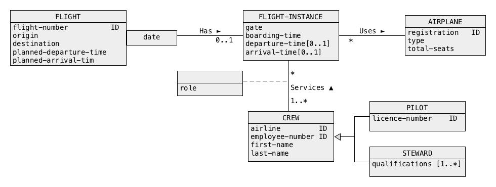
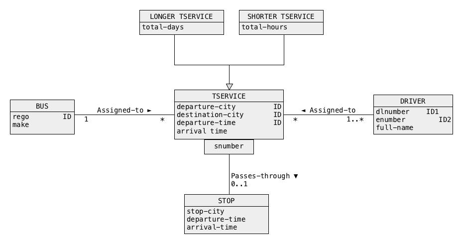
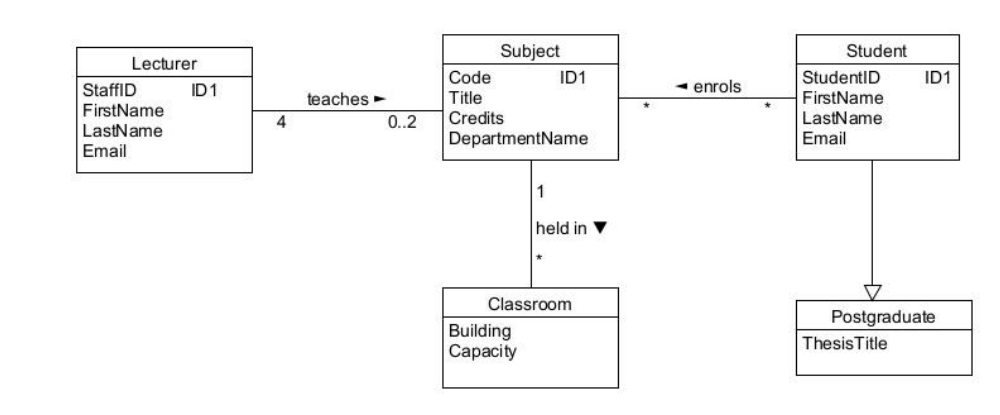
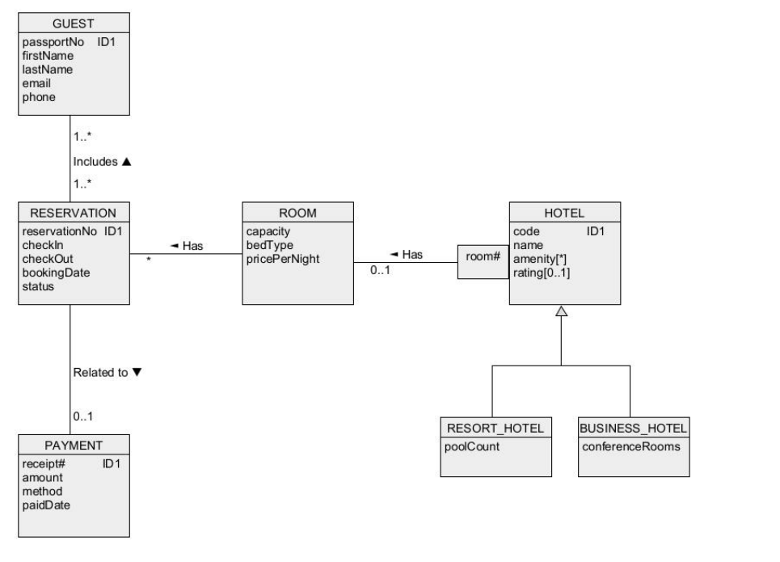

# 英文题目与中文翻译

教师原题保持来源与题号。匿名版只替换样例身份、联系方式和密码；共享schema与样例数据在文末。逐题教学在[工作台](./index.html)或[answers.md](./answers.md)。

<a id="m1-q1"></a>
## M1-Q1 · Mock Examination 1
Official Mock Exam · A

Read and analyse the following specification of a sample database domain.

A University would like to create a database to record information about some of its activities. The university offers a number of degrees to students. A degree is described by a unique name, total number of credit points required to complete a degree, and several requirements that must be satisfied by the future students. The university offers three types of degrees: undergraduate degrees, postgraduate degrees, and graduate certificate. Postgraduate degrees are available only for the students who already got an undergraduate degree. A description of a postgraduate degree includes a list of acceptable undergraduate degrees. A description of a graduate certificate includes a requirement on the total number of years of professional experience.

Each degree consists of a collection of subjects. A description of a subject consists of its unique code, unique title, total number of credits points a subject is worth, and a list of subject learning objectives.

The university employs academic staff members, tutors and support staff members. A description of a university employee consists of a unique employee number, first name last name and date of birth. First name, last name and date of birth uniquely identified each employee. Additionally, academic staff members and tutors are described by an academic degree achieved. Support staff members are described by a list of qualifications acquired in the past together with a date when each qualification has been acquired.

The university assigns the academic staff members and tutors to the subjects. A subject has one or two academic members assigned and a number of tutors. An academic staff member and tutor can be assigned to many subjects. Support staff members are assigned to the degrees. Each support staff member is assigned to one degree and a degree has one or more support staff members assigned.

The university is divided into faculties and faculties are divided into schools. Academic staff members and tutors belong to one school and each school consists of many academic staff members and tutors. The faculties and schools are described by the unique names.

Draw a conceptual schema for the specification of a database domain listed above.

### 中文翻译

阅读并分析以下数据库领域说明。

一所大学希望建立数据库，记录它的部分活动。大学向学生开设多种Degree（学位课程）。每个Degree有唯一名称、完成该Degree所需的总学分，以及未来学生必须满足的若干入学要求。

大学提供三类Degree：Undergraduate Degree（本科学位）、Postgraduate Degree（研究生学位）和Graduate Certificate（研究生证书）。只有已经取得本科学位的学生，才可以申请Postgraduate Degree。每个Postgraduate Degree的说明中列有可接受的本科学位。Graduate Certificate的说明中列有专业工作经验年数要求。

每个Degree包含一组Subject（科目）。每个Subject有唯一code、唯一title、学分值，以及一组learning objectives（学习目标）。code与title分别唯一。

大学雇用Academic Staff、Tutor和Support Staff。每位Employee记录唯一employee number、first name、last name和date of birth。first name、last name与date of birth的组合也能唯一识别Employee。Academic Staff与Tutor还记录已经取得的academic degree。Support Staff记录过去获得的每项qualification，以及该项qualification的取得日期。

大学把Academic Staff和Tutor分配到Subject。每个Subject分配一至两位Academic Staff，以及若干Tutor。一位Academic Staff或Tutor可分配到多个Subject。Support Staff分配到Degree：每位Support Staff恰好对应一个Degree，每个Degree至少对应一位Support Staff。

大学分为Faculty，Faculty再分为School。每位Academic Staff和Tutor属于一个School；每个School有多位Academic Staff和Tutor。Faculty与School都用各自唯一名称描述。

为上述领域绘制conceptual schema（概念模式）。

<a id="m1-q2"></a>
## M1-Q2 · Mock Examination 1
Official Mock Exam · A

Consider a conceptual schema given below.


Your task is to perform a step of logical database design, i.e. to transform a conceptual schema given above into a collection of relational schemas.

For each relational schema clearly list the names of attributes, primary key, candidate keys (if any), and foreign keys (if any). Assume, that a superset method must be used to implement a generalization.

### 中文翻译

根据上面的conceptual schema进行logical database design：把图转换成一组relational schemas（关系模式）。

对每个relational schema，清楚列出attributes、primary key、其他candidate keys（如有）以及foreign keys（如有）。generalization（泛化）必须使用superset method（超集法）实现。

图中文字：**图中文字对照（仅翻译，不作转换提示）**：LONGER TSERVICE 较长运输服务；SHORTER TSERVICE 较短运输服务；TSERVICE 运输服务；BUS 巴士；DRIVER 司机；STOP 停靠点。total-days 总天数；total-hours 总小时数；rego 注册号；make 品牌；departure-city 出发城市；destination-city 目的城市；departure-time 出发时间；arrival time/arrival-time 到达时间；dlnumber 驾照号；enumber 员工号；full-name 全名；snumber 停靠序号。Assigned-to 分配给；Passes-through 途经。ID identifier；ID1、ID2 为不同identifier；1 恰好一个；* 多个（可为零）；1..* 一个或多个；0..1 零个或一个。三角空心箭头为 generalization（泛化）符号。

<a id="m1-q3"></a>
## M1-Q3 · Mock Examination 1
Official Mock Exam · A

Write SELECT statements that implement the following queries.

(1) Find the registration numbers of trucks, that have capacity in a range between 100 inclusive and 500 inclusive.

(2) Find the first and the last names of all drivers who are on leave.

(3) Find the registration numbers of all trucks that have not been used for any trips.

(4) Find the registration numbers of all trucks together with total number of trips the trucks have been used for. There is no need to include the truck that have not been used for any trips.

(5) Find the names of all departure cities together with the names of all destination cities.

### 中文翻译

编写SELECT语句完成以下查询。所需CREATE TABLE语句在本题的共享schema中。

(1) 找出capacity在100至500之间、包含两个边界的Truck，输出REGNUM。

(2) 找出所有状态为ON LEAVE的Driver，输出first name与last name。

(3) 找出从未用于任何Trip的Truck，输出REGNUM。

(4) 对每辆用于过Trip的Truck，输出REGNUM及Trip总数。无需包含从未用于Trip的Truck。

(5) 找出所有departure city的名称，以及所有destination city的名称。

共享schema：[Transport](#schema-transport)

<a id="m1-q4"></a>
## M1-Q4 · Mock Examination 1
Official Mock Exam · A

Write SQL statements that implement the following structural modifications of a database and data manipulations on the contents of a database. Note, that implementation of some of the tasks listed below may need more than one SQL statement.

(1) We would like to add to a database information about the skills possessed by each driver. Assume, that a driver has many skills and a skill can be possessed by many drivers. It may happen that some skills are not possessed by any driver. The types of the new columns are up to you.

(2) Delete from a database information about the second and third leg of a trip 36.

(3) Change a date of trip number 26 to the next day after the present date of trip 26.

(4) Assume that a trip number 25 has 3 legs. A trip number 25 started in Sydney and it ended in Perth. Add one more leg to a trip 25 such that after update the trip ends in the same city it started from.

(5) Assume that a trip 20 has 2 legs and that a destination of the first leg is Sydney. Update information about a trip 20 such that after update a destination of the first leg is Perth.

### 中文翻译

编写SQL完成下列结构修改和数据操作。部分小题可能需要不止一条SQL语句。使用本题给出的Transport schema。

(1) 增加Driver所拥有的Skill信息。一个Driver拥有多项Skill，一项Skill可由多个Driver拥有。某些Skill也可能尚未由任何Driver拥有。新增列的类型自行选择。

(2) 删除Trip 36中第2段与第3段的信息。

(3) 把Trip 26的日期改成它当前所存日期的后一天。

(4) 已知Trip 25有3段，从Sydney出发、在Perth结束。再增加一段，使更新后的Trip回到最初出发的城市。

(5) 已知Trip 20有2段，第1段目的地为Sydney。更新Trip 20，使第1段目的地变成Perth。

共享schema：[Transport](#schema-transport)

<a id="m1-q5"></a>
## M1-Q5 · Mock Examination 1
Official Mock Exam · A

Assume that a user root with a password '[ROOT_OR_USER_PASSWORD]' created a database called transport and the user executed CREATE TABLE statements given on page 2 of the examination paper to create the relational tables in the database transport.

Write the implementations of the operations listed below as a user root. Assume that a user root has already connected to the database. Note, that implementation of some operations may need more than one SQL statement.

(1) A user root nominates a database transport as a default database and then the user creates two new users USER_A and USER_B.

(2) A user root grants the read access rights to the relational tables EMPLOYEE and DRIVER to a user USER_A. The read access rights cannot be propagated to other roles or users.

(3) A user root grants the rights to insert the rows into a relational tables TRIP and TRIPLEG to a user USER_B. The access rights can be propagated to other roles or users.

(4) A user root grants the update privilege on all relational tables in csit115 database to a user USER_A. The privilege cannot be propagated to other roles or users.

(5) A user root grants the rights to information about the total number trips performed by each driver to a user USER_B.

### 中文翻译

root用户已连接数据库，并已在transport数据库建立题面给出的表。root的密码按英文题面给定。以root身份实现以下操作；部分小题可能需要多条SQL。

(1) 把transport设为默认数据库，然后创建英文题面指定的两个用户。

(2) 向第一个用户授予EMPLOYEE和DRIVER表的读取权限。这些权限不能再授予其他用户或role。

(3) 向第二个用户授予向TRIP和TRIPLEG插入行的权限，并允许它把这些权限再授予其他用户或role。

(4) 向第一个用户授予csit115数据库中所有表的UPDATE权限，不允许转授。

(5) 向第二个用户开放“每位Driver完成的Trip总数”信息。

共享schema：[Transport](#schema-transport)

<a id="m1-q6"></a>
## M1-Q6 · Mock Examination 1
Official Mock Exam · A

Assume, that we would like to verify the following logical consistency constraint imposed on the contents of a sample database.

"A truck cannot be used for more that 100 trips"

Write SQL statements that perform the following actions.

(1) First, create a relational table MESSAGE with information about the contents of a sample database that violate the following consistency constraint listed above. A relational table MESSAGE must consist of two columns. The first column contains truck registration numbers and the second column contains the total number of trips for all trucks that have been used for more than 100 trips.

(2) Next, list the contents of a relational table MESSAGE in the following way.

Truck <insert ruck registration number here> has been used for <insert total number of trips here> trips.

For example, if a truck with registration number PKR856 has been used 120 times then the following line must be listed.

Truck PKR856 has been used for 120 trips.

(3) Next, make the contents of a relational table MESSAGE permanent.

(4) Finally, drop a relational table MESSAGE.

### 中文翻译

希望检查以下数据库逻辑一致性限制：“一辆Truck不能用于超过100次Trip。”

(1) 首先创建MESSAGE表，保存违反该限制的信息。表必须只有两列：Truck的REGNUM，以及该Truck的Trip总数。只保存Trip总数大于100的Truck。

(2) 按指定句式显示MESSAGE内容：Truck后接注册号，再接has been used for、次数及trips.。例如Truck PKR856 has been used for 120 trips.。尖括号中的文字是待填值说明，不是要原样输出的内容。

(3) 使MESSAGE中的数据成为永久保存的内容，即提交当前事务。

(4) 最后删除MESSAGE表。

共享schema：[Transport](#schema-transport)

<a id="m2-q1"></a>
## M2-Q1 · Mock Examination 2
Official Mock Exam · A

Read and analyse the following specification of a sample database domain.

A description of a hospital consists of a unique hospital name, address of a main building including city, street, and building number, phone and fax numbers, and email address. The phone number, fax number, and email address can also be used for the identification purposes. A hospital consists of a number of buildings. A building number is a local identifier of a building. Some of the buildings have the names, which are unique within a hospital.

A hospital consists of wards and wards consist of decks. Each ward has a unique name and is located in one building. A ward may occupy several levels of a building. A deck is identified by a number unique within a ward and it is located at one level of a building. The database should contain the complete information about the locations of buildings and decks.

A hospital employs the doctors, nurses, administration and maintenance staff members. The employees are described by an employee number unique within a hospital, first name, last name, date of birth and salary. The doctors are additional described by a status and specialization. The nurses are also described by a category. Administration and maintenance staff members are described by a position occupied. The doctors are assigned to the wards and the nurses are assigned to the decks. Additionally, a hospital contracts a number of consultants. The consultants are not assigned to the wards and are employed by a hospital for a limited time only. The consultants are described by first and last name, specialization, phone number, and amount of charge per hour, start and end of contract with a hospital. The consultants can be employed by more than one hospital at a time.

A hospital admits the patients for the treatments. A patient is described by medical insurance company name and insurance policy number. Date and time are recorded on admittance to a hospital. A patient may be admitted to and discharged from a hospital many times. On arrival to a hospital a patient passes through entry physical examinations, which consists of a number of tests. The database should contain information about the names of tests applied and the results of the tests conducted just after arrival to a hospital. When, an illness a patient suffers from is identified he/she is located at a ward and at a deck of a ward.

Design a conceptual schema for the database domain described above. Use a notation of simplified UML object class diagrams explained during the lecture classes and applied for conceptual modelling in the assignments and class test. Remember to determine the multiplicities of associations, identifiers of classes of objects, multivalued, optional and derived attributes (if any).

There is NO NEED to provide a detailed analysis how a conceptual schema has been created. The final conceptual schema expressed in a notation of UML simplified classes is completely sufficient.

It is not allowed to use any artificial identifiers and any attributes that are not mentioned in a specification above.

### 中文翻译

阅读并分析以下医院数据库领域说明，并设计conceptual schema。

Hospital记录唯一hospital name、主楼地址（city、street和building number）、phone、fax和email。phone、fax和email也分别可用于识别Hospital。一个Hospital有多座Building。building number只在所属Hospital内唯一。部分Building有名称；名称只在该Hospital内唯一。

Hospital分为Ward，Ward再分为Deck。每个Ward有唯一名称，并位于一座Building中。一个Ward可以占据该Building的多个楼层。Deck使用在所属Ward内唯一的号码识别，并位于Building的某一层。数据库必须完整记录Building与Deck的位置。

Hospital雇用Doctor、Nurse、Administration Staff和Maintenance Staff。Employee记录在该Hospital内唯一的employee number、first name、last name、date of birth和salary。Doctor另外记录status与specialization；Nurse另外记录category；行政及维护人员另外记录position。Doctor分配到Ward，Nurse分配到Deck。

Hospital还会按有限期限聘用Consultant。Consultant不分配到Ward。Consultant记录first name、last name、specialization、phone、每小时收费，以及与某Hospital的合同开始／结束时间。同一Consultant可同时被多家Hospital聘用。

Hospital接收Patient进行治疗。Patient记录medical insurance company name和insurance policy number。每次入院记录date与time。Patient可以多次入院和出院。每次到院时进行entry physical examination，检查包含若干Test。数据库必须记录该次入院所做Test的名称及结果。确定Patient患有的illness后，将其安置到某Ward及该Ward的某Deck。

使用课堂、作业和测验采用的simplified UML class diagram记法。确定association multiplicities、identifiers，以及multivalued、optional、derived attributes（如有）。只需最终图，不需要详细描述建模过程。

禁止使用artificial identifiers（人工编号），也禁止加入说明中没有提到的attributes。

<a id="m2-q2"></a>
## M2-Q2 · Mock Examination 2
Official Mock Exam · A

Consider a conceptual schema given below.



Your task is to perform a step of logical database design, i.e. to transform a conceptual schema given above into a collection of relational schemas. For each relational schema clearly list the names of attributes, primary key, candidate keys (if any), and foreign keys (if any). Assume, that a superset method must be used to implement a generalization.

### 中文翻译

根据给定的航班conceptual schema，进行logical database design，转换成一组relational schemas。

每个schema需列出attributes、primary key、candidate keys（如有）与foreign keys（如有）。generalization必须使用superset method。

图中文字：**图中文字对照（仅翻译）**：FLIGHT 航班；FLIGHT-INSTANCE 某日的航班实例；AIRPLANE 飞机；CREW 机组人员；PILOT 飞行员；STEWARD 乘务员。flight-number 航班号；origin 始发地；destination 目的地；planned-departure-time 计划起飞时间；planned-arrival-tim（原图拼写）计划到达时间；date 日期；gate 登机口；boarding-time 登机时间；departure-time 实际起飞时间；arrival-time 实际到达时间；registration 注册号；type 类型；total-seats 总座位数；airline 航空公司；employee-number 员工号；first-name 名；last-name 姓；licence-number 执照号；qualifications 资格；role 此次服务的角色。Has 具有；Uses 使用；Services 提供服务。ID identifier；[0..1] 可选单值；[1..*] 至少一个值；* 零到多个；1..* 一个或多个；0..1 零个或一个。虚线框中的 role 是关联属性；空心三角表示泛化。

<a id="m2-q3"></a>
## M2-Q3 · Mock Examination 2
Official Mock Exam · A

This question is related to a sample database created through processing of the common CREATE TABLE statements above.

Write SELECT statements that implement the following queries. You can use any implementation technique for your SELECT statements.

(1) For each bank find the total number of branches owned by a bank. List a bank name and the total number of branches owned by a bank. Assume that some banks do not have any branches yet. In all such cases the total number of branches must be listed as zero (0).

(2) For all accounts that have no bank transactions in 2021, find the account numbers and balance on each account. List an account number and balance on each account.

(3) Find the names and emails of all banks, that have at least one branch with unknow total number of employees at a branch.

Write SQL statements that implement the following structural modifications of a database and data manipulations on the contents of a database. Note, that implementation of some of the tasks listed below may need more than one SQL statement. You are not allowed to drop and/or suspend any referential integrity constraints in your implementations

(4) We would like to add to a database information about the total number of bank transactions performed on each bank account. Modify the structures of a sample database in the best possible way. Insert appropriate information into the new structures of a sample database.

(5) Delete from a database information about all bank transactions submitted in a year 2019. Note, that you are not allowed to drop and/or suspend any referential integrity constraints in your implementation.

### 中文翻译

根据共享Bank schema完成以下操作。SELECT小题可使用任意实现方法。

(1) 对每家Bank输出bank name及Branch总数。没有Branch的Bank也必须输出，数量为0。

(2) 找出2021年没有任何Transaction的Account，输出account number和balance。

(3) 找出至少有一个Branch的total_emps未知的Bank，输出bank name和email。未知对应NULL。

下面进行结构修改与数据操作，可能需要多条SQL；禁止删除或停用referential integrity constraints。

(4) 在数据库中增加“每个Account已进行的Transaction总数”信息。以合适方式修改结构，并根据现有数据填入正确计数。

(5) 删除2019年提交的所有Transaction。禁止删除或停用referential integrity constraints。

共享schema：[Bank](#schema-bank)

<a id="m2-q4"></a>
## M2-Q4 · Mock Examination 2
Official Mock Exam · A

This question is related to a sample database created through processing of the common CREATE TABLE statements above.

An objective of this question is to explain how to implement a simple method of auditing the database activities.

Assume, that a database administrator would like to audit the data manipulation statements (INSERT, UPDATE, DELETE) processed by a selected group of users on a selected group of relational tables. Write SQL statements and in the comments provide the comprehensive explanation of a role of SQL statement plays in the implementation of a simple database auditing system.

### 中文翻译

本题使用共享Bank schema。目标是说明如何实现一种简单的database auditing（数据库活动审计）方法。

DBA希望审计选定一组用户在选定一组表上执行的INSERT、UPDATE、DELETE。编写SQL，并在注释中充分解释每条SQL在这个简单审计系统中的作用。


共享schema：[Bank](#schema-bank)

<a id="m2-q5"></a>
## M2-Q5 · Mock Examination 2
Official Mock Exam · A

This question is related to a sample database created through processing of the common CREATE TABLE statements above.

Assume that CREATE TABLE statements listed above are included in SQL script dbcreate.sql. The script is located at a folder $HOME/bank/sql. Write the implementations of the operations listed below as a user root. Assume that a user root has already connected to the database. Assume, that user root has access to SQL script dbcreate.sql. Note, that implementation of some operations may need more than one SQL statement.

(1) A user root with a password '[ROOT_OR_USER_PASSWORD]' would like to create a database called banks and nominate the database as its default database.

(2) A user root would like to create within a database banks, the relational tables given on page 3 of the examination paper.

(3) Then, a user root would like to create a new user account called admin with a password '[ROOT_OR_USER_PASSWORD]'.

(4) A user admin must have the rights to execute CREATE TABLE and CREATE VIEW statements with the rights to propagate the privilege to the other users.

(5) A user admin must have the rights to read information about all bank transactions submitted in 2021 with no rights to propagate the privilege to the other users.

### 中文翻译

假设共享schema中的CREATE TABLE语句保存在dbcreate.sql，脚本位于操作系统用户的$HOME/bank/sql目录。root已连接数据库并能访问脚本。以root身份实现下列操作；部分小题可能需要多条SQL。

(1) root按题面给出的密码创建banks数据库，并把它设为默认数据库。

(2) 在banks中创建题面给出的表，即处理dbcreate.sql脚本。

(3) 创建名为admin的新用户，密码按英文题面给定。

(4) admin必须能执行CREATE TABLE和CREATE VIEW，并能把相应权限转授其他用户。

(5) admin必须能读取2021年提交的Transaction信息，但不能转授这项读取权限。

共享schema：[Bank](#schema-bank)

<a id="m2-q6"></a>
## M2-Q6 · Mock Examination 2
Official Mock Exam · A

This question is related to a sample database created through processing of the common CREATE TABLE statements above.

(1) Consider a bank that has a name NAB. Assume, that at the moment, the balance on account number 1 is equal to 100. Assume, that at the moment, the balance on account number 2 is equal to 200.

Assume, that concurrently processed database transactions T1 and T2 interleaved their operations in a way listed below.

```text
T1                                           T2
SET TRANSACTION ISOLATION LEVEL SERIALIZABLE;
                                             SET TRANSACTION ISOLATION LEVEL SERIALIZABLE;
UPDATE ACCOUNT
SET balance = balance + 10
WHERE account_num = 1 AND
      bank_name = 'NAB';
                                             UPDATE ACCOUNT
                                             SET balance = balance + 20
                                             WHERE account_num = 1 AND
                                                   bank_name = 'NAB';

UPDATE ACCOUNT
SET balance = (SELECT balance + 10
               FROM ACCOUNT
               WHERE account_num = 1 AND
                     bank_name = 'NAB')
WHERE account_num = 1 AND
      bank_name = 'NAB';

COMMIT;
                                             COMMIT;
```

(1) Explain how the values of an attribute balance in the rows where account_num = 1 and account_num = 2 in NAB bank change after each UPDATE statement.

(2) Consider a bank that has a name NAB. Assume, that at the moment, the balance on account number 1 is equal to 100. Assume, that at the moment, the balance on account number 2 is equal to 200.

Assume, that concurrently processed database transactions T1 and T2 interleaved their operations in a way listed below.

```text
T1                                              T2
SET TRANSACTION ISOLATION LEVEL READ COMMITTED;
                                                SET TRANSACTION ISOLATION LEVEL READ UNCOMMITTED;
UPDATE ACCOUNT
SET balance = balance + 10
WHERE account_num = 1 AND
      bank_name = 'NAB';
                                                UPDATE ACCOUNT
                                                SET balance = balance + 20
                                                WHERE account_num = 2 AND
                                                      bank_name = 'NAB';
                                                COMMIT;
UPDATE ACCOUNT
SET balance = (SELECT balance + 10
               FROM ACCOUNT
               WHERE account_num = 2 AND
                     bank_name = 'NAB')
WHERE account_num = 1 AND
      bank_name = 'NAB';
COMMIT;
```

Explain how the values of an attribute balance in the rows where account_num = 1 and account_num = 2 change after processing of each UPDATE statement.

Answer text Question 6

### 中文翻译

两组情景均重新从NAB的Account 1余额100、Account 2余额200开始。T1与T2按英文题面给出的交错顺序处理。必须逐条UPDATE说明余额变化。

(1) 两个事务都采用SERIALIZABLE。T1先把Account 1增加10；T2尝试把同一Account 1增加20；随后T1把Account 1读取到的余额再增加10并赋回Account 1；最后按题面顺序COMMIT。需要解释T2在冲突期间是等待、成功还是失败。Account 2没有被更新。

(2) T1采用READ COMMITTED，T2采用READ UNCOMMITTED。T1先把Account 1增加10。T2把Account 2增加20并COMMIT。T1再读取Account 2的余额，把“该值加10”的结果赋给Account 1，最后COMMIT。

原题要求说明每条UPDATE处理后，这两个Account的balance分别如何变化。

共享schema：[Bank](#schema-bank)

<a id="m3-q1"></a>
## M3-Q1 · Mock Examination 3
Official Mock Exam · A

Read and analyse the following specification of a sample database domain.

A University would like to create a database to record information about some of its activities. The university offers a number of degrees to students. A degree is described by a unique name, total number of credit points required to complete a degree, and several requirements that must be satisfied by the future students. The university offers three types of degrees: undergraduate degrees, postgraduate degrees, and graduate certificate. Postgraduate degrees are available only for the students who already got an undergraduate degree. A description of a postgraduate degree includes a list of acceptable undergraduate degrees. A description of a graduate certificate includes a requirement on the total number of years of professional experience.

Each degree consists of a collection of subjects. A description of a subject consists of its unique code, unique title, total number of credits points a subject is worth, and a list of subject learning objectives.

The university employs academic staff members, tutors and support staff members. A description of a university employee consists of a unique employee number, first name last name and date of birth. First name, last name and date of birth uniquely identified each employee. Additionally, academic staff members and tutors are described by an academic degree achieved. Support staff members are described by a list of qualifications acquired in the past together with a date when each qualification has been acquired.

The university assigns the academic staff members and tutors to the subjects. A subject has one or two academic members assigned and a number of tutors. An academic staff member and tutor can be assigned to many subjects. Support staff members are assigned to the degrees. Each support staff member is assigned to one degree and a degree has one or more support staff members assigned.

The university is divided into faculties and faculties are divided into schools. Academic staff members and tutors belong to one school and each school consists of many academic staff members and tutors. The faculties and schools are described by the unique names.

Draw a conceptual schema for the specification of a database domain listed above.

### 中文翻译

阅读并分析以下数据库领域说明。

一所大学希望建立数据库，记录它的部分活动。大学向学生开设多种Degree（学位课程）。每个Degree有唯一名称、完成该Degree所需的总学分，以及未来学生必须满足的若干入学要求。

大学提供三类Degree：Undergraduate Degree（本科学位）、Postgraduate Degree（研究生学位）和Graduate Certificate（研究生证书）。只有已经取得本科学位的学生，才可以申请Postgraduate Degree。每个Postgraduate Degree的说明中列有可接受的本科学位。Graduate Certificate的说明中列有专业工作经验年数要求。

每个Degree包含一组Subject（科目）。每个Subject有唯一code、唯一title、学分值，以及一组learning objectives（学习目标）。code与title分别唯一。

大学雇用Academic Staff、Tutor和Support Staff。每位Employee记录唯一employee number、first name、last name和date of birth。first name、last name与date of birth的组合也能唯一识别Employee。Academic Staff与Tutor还记录已经取得的academic degree。Support Staff记录过去获得的每项qualification，以及该项qualification的取得日期。

大学把Academic Staff和Tutor分配到Subject。每个Subject分配一至两位Academic Staff，以及若干Tutor。一位Academic Staff或Tutor可分配到多个Subject。Support Staff分配到Degree：每位Support Staff恰好对应一个Degree，每个Degree至少对应一位Support Staff。

大学分为Faculty，Faculty再分为School。每位Academic Staff和Tutor属于一个School；每个School有多位Academic Staff和Tutor。Faculty与School都用各自唯一名称描述。

为上述领域绘制conceptual schema（概念模式）。

<a id="m3-q2"></a>
## M3-Q2 · Mock Examination 3
Official Mock Exam · A

Consider a conceptual schema given below.



Your task is to perform a step of logical database design, i.e. to transform a conceptual schema given above into a collection of relational schemas.

For each relational schema clearly list the names of attributes, primary key, candidate keys (if any), and foreign keys (if any). Assume, that a superset method must be used to implement a generalization.

### 中文翻译

根据上面的conceptual schema进行logical database design：把图转换成一组relational schemas（关系模式）。

对每个relational schema，清楚列出attributes、primary key、其他candidate keys（如有）以及foreign keys（如有）。generalization（泛化）必须使用superset method（超集法）实现。

图中文字：**图中文字对照（仅翻译，不作转换提示）**：LONGER TSERVICE 较长运输服务；SHORTER TSERVICE 较短运输服务；TSERVICE 运输服务；BUS 巴士；DRIVER 司机；STOP 停靠点。total-days 总天数；total-hours 总小时数；rego 注册号；make 品牌；departure-city 出发城市；destination-city 目的城市；departure-time 出发时间；arrival time/arrival-time 到达时间；dlnumber 驾照号；enumber 员工号；full-name 全名；snumber 停靠序号。Assigned-to 分配给；Passes-through 途经。ID identifier；ID1、ID2 为不同identifier；1 恰好一个；* 多个（可为零）；1..* 一个或多个；0..1 零个或一个。三角空心箭头为 generalization（泛化）符号。

<a id="m3-q3"></a>
## M3-Q3 · Mock Examination 3
Official Mock Exam · A

Write SELECT statements that implement the following queries.

(1) Find the registration numbers of trucks, that have capacity in a range between 100 inclusive and 500 inclusive.

(2) Find the first and the last names of all drivers who are on leave.

(3) Find the registration numbers of all trucks that have not been used for any trips.

(4) Find the registration numbers of all trucks together with total number of trips the trucks have been used for. There is no need to include the truck that have not been used for any trips.

(5) Find the names of all departure cities together with the names of all destination cities.

### 中文翻译

编写SELECT语句完成以下查询。所需CREATE TABLE语句在本题的共享schema中。

(1) 找出capacity在100至500之间、包含两个边界的Truck，输出REGNUM。

(2) 找出所有状态为ON LEAVE的Driver，输出first name与last name。

(3) 找出从未用于任何Trip的Truck，输出REGNUM。

(4) 对每辆用于过Trip的Truck，输出REGNUM及Trip总数。无需包含从未用于Trip的Truck。

(5) 找出所有departure city的名称，以及所有destination city的名称。

共享schema：[Transport](#schema-transport)

<a id="m3-q4"></a>
## M3-Q4 · Mock Examination 3
Official Mock Exam · A

Write SQL statements that implement the following structural modifications of a database and data manipulations on the contents of a database. Note, that implementation of some of the tasks listed below may need more than one SQL statement.

(1) We would like to add to a database information about the skills possessed by each driver. Assume, that a driver has many skills and a skill can be possessed by many drivers. It may happen that some skills are not possessed by any driver. The types of the new columns are up to you.

(2) Delete from a database information about the second and third leg of a trip 36.

(3) Change a date of trip number 26 to the next day after the present date of trip 26.

(4) Assume that a trip number 25 has 3 legs. A trip number 25 started in Sydney and it ended in Perth. Add one more leg to a trip 25 such that after update the trip ends in the same city it started from.

(5) Assume that a trip 20 has 2 legs and that a destination of the first leg is Sydney. Update information about a trip 20 such that after update a destination of the first leg is Perth.

### 中文翻译

编写SQL完成下列结构修改和数据操作。部分小题可能需要不止一条SQL语句。使用本题给出的Transport schema。

(1) 增加Driver所拥有的Skill信息。一个Driver拥有多项Skill，一项Skill可由多个Driver拥有。某些Skill也可能尚未由任何Driver拥有。新增列的类型自行选择。

(2) 删除Trip 36中第2段与第3段的信息。

(3) 把Trip 26的日期改成它当前所存日期的后一天。

(4) 已知Trip 25有3段，从Sydney出发、在Perth结束。再增加一段，使更新后的Trip回到最初出发的城市。

(5) 已知Trip 20有2段，第1段目的地为Sydney。更新Trip 20，使第1段目的地变成Perth。

共享schema：[Transport](#schema-transport)

<a id="m3-q5"></a>
## M3-Q5 · Mock Examination 3
Official Mock Exam · A

Assume that a user root with a password '[ROOT_OR_USER_PASSWORD]' created a database called transport and the user executed CREATE TABLE statements given on page 2 of the examination paper to create the relational tables in the database transport.

Write the implementations of the operations listed below as a user root. Assume that a user root has already connected to the database. Note, that implementation of some operations may need more than one SQL statement.

(1) A user root nominates a database transport as a default database and then the user creates two new users USER_A and USER_B.

(2) A user root grants the read access rights to the relational tables EMPLOYEE and DRIVER to a user USER_A. The read access rights cannot be propagated to other roles or users.

(3) A user root grants the rights to insert the rows into a relational tables TRIP and TRIPLEG to a user USER_B. The access rights can be propagated to other roles or users.

(4) A user root grants the update privilege on all relational tables in csit115 database to a user USER_A. The privilege cannot be propagated to other roles or users.

(5) A user root grants the rights to information about the total number trips performed by each driver to a user USER_B.

### 中文翻译

root用户已连接数据库，并已在transport数据库建立题面给出的表。root的密码按英文题面给定。以root身份实现以下操作；部分小题可能需要多条SQL。

(1) 把transport设为默认数据库，然后创建英文题面指定的两个用户。

(2) 向第一个用户授予EMPLOYEE和DRIVER表的读取权限。这些权限不能再授予其他用户或role。

(3) 向第二个用户授予向TRIP和TRIPLEG插入行的权限，并允许它把这些权限再授予其他用户或role。

(4) 向第一个用户授予csit115数据库中所有表的UPDATE权限，不允许转授。

(5) 向第二个用户开放“每位Driver完成的Trip总数”信息。

共享schema：[Transport](#schema-transport)

<a id="m3-q6"></a>
## M3-Q6 · Mock Examination 3
Official Mock Exam · A

Assume, that we would like to verify the following logical consistency constraint imposed on the contents of a sample database.

"A truck cannot be used for more that 100 trips"

Write SQL statements that perform the following actions.

(1) First, create a relational table MESSAGE with information about the contents of a sample database that violate the following consistency constraint listed above. A relational table MESSAGE must consist of two columns. The first column contains truck registration numbers and the second column contains the total number of trips for all trucks that have been used for more than 100 trips.

(2) Next, list the contents of a relational table MESSAGE in the following way.

Truck <insert ruck registration number here> has been used for <insert total number of trips here> trips.

For example, if a truck with registration number PKR856 has been used 120 times then the following line must be listed.

Truck PKR856 has been used for 120 trips.

(3) Next, make the contents of a relational table MESSAGE permanent.

(4) Finally, drop a relational table MESSAGE.

### 中文翻译

希望检查以下数据库逻辑一致性限制：“一辆Truck不能用于超过100次Trip。”

(1) 首先创建MESSAGE表，保存违反该限制的信息。表必须只有两列：Truck的REGNUM，以及该Truck的Trip总数。只保存Trip总数大于100的Truck。

(2) 按指定句式显示MESSAGE内容：Truck后接注册号，再接has been used for、次数及trips.。例如Truck PKR856 has been used for 120 trips.。尖括号中的文字是待填值说明，不是要原样输出的内容。

(3) 使MESSAGE中的数据成为永久保存的内容，即提交当前事务。

(4) 最后删除MESSAGE表。

共享schema：[Transport](#schema-transport)

<a id="a1-t1"></a>
## A1-T1 · Assignment 1
Official Assignment · A

Consider a local library that wants to maintain information about its books and authors. The  following business rules apply: 
• Each Book has ISBN, Title, Edition, and Publication Year. ISBN uniquely identifies a  book. 
• Each Author has AuthorID, FirstName, and LastName. AuthorID uniquely identifies an  author. 
• A book is written by one or more authors. 
• An author may write zero or more books. 
• The library may own multiple copies of the same book. 
• Each Copy has CopyID, and Status (e.g., Available or On Loan). CopyID uniquely  identifies a copy.  
• Each Copy represents exactly one Book. 
• Each Member has MemberID, FirstName, LastName, and Email. MemberID uniquely  identifies a member. 
• A Member may borrow zero or more Copies. A Copy may be borrowed by at most one  Member at a time.  Using the CSIT115 Palette in UMLet, create a conceptual schema that satisfies the requirements  above. Your diagram must include all required entities with their specified attributes and correct  multiplicity (cardinality).  Finally, add one meaningful attribute to one of the classes that is not listed above. The attribute  should be appropriate for the scenario and the custom attribute you create must end with your  Student ID (e.g., `Genre_1234567`).

### 中文翻译

为本地图书馆设计conceptual schema。以下业务规则均需保留。

每个Book有ISBN、Title、Edition和Publication Year；ISBN唯一识别Book。每个Author有AuthorID、FirstName和LastName；AuthorID唯一识别Author。一本Book由至少一位Author撰写；一位Author可撰写零本或多本Book。

图书馆可持有同一Book的多份Copy。每份Copy有CopyID和Status（例如Available或On Loan）；CopyID唯一识别Copy。每份Copy恰好代表一本Book。

每位Member有MemberID、FirstName、LastName和Email；MemberID唯一识别Member。一位Member可借零份或多份Copy；一份Copy在同一时刻至多由一位Member借阅。

使用UMLet的CSIT115 Palette绘图。图中必须包含全部指定对象、attributes及正确multiplicities。最后给某个类增加一个题面未列出的、有实际意义的attribute；其名称必须以自己的Student ID结尾，例如Genre_1234567。这个自选要求属于原作业，不能漏掉。

图中文字：Book 书目；Author 作者；Copy 实体副本；Member 会员。ISBN 国际标准书号；AuthorID 作者标识；CopyID 副本标识；MemberID 会员标识。Title 书名；Edition 版次；PublicationYear 出版年份；FirstName 名；LastName 姓；Status 当前状态；Email 邮箱属性。writes 撰写；has 拥有；borrows 借阅。ID1 标识；0..1 零个或一个；0..* 零个或多个；1..* 至少一个。随附图中的Email_1234567是带学号后缀的自定义属性名示例，不是邮箱地址。

<a id="a1-t2"></a>
## A1-T2 · Assignment 1
Official Assignment · A

The university has the following business rules. 
 
1. Each lecturer has a Staff ID, First Name, Last Name and Email.  
2. Each student has a Student ID, First Name, Last Name and Email and every student is either  an Undergraduate student or a Postgraduate student. An undergraduate student has an  additional attribute GPA and a postgraduate student has an additional attribute Thesis Title. 
3. Each subject has a Code, Title and Credits.  
4. Each subject is offered by one department with an attribute Name. 
5. Each classroom has a Room Number, Building and Capacity.  
6. A lecturer may teach up to four subjects in a semester.  
7. Each subject must be taught by at most two lecturers and is held in one classroom. 
8. A student may enrol in zero or more subjects.  
9. A classroom may be used for zero or more subjects.    Correct the conceptual schema by fixing all errors in entity representation, inheritance notation,  and multiplicities so that it accurately represents the business rules above.



### 中文翻译

根据以下大学业务规则纠正给定conceptual schema。

1. Lecturer有Staff ID、First Name、Last Name和Email。
2. Student有Student ID、First Name、Last Name和Email；每位Student属于Undergraduate或Postgraduate。Undergraduate另外有GPA；Postgraduate另外有Thesis Title。
3. Subject有Code、Title和Credits。
4. 每个Subject由一个Department开设；Department有Name。
5. Classroom有Room Number、Building和Capacity。
6. 每位Lecturer在一个学期最多教4门Subject。
7. 每个Subject最多由2位Lecturer教授，并在一间Classroom上课。
8. Student可选修零门或多门Subject。
9. Classroom可用于零门或多门Subject。

纠正对象表示、generalization记法与multiplicities的全部错误，使图符合这些业务规则。

图中文字：**待纠错图中文字对照**：Lecturer 讲师；Subject 科目；Student 学生；Postgraduate 研究生；Classroom 教室。StaffID 员工号；FirstName 名；LastName 姓；Email 邮箱；Code 科目代码；Title 标题；Credits 学分；DepartmentName 系名；StudentID 学号；ThesisTitle 论文题目；Building 建筑；Capacity 容量。teaches 教授；enrols 选修；held in 在某处上课。ID1 identifier；4 四个；0..2 零至两个；1 一个；* 多个。原图就是待修正对象，不能将其中数量和箭头当作正确业务规则。

<a id="a2-t1"></a>
## A2-T1 · Assignment 2
Official Assignment · A

Given the conceptual schema below, perform logical database design by transforming it  into a collection of relational schemas. 

(1) Identify each feature of the conceptual schema that requires a transformation and state  the transformation applied to that feature. 

(2) For each relational schema created , clearly list the names of attributes, primary keys ,  candidate keys (if any), and foreign keys (if any). Assume that the superset  method must be used to implement a generalization (if any). A way how a conceptual  schema can be transformed into a collection of relational schemas is explained in a  presentation 06 Logical Design.      The relational schemas must be listed in a format presented in slides 42 and 43 in  presentation 06 Logical Design. Listing of the relational schemas in the other format scores  no marks.   

Note that the order of the definitions on the relation schemas is important. You must  define a parent relation schema (referenced) before its  child relational schema  (references to the parent relational schema).



### 中文翻译

把给定酒店conceptual schema转换成一组relational schemas。

(1) 识别每一种需要转换的特征，逐项说明采用了哪一种转换。

(2) 每个schema清楚列出attributes、primary key、其他candidate keys及foreign keys。generalization必须使用superset method。必须使用Logical Design课件第42–43页规定的格式；使用其他格式不计分。

schema定义顺序也有要求：先定义被引用的parent schema，再定义引用它的child schema。

图中文字：**图中文字对照**：GUEST 住客；RESERVATION 预订；PAYMENT 付款；ROOM 房间；HOTEL 酒店；RESORT_HOTEL 度假酒店；BUSINESS_HOTEL 商务酒店。passportNo 护照号；firstName 名；lastName 姓；email 邮箱；phone 电话；reservationNo 预订号；checkIn 入住日期；checkOut 退房日期；bookingDate 预订日期；status 状态；receipt# 收据号；amount 金额；method 付款方式；paidDate 付款日期；capacity 容量；bedType 床型；pricePerNight 每晚价格；room# 房号；code 酒店代码；name 名称；amenity 配套设施；rating 评分；poolCount 泳池数量；conferenceRooms 会议室数量。Includes 包含；Has 具有；Related to 与之相关。ID1 identifier；[*] 多值；[0..1] 可选；* 零到多个；1..* 至少一个；0..1 零个或一个；空心三角表示泛化。

<a id="a2-t2"></a>
## A2-T2 · Assignment 2
Official Assignment · A

This question builds upon the relational schemas you designed in Task 1.  Write SQL  statements to answer the following queries. Since the parts  are interconnected, you must  complete them in sequential order from (1) to (5).  

(1) Create empty relational tables to implement the relational schemas you designed in  Task 1 for the hotel reservation database. The names of the relational tables and  columns must be consistent with your logical design. Use reasonable column types  and sizes (lengths). Enforce all appropriate primary key and referential integrity  constraints.  Note that the order of CREATE TABLE statements is important. Create the  parent table (referenced) before its child table (references to the parent table).  

(2) Next, assume that a new business rule is introduced requiring that no two guests  have the same email address. Add an appropriate constraint after the table has  already been created. 

(3) Next, insert sufficient sample data into the tables to represent at least two hotels,  two rooms for each hotel, two guests, and two reservations. Insert appropriate data  into the other tables resulting from your logical design where required.  The data values are up to you, but they must satisfy all primary key and referential  integrity constraints defined in part (1) and (2).    Note that the order of INSERT statements is important. Insert data into the  parent table (referenced) before inserting data into its child table (references to  the parent table).  

(4) Increase the pricePerNight of all rooms belonging to one of the hotels inserted  in part (3) by 10%. The choice of hotel is up to you. 

(5) Finally, delete one of the hotels inserted in part ( 3) and all records that must be  removed beforehand to satisfy the referential integrity constraints. Do not delete the  other hotel or its related information, and do not drop any table.    Note that the order of delete statements is important. Delete data from the child table  (references to the parent table) before deleting data from its parent table (referenced).

### 中文翻译

在Task 1设计的酒店relational schemas基础上编写SQL。(1)至(5)互相关联，必须顺序完成。

(1) 建立空表实现Task 1的设计。表名与列名必须一致。选择合理类型和长度，设置所有适当的primary keys及referential integrity constraints。先建parent tables，再建child tables。

(2) 表创建完成后，新增业务规则：两个Guest不能有相同email。用适当constraint实现。

(3) 插入足够数据：至少2家Hotel、每家至少2间Room、2位Guest和2个Reservation。其他关系表也要在需要时插入合适记录。数据值自行选择，但必须满足(1)(2)的keys及foreign keys。先插parent rows，再插child rows。

(4) 任选(3)中的一家Hotel，把它全部Room的pricePerNight增加10%。

(5) 删除(3)中的一家Hotel，以及为满足foreign keys必须事先删除的依赖记录。保留另一家Hotel及其相关信息；不得DROP任何表。先删child rows，再删parent rows。

<a id="a3-t1"></a>
## A3-T1 · Assignment 3
Official Assignment · A

Note that you may need more than one SQL statement to implement a single subtask  listed below.    Your implementation must directly follow a comment with the specifications of a  subtask.  Implement SQL DDL (Data Definition Language) statements for questions (1) and (2)  below. 

(1)  Modify the structure and consistency constraint of the sample database such that the  fee of each workshop must be a positive value not larger than 9999.99. 

(2)  Modify the structure and consistency constraints of the sample database such that a  qualification level possessed by a participant and a qualification level required by a  workshop must be positive values no more than 10.  Implement SQL DML (Data Manipulation Language) statements for questions (3), (4)  and (5) below.  Note that you are not allowed to modify and/or drop any consistency constraints. We  assume that safe update has been disabled so that SQL can execute DML statements  anywhere. 

(3)  Add a new workshop (workshopNo=9) to the sample database. The values of the  new Workshop columns are up to you. Add two qualification requirements for the new  workshop. The qualification names, required levels and mandatory values are up to you. 

(4)  Modify the qualification levels possessed by participant (participantNo=3) such  that all qualification levels possessed by the participant increase by 1. 

(5)  Remove participant (participantNo=10) and all information related to this  participant from the sample database.

### 中文翻译

部分小题可能需要多条SQL。每项实现应紧接相应题目注释。(1)(2)使用DDL。

(1) 修改结构和一致性约束，使Workshop.fee大于0且不超过9999.99。

(2) 修改结构和约束，使Participant拥有的Qualification.qlevel以及Workshop要求的Requirement.requiredLevel都大于0且不超过10。

(3)(4)(5)使用DML，禁止为完成这些数据操作而修改或删除约束。题目假设safe update已经停用。

(3) 增加workshopNo=9的Workshop，其他属性自行选择。再给它增加2项qualification requirements；名称、等级及mandatory值自行选择。

(4) 把participantNo=3拥有的每一项Qualification.qlevel都增加1。

(5) 删除participantNo=10的Participant及与此人有关的全部信息。

共享schema：[Professional training workshops](#schema-workshop)

<a id="a3-t2"></a>
## A3-T2 · Assignment 3
Official Assignment · A

(1)  Find the workshop number, title, category and fee of all workshops whose fees are  between 150.00 and 220.00. 

(2)  Find the participant number and full name of all participants who live in Sydney. 

(3)  Find the participant number for all participants who possess more than 3  qualifications. 

(4)  Display the workshop number, title, fee and category of all workshops in ascending  order of category, then in descending order of fee. 

(5)  Find the average fee of workshops in the TECHNOLOGY category.

### 中文翻译

在原始Workshop样例数据上编写SELECT。

(1) 找出fee在150.00与220.00之间的Workshop，输出workshopNo、title、category和fee。

(2) 找出住在Sydney的Participant，输出participantNo和full name。

(3) 找出拥有超过3项Qualification的Participant，输出participantNo。

(4) 输出Workshop的workshopNo、title、fee和category；先按category升序，再按fee降序排列。

(5) 求category为TECHNOLOGY的Workshop的平均fee。

共享schema：[Professional training workshops](#schema-workshop)

<a id="a3-t3"></a>
## A3-T3 · Assignment 3
Official Assignment · A

You must implement SQL statements for the questions below by using JOIN / OUTER  JOIN.    Your implementation must directly follow a comment with a specification of a subtask. 

(1)  Find the full name and phone number of all participants who possess more than 2  qualifications and display the results in ascending order of last name and first name. 

(2)  Find the workshop number, title and category of all workshops that have no  qualification requirements. 

(3)  Find the participant number, full name and total number of workshop enrolments for  each participant and display the results in ascending order of the total number of  enrolments. Participants who have not enrolled in a workshop must also be included. 

(4)  Find the workshop number, title and total number of trainers assigned to each  workshop and display the results in ascending order of the total number of trainers.  Workshops that have no trainer assigned must also be included. 

(5)  Find the trainer number and full name of all trainers who have not been assigned to  any workshop.

### 中文翻译

以下查询必须使用JOIN／OUTER JOIN。每项实现紧接相应题目注释。

(1) 找出拥有超过2项Qualification的Participant，输出full name和phone；先按last name升序，再按first name升序。

(2) 找出没有任何qualification requirement的Workshop，输出workshopNo、title和category。

(3) 每位Participant输出participantNo、full name及Workshop enrolment总数，按报名总数升序。没有报名的Participant也必须包含。

(4) 每个Workshop输出workshopNo、title及已分配Trainer总数，按Trainer总数升序。没有Trainer的Workshop也必须包含。

(5) 找出没有分配到任何Workshop的Trainer，输出trainerNo和full name。

共享schema：[Professional training workshops](#schema-workshop)

<a id="a4-t1"></a>
## A4-T1 · Assignment 4
Official Assignment · A

Implement SQL nested query statements for questions (1), (2) and (3). 

(1) Find the workshop number, title and fee of every workshop whose fee is higher than  the average fee of all workshops. 

(2) Find the participant number and full name of participants who have completed at least  one TECHNOLOGY workshop and at least one BUSINESS workshop. Cancelled  enrolments must not contribute to either condition. 

(3) Find the trainer number and full name of trainers assigned to at least two workshops.  Count workshop assignments, not enrolments.    Implement SQL correlated nested query statements for questions (4) and 

(5). 

(4) Find the participant number, full name, qualification name and qualification level of  participants whose level is the highest recorded for that qualification name. Order by  qualification name, then participant number. 

(5) Find the participant number and full name of participants who have completed at least  one workshop with a current fee of 200.00 or more. Ignore cancelled enrolments.

### 中文翻译

(1)(2)(3)必须用nested queries（嵌套查询）；(4)(5)必须用correlated nested queries（相关子查询）。

(1) 找出fee高于所有Workshop平均fee的Workshop，输出workshopNo、title和fee。

(2) 找出至少完成过一门TECHNOLOGY Workshop、并且至少完成过一门BUSINESS Workshop的Participant，输出participantNo和full name。Cancelled报名不能计入任一条件。

(3) 找出分配到至少2个Workshop的Trainer，输出trainerNo和full name。数的是Workshop assignments，不是Participant报名记录。

(4) 对每个qualification name，找出达到该资格已记录最高qlevel的Participant。输出participantNo、full name、qname和qlevel；先按qname，再按participantNo排列。并列最高者都符合。

(5) 找出至少完成过一门当前fee不低于200.00的Workshop的Participant，输出participantNo与full name。忽略Cancelled报名。

共享schema：[Professional training workshops](#schema-workshop)

<a id="a4-t2"></a>
## A4-T2 · Assignment 4
Official Assignment · A

(1) Implement SELECT statements in a WITH clause for the query below.    Find the participant number, full name and email of all  participants who have enrolled in a workshop taught by at  least one trainer whose organisation is 'UOW'. Include  enrolments regardless of their status. Use at least two named  common table expressions.    You must implement at least 2 subqueries in the WITH clause for this question. 

(2) Use relational views to implement the questions below.    Find the workshop number, title and category of all workshops  in which PARTICIPANT_02 SAMPLE has enrolled. Display the result, then  drop the views in dependency order.    You must create at least 2 views to implement the query above. 

(3) Implement the questions below by using the advanced DDL and other required  statements.    Use one CREATE TABLE ... AS SELECT statement to create and  populate ParticipantQualifications with the participant  number, full name, email and total number of qualifications  possessed by each participant, including participants with no  qualifications. Name the columns participantNo, fullName,  email and totalQualifications. Then define participantNo as  both the primary key and a foreign key referencing  Participant(participantNo). Display all rows and finally drop 

ParticipantQualifications. 

(4) Implement the questions below by using the advanced DML statements.    Increase capacity by 10 places for each workshop assigned to  at least two trainers. Use WorkshopTrainer to identify the  workshops rather than hard-coded numbers. Display the workshop  number, title and new capacity of the affected workshops. 

(5) Implement the questions below by using the advanced DML statements.  Remove BUSINESS workshops whose current fee is less than 
150.00.   Note that you must remove the information from the child tables (which contain  foreign key references to the parent table), then remove the information from the  parent table (which is referenced by the child tables).

### 中文翻译

使用原始schema和数据处理以下任务，各子题的实现方式有明确要求。

(1) 使用WITH中的SELECT实现查询：找出报名过至少由一位organisation为UOW的Trainer教授的Workshop的Participant，输出participantNo、full name和email。所有报名状态都计入。WITH中至少要有2个有名称的CTE，不能只写一个。

(2) 使用至少2个View，找出PARTICIPANT_02 SAMPLE报名的全部Workshop，输出workshopNo、title、category。先显示结果，再按依赖顺序删除Views。

(3) 用一条CREATE TABLE ... AS SELECT创建并填充ParticipantQualifications，包含每位Participant的participantNo、fullName、email和totalQualifications。没有Qualification的人也要包含。随后把participantNo设为primary key及引用Participant(participantNo)的foreign key。显示所有行，最后DROP这个新表。

(4) 给分配了至少2位Trainer的Workshop增加10个capacity名额。必须从WorkshopTrainer识别目标，不能硬编码Workshop号码。显示受影响Workshop的workshopNo、title和新capacity。

(5) 删除当前fee小于150.00的BUSINESS Workshop。必须先删除引用它们的child rows，再删被引用的Workshop rows。

共享schema：[Professional training workshops](#schema-workshop)

<a id="a4-t3"></a>
## A4-T3 · Assignment 4
Official Assignment · A

Note that a user csit882 does not have the privileges required to process the steps listed  below. You must connect as the user root with the password [ROOT_PASSWORD].    Assume that the user root with a password '[ROOT_OR_USER_PASSWORD]' created a database called csit882.  The user root has created the sample database by executing dbcreate.sql and dbload.sql in  the database csit882. The user root nominates the database csit882 as the default  database.    Implement the SQL statements for the questions below. 

(1) Create two new users named <email-prefix>_1 and <email-prefix>_2. Use the part  of your UOW email address before @ as <email-prefix>.   For example, the anonymized prefix STUDENT_CODE gives STUDENT_CODE_1 and STUDENT_CODE_2. The passwords are  up to you 

(2) Grant read privileges on all relational tables in the database csit882 to the first user  created in subtask 1. The first user must not be allowed to propagate these privileges to  other users or roles. 

(3) Grant write privileges (INSERT, UPDATE and DELETE) on the relational table  Enrolment in the database csit882 to the first user created in subtask 1. The first user  must not be allowed to propagate these privileges to other users or roles. 

(4) Grant read privileges on only the workshop number, title, category and fee in the  relational table Workshop in the database csit882 to the second user created in  subtask 1. The second user must be allowed to grant the same privileges to other  users or roles. 

(5) Grant read privileges on the participant number, full name and total number of  qualifications possessed by each participant, including participants with no  qualifications, to the second user created in subtask 1. Create a view named  ParticipantQualificationSummary to provide this information. The second user must  not be allowed to propagate the privileges on this view to other users or roles.

### 中文翻译

csit882普通用户没有完成以下操作的权限，必须以root身份执行。root密码按英文题面给定。root已通过dbcreate.sql和dbload.sql在csit882中建立样例数据库，并已将它设为默认数据库。

(1) 创建两个用户，名称为<email-prefix>_1与<email-prefix>_2；<email-prefix>取自己的UOW邮箱在@前的部分。公开版使用STUDENT_CODE作为匿名示例。密码自行选择。

(2) 向第一个用户授予csit882所有表的读取权，不允许转授其他用户或role。

(3) 向第一个用户授予Enrolment的INSERT、UPDATE、DELETE权限，不允许转授。

(4) 向第二个用户只授予Workshop的workshopNo、title、category、fee这4列的读取权，并允许转授这些读取权限。

(5) 建立名为ParticipantQualificationSummary的View，提供participantNo、full name及该人Qualification总数，包含没有Qualification的人。向第二个用户授予该View的读取权，不允许转授这项View权限。

共享schema：[Professional training workshops](#schema-workshop)

<a id="a4-t4"></a>
## A4-T4 · Assignment 4
Official Assignment · A

Consider the relational schemas given below and the respective sets of functional  dependencies valid in the schemas. Assume that each schema is in 1NF.    For each one of the relational schemas, determine the highest normal form that is valid  for a schema. Justify your answer. Justification must include the derivations of minimal  keys from the functional dependencies and testing the validity of all normal forms (2NF,  3NF, BCNF) against the relational schemas, minimal keys, and functional dependencies.    A correct guess without the comprehensive justifications scores no marks!  Do not change the attributes of relational schemas in the questions. 

(1) $R=(A,B,C,D)$      $F=\{A \to B, A \to C, C \to D\}$ 

(2) $R=(A,B,C,D)$      $F=\{A \to C, B \to D\}$ 

(3) $R=(A,B,C,D)$      $F=\{A \to B, B \to C, C \to A, C \to D\}$ 

(4) $R=(A,B,C,D)$      $F=\{AB \to C, AB \to D, C \to B\}$

### 中文翻译

考虑给定的relational schemas以及其中成立的Functional Dependencies。已知每个schema都满足1NF。

对每个schema，确定成立的最高Normal Form，并证明理由。证明必须包括：从FD推导全部minimal keys；根据schema、keys与FD，逐一检查2NF、3NF及BCNF。

只猜对最高范式、却不给完整证明，不满足原题要求。不得修改题目的attributes。

(1) R=(A,B,C,D)，F={A→B, A→C, C→D}。

(2) R=(A,B,C,D)，F={A→C, B→D}。

(3) R=(A,B,C,D)，F={A→B, B→C, C→A, C→D}。

(4) R=(A,B,C,D)，F={AB→C, AB→D, C→B}。

<a id="s01"></a>
## S01 · Supplementary practice
Supplementary Practice · C

An organisation runs workshops. Each workshop has a unique workshop number, a title, and a set of learning objectives. A trainer has a unique trainer number and a name. A trainer may teach many workshops. Every workshop has at least one trainer. Each trainer–workshop assignment has its own topic. A participant has a unique participant number, a name, and an optional email address. Participants may enrol in many workshops, and a workshop may have no participants yet. Each enrolment records an enrolment date and a status. For each workshop, the total number of enrolments can be derived from the enrolment records.

Draw a simplified UML conceptual schema. Show identifiers, multiplicities, multivalued attributes, optional attributes, derived attributes, and attributes of associations. Do not invent additional identifiers.

### 中文翻译

辅助资料：英文题面保留。该题不进入核心训练；相关概念按当前原题需要查阅。

<a id="s02"></a>
## S02 · Supplementary practice
Supplementary Practice · C

A hospital has a unique name. A building number is unique only within its hospital. A ward has a globally unique name and belongs to one building. A deck number is unique only within its ward. An employee number is unique only within a hospital. A patient is identified by the combination of insurance company name and policy number. A patient may be admitted to the same hospital many times. Each admission has a date and a time. Assume that one patient cannot have two admissions at the same hospital at exactly the same date and time.

(1) List complete identifiers for BUILDING, WARD, DECK, EMPLOYEE, PATIENT and ADMISSION.
(2) Can building number 1 occur in two hospitals? Can deck number 2 occur in two wards?
(3) Explain why using only PATIENT's identifier for ADMISSION would lose information. Do not add artificial IDs.

### 中文翻译

辅助资料：英文题面保留。该题不进入核心训练；相关概念按当前原题需要查阅。

<a id="s03"></a>
## S03 · Supplementary practice
Supplementary Practice · C

The conceptual schema has these features:

- HOTEL has code [ID] and name.
- ROOM is identified by its HOTEL and roomNo; roomNo is unique only within a HOTEL. ROOM also has pricePerNight.
- GUEST has passportNo [ID] and email [ID2]. Both are mandatory.
- GUEST and ROOM have a many-to-many association. The association records checkIn and checkOut. Assume that there is at most one recorded stay for each GUEST–ROOM pair.
- HOTEL has a multivalued attribute amenity [*].

Transform the schema into relational schemas. List attributes, PK, other CK and all FKs, with parents before children. Then state what changes if repeat stays for the same guest and room must be recorded and checkIn is unique for that pair.

### 中文翻译

辅助资料：英文题面保留。该题不进入核心训练；相关概念按当前原题需要查阅。

<a id="s04"></a>
## S04 · Supplementary practice
Supplementary Practice · C

EMPLOYEE is identified by employeeNo and has name. Each employee is exactly one of DRIVER and SUPPORT. DRIVER has a mandatory licenceNo that is unique among all drivers. SUPPORT has a multivalued qualification [1..*].

(1) Implement the generalization with the superset method. List attributes, PK, other CK or conditional unique constraints, and FKs.
(2) Identify nullable subtype columns and give a CHECK condition for the employee type and licenceNo.
(3) Can a single ordinary FK guarantee that only SUPPORT employees have qualification rows, and that every SUPPORT employee has at least one such row? Explain briefly.

### 中文翻译

辅助资料：英文题面保留。该题不进入核心训练；相关概念按当前原题需要查阅。

<a id="s05"></a>
## S05 · Supplementary practice
Supplementary Practice · C

Let $R=(A,B,C,D,E)$ and $F=\{A\to B, B\to C, C\to A, CD\to E\}$.

(1) Compute $A^+$, $D^+$, and $(AD)^+$, showing the steps.
(2) Derive all minimal keys. Prove that each is minimal and explain why no keys are missing.
(3) Does $F$ imply $AD\to E$? Does it imply $A\to E$? Justify using closure or dependency rules.

### 中文翻译

辅助资料：英文题面保留。该题不进入核心训练；相关概念按当前原题需要查阅。

<a id="s06"></a>
## S06 · Supplementary practice
Supplementary Practice · C

A table stores Employee(employeeNo, name, hobbies). One row is (101, 'PARTICIPANT_07', {'reading', 'swimming'}), and another is (102, 'PARTICIPANT_02', {}). Assume employeeNo uniquely identifies an employee, and an employee may have no hobbies.

(1) Identify the 1NF problem.
(2) Produce a 1NF design with keys that preserves both employees and all recorded hobbies. Do not introduce artificial IDs.
(3) Show the rows for the two employees. Do not invent a hobby value for PARTICIPANT_02.

### 中文翻译

辅助资料：英文题面保留。该题不进入核心训练；相关概念按当前原题需要查阅。

<a id="s07"></a>
## S07 · Supplementary practice
AI-generated Variant · B

Each schema is in 1NF. For every case, derive all minimal keys, identify prime/non-prime attributes, test 2NF, 3NF and BCNF, and state the highest normal form with justification. Do not change the attributes.

(1) $R=(P,Q,R,S)$; $F=\{P\to Q,Q\to R,P\to S\}$.

(2) $R=(P,Q,R,S)$; $F=\{PQ\to R,P\to S\}$.

(3) $R=(P,Q,R,S)$; $F=\{P\to Q,Q\to R,R\to P,R\to S\}$.

(4) $R=(P,Q,R,S)$; $F=\{PQ\to R,PQ\to S,R\to Q\}$.

### 中文翻译

必要变式，非教师原题。每个schema都已满足1NF。对四组不同FD，计算全部candidate keys并判断最高Normal Form；逐一给出2NF、3NF、BCNF理由。

(1) R=(P,Q,R,S)，F={P→Q,Q→R,P→S}。

(2) R=(P,Q,R,S)，F={PQ→R,P→S}。

(3) R=(P,Q,R,S)，F={P→Q,Q→R,R→P,R→S}。

(4) R=(P,Q,R,S)，F={PQ→R,PQ→S,R→Q}。不得修改属性。

<a id="s08"></a>
## S08 · Supplementary practice
Supplementary Practice · C

Assume $R=(A,B,C)$ is in 1NF and $F=\{AB\to C,C\to B\}$.

(1) Derive all minimal keys.
(2) A student says, “C is not a superkey, so C → B violates 3NF.” Decide whether this is correct and justify your answer.
(3) Determine the highest normal form. Test 2NF, 3NF and BCNF explicitly.

### 中文翻译

辅助资料：英文题面保留。该题不进入核心训练；相关概念按当前原题需要查阅。

<a id="s09"></a>
## S09 · Supplementary practice
Supplementary Practice · C

Assume $R=(A,B,C,D)$ is in 1NF and $F=\{A\to B,A\to C,BC\to A,B\to D\}$.

(1) Derive all minimal keys and classify prime/non-prime attributes.
(2) A student chooses A as the primary key and claims that the schema must be in 2NF because A has only one attribute. Evaluate the claim.
(3) Determine the highest normal form and identify a violating FD for each failed higher normal form.

### 中文翻译

辅助资料：英文题面保留。该题不进入核心训练；相关概念按当前原题需要查阅。

<a id="s10"></a>
## S10 · Supplementary practice
Supplementary Practice · C · Archived

Assume $R=(A,B,C)$ is in 1NF and $F=\{AB\to C,C\to B\}$.

(1) Identify a BCNF violation and decompose R into BCNF schemas using it.
(2) List the keys and projected nontrivial FDs of the resulting schemas.
(3) Is the decomposition lossless? Is it dependency-preserving? Justify both answers.

This is a method-extension exercise. In a question that asks only for the highest normal form, do not replace the requested original schema with a decomposition.

### 中文翻译

辅助资料：英文题面保留。该题不进入核心训练；相关概念按当前原题需要查阅。

<a id="s11"></a>
## S11 · Supplementary practice
Supplementary Practice · C

Use the original workshop database.

(1) Find participantNo and fullName for participants whose email is unknown. Do not treat an empty string as NULL.
(2) Find workshopNo and title when the title contains the word DATABASE, regardless of letter case, and category is either TECHNOLOGY or BUSINESS.
(3) Find workshopNo and date for workshops occurring in June 2026. Write a date range that includes all June dates and excludes 1 July.
(4) List each participant's email, displaying 'NO EMAIL' when it is NULL. Preserve any non-NULL value, including an empty string.

### 中文翻译

以下是基于Workshop schema的必要变式，不是教师原题。

(1) 找出email未知的Participant，输出participantNo和full name。不能把空字符串当成NULL。

(2) 找出title包含DATABASE且category为TECHNOLOGY或BUSINESS的Workshop，输出workshopNo与title。不区分标题字母大小写。

(3) 找出日期在2026年6月的Workshop，输出workshopNo与date。日期范围须包含6月的全部日期，并排除7月1日。

(4) 显示每位Participant的email。只有NULL时才显示NO EMAIL；保留任何非NULL值，包括空字符串。

共享schema：[Professional training workshops](#schema-workshop)

<a id="s12"></a>
## S12 · Supplementary practice
Supplementary Practice · C

Use the original workshop database.

(1) Find every unordered pair of different participants who live in the same city. List the two participant numbers and the city. Do not return a participant paired with themselves or both (1,4) and (4,1).
(2) Produce a one-column list of all qualification names recorded either as possessed qualifications or workshop requirements. Remove duplicates.
(3) Rewrite (2) to preserve duplicates, and explain what one output row represents in each version.

### 中文翻译

辅助资料：英文题面保留。该题不进入核心训练；相关概念按当前原题需要查阅。

共享schema：[Professional training workshops](#schema-workshop)

<a id="s13"></a>
## S13 · Supplementary practice
Supplementary Practice · C · Archived

Use the original workshop database.

(1) Find participantNo and fullName for participants who have completed every TECHNOLOGY workshop. Use correlated subqueries. A CANCELLED enrolment does not count as completion. If there are no TECHNOLOGY workshops, every participant qualifies.
(2) For every workshop, report workshopNo, number of enrolments and number of assigned trainers, including zero counts. Ensure that having several enrolments and several trainers does not multiply either count.

### 中文翻译

以下是嵌套查询及计数的必要变式，不是教师原题。

(1) 找出完成了每一门TECHNOLOGY Workshop的Participant，输出participantNo与full name。必须使用correlated subqueries。CANCELLED不算完成。如果没有TECHNOLOGY Workshop，每位Participant都符合。

(2) 每个Workshop输出workshopNo、enrolment总数和已分配Trainer总数，包括0。多条报名和多位Trainer不能使任一计数被相乘放大。

共享schema：[Professional training workshops](#schema-workshop)

<a id="s14"></a>
## S14 · Supplementary practice
Supplementary Practice · C

Use the original workshop database in an isolated practice database.

(1) Create an empty table WorkshopLoad(workshopNo, totalEnrolments), with a primary key and a foreign key to Workshop. Use suitable types.
(2) Populate it using one INSERT ... SELECT statement. Include every workshop, including those with no enrolments.
(3) Explain the difference between this two-step method and CREATE TABLE ... AS SELECT with respect to keys.
(4) Assume Workshop is transactional and has an enforced CHECK(capacity > 0). Show an explicit transaction that increases capacity by 5 for workshop 1 and is then rolled back. State the final capacity if its original value was 40. Then state whether setting capacity = 0 can succeed under the assumed CHECK.

### 中文翻译

辅助资料：英文题面保留。该题不进入核心训练；相关概念按当前原题需要查阅。

共享schema：[Professional training workshops](#schema-workshop)

<a id="s15"></a>
## S15 · Supplementary practice
Supplementary Practice · C

As root, create a new localhost user practice_reader and a role workshop_reader. The role must allow SELECT on csit882.Workshop and csit882.Enrolment, with no right to propagate these object privileges.

(1) Create the account and role.
(2) Grant the required SELECT privileges to the role and assign the role to the user.
(3) Make this role a default role for the user. Also show how the user can activate it in their current connection.
(4) Show how root removes the role assignment from this user while preserving the role for other users. Does granting a role alone necessarily activate it in an already open connection?

### 中文翻译

辅助资料：英文题面保留。该题不进入核心训练；相关概念按当前原题需要查阅。

<a id="s16"></a>
## S16 · Supplementary practice
Supplementary Practice · C · Archived

User user u at localhost has SELECT on csit882.* directly. The user also has an active role r that grants SELECT on csit882.Workshop. There are no other privilege sources. The database contains exactly the seven workshop tables shown in the shared definition.

(1) Someone attempts REVOKE SELECT ON csit882.Workshop FROM 'u'@'localhost'. Can this make Workshop unreadable? Explain the relevant privilege sources.
(2) Write statements as root to make Workshop unreadable to u while preserving read access to the other six tables. Preserve role r and its privileges for other users.
(3) In a separate scenario, a newly created user v has only SELECT WITH GRANT OPTION on csit882.Workshop. Revoke only v's right to propagate SELECT while preserving v's own SELECT privilege.

### 中文翻译

辅助资料：英文题面保留。该题不进入核心训练；相关概念按当前原题需要查阅。

<a id="l01"></a>
## L01 · SELECT lectures
Supplementary Practice · C

Using the lecture DEPARTMENT and COURSE tables, write SELECT statements for these lecture questions.

(1) List the names of departments in uppercase format.

(2) Find the first three characters from all course codes and full titles of all courses.

(3) Display the name of departments and budgets increased by 10%.

(4) Find the total number of all staff members in all departments.

(5) Find the total number of staff members in the largest department.

(6) How many days have passed since 1 January 2001?

### 中文翻译

辅助资料：英文题面保留。该题不进入核心训练；相关概念按当前原题需要查阅。

共享schema：[Lecture example: DEPARTMENT and COURSE](#schema-lecture)

<a id="l02"></a>
## L02 · SELECT lectures
Supplementary Practice · C · Archived

Use the lecture DEPARTMENT and COURSE tables.

(1) Find the credit points that can be earned both for a course offered by Physics and for a course offered by Mathematics.

(2) Find the credit points that can be earned for a course offered by Physics and cannot be earned for a course offered by Mathematics.

### 中文翻译

辅助资料：英文题面保留。该题不进入核心训练；相关概念按当前原题需要查阅。

共享schema：[Lecture example: DEPARTMENT and COURSE](#schema-lecture)

<a id="l03"></a>
## L03 · SELECT lectures
Supplementary Practice · C

Find the chairs of all departments that offer no courses.

Use the lecture DEPARTMENT and COURSE tables. The offered_by column is nullable. Your answer must also work when at least one course has no assigned department.

### 中文翻译

辅助资料：英文题面保留。该题不进入核心训练；相关概念按当前原题需要查阅。

共享schema：[Lecture example: DEPARTMENT and COURSE](#schema-lecture)

<a id="l04"></a>
## L04 · DDL and advanced DDL/DML
Supplementary Practice · C · Archived

In a separate practice schema, perform the following operations in order. Assume InnoDB tables and enforced CHECK constraints.

(1) Create PracticeParent(id), with id as its primary key, and PracticeChild(id, parentId, qty). PracticeChild.id is its primary key. qty must be positive. parentId references PracticeParent(id), with ON UPDATE CASCADE and ON DELETE CASCADE. Use integer columns; all columns are mandatory.

(2) Insert parent 1 and child 101, belonging to parent 1, with qty = 2.

(3) Change parent 1 to parent 2. Show the child row after the update.

(4) Delete parent 2. Show the child rows after the deletion.

(5) Insert parent 3 and child 102 with qty = 2, then COMMIT. Start a transaction, change the child's qty to 3, TRUNCATE PracticeChild, and ROLLBACK. Show the remaining child rows. Explain the transaction effect.

(6) Add an optional note column of type VARCHAR(100) to PracticeChild, change it to VARCHAR(200), rename the table to PracticeItems, then drop the note column. Finally, drop its foreign key and its CHECK constraint using their actual constraint names. Do not disable foreign-key checks.

### 中文翻译

辅助资料：英文题面保留。该题不进入核心训练；相关概念按当前原题需要查阅。

<a id="l05"></a>
## L05 · Logical Design
Supplementary Practice · C · Archived

Consider the lecture's generalization:

```text
STUDENT: s# [ID], first-name, last-name, dob
UNDERGRADUATE-STUDENT: project
POSTGRADUATE-STUDENT: thesis
```

Assume each student is exactly one of the two subtypes. Produce relational schemas with primary keys and foreign keys using:

(1) The superset method.

(2) The subset method.

(3) The association method.

Explain where the common attributes and subtype attributes are stored in each method. If an examination question explicitly requires the superset method, which answer must you submit?

### 中文翻译

辅助资料：英文题面保留。该题不进入核心训练；相关概念按当前原题需要查阅。

<a id="l06"></a>
## L06 · Discretionary Access Control
Supplementary Practice · C · Archived

Assume ROLE_USER and the tables ITEM, ORDERS and DISCOUNT already exist in database university. Use the localhost account for ROLE_USER.

(1) Create role CUSTOMER. Grant it SELECT on ITEM, and INSERT, UPDATE and DELETE on ORDERS.

(2) Create role FREQUENT_CUSTOMER. It must inherit CUSTOMER and additionally have INSERT, UPDATE and DELETE on DISCOUNT.

(3) Grant FREQUENT_CUSTOMER to ROLE_USER WITH ADMIN OPTION. Make it ROLE_USER's default role, and show ROLE_USER's grants using this role. Explain whether ADMIN OPTION is the same as GRANT OPTION.

(4) Change ROLE_USER's password to a value of your choice. Then remove this role assignment, drop ROLE_USER, and drop the two roles without dropping any tables.

### 中文翻译

辅助资料：英文题面保留。该题不进入核心训练；相关概念按当前原题需要查阅。

<a id="l07"></a>
## L07 · Functional dependencies and normalization
Supplementary Practice · C · Archived

Assume each schema is in 1NF. For each lecture example, derive all minimal keys and determine the highest normal form, explicitly testing 2NF, 3NF and BCNF with justification.

(1) $R=(A,B,C)$, $F={AB\to C,C\to B,C\to A\}$.

(2) $R=(A,B,C,D)$, $F={A\to B,B\to D,C\to B\}$.

(3) $R=(A,B,C,D)$, $F={AB\to C,C\to D,D\to A,D\to B\}$.

For (2), optionally give a lossless BCNF decomposition. Do not assume that an arbitrary collection of two-attribute relations is lossless.

### 中文翻译

辅助资料：英文题面保留。该题不进入核心训练；相关概念按当前原题需要查阅。

<a id="l08"></a>
## L08 · SELECT lectures
Supplementary Practice · C · Archived

Use the lecture DEPARTMENT and COURSE tables.

(1) Find the names of departments together with the titles of all courses offered by each department and include the names of departments that offer no courses at all.

(2) Find the names of departments together with the titles of all courses offered by each department and include the titles of all courses not assigned to any department.

(3) Find the names of departments together with the titles of all courses offered by each department, include the names of departments that offer no courses, and include the titles of courses not offered by any department.

### 中文翻译

辅助资料：英文题面保留。该题不进入核心训练；相关概念按当前原题需要查阅。

共享schema：[Lecture example: DEPARTMENT and COURSE](#schema-lecture)

<a id="l09"></a>
## L09 · SELECT lectures
Supplementary Practice · C

Use the EMPLOYEE(enum, name, manager) example. manager is the employee number of the direct manager and may be NULL.

(1) Find a name of manager of employee number 40.

(2) Find the names of all employees directly managed by STAFF_50.

(3) Draw a simplified UML self-association for this relationship. Show the role names and multiplicities. Assume that an employee may have at most one direct manager, and a manager may directly manage zero or more employees. Do not introduce a separate manager identifier.

### 中文翻译

辅助资料：英文题面保留。该题不进入核心训练；相关概念按当前原题需要查阅。

共享schema：[Lecture self-join: EMPLOYEE](#schema-employee)

<a id="v01"></a>
## V01 · AI-generated Variant
AI-generated Variant · B

Use the workshop database. Write the following queries. These are variants of Assignment 4 Task 1, not official examination questions.

(1) Find participantNo and fullName for participants who completed at least one TECHNOLOGY workshop with a current fee of at least 220.00. Ignore cancelled enrolments. Use a correlated EXISTS query.
(2) Find workshopNo, title and fee for workshops whose fee is less than the average fee of BUSINESS workshops. Use a nested query. The outer result may contain any category.
(3) For the qualification named EXCEL, find participantNo, fullName and qlevel for every participant at the highest recorded level. Include ties. Use a correlated MAX subquery and order by participantNo.

### 中文翻译

使用Workshop数据库。这些是A4-T1的变式，不是教师原题。

(1) 找出至少完成一门TECHNOLOGY且当前fee至少220.00的Workshop的Participant，输出participantNo及fullName。忽略Cancelled，必须使用相关EXISTS。

(2) 找出fee低于BUSINESS Workshop平均费用的Workshop，输出workshopNo、title和fee。使用nested query；外层结果不限category。

(3) 只针对EXCEL资格，找出达到已记录最高qlevel的全部Participant，输出participantNo、fullName和qlevel。保留并列，使用相关MAX子查询，按participantNo排序。

共享schema：[Professional training workshops](#schema-workshop)

<a id="v02"></a>
## V02 · AI-generated Variant
AI-generated Variant · B

Use the workshop database. These are variants of Assignment 3 Tasks 2–3, not official examination questions.

(1) Find workshopNo, title and fee for workshops with a fee between 180.00 and 220.00 inclusive.
(2) List every participant's participantNo, fullName and number of COMPLETED enrolments, including zero. Use LEFT JOIN, and order by participantNo. Cancelled enrolments do not count.
(3) Find workshopNo, title and the number of assigned trainers for workshops with at least two trainers. Use GROUP BY and HAVING. Count trainer assignments, not enrolments.

### 中文翻译

使用Workshop数据库。这些是A3-T2／T3的变式，不是教师原题。

(1) 找出fee在180.00与220.00之间、包含两端的Workshop，输出workshopNo、title和fee。

(2) 每位Participant输出participantNo、fullName及COMPLETED报名总数，包含0。必须使用LEFT JOIN，按participantNo排序。Cancelled不计数。

(3) 找出至少分配两位Trainer的Workshop，输出workshopNo、title及Trainer总数。使用GROUP BY和HAVING；数的是Trainer assignments，不是Enrolment。

共享schema：[Professional training workshops](#schema-workshop)

<a id="schema-transport"></a>
## 共享schema：Transport

```sql
CREATE TABLE EMPLOYEE (
    ENUM DECIMAL(12) NOT NULL,
    FNAME VARCHAR(50) NOT NULL,
    LNAME VARCHAR(50) NOT NULL,
    DOB DATE NULL,
    CONSTRAINT EMPLOYEE_PKEY PRIMARY KEY (ENUM)
);

CREATE TABLE DRIVER (
    ENUM DECIMAL(12) NOT NULL,
    LNUM DECIMAL(8) NOT NULL,
    STATUS VARCHAR(10) NOT NULL,
    CONSTRAINT DRIVER_PKEY PRIMARY KEY (ENUM),
    CONSTRAINT DRIVER_UNIQUE UNIQUE (LNUM),
    CONSTRAINT DRIVER_FKEY FOREIGN KEY (ENUM)
        REFERENCES EMPLOYEE (ENUM),
    CONSTRAINT DRIVER_STATUS CHECK (
        STATUS IN ('AVAILABLE', 'BUSY', 'ON LEAVE')
    )
);

CREATE TABLE TRUCK (
    REGNUM VARCHAR(10) NOT NULL,
    CAPACITY DECIMAL(7) NOT NULL,
    WEIGHT DECIMAL(7) NOT NULL,
    STATUS VARCHAR(10) NOT NULL,
    CONSTRAINT TRUCK_PKEY PRIMARY KEY (REGNUM),
    CONSTRAINT TRUCK_STATUS CHECK (
        STATUS IN ('AVAILABLE', 'USED', 'MAINTAINED')
    ),
    CONSTRAINT TRUCK_WEIGHT CHECK (WEIGHT > 0.0 AND WEIGHT < 500),
    CONSTRAINT TRUCK_CAPACITY CHECK (CAPACITY > 0.0 AND CAPACITY < 100)
);

CREATE TABLE TRIP (
    TNUM DECIMAL(10) NOT NULL,
    LNUM DECIMAL(8) NOT NULL,
    REGNUM VARCHAR(10) NOT NULL,
    TDATE DATE NOT NULL,
    CONSTRAINT TRIP_PKEY PRIMARY KEY (TNUM),
    CONSTRAINT TRIP_CKEY UNIQUE (LNUM, REGNUM, TDATE),
    CONSTRAINT TRIP_FKEY1 FOREIGN KEY (LNUM)
        REFERENCES DRIVER (LNUM),
    CONSTRAINT TRIP_FKEY2 FOREIGN KEY (REGNUM)
        REFERENCES TRUCK (REGNUM)
);

CREATE TABLE TRIPLEG (
    TNUM DECIMAL(10) NOT NULL,
    LEGNUM DECIMAL(2) NOT NULL,
    DEPARTURE VARCHAR(30) NOT NULL,
    DESTINATION VARCHAR(30) NOT NULL,
    CONSTRAINT TRIPLEG_PKEY PRIMARY KEY (TNUM, LEGNUM),
    CONSTRAINT TRIPLEG_UNIQUE UNIQUE (TNUM, DEPARTURE, DESTINATION),
    CONSTRAINT TRIPLEG_FKEY1 FOREIGN KEY (TNUM)
        REFERENCES TRIP (TNUM)
);

```

<a id="schema-bank"></a>
## 共享schema：Bank

```sql
CREATE TABLE BANK(
 bank_name     VARCHAR(50)  NOT NULL,  /* Bank name                                    */
 hq_country    VARCHAR(30)  NOT NULL,  /* Country part of headquarters address         */
 hq_city       VARCHAR(30)  NOT NULL,  /* City part of headquarters address            */
 hq_street     VARCHAR(30)  NOT NULL,  /* Street part of headquarters address          */
 hq_bldg_num   DECIMAL(4)   NOT NULL,  /* Building number part of headquarters address */
 web_site      VARCHAR(200) NOT NULL,  /* Link to Web site                             */
 email         VARCHAR(100) NOT NULL,  /* Email address                                */
 bank_type     VARCHAR(30)      NULL,  /* Bank type                                    */
  CONSTRAINT BANK_PK PRIMARY KEY (bank_name),
  CONSTRAINT BANK_CK1 UNIQUE (hq_country, hq_city, hq_street, hq_bldg_num),
  CONSTRAINT BANK_CK2 UNIQUE (web_site),
  CONSTRAINT BANK_CK3 UNIQUE (email),
  CONSTRAINT BANK_CHECK CHECK (bank_type IN ('investment', 'commercial', 'central', 'agriculture', 'construction', 'industrial') ) );
CREATE TABLE BRANCH(
  bank_name     VARCHAR(50)  NOT NULL, /* Bank name                                   */
  br_name       VARCHAR(50)  NOT NULL, /* Branch name                                 */
  br_country    VARCHAR(30)  NOT NULL, /* Country part of branch address              */
  br_city       VARCHAR(30)  NOT NULL, /* City part of branch address                 */
  br_street     VARCHAR(30)  NOT NULL, /* Street part of branch address               */
  br_bldg_num   DECIMAL(4)   NOT NULL, /* Building number part of branch address      */
  total_emps    DECIMAL(3)        NULL, /* Total number of employees at a branch      */
   CONSTRAINT BRANCH_PK PRIMARY KEY (bank_name, br_name, br_country, br_city),
   CONSTRAINT BRANCH_CK1 UNIQUE (br_country, br_city, br_street, br_bldg_num),
   CONSTRAINT BRANCH_FK1 FOREIGN KEY (bank_name) REFERENCES BANK(bank_name) );
CREATE TABLE EMPLOYEE(
  emp_num       DECIMAL(7)   NOT NULL,  /* Employee number                            */
  first_name    VARCHAR(20)      NULL, /* Employee first name                         */
  last_name     VARCHAR(20)  NOT NULL, /* Employee last name                          */
  date_of_birth DATE         NOT NULL, /* Date of birth                               */
  position      VARCHAR(100) NOT NULL, /* Position occupied                           */
  bank_name     VARCHAR(50)  NOT NULL, /* Bank name                                   */
  br_name       VARCHAR(50)      NULL, /* Branch name                                 */
  br_country    VARCHAR(30)      NULL, /* Country location of a branch                */
  br_city       VARCHAR(30)      NULL, /* City location of a branch                   */
   CONSTRAINT EMPLOYEE_PK PRIMARY KEY (bank_name, emp_num),
   CONSTRAINT EMPLOYEE_FK1 FOREIGN KEY (bank_name, br_name, br_country, br_city)
                           REFERENCES BRANCH(bank_name, br_name, br_country, br_city) );
CREATE TABLE ACCOUNT(
 account_num   DECIMAL(10)  NOT NULL,   /* Account number                             */
 bank_name     VARCHAR(50)  NOT NULL,   /* Bank name                                  */
 balance       DECIMAL(9,2) NOT NULL,   /* Account balance                            */
 account_type  VARCHAR(8)   NOT NULL,   /* Account type: savings, checking, loan      */
  CONSTRAINT ACCOUNT_PK PRIMARY KEY (account_num, bank_name),
  CONSTRAINT ACCOUNT_FK1 FOREIGN KEY (bank_name) REFERENCES BANK(bank_name),
  CONSTRAINT ACCOUNT_CHK1 CHECK( balance >= 0 ),
  CONSTRAINT ACCOUNT_CHK2 CHECK( account_type IN ('savings','checking','loan') ) );
CREATE TABLE TRANSACTION(
 acc_num       DECIMAL(10)  NOT NULL,  /* Account number                             */
 bank_name     VARCHAR(50)  NOT NULL,  /* Bank name                                  */
 tr_date_time  DATETIME     NOT NULL,  /* Transaction date                           */
 amount        DECIMAL(7,2) NOT NULL,  /* Amount involved                            */
 type          VARCHAR(10)  NOT NULL,  /* Transaction type                           */
  CONSTRAINT TRANSACTION_PK PRIMARY KEY(acc_num, bank_name, tr_date_time),
  CONSTRAINT TRANSACTION_FK2 FOREIGN KEY(acc_num, bank_name) 
                             REFERENCES ACCOUNT(account_num, bank_name),
  CONSTRAINT TRANSACTION_CHK1 CHECK( amount >= 0 ),
  CONSTRAINT TRANSACTION_CHK2 CHECK( type IN ('deposit', 'withdrawal' ) ) );

```

<a id="schema-workshop"></a>
## 共享schema：Professional training workshops

```sql
/* ~~~~~~~~~~~~~~~~~~~~~~~~~~~~~~~~~~~~~~~~~~~~~~~~~~~~~~~~~~~~~~~~~~~~ */
/* Professional Training Workshops - Create database                  */
/* ~~~~~~~~~~~~~~~~~~~~~~~~~~~~~~~~~~~~~~~~~~~~~~~~~~~~~~~~~~~~~~~~~~~~ */

CREATE TABLE Participant (
    participantNo DECIMAL(6)   NOT NULL,
    fname         VARCHAR(20)  NOT NULL,
    lname         VARCHAR(30)  NOT NULL,
    city          VARCHAR(30)  NOT NULL,
    state         VARCHAR(20)  NOT NULL,
    phone         VARCHAR(15)  NOT NULL,
    email         VARCHAR(80),
    CONSTRAINT Participant_pkey PRIMARY KEY (participantNo)
);

CREATE TABLE Qualification (
    participantNo DECIMAL(6)   NOT NULL,
    qname         VARCHAR(50)  NOT NULL,
    qlevel        DECIMAL(1)   NOT NULL,
    awardYear     DECIMAL(4),
    CONSTRAINT Qualification_pkey PRIMARY KEY (participantNo, qname),
    CONSTRAINT Qualification_fkey1 FOREIGN KEY (participantNo)
        REFERENCES Participant (participantNo)
);

CREATE TABLE Workshop (
    workshopNo DECIMAL(6)    NOT NULL,
    title      VARCHAR(100)  NOT NULL,
    category   VARCHAR(30)   NOT NULL,
    `date`     DATE          NOT NULL,
    fee        DECIMAL(5,2)  NOT NULL,
    capacity   DECIMAL(4)    NOT NULL,
    CONSTRAINT Workshop_pkey PRIMARY KEY (workshopNo)
);

CREATE TABLE Requirement (
    workshopNo   DECIMAL(6)   NOT NULL,
    qname        VARCHAR(50)  NOT NULL,
    requiredLevel DECIMAL(1)  NOT NULL,
    mandatory    CHAR(1)      NOT NULL,
    CONSTRAINT Requirement_pkey PRIMARY KEY (workshopNo, qname),
    CONSTRAINT Requirement_fkey1 FOREIGN KEY (workshopNo)
        REFERENCES Workshop (workshopNo)
);

CREATE TABLE Trainer (
    trainerNo    DECIMAL(6)   NOT NULL,
    fname        VARCHAR(20)  NOT NULL,
    lname        VARCHAR(30)  NOT NULL,
    organisation VARCHAR(80),
    expertise    VARCHAR(60)  NOT NULL,
    CONSTRAINT Trainer_pkey PRIMARY KEY (trainerNo)
);

CREATE TABLE Enrolment (
    participantNo DECIMAL(6)   NOT NULL,
    workshopNo    DECIMAL(6)   NOT NULL,
    enroldate     DATE         NOT NULL,
    status        VARCHAR(15)  NOT NULL,
    CONSTRAINT Enrolment_pkey PRIMARY KEY (participantNo, workshopNo),
    CONSTRAINT Enrolment_fkey1 FOREIGN KEY (participantNo)
        REFERENCES Participant (participantNo),
    CONSTRAINT Enrolment_fkey2 FOREIGN KEY (workshopNo)
        REFERENCES Workshop (workshopNo)
);

CREATE TABLE WorkshopTrainer (
    workshopNo DECIMAL(6)    NOT NULL,
    trainerNo  DECIMAL(6)    NOT NULL,
    topic      VARCHAR(100)  NOT NULL,
    CONSTRAINT WorkshopTrainer_pkey PRIMARY KEY (workshopNo, trainerNo),
    CONSTRAINT WorkshopTrainer_fkey1 FOREIGN KEY (workshopNo)
        REFERENCES Workshop (workshopNo),
    CONSTRAINT WorkshopTrainer_fkey2 FOREIGN KEY (trainerNo)
        REFERENCES Trainer (trainerNo)
);

COMMIT;
/* ~~~~~~~~~~~~~~~~~~~~~~~~~~~~~~~~~~~~~~~~~~~~~~~~~~~~~~~~~~~~~~~~~~~~ */
/* End of script                                                       */
/* ~~~~~~~~~~~~~~~~~~~~~~~~~~~~~~~~~~~~~~~~~~~~~~~~~~~~~~~~~~~~~~~~~~~~ */

```

```sql
/* ~~~~~~~~~~~~~~~~~~~~~~~~~~~~~~~~~~~~~~~~~~~~~~~~~~~~~~~~~~~~~~~~~~~~ */
/* Professional Training Workshops - Load database                    */
/* ~~~~~~~~~~~~~~~~~~~~~~~~~~~~~~~~~~~~~~~~~~~~~~~~~~~~~~~~~~~~~~~~~~~~ */

INSERT INTO Participant VALUES
(1, 'PARTICIPANT_01', 'SAMPLE', 'SYDNEY', 'NSW', 'PHONE_TOKEN_02', 'EMAIL_TOKEN_07'),
(2, 'PARTICIPANT_02', 'SAMPLE', 'WOLLONGONG', 'NSW', 'PHONE_TOKEN_03', 'EMAIL_TOKEN_10'),
(3, 'PARTICIPANT_03', 'SAMPLE', 'MELBOURNE', 'VIC', 'PHONE_TOKEN_04', 'EMAIL_TOKEN_14'),
(4, 'PARTICIPANT_04', 'SAMPLE', 'SYDNEY', 'NSW', 'PHONE_TOKEN_05', NULL),
(5, 'PARTICIPANT_05', 'SAMPLE', 'BRISBANE', 'QLD', 'PHONE_TOKEN_06', 'EMAIL_TOKEN_03'),
(6, 'PARTICIPANT_06', 'SAMPLE', 'ADELAIDE', 'SA', 'PHONE_TOKEN_07', 'EMAIL_TOKEN_08'),
(7, 'PARTICIPANT_07', 'SAMPLE', 'SYDNEY', 'NSW', 'PHONE_TOKEN_08', 'EMAIL_TOKEN_11'),
(8, 'PARTICIPANT_08', 'SAMPLE', 'PERTH', 'WA', 'PHONE_TOKEN_09', NULL),
(9, 'PARTICIPANT_09', 'SAMPLE', 'CANBERRA', 'ACT', 'PHONE_TOKEN_10', 'EMAIL_TOKEN_15'),
(10, 'PARTICIPANT_10', 'SAMPLE', 'NEWCASTLE', 'NSW', 'PHONE_TOKEN_11', 'EMAIL_TOKEN_09'),
(11, 'PARTICIPANT_11', 'SAMPLE', 'HOBART', 'TAS', 'PHONE_TOKEN_12', 'EMAIL_TOKEN_04'),
(12, 'PARTICIPANT_12', 'SAMPLE', 'DARWIN', 'NT', 'PHONE_TOKEN_13', NULL);

INSERT INTO Qualification VALUES
(1, 'PYTHON PROGRAMMING', 5, 2025),
(1, 'DATA ANALYSIS', 4, 2025),
(2, 'PYTHON PROGRAMMING', 3, 2024),
(2, 'EXCEL', 4, 2023),
(2, 'PRESENTATION SKILLS', 2, NULL),
(3, 'PROJECT MANAGEMENT', 4, 2024),
(3, 'COMMUNICATION', 3, NULL),
(4, 'CYBERSECURITY', 5, 2025),
(5, 'DIGITAL MARKETING', 4, 2024),
(5, 'COMMUNICATION', 3, 2023),
(6, 'PROJECT MANAGEMENT', 5, 2025),
(6, 'EXCEL', 4, 2024),
(7, 'UX DESIGN', 5, 2025),
(7, 'PYTHON PROGRAMMING', 4, 2024),
(7, 'CLOUD COMPUTING', 3, NULL),
(7, 'DATA ANALYSIS', 4, 2025),
(8, 'CLOUD COMPUTING', 2, NULL),
(9, 'CYBERSECURITY', 4, 2025),
(9, 'DIGITAL MARKETING', 3, 2024),
(10, 'EXCEL', 5, 2025),
(10, 'PROJECT MANAGEMENT', 3, 2024),
(12, 'PYTHON PROGRAMMING', 2, NULL);

INSERT INTO Workshop VALUES
(1, 'PYTHON FOR DATA ANALYSIS', 'TECHNOLOGY', STR_TO_DATE('14-MAR-2026','%d-%M-%Y'), 180.00, 40),
(2, 'CYBERSECURITY ESSENTIALS', 'TECHNOLOGY', STR_TO_DATE('28-MAR-2026','%d-%M-%Y'), 220.00, 35),
(3, 'PROJECT MANAGEMENT BASICS', 'BUSINESS', STR_TO_DATE('11-APR-2026','%d-%M-%Y'), 160.00, 50),
(4, 'DIGITAL MARKETING STRATEGY', 'BUSINESS', STR_TO_DATE('25-APR-2026','%d-%M-%Y'), 140.00, 45),
(5, 'UX DESIGN FUNDAMENTALS', 'DESIGN', STR_TO_DATE('09-MAY-2026','%d-%M-%Y'), 190.00, 30),
(6, 'PUBLIC SPEAKING', 'COMMUNICATION', STR_TO_DATE('23-MAY-2026','%d-%M-%Y'), 90.00, 60),
(7, 'CLOUD COMPUTING FOUNDATIONS', 'TECHNOLOGY', STR_TO_DATE('06-JUN-2026','%d-%M-%Y'), 250.00, 35),
(8, 'EXCEL FOR BUSINESS', 'BUSINESS', STR_TO_DATE('20-JUN-2026','%d-%M-%Y'), 120.00, 50);

INSERT INTO Requirement VALUES
(1, 'PYTHON PROGRAMMING', 3, 'Y'),
(1, 'DATA ANALYSIS', 2, 'Y'),
(2, 'CYBERSECURITY', 4, 'Y'),
(2, 'NETWORKING', 2, 'N'),
(3, 'PROJECT MANAGEMENT', 3, 'Y'),
(3, 'COMMUNICATION', 2, 'N'),
(4, 'DIGITAL MARKETING', 3, 'Y'),
(5, 'UX DESIGN', 4, 'Y'),
(7, 'CLOUD COMPUTING', 3, 'Y'),
(7, 'PYTHON PROGRAMMING', 2, 'N'),
(8, 'EXCEL', 3, 'Y');

INSERT INTO Trainer VALUES
(1, 'TRAINER_01', 'SAMPLE', 'UOW', 'DATA ANALYTICS'),
(2, 'TRAINER_02', 'SAMPLE', 'CYBERSAFE AU', 'CYBERSECURITY'),
(3, 'TRAINER_03', 'SAMPLE', 'UTS', 'PROJECT MANAGEMENT'),
(4, 'TRAINER_04', 'SAMPLE', 'CREATIVELAB', 'UX DESIGN'),
(5, 'TRAINER_05', 'SAMPLE', 'SPEAKWELL', 'COMMUNICATION'),
(6, 'TRAINER_06', 'SAMPLE', 'CLOUDWORKS', 'CLOUD COMPUTING'),
(7, 'TRAINER_07', 'SAMPLE', 'BUSINESSEDGE', 'BUSINESS STRATEGY'),
(8, 'TRAINER_08', 'SAMPLE', NULL, 'DATABASE SYSTEMS');

INSERT INTO Enrolment VALUES
(1, 1, STR_TO_DATE('20-FEB-2026','%d-%M-%Y'), 'COMPLETED'),
(1, 2, STR_TO_DATE('21-FEB-2026','%d-%M-%Y'), 'COMPLETED'),
(1, 3, STR_TO_DATE('01-MAR-2026','%d-%M-%Y'), 'COMPLETED'),
(2, 1, STR_TO_DATE('22-FEB-2026','%d-%M-%Y'), 'COMPLETED'),
(2, 6, STR_TO_DATE('03-MAY-2026','%d-%M-%Y'), 'COMPLETED'),
(3, 3, STR_TO_DATE('05-MAR-2026','%d-%M-%Y'), 'COMPLETED'),
(3, 5, STR_TO_DATE('10-APR-2026','%d-%M-%Y'), 'CANCELLED'),
(4, 2, STR_TO_DATE('01-MAR-2026','%d-%M-%Y'), 'COMPLETED'),
(4, 7, STR_TO_DATE('15-MAY-2026','%d-%M-%Y'), 'COMPLETED'),
(4, 8, STR_TO_DATE('25-MAY-2026','%d-%M-%Y'), 'COMPLETED'),
(5, 4, STR_TO_DATE('20-MAR-2026','%d-%M-%Y'), 'COMPLETED'),
(6, 3, STR_TO_DATE('18-MAR-2026','%d-%M-%Y'), 'COMPLETED'),
(6, 6, STR_TO_DATE('02-MAY-2026','%d-%M-%Y'), 'COMPLETED'),
(7, 1, STR_TO_DATE('25-FEB-2026','%d-%M-%Y'), 'COMPLETED'),
(7, 5, STR_TO_DATE('12-APR-2026','%d-%M-%Y'), 'COMPLETED'),
(7, 6, STR_TO_DATE('04-MAY-2026','%d-%M-%Y'), 'COMPLETED'),
(7, 7, STR_TO_DATE('18-MAY-2026','%d-%M-%Y'), 'COMPLETED'),
(8, 7, STR_TO_DATE('19-MAY-2026','%d-%M-%Y'), 'CANCELLED'),
(9, 2, STR_TO_DATE('03-MAR-2026','%d-%M-%Y'), 'COMPLETED'),
(9, 4, STR_TO_DATE('22-MAR-2026','%d-%M-%Y'), 'COMPLETED'),
(10, 3, STR_TO_DATE('16-MAR-2026','%d-%M-%Y'), 'COMPLETED'),
(10, 8, STR_TO_DATE('27-MAY-2026','%d-%M-%Y'), 'COMPLETED'),
(12, 1, STR_TO_DATE('28-FEB-2026','%d-%M-%Y'), 'COMPLETED');

INSERT INTO WorkshopTrainer VALUES
(1, 1, 'DATA ANALYSIS WITH PYTHON'),
(2, 2, 'CYBERSECURITY FUNDAMENTALS'),
(3, 3, 'PLANNING AND DELIVERY'),
(3, 7, 'BUSINESS CASE DEVELOPMENT'),
(4, 7, 'DIGITAL CAMPAIGN STRATEGY'),
(5, 4, 'USER EXPERIENCE DESIGN'),
(6, 5, 'PRESENTATION SKILLS'),
(7, 6, 'CLOUD ARCHITECTURE'),
(7, 1, 'CLOUD DATA ANALYTICS');

COMMIT;
/* ~~~~~~~~~~~~~~~~~~~~~~~~~~~~~~~~~~~~~~~~~~~~~~~~~~~~~~~~~~~~~~~~~~~~ */
/* End of script                                                       */
/* ~~~~~~~~~~~~~~~~~~~~~~~~~~~~~~~~~~~~~~~~~~~~~~~~~~~~~~~~~~~~~~~~~~~~ */

```

<a id="schema-lecture"></a>
## 共享schema：Lecture example: DEPARTMENT and COURSE

```sql

CREATE TABLE DEPARTMENT (
    name VARCHAR(50) NOT NULL,
    code CHAR(5) NOT NULL,
    total_staff_number DECIMAL(2) NOT NULL,
    chair VARCHAR(50) NULL,
    budget DECIMAL(9,1) NULL,
    CONSTRAINT dept_pkey PRIMARY KEY (name),
    CONSTRAINT dept_ckey1 UNIQUE (code),
    CONSTRAINT dept_ckey2 UNIQUE (chair),
    CONSTRAINT dept_check1 CHECK (total_staff_number BETWEEN 1 AND 50)
);
CREATE TABLE COURSE (
    cnum CHAR(7) NOT NULL,
    title VARCHAR(200) NOT NULL,
    credits DECIMAL(2) NOT NULL,
    offered_by VARCHAR(50) NULL,
    CONSTRAINT course_pkey PRIMARY KEY (cnum),
    CONSTRAINT course_check1 CHECK (credits IN (6,12)),
    CONSTRAINT course_fkey1 FOREIGN KEY (offered_by)
        REFERENCES DEPARTMENT(name) ON DELETE CASCADE
);

```

```sql

-- Validation fixture, independently written; not lecture sample results.
INSERT INTO DEPARTMENT VALUES
('Physics','PHYS',10,'STAFF_20',1000.0),
('Mathematics','MATH',20,'STAFF_30',NULL),
('Biology','BIOL',5,NULL,500.0);
INSERT INTO COURSE VALUES
('PHYS101','Mechanics',6,'Physics'),
('PHYS201','Waves',12,'Physics'),
('MATH101','Calculus',6,'Mathematics'),
('MATH201','Algebra',6,'Mathematics'),
('GENE101','Unassigned',12,NULL);

```

<a id="schema-employee"></a>
## 共享schema：Lecture self-join: EMPLOYEE

```sql

CREATE TABLE EMPLOYEE (
    enum INT NOT NULL PRIMARY KEY,
    name VARCHAR(30) NOT NULL,
    manager INT NULL,
    FOREIGN KEY (manager) REFERENCES EMPLOYEE(enum)
);

```

```sql

INSERT INTO EMPLOYEE VALUES (10,'STAFF_10',NULL),(20,'STAFF_20',10),(30,'STAFF_30',10),
(40,'STAFF_40',20),(50,'STAFF_50',20),(60,'STAFF_60',50),(70,'STAFF_70',50);

```
