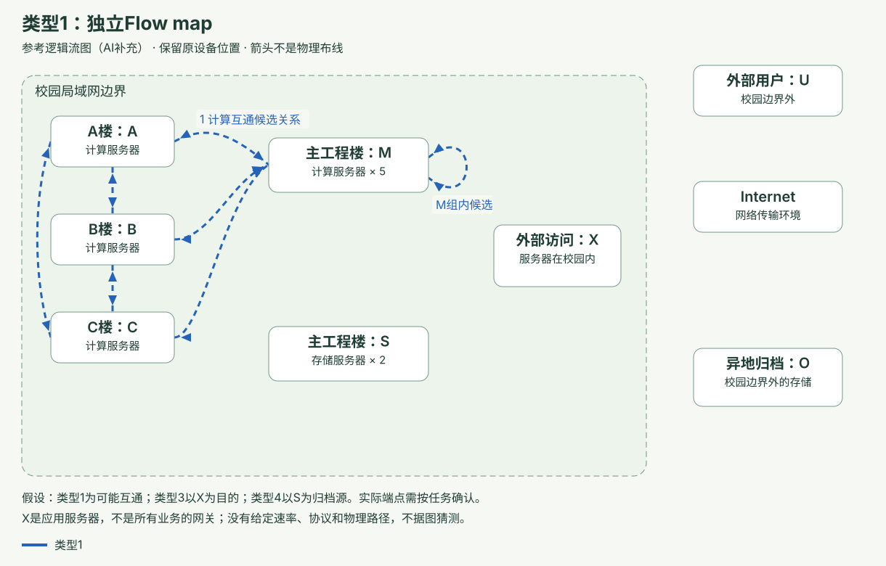
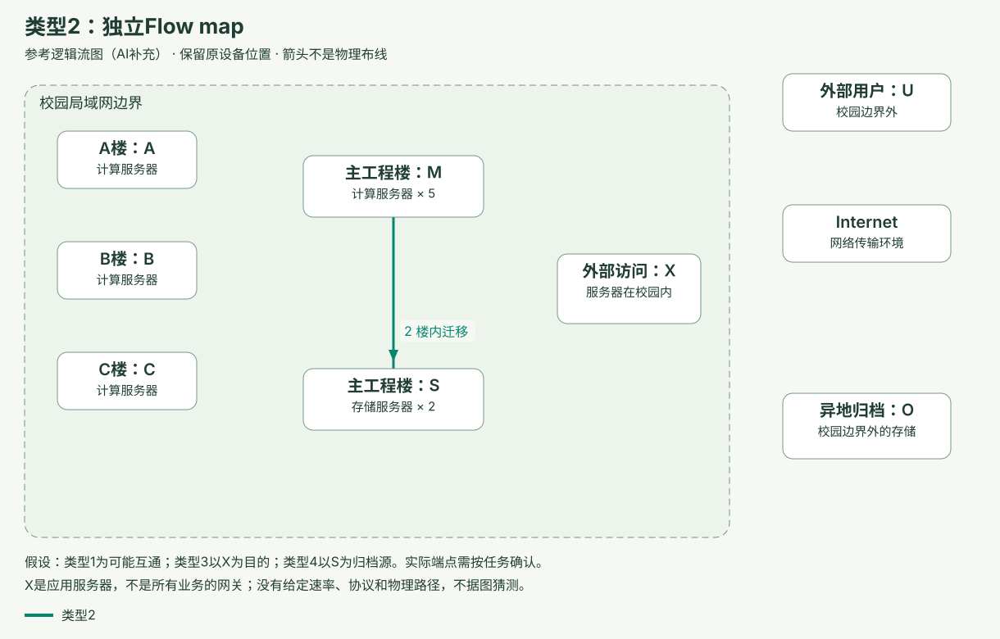
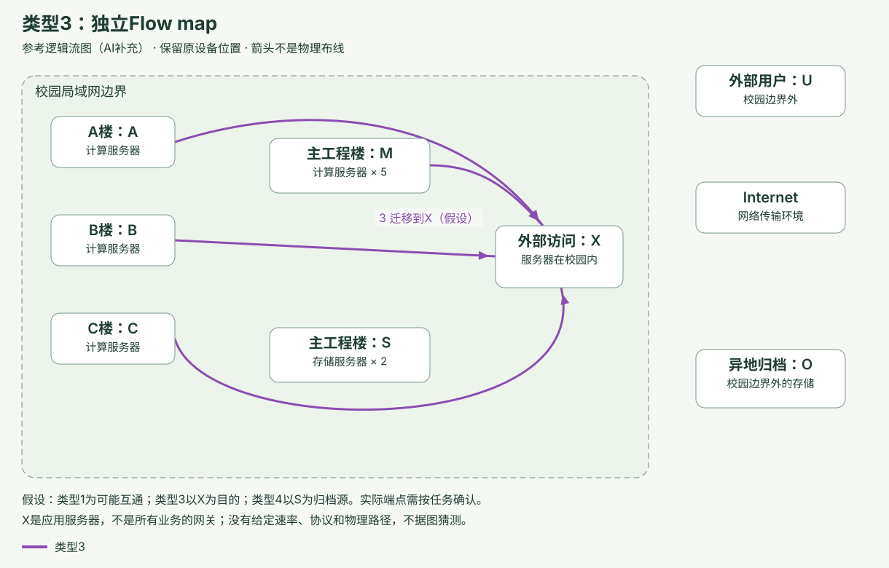
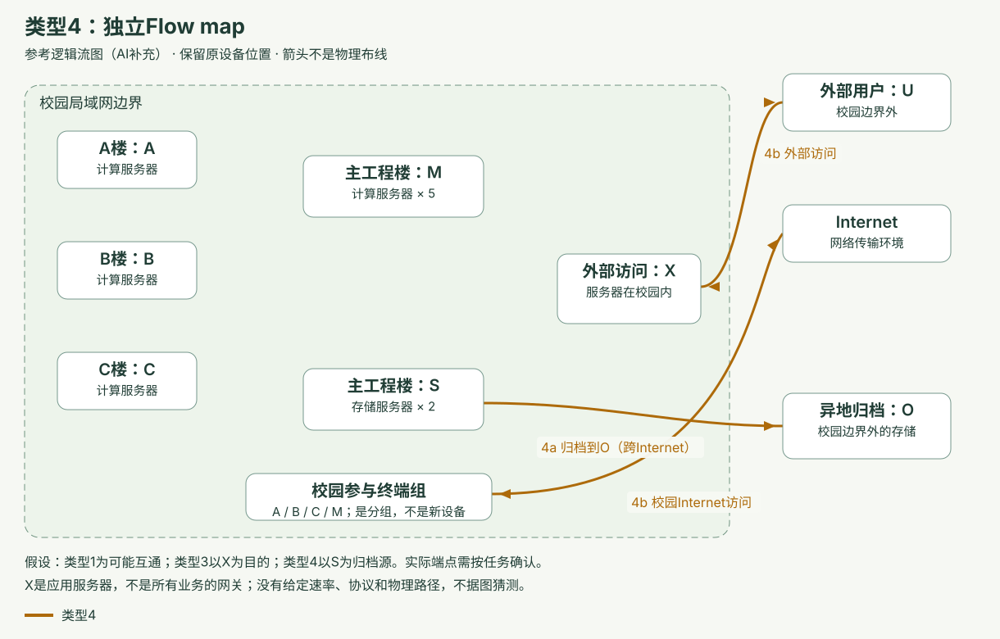
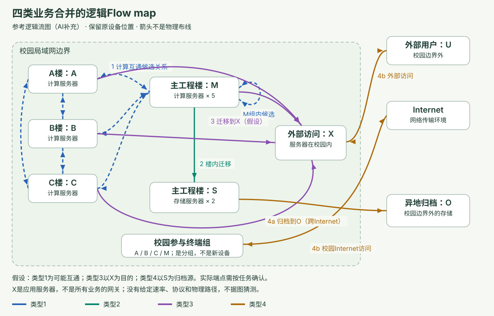

# 05-Week5-Flow分析

返回：[期末题库总入口](../README.md)；[旧题号与当前题号对照](../question-map.md)。

本册按对应课件的可见页序排列。计算与补题放到其知识点附近；Workshop Flow题接在Week5 Flow主线，原资源仍明确标为Workshop Week7a。综合长答统一放最后。

来源页码按PDF文件从第1页起计，包含封面。英文答案为教学参考，不是官方评分答案。老师样题保留标记。使用条件与假设属于答案的一部分。

## T038

**Flow 的定义与建立**

- 题型：简答；检索码：Q32；依据：范围扩展题。
- 知识点：Traffic flows（网络流量及流量识别）。

**Question:** What is a traffic flow, and how is it developed from requirements?

**中文题意：**定义 flow 并说明建立步骤。

<!-- answer-guidance:T038:start -->
### 组织方式与答题思路

**任务类型：**定义＋建立过程。以下为教学建议。

**建议答题路线（按实际题干调整）：**

1. 定义flow的共同属性和端到端范围。
2. 从应用需求与位置找到source/sink。
3. 应用flow model并形成flowspec。
4. 区分individual、composite、critical与flow map用途。

**现有参考答案的组织方式：**

- 第1段：flow定义与关联实体。
- 第2段：从需求建立flow的步骤。
- 第3段：flow分类与map的设计价值。

**回Moodle核对：**

- [Week 5 - Lecture Slides](https://moodle.uowplatform.edu.au/mod/resource/view.php?id=4607048) → PDF物理页 **6–29**；课件主题：Flows。

搜索词：`traffic flow`；`source`；`sink`；`flowspec`。

查到后确认：看flow属性、源汇与建立步骤，图上位置不是自动的物理布线。

**换问法时：**若给业务，先明确谁产生什么数据、发给谁及方向，再选模型。
<!-- answer-guidance:T038:end -->

### 中文思路

共同属性的端到端流量；源汇/方向/位置/服务；individual/composite/critical。

### 英文参考答案（126词）

A traffic flow is a set of network traffic with common attributes, such as source, destination, information type and direction. It is an end-to-end entity that can be associated with an application, device or user.

To develop flows, identify application requirements and locations, locate data sources and sinks, apply suitable flow models and combine performance requirements into flow specifications. A source produces data, while a sink receives it. The same device may perform both roles.

An individual flow represents a single application session. A composite flow combines flows sharing a link, path or network. A critical flow has particular importance or strict requirements. A flow map connects requirements to places in the network. This helps reveal shared paths, bottlenecks and where service mechanisms must be applied.

### 易错、变式与反馈

不要把 flow 当成任意一条物理线；同一设备可同时 source/sink。

变式：Explain individual, composite and critical flows; draw sources and sinks.

概念：□不清楚 □能解释；英文：□看懂 □能复述 □独立写；Moodle：□能定位。具体卡点：____。

### 来源

- [Moodle：Week 5 - Lecture Slides](https://moodle.uowplatform.edu.au/mod/resource/view.php?id=4607048) → **PDF物理页6–29**，关键词`Flows`。

## T039

**校园四类Flow：逐类图与合并图**

- 题型：图题；检索码：G01；依据：Workshop原题；AI参考图，含显式假设。
- 知识点：Traffic flows（网络流量及流量识别）。

**Question:** Using Workshop Week7a Exercise 1, identify sources and sinks for all four flow types, draw each type, and combine them into one logical flow map. State assumptions where endpoints are not uniquely specified.

**中文题意：**按原图完成四类source/sink、各类型flow map与合并图；题目没唯一指定的端点要写假设。

<!-- answer-guidance:T039:start -->
### 组织方式与答题思路

**任务类型：**图题＋假设。以下为教学建议。

**建议答题路线（按实际题干调整）：**

1. 先列四类业务及明确的端点。
2. 逐类列source、sink、方向和性能要求。
3. 未唯一指定端点先写假设再画逻辑箭头。
4. 分别画四图并合并，共享路径保留标签。
5. 检查不把地理位置当已知布线。

**现有参考答案的组织方式：**

- 原题条件和底图定位。
- 条件、步骤与source/sink表。
- 四类独立Flow图与合并图（含显式假设）。
- 英文参考答案。

**回Moodle核对：**

- [Week 7a - Flow Analysis](https://moodle.uowplatform.edu.au/mod/resource/view.php?id=4607864) → PDF物理页 **1 Ex1**；课件主题：Exercise 1。

搜索词：`Exercise 1`；`flow map`；`source`；`sink`。

查到后确认：回到Workshop原底图确认业务和端点；参考图中的假设不能当成题目已知。

**换问法时：**端点或应用变化时重建source/sink表；合理替代图要有一致假设和需求依据。
<!-- answer-guidance:T039:end -->

### 原题定位

原题底图见[Moodle：Week 7a - Flow Analysis](https://moodle.uowplatform.edu.au/mod/resource/view.php?id=4607864)第1页Ex1。下方是带显式假设的AI参考图与解答。

### 条件、步骤与source/sink表

### 已给条件与记号

A、B、C为三栋楼的compute server；M为Main Engineering的5台compute；S为该楼2台storage；X为校园内External Access Server；O为校外Off-Site Data Archival storage；U为external users。

### 参考映射（AI补充；不是老师发布的唯一答案）

|流类型|Source → Sink|方向与已知/假设|
|---|---|---|
|1 高性能计算互通|参与计算的A/B/C/M组之间|参考图假设组间可能双向；M组内是否有互通按任务再确认；题目没给全配对清单，因此虚线表示候选关系，不声明所有同时活跃|
|2 主工程楼内部迁移|M → S|compute向storage，主方向由题干明确；不把协议ACK当等量反向业务|
|3 迁移到external server|参与迁移的A/B/C/M → X|参考图把X当所指server，是显式假设；若教师另指真正校外server，应换端点；X物理位置不变|
|4a 数据归档|S → O（跨Internet）|归档源假定S；若实际指定compute直接归档，按该需求改源|
|4b Internet access|校园参与终端 ↔ Internet；U ↔ X（跨Internet）|访问的请求/响应分别保留；X是应用服务器，不凭空把它当所有校园业务的网关|

### 画图步骤

1. 先临摹位置底图，保留Campus LAN边框，把X放框内、O/U放框外。
2. 单独画Type1，再画Type2。只有Type2的方向和楼内两组端点在题干非常明确。
3. 为Type3、Type4写上述假设，然后画各自图；未知流量速率、协议、具体路径保持未知。
4. 用颜色/类型标签把箭头合并。同一对端点可有不同业务流；不要因合并而删除方向或把不同服务保证平均掉。
5. 查是否保留5台compute/2台storage的区别、source/sink、外部用户访问与归档两类需求。要估容量还需每流速率、并发和调度数据，不能从图形距离推导。

交叉线没有节点圆点时，不表示交换设备或汇合；图只描述业务流，不确定实际物理拓扑。

### 英文参考答案

I keep the original device locations: compute servers in Buildings A, B and C; five compute servers and two storage servers in Main Engineering; and the external-access server inside the campus. Off-site archive storage and external users remain outside.

Type 1 connects participating computing devices. I use possible bidirectional communication between the compute groups; the workload must confirm the actual communicating pairs. Type 2 sends data from Main Engineering compute servers to its storage servers.

For Type 3, I assume the labelled external-access server is the intended migration destination and show participating compute groups sending to it. The wording alone does not uniquely identify every source or destination.

For Type 4, I assume Main Engineering storage supplies off-site archives. Internet access is shown separately, including campus communication with the Internet and external users accessing the campus server. The combined map preserves these flow types, directions and assumptions without inventing rates or physical links.

### 易错、变式与反馈

External Access Server不因external一词而移到校园框外；Type3目的、Type4归档源有歧义，图必须标假设，不能声称唯一官方答案。

概念：□不清楚 □能解释；英文：□看懂 □能复述 □独立写；Moodle：□能定位。具体卡点：____。

### 来源

- [Moodle：Week 7a - Flow Analysis](https://moodle.uowplatform.edu.au/mod/resource/view.php?id=4607864) → **PDF物理页1 Ex1**，关键词`Exercise 1`。

## T040

**Workshop Flow 的方向与时延**

- 题型：简答；检索码：Q88；依据：范围扩展题。
- 知识点：Traffic flows（网络流量及流量识别）。

**Question:** Label the directions and requirements of the four flows in Workshop Week7a Exercise 2.

**中文题意：**按原练习区分上下行、单向/双向与one-way/RTT。

<!-- answer-guidance:T040:start -->
### 组织方式与答题思路

**任务类型：**逐项标注。以下为教学建议。

**建议答题路线（按实际题干调整）：**

1. 按四个应用分别写source→sink方向。
2. 双向需求各自保留速率。
3. 标明one-way或round-trip的时延口径。
4. 检查单位与未指定的控制流假设。

**现有参考答案的组织方式：**

- 第1段：client-server双向速率。
- 第2段：UDP video单向媒体及one-way delay。
- 第3段：web与POS双向数据及delay口径。
- 第4段：单向与往返的最终核对。

**回Moodle核对：**

- [Week 7a - Flow Analysis](https://moodle.uowplatform.edu.au/mod/resource/view.php?id=4607864) → PDF物理页 **2 Ex2**；课件主题：Exercise 2。

搜索词：`Exercise 2`；`client-server`；`UDP`；`round-trip`。

查到后确认：直接核对Workshop Ex2各箭头、数值和时延定义。

**换问法时：**若数字或方向变化，重画方向表；不把上下行速率相加后替代两条要求。
<!-- answer-guidance:T040:end -->

### 中文思路

client-server双向1.2Mb/s下15kb/s上；video业务单向300kb/s40ms单程；Web双向250/100kb/s给5s；PoS双向30上50下100msRTT。

### 英文参考答案（131词）

The client-server application has bidirectional flows: 1.2 Mb/s from server to client and 15 kb/s from client to server. These directions should be labelled separately.

The UDP video application has a dominant unidirectional media flow from server to subscriber. Its requirements are 300 kb/s and 40 ms one-way delay. Any control traffic should be distinguished from the stated media flow.

The web application has 250 kb/s downstream and 100 kb/s upstream, with a stated five-second delay requirement. Do not silently reinterpret an unspecified delay as round-trip time. The point-of-sale application has 30 kb/s upstream, 50 kb/s downstream and a 100 ms round-trip requirement.

One-way delay and round-trip delay are different measures. Preserve the direction and measurement meaning in the flow map instead of replacing each application with one undirected capacity total.

### 易错、变式与反馈

Workshops周号不同于lecture；RTT不能直接当每一方向100ms。

变式：原题来源另见Moodle资料定位表 → Week7a Flow Analysis p.2 Ex2；Ex1四类flow及原图见Workshop原页与勘误。

概念：□不清楚 □能解释；英文：□看懂 □能复述 □独立写；Moodle：□能定位。具体卡点：____。

### 来源

- [Moodle：Week 7a - Flow Analysis](https://moodle.uowplatform.edu.au/mod/resource/view.php?id=4607864) → **PDF物理页2 Ex2**，关键词`Exercise 2`。

## T041

**四种 Flow model**

- 题型：简答；检索码：Q33；依据：范围扩展题。
- 知识点：Flow models（流量模型）。

**Question:** Describe peer-to-peer, client-server, hierarchical client-server and distributed-computing flow models.

**中文题意：**解释四种流量模型。

<!-- answer-guidance:T041:start -->
### 组织方式与答题思路

**任务类型：**模型列举＋关系。以下为教学建议。

**建议答题路线（按实际题干调整）：**

1. 列四种flow model。
2. 按谁请求、谁服务、谁协作解释差别。
3. 说明hierarchical client-server的层间流量。
4. 给共享服务或计算集群例子，并区分逻辑flow与布线。

**现有参考答案的组织方式：**

- 第1段：peer-to-peer和client-server。
- 第2段：hierarchical与distributed computing。
- 第3段：模型用途、混合场景和物理边界。

**回Moodle核对：**

- [Week 5 - Lecture Slides](https://moodle.uowplatform.edu.au/mod/resource/view.php?id=4607048) → PDF物理页 **30–44**；课件主题：Flow Models。

搜索词：`peer-to-peer`；`hierarchical`；`distributed computing`。

查到后确认：看四类通信关系图，核对server是否也作为上层client。

**换问法时：**若给校园场景，可组合模型，但必须指出实际源汇和交互关系。
<!-- answer-guidance:T041:end -->

### 中文思路

谁和谁通信，不等于物理拓扑；层级聚合、协作计算。

### 英文参考答案（131词）

A peer-to-peer flow model describes communication between peers that can both provide and request resources. A client-server model describes requests and responses between clients and service-providing servers.

In a hierarchical client-server model, servers can also act as clients of higher-level servers. Flows may be aggregated through several service levels. In distributed computing, multiple computing resources cooperate on a task and exchange data or intermediate results. This can create important flows between computing nodes as well as flows to storage.

The models help predict communication relationships and service locations. They do not directly specify the physical cable layout. For example, clients using a shared campus service may need a client-server model, while a compute cluster may also need a distributed-computing model. A real network can contain several models at the same time.

### 易错、变式与反馈

模型可以并存；不是把四种分别当四种互斥物理拓扑。

变式：Identify the model for email, tiered databases or a compute cluster.

概念：□不清楚 □能解释；英文：□看懂 □能复述 □独立写；Moodle：□能定位。具体卡点：____。

### 来源

- [Moodle：Week 5 - Lecture Slides](https://moodle.uowplatform.edu.au/mod/resource/view.php?id=4607048) → **PDF物理页30–44**，关键词`Flow Models`。

## T042

**选择应用与 Flow 优先级**

- 题型：简答；检索码：Q34；依据：范围扩展题。
- 知识点：Traffic flows（网络流量及流量识别）。

**Question:** How should flows be selected for analysis and prioritized?

**中文题意：**如何选择分析对象并给流排序？

<!-- answer-guidance:T042:start -->
### 组织方式与答题思路

**任务类型：**方法＋优先级。以下为教学建议。

**建议答题路线（按实际题干调整）：**

1. 先选择分析的应用或profile。
2. 说明不能忽略被排除流量的服务。
3. 按组织重要性、失败影响、性能安全与用户数排序。
4. 用数据量大但优先级不一定高的例子说明。

**现有参考答案的组织方式：**

- 第1段：分析对象与选择方式。
- 第2段：优先级因素及不同排名。
- 第3段：校园例子、明确标准与资源取舍。

**回Moodle核对：**

- [Week 5 - Lecture Slides](https://moodle.uowplatform.edu.au/mod/resource/view.php?id=4607048) → PDF物理页 **19–22、45–49**；课件主题：Flow Prioritization。

搜索词：`top applications`；`priority`；`flow analysis`。

查到后确认：核对选择分析对象与决定优先级是两个任务。

**换问法时：**若给两项冲突业务，用约定标准解释取舍，不仅按Mb/s排序。
<!-- answer-guidance:T042:end -->

### 中文思路

top N需检查遗漏；业务/用户/安全/性能；排序依据变结果变。

### 英文参考答案（130词）

A designer may analyse individual applications, build profiles for similar flows or focus on the top applications driving the design. Selection can consider usage, user or device numbers and performance requirements. It is still necessary to check whether excluded applications will receive adequate service.

Flow priority should reflect organizational importance. Relevant factors include business objectives, consequences of failure, political priorities, performance and security requirements, and the number of users served. Different criteria can produce different rankings.

For example, a large student download flow may serve many people, while a smaller examination service may have stricter reliability requirements. The highest data rate is not automatically the highest priority. State the chosen criteria and explain how the ranking affects resource allocation. This makes later trade-offs transparent and connected to the organization’s goals.

### 易错、变式与反馈

Top N 不是忽略所有其他应用；带宽大不自动最重要。

变式：Rank the same flows by user count and by reliability; explain the difference.

概念：□不清楚 □能解释；英文：□看懂 □能复述 □独立写；Moodle：□能定位。具体卡点：____。

### 来源

- [Moodle：Week 5 - Lecture Slides](https://moodle.uowplatform.edu.au/mod/resource/view.php?id=4607048) → **PDF物理页19–22、45–49**，关键词`Flow Prioritization`。

## T043

**Flowspec 与聚合规则**

- 题型：简答；检索码：Q35；依据：范围扩展题。
- 知识点：Flow specification（流量规格与合成方法）。

**Question:** Explain one-part, two-part and multipart flow specifications.

**中文题意：**解释三种 flowspec 及组合规则。

<!-- answer-guidance:T043:start -->
### 组织方式与答题思路

**任务类型：**分类＋聚合规则。以下为教学建议。

**建议答题路线（按实际题干调整）：**

1. 说明one-part只合best-effort容量。
2. 说明two-part中predictable容量相加而delay/RMA保留最严格值。
3. 说明multipart逐条保留guaranteed要求。
4. 写共享链路、方向和同时发生的假设。

**现有参考答案的组织方式：**

- 第1段：flowspec及one/two-part。
- 第2段：predictable的容量、delay和RMA聚合。
- 第3段：guaranteed独立承诺与路径、时间条件。

**回Moodle核对：**

- [Week 5 - Lecture Slides](https://moodle.uowplatform.edu.au/mod/resource/view.php?id=4607048) → PDF物理页 **50–56**；课件主题：Flowspec Algorithm。

搜索词：`one-part`；`two-part`；`multipart`；`flowspec`。

查到后确认：核对各服务等级的聚合规则，availability不是百分比相加。

**换问法时：**若给数值，先按服务等级与方向分组，再选sum/min/max，勿机械取平均。
<!-- answer-guidance:T043:end -->

### 中文思路

BE合容量；predictable合容量取最严格delay/RMA；guaranteed逐流保留。

### 英文参考答案（134词）

A flow specification lists flows and their performance requirements. A one-part flowspec contains best-effort traffic and combines its capacity requirements. A two-part flowspec includes predictable traffic and may also include best effort.

For predictable traffic, capacity requirements are combined, while the most demanding relevant delay and RMA requirements must be preserved. In the course’s aggregation method, this means the minimum permitted delay and maximum required reliability or availability value. It does not mean adding availability percentages.

A multipart flowspec also includes guaranteed flows. Each guaranteed flow keeps its own requirements rather than losing them inside a single average. This is important because an acceptable aggregate may hide failure to meet one flow’s commitment. Aggregation must also respect shared paths, direction and timing. Opposite-direction or non-overlapping traffic should not be combined without stating the assumptions.

### 易错、变式与反馈

不相加delay上限或availability百分比；guaranteed不被平均。

变式：Compute a flowspec; explain why guarantees remain individual.

概念：□不清楚 □能解释；英文：□看懂 □能复述 □独立写；Moodle：□能定位。具体卡点：____。

### 来源

- [Moodle：Week 5 - Lecture Slides](https://moodle.uowplatform.edu.au/mod/resource/view.php?id=4607048) → **PDF物理页50–56**，关键词`Flowspec Algorithm`。

## T044

**Flowspec 数值组合**

- 题型：计算；检索码：C16；依据：AI计算变式；题值并非真实试题。
- 知识点：Flow specification（流量规格与合成方法）。

**Question:** Combine best-effort flows of 2 and 3 Mb/s, predictable flows of 4 and 6 Mb/s with delays 40 and 20 ms and availability targets 99.9% and 99.99%, plus a guaranteed flow of 5 Mb/s, 10 ms and 99.999%.

**中文题意：**按课件规则给multipart flowspec。

<!-- answer-guidance:T044:start -->
### 组织方式与答题思路

**任务类型：**分类聚合计算。以下为教学建议。

**建议答题路线（按实际题干调整）：**

1. 按BE、predictable、guaranteed分组。
2. BE和predictable分别合容量。
3. predictable取最严格delay/RMA。
4. guaranteed逐条保留tuple。
5. 仅在同向同路径同时假设下另求总payload。

**现有参考答案的组织方式：**

- 条件、计算步骤及必要表格。
- 英文作答：结果与条件解释。

**回Moodle核对：**

- [Week 5 - Lecture Slides](https://moodle.uowplatform.edu.au/mod/resource/view.php?id=4607048) → PDF物理页 **51–56**；课件主题：Flow specification。

搜索词：`flowspec`；`predictable`；`guaranteed`。

查到后确认：核对sum/min/max各适用于哪个指标及逐flow保证。

**换问法时：**方向、路径、同时性变化后重新分组，不机械相加或平均availability。
<!-- answer-guidance:T044:end -->

### 计算步骤

BE capacity=2+3=5Mb/s。
Predictable capacity=4+6=10Mb/s；delay上限min(40,20)=20ms；availability目标max(99.9%,99.99%)=99.99%。
Guaranteed保留独立tuple：(5Mb/s,10ms,99.999%)。
若全在同方向、同链路同时发，初步payload需求5+10+5=20Mb/s。这个总和不抹掉独立保证，也不证明端到端availability已实现。
这里availability用作课件RMA聚合指标示例；各参数单位/测量口径须一致。

### 英文作答

The multipart specification contains 5 Mb/s best effort, a predictable aggregate of 10 Mb/s with a 20 ms delay limit and 99.99% availability target, and the guaranteed flow kept separately at 5 Mb/s, 10 ms and 99.999%.

### 易错、变式与反馈

目标聚合不是串联系统实际可用性的概率计算。

概念：□不清楚 □能解释；英文：□看懂 □能复述 □独立写；Moodle：□能定位。具体卡点：____。

### 来源

- [Moodle：Week 5 - Lecture Slides](https://moodle.uowplatform.edu.au/mod/resource/view.php?id=4607048) → **PDF物理页51–56**，关键词`Flow specification`。

